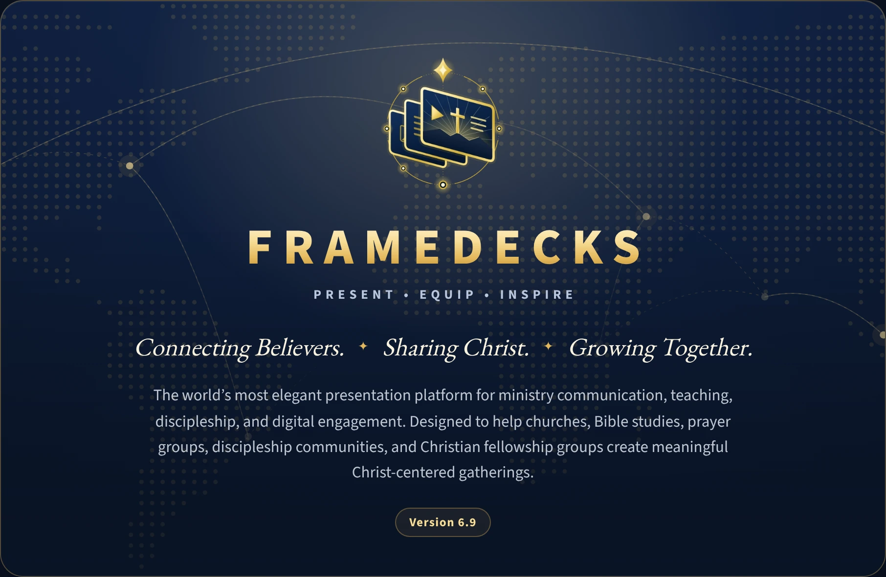

<p align="center"></p>

A service presentation platform for churches and ministries. Plan each service as **Frames** — Welcome, Worship,
Scripture, Discussion, Prayer, Closing — fill them with questions, scriptures, text, timers, pictures, video and
PowerPoint, and present to the room, to Zoom / Teams / Google Meet and to your stream at the same time. Run it from
the PC, a phone or an iPad. **FRAMEDECKS 6.9 runs locally**: no account or cloud connection is required for a
service, and the only current online feature is the optional ESV scripture fetch. The modernization plan adds
optional cloud accounts and metadata sync while keeping presentation media and live output local. FRAMEDECKS
remains free, with no payments or feature restrictions.

> **Status: FRAMEDECKS 6.9 is ready for teaching, Bible study, small-group and hybrid services, with documented
> gaps.** The biggest: no song / lyrics library yet (lyrics are shown as Text Content or a PowerPoint), an unsigned
> installer, no automated UI tests, and no published licence. See the
> [repository audit](docs/project/repository-audit.md), [modernization status](docs/FRAMEDECKS_MODERNIZATION_STATUS.md),
> and the [roadmap](ROADMAP.md).

## What it does
- **Frames and Content**: one Frame per moment of the service; **+ Content** adds a Question, Scripture, Text,
  Discussion topic, Icebreaker, Poll (show of hands), Image, Video, Timer, PowerPoint or Free Content (announcement,
  prayer, lower third, branding, camera, screen, window, shapes). Every Frame owns its Content, so duplicating last
  week's service never changes it. Rename and edit in place (double-click; no pop-ups); select several Frames or
  Contents to copy, paste, duplicate, move or delete them with Undo ([FRAMES](docs/frames.md) ·
  [CONTENT](docs/content.md)).
- **Presenting**: **Go Live** (T), Frame and item steppers, transitions and auto-advance, Hide all (Esc), Blackout
  (K), Emergency screen, Freeze (F) and Annotate (D) — pen, highlighter, arrow, shapes and text above everything.
  A **command palette** (Ctrl+K or Ctrl+Space) finds any Frame, question, scripture or setting and runs commands
  ([PRESENTATIONS](docs/presentations.md)).
- **Questions and scriptures**: per-Frame lists with labels; Show question, scripture or both; drag to reorder;
  double-click an item in the list, or any card on the canvas, to edit it in place. ESV fetch online, or any translation
  typed for offline use.
- **Outputs**: the **FRAMEDECKS** virtual camera (your webcam with the Frame on top, background blur, Camera
  Looks) for Zoom, Teams, Google Meet and OBS; a full-screen **Presentation window** for a projector; transparent
  **overlay pages** for OBS ([MEDIA](docs/media.md)).
- **Media**: images, video (muted), PowerPoint (.pptx converted by the PowerPoint on the PC, or PDF), live window
  capture that keeps PowerPoint animations, screen capture, and *Show objects only* for plain slide backgrounds
  ([POWERPOINT](docs/reference/powerpoint.md)).
- **Phone remote**: a **Simple** remote with large PREVIOUS / NEXT FRAME and CONTENT, ANNOTATE, FREEZE and BLACK
  SCREEN buttons, a TELEPROMPTER button, and an **Advanced** remote with search, a Teleprompter panel and run-through. PIN-protected, local network only;
  draw on the real live picture, full screen in landscape ([REMOTE_CONTROL](docs/remote-control.md)).
- **Teleprompter**: each Frame's script, seen only by the presenter — docked in the Studio (R), in its own
  **Teleprompter window** on a second screen (clocks and what comes next on request), or on the phone. Scrolls by itself,
  with speed, text size, high contrast and focus mode. Never on any output.
- **Teleprompter overlay (Meeting Leader mode)**: your script in a see-through window over Zoom, Teams or Meet
  (Shift+R), with five transparency modes (Solid to Ghost), frosted glass and stay on top. Left out of screen sharing
  and recordings (Windows 10 2004 or later) ([PRESENTATIONS](docs/presentations.md#teleprompter-overlay-meeting-leader-mode)).
- **Window and tray**: the app's own ribbon instead of the Windows title bar (Snap and resizing kept); Minimize can hide
  it to the tray, where the camera, overlays, phone remote and shortcuts keep working. **Spotlight** (Alt+Space) opens
  the command palette from anywhere in Windows, even from the tray ([GETTING_STARTED](docs/getting-started.md#the-window-buttons-and-the-tray)).
- **Branding**: your logo and Meeting Name in a corner, with size, margin, opacity, padding and an optional plate;
  **Remove background** makes a plain logo background transparent, on the PC.
- **Planning**: Quick Start, templates, groups, favourites, and the **Excel Meeting Workbook**: two tabs, a guided
  **Meeting Form** (meeting details, speaker, attendees, presentation, then the Frames, Content, questions and
  scriptures) and a **Dashboard** that sums it up with KPI tiles, readiness checks and a meeting log. Import shows a
  preview with every problem and its row, and can be undone; export gives back the same two tabs, filled in
  ([SERVICE_PLANNING](docs/service-planning.md) · [MEETING_WORKBOOK](docs/reference/meeting-workbook-and-branding.md)).
- **Data**: everything in one folder on the PC, saved atomically, with daily backups and Frame history.

## Install
See [INSTALLATION](docs/installation.md) and [GETTING_STARTED](docs/getting-started.md). In short: run
`FRAMEDECKS v6.9.exe` (unsigned, so check it against its `.sha256` file first and choose **More info → Run
anyway** at the SmartScreen prompt), keep **Install the FRAMEDECKS camera** ticked, and allow the one
administrator prompt. Windows 10 or 11 (64-bit) is required. The installer comes from the **Build Windows
installer** workflow ([BUILDING_THE_INSTALLER](docs/development/building-the-installer.md)).

## Run, build, package (developers)
Prerequisites: Python 3.12 and Node.js (for the tests). There is no UI build step and there are no npm packages.
See [CONTRIBUTING](CONTRIBUTING.md) and the [developer guide](docs/contributing.md).

```powershell
python server.py                                    # run from source in your browser at http://localhost:8750
$env:KC_VCAM_DEMO=1; python server.py --remote      # with a built-in test camera and the phone remote on
python -m pip install -r packaging/requirements-desktop.txt -c packaging/constraints.txt   # desktop + camera
python desktop_app.py                               # the desktop app window (WebView2)
node tests/run.js                                   # the automated tests (JavaScript)
python -m unittest discover -s tests -p "test_*.py" # the automated tests (Python)
python tools/make_meeting_workbook.py               # rebuild the Excel template after changing meeting_form.py
python packaging/check.py                           # start-up self-check
python tools/check_doc_links.py                     # every documentation link and anchor
build.bat                                           # local Windows build (CI is the usual way)
```

## Quality gates (`.github/workflows/build-windows.yml`)
| Gate | What it checks |
|---|---|
| camera build | Builds the FRAMEDECKS camera (softcam, 64- and 32-bit) and records SHA-256 hashes of the DLLs |
| self-check | `packaging/check.py`: the program starts, serves every page and script, camera name and ID match the build, blur model loads |
| tests | `node tests/run.js`: Frame-owned lists, independent duplicates, conversion of older data, output folding, Meeting Workbook template, import and export |
| Python tests | `python -m unittest`: the Spotlight shortcut and desktop settings, moving data saved under the earlier name, and the Meeting Form layout and export |
| doc-links | `tools/check_doc_links.py`: every relative link and heading anchor in the Markdown docs resolves |
| pinned packages | Builds install `packaging/constraints.txt`: the exact versions of the last good build |
| app folder | The built app contains its window, pages and camera driver |
| installer | Inno Setup builds `FRAMEDECKS v<version>.exe` with a `.sha256` file |
| release | On a `v*` tag, publishes the installer and checksum with `docs/releases/v<version>.md` as the notes |

Not automated yet: UI end-to-end tests, the camera in a real Zoom / Teams call, and PowerPoint conversion on real
Office installs — these are covered by the manual [testing script](docs/development/testing.md) before each release.

## Documentation
| Topic | Documents |
|---|---|
| Using it | [GETTING_STARTED](docs/getting-started.md) · [INSTALLATION](docs/installation.md) · [SERVICE_PLANNING](docs/service-planning.md) · [PRESENTATIONS](docs/presentations.md) · [FRAMES](docs/frames.md) · [CONTENT](docs/content.md) · [MEDIA](docs/media.md) · [REMOTE_CONTROL](docs/remote-control.md) |
| Help | [TROUBLESHOOTING](docs/troubleshooting.md) · [FAQ](docs/faq.md) · [SUPPORT](SUPPORT.md) |
| Church teams | [OPERATIONS_HUB](docs/ministry/README.md) · [WORSHIP_LEADERS](docs/ministry/worship-leaders.md) · [MEDIA_TEAM](docs/ministry/media-team.md) · [SERVICE_OPERATORS](docs/ministry/service-operators.md) · [REMOTE_OPERATORS](docs/ministry/remote-operators.md) · [VOLUNTEERS](docs/ministry/volunteers.md) · [SERVICE_DAY_CHECKLIST](docs/ministry/service-day-checklist.md) |
| Architecture | [ARCHITECTURE](docs/architecture.md) (service flow, engine, remote, media, rendering, sync) · [DESIGN_HISTORY](docs/architecture/design-history.md) · [CONFIGURATION](docs/reference/configuration-guide.md) |
| Security | [SECURITY](SECURITY.md) · [Security boundaries](docs/architecture.md#security-boundaries) |
| Development | [CONTRIBUTING](CONTRIBUTING.md) · [DEVELOPER_GUIDE](docs/contributing.md) · [BRANCHING](docs/development/branching.md) · [RELEASE_PROCESS](docs/development/release-process.md) · [TESTING](docs/development/testing.md) · [CODE_STYLE](docs/development/code-style.md) |
| Quality | [REPOSITORY_AUDIT](docs/project/repository-audit.md) |
| Reference | [USER_GUIDE](docs/reference/user-guide.md) · [FEATURES](docs/reference/features.md) · [MEETING_WORKBOOK](docs/reference/meeting-workbook-and-branding.md) · [POWERPOINT](docs/reference/powerpoint.md) |
| Project | [ROADMAP](ROADMAP.md) · [CHANGELOG](CHANGELOG.md) · [RELEASE_NOTES](docs/releases/) · [DOCS_INDEX](docs/README.md) |

## Principles
Reliability over features. Volunteers over experts. Offline over online. Privacy over convenience. Honesty over
marketing. Nothing may put a live service at risk, and the screen must always be one key away from safe (Esc, K).
No feature, test result or screenshot in this repository is faked; where something isn't done or isn't verified,
the docs say so.

## License
No licence has been published yet; until one is, all rights are reserved by the author. Third-party components keep
their own licences: softcam (MIT), MediaPipe selfie segmentation model (Apache 2.0), SheetJS and Lucide icons (see
`app/vendor/`), EB Garamond and Source Sans 3 (SIL Open Font License).

<sub>Earlier versions were named Kingdom Connect and BSF Command Center. Version 6.9 installs over those versions and
moves their data into the FRAMEDECKS folder on first start, so each church keeps its data.</sub>
