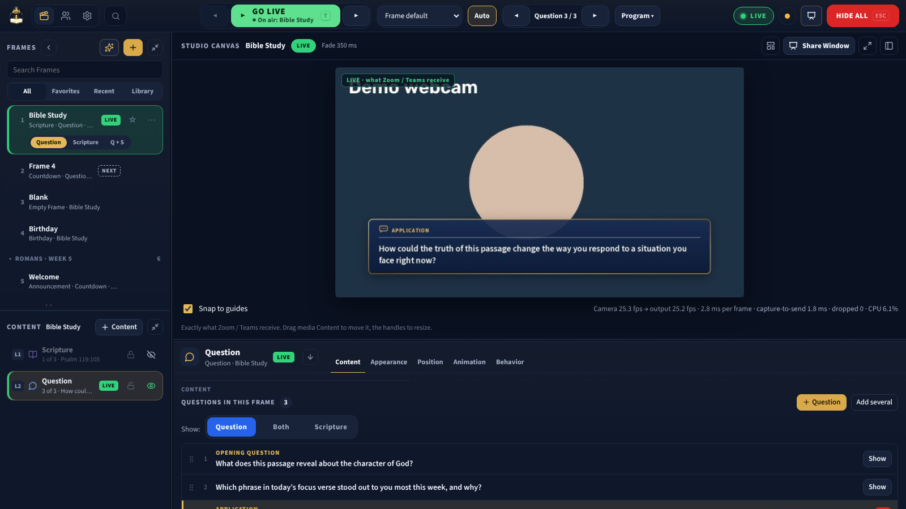
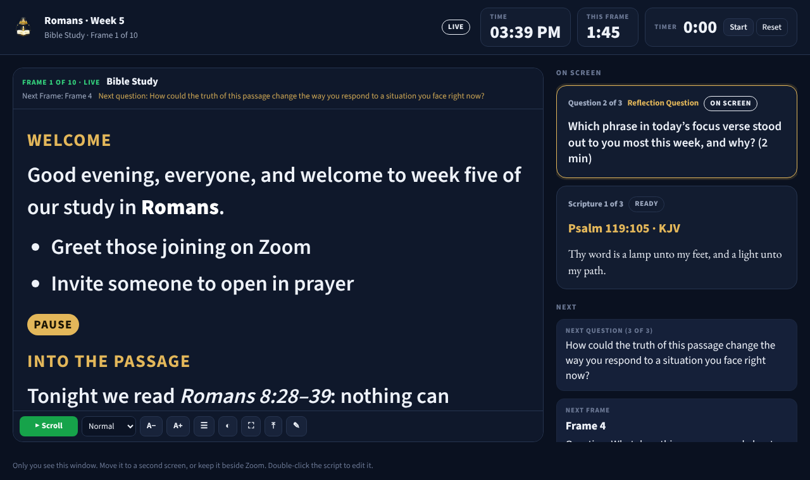
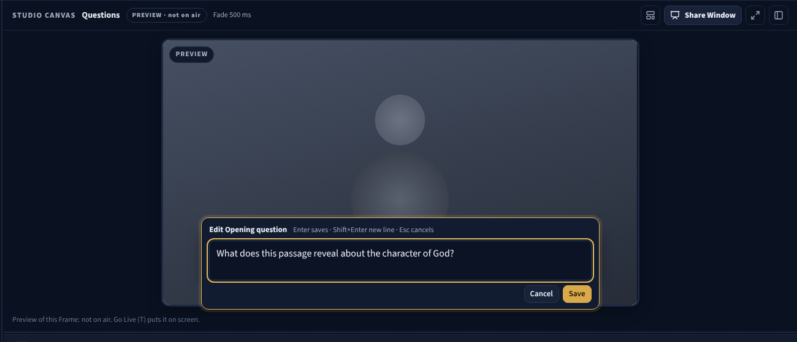
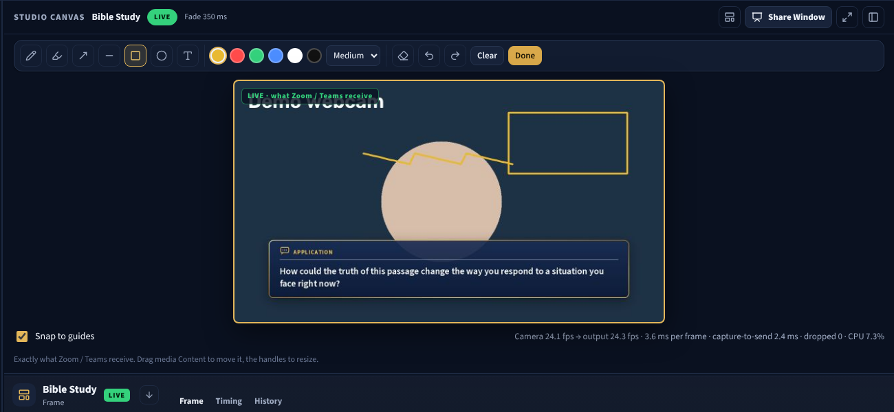
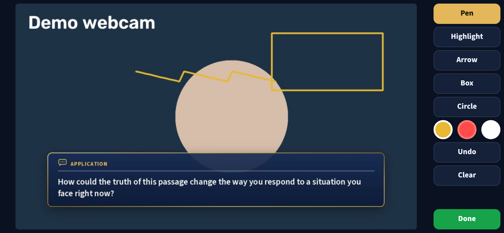
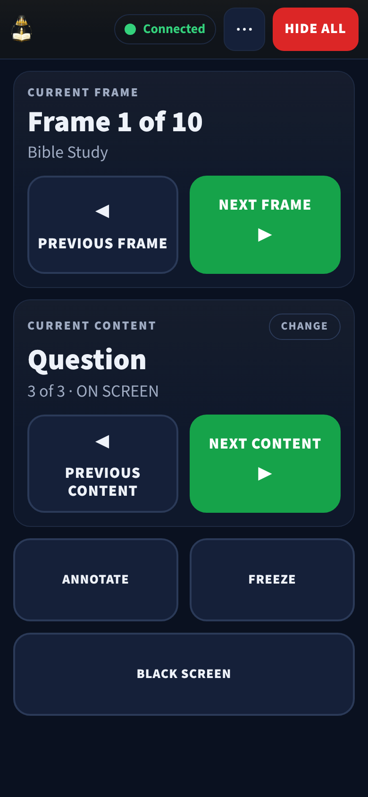
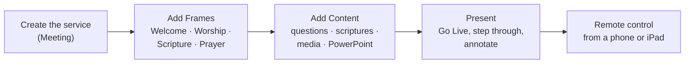
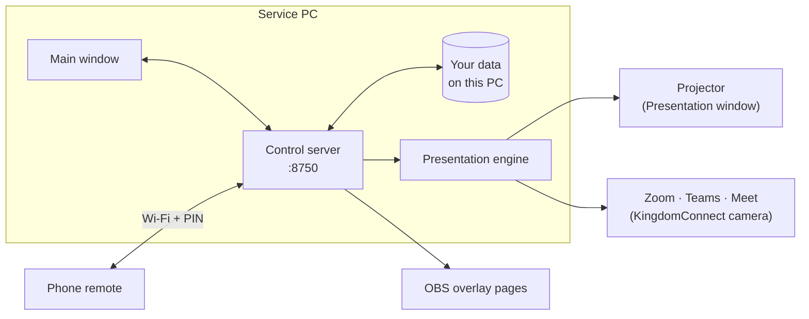

# Kingdom Connect

### Connect. Present. Worship.

**Service presentation for churches and ministries — built for volunteers, ready for Sunday, and fully offline.**

Plan your service as Frames, present questions, scriptures, media and PowerPoint to the room, to Zoom and to
your stream at the same time, and run it all from a phone.

**Simple. Reliable. Worship Ready.** · *Designed for Ministry.*

[Get started](docs/getting-started.md) ·
[Install](docs/installation.md) ·
[Plan a service](docs/service-planning.md) ·
[Present](docs/presentations.md) ·
[Phone remote](docs/remote-control.md) ·
[FAQ](docs/faq.md) ·
[Teams](docs/ministry/README.md)

---

## What is Kingdom Connect?

Kingdom Connect is a Windows presentation app for churches, Bible studies, small groups, prayer meetings and
ministry trainings. You build each service as a short list of **Frames** — *Welcome, Worship, Scripture
Reading, Discussion, Prayer, Closing* — and put **Content** in each: questions, scriptures, text, timers,
pictures, video and PowerPoint.

When you press **Go Live**, the Frame appears everywhere you need it at once:

| Where | How |
| --- | --- |
| **In the room** | The **Presentation window**, full screen on a projector or TV |
| **On Zoom, Teams or Google Meet** | The **KingdomConnect** camera: your webcam with the Frame on top |
| **On your livestream** | **OBS overlay pages** with transparent backgrounds |
| **In your hand** | The **phone remote**: next Frame, next question, draw, freeze, black screen |
| **In front of you** | The **Speaker View**: the answer, your notes, what's next and a clock |

Everything runs on one PC. There are no accounts, no subscriptions and no cloud — your service works the same
with or without the internet.

## Key features

| | Feature | What it gives your team |
| :---: | --- | --- |
| ✅ | **Presentation control** | Go Live, transitions, auto-advance, Hide all, Blackout, Emergency screen, Freeze — every live action one click or key away |
| ✅ | **Frames** | Your order of service as independent screens. Duplicate last week's service without ever changing it |
| ✅ | **Content management** | Questions, scriptures, text, timers, lower thirds, images, video, PowerPoint — all in one settings panel |
| 🟡 | **Worship lyrics** | Show lyrics today as Text Content or a PowerPoint / PDF of the song. A dedicated song library is on the [Roadmap](ROADMAP.md) |
| ✅ | **Media playback** | Images, video, PowerPoint slides, PDF, live window and screen capture, webcam with background blur |
| ✅ | **Bible integration** | Fetch ESV passages online, or type any translation for full offline use; per-Frame scripture lists |
| ✅ | **Remote phone control** | A Simple remote with five big buttons, an Advanced remote with search and notes, PIN-protected |
| ✅ | **Annotation** | Draw on the live picture (pen, highlighter, arrow, shapes, text) from the PC or the phone |
| ✅ | **Speaker View** | A private screen with the answer, notes, what comes next and a timer |
| ✅ | **Offline operation** | No internet needed for anything except the optional ESV fetch |
| ✅ | **Fast service flow** | Step Frames, questions and scriptures with arrow keys or the phone; edit a question by double-clicking it |
| ✅ | **Volunteer-friendly design** | Plain words, one settings panel, checklists and role guides for every team member |
| ✅ | **Excel Meeting Workbook** | Plan a whole service in Excel, import it with a preview, export it again |

✅ available today · 🟡 possible today, dedicated feature planned

## Screenshots

<table>
  <tr>
    <td width="50%"> <b>Speaker View</b> — the answer, your notes, what's next and a timer, on your screen only.</td>
    <td width="50%"> <b>Edit on the canvas</b> — double-click a question or scripture to change it in place.</td>
  </tr>
  <tr>
    <td> <b>Annotate</b> — draw on the live picture; everyone sees it.</td>
    <td> <b>Draw from the phone</b> — the real live picture, full screen sideways.</td>
  </tr>
</table>

 
<b>Simple phone remote</b> — Frame and Content steppers, Annotate, Freeze, Black Screen.

Screenshots were taken with the app's built-in test camera.

## Service workflow

1. **Create the service.** Start from Quick Start, a template, last week's Frames, or the Excel Meeting Workbook.
2. **Add Frames.** One Frame per moment of the service. Name, group and reorder them.
3. **Add Content.** Select a Frame, press **+ Content**, choose the type, fill it in.
4. **Present.** Press **Go Live** (T). Step with **Frame ▶**, → / ← for questions, Shift + → / ← for scriptures.
5. **Remote control.** Hand the phone to anyone on the team — Simple mode needs no training.

Full guide: [Service planning](docs/service-planning.md) · [Presentations](docs/presentations.md)

## Architecture overview

One process, one state, one final picture: what you preview is exactly what the room, Zoom and the stream see.
Details and six deeper diagrams: [docs/architecture.md](docs/architecture.md).

## Installation

**Requirements:** Windows 10 or 11 (64-bit). A webcam for the camera features; Microsoft PowerPoint only if you
want to turn `.pptx` files into slides; internet only for the optional ESV scripture fetch.

1. Download **Kingdom Connect v6.6.exe** (from the Releases page, or the latest build's artifact).
2. Optional: check the download against its `.sha256` file —
   `Get-FileHash "Kingdom Connect v6.6.exe" -Algorithm SHA256`.
3. Run it. If Windows shows *"Windows protected your PC"*, choose **More info → Run anyway** (the installer is
   not code-signed yet).
4. Keep **Install the KingdomConnect camera** ticked, and allow the one administrator prompt.

Step-by-step, updating and uninstalling: [docs/installation.md](docs/installation.md).
Building the installer yourself: [docs/development/building-the-installer.md](docs/development/building-the-installer.md).

## Quick start

1. Open **Kingdom Connect** from the desktop icon.
2. Click the **✨ Meeting** button next to **+ Frame** → **Quick Start**, or press **+ Frame** for a blank Frame.
3. Select a Frame → **+ Content** → **Question** (or Scripture, Text, Image, Video, Timer, PowerPoint).
4. Type your questions; double-click one to edit it. Drag the handle to reorder.
5. Press **Go Live** (T). Use **→** for the next question and **Frame ▶** for the next Frame.
6. Press **Esc** to hide everything, **K** for a black screen.

Your first 15 minutes, with pictures: [docs/getting-started.md](docs/getting-started.md).

## Remote control setup

1. On the PC: **Settings → Phone & iPad Remote** → turn it on.
2. The first time, Windows Firewall asks: tick **Private networks** → **Allow**.
3. On the phone (same Wi-Fi): scan the QR code and enter the PIN.
4. You get the **Simple remote**: PREVIOUS / NEXT FRAME, PREVIOUS / NEXT CONTENT, ANNOTATE, FREEZE,
   BLACK SCREEN. For search, notes and run-through, open **⋯ → Advanced remote**.

More, including security and connection help: [docs/remote-control.md](docs/remote-control.md).

## Presentation flow

| Moment | Action | Key |
| --- | --- | :---: |
| Put the selected Frame on screen | **Go Live** | T |
| Next / previous Frame | **Frame ▶** / **◀ Frame** | — |
| Next / previous question | Command bar ◀ ▶ | → / ← |
| Next / previous scripture | Command bar ◀ ▶ | Shift + → / ← |
| Draw on the picture | Program → **Annotate** | D |
| Hold the picture | Program → **Freeze** | F |
| Black screen | Program → **Blackout** | K |
| Hide all Content | **Hide all** | Esc |
| Answers and notes for you | Program → **Speaker View** | — |

Details: [docs/presentations.md](docs/presentations.md).

## Troubleshooting

| Problem | First thing to try |
| --- | --- |
| Zoom / Teams doesn't list **KingdomConnect** | Restart Zoom or Teams (they read cameras when they start). Still missing? Settings → KingdomConnect Camera → Install |
| The phone can't connect | Same Wi-Fi as the PC? Remote turned on? Allow the firewall prompt for **Private networks** |
| The phone's drawing pad shows only the cards | Turn the KingdomConnect camera on (Settings → KingdomConnect Camera) |
| A PowerPoint file won't convert | Open it in PowerPoint once (Protected View), or save it as PDF and add the PDF |
| "Can't reach api.esv.org" | You're offline: choose **Fetch from → Type it myself** and paste the verse |
| Something looks wrong during the service | **Esc** hides everything; **K** blacks out the screen. Fix it, then show again |

Everything else: [docs/troubleshooting.md](docs/troubleshooting.md). For support, copy
**Settings → Diagnostics → Copy diagnostics** (it never contains your PIN or member details).

## FAQ

<b>Services and planning</b>

**1. What kinds of services is Kingdom Connect best for?**
Bible studies, small groups, prayer meetings, trainings, teaching services and hybrid or online services. It
works for in-room services too, through the full-screen Presentation window.

**2. Can I reuse last week's service?**
Yes. Duplicate the Frames (⋯ → Duplicate) and change what's new. A duplicate is completely independent, so
last week's service never changes.

**3. Can I plan the service in Excel?**
Yes. Meeting → **Download the Excel template**, fill in the five sheets, then **Import meeting from Excel…**. You
see a preview with any problems before anything changes, and you can undo the import.

**4. Can several people plan the same service at once?**
Not over the internet — Kingdom Connect has no cloud. Share the Excel Meeting Workbook or a Frame file instead.
On the service PC, the phone and the PC can be used together safely.

**5. Do I need to be online on Sunday?**
No. Everything works offline. Only the ESV scripture fetch needs the internet, so fetch your passages ahead of
time or type them.

<b>Worship and lyrics</b>

**6. Can I show worship song lyrics?**
Yes, today, as Text Content (one Frame per section, or one Text Content per slide) or by adding a PowerPoint /
PDF of the lyrics. A dedicated song library with verse / chorus arrangement is planned (see the Roadmap).

**7. Does it report song usage to CCLI?**
No. Keep reporting the way you do today. CCLI number fields are part of the planned song library.

**8. Can I use our existing worship slides?**
Yes. Add the `.pptx` (converted by PowerPoint on your PC) or a PDF export. To keep PowerPoint animations, show
the running slide show window instead.

**9. Can musicians see a confidence monitor?**
The **Speaker View** shows what's on screen and what's next on a second display. A dedicated stage display for
musicians is on the Roadmap.

<b>Bible</b>

**10. Which Bible translations are supported?**
ESV can be fetched online (free API key for churches from api.esv.org, entered in Settings → Scripture). Any
other translation can be typed or pasted, and works offline.

**11. Can I show a question and its scripture together?**
Yes. Choose **Show: Both** above the question list, or set it per question.

**12. Can each Frame have different scriptures?**
Yes. Every Frame owns its own scripture list, with its own labels and notes.

<b>Media, online and hybrid</b>

**13. Does it work with Zoom, Teams and Google Meet?**
Yes. Choose **KingdomConnect** as your camera. Participants see you with the live Frame on top.

**14. Can I use it with OBS for livestreaming?**
Yes, two ways: add KingdomConnect as a Video Capture Device, or add the overlay pages as browser sources.

**15. How do I show it on the projector in the room?**
Open the **Presentation window** (Share Window in the Studio) and make it full screen on the projector.

**16. Does Kingdom Connect handle sound?**
No. Audio stays with your sound desk or with Zoom / Teams, which carry the microphone, and Video Content plays
muted. For a video with sound, play it in a media player and share it, or play it through your sound desk.

**17. Will it slow down the PC during Zoom?**
It is designed not to: it only works when something changes, previews run only while you watch them, and the
window can be drawn without the graphics card (Settings → General → Light on graphics card).

<b>Phone remote and volunteers</b>

**18. Is the phone remote secure?**
It is off until you turn it on, works only on your local network, needs a PIN, and locks a device out for a minute
after five wrong PINs. Members, settings and uploads are never available to the phone.

**19. Can a new volunteer run the remote?**
Yes. The Simple remote has five large controls and spells out the connection status. Most volunteers are
comfortable after one rehearsal. See [docs/ministry/remote-operators.md](docs/ministry/remote-operators.md).

**20. Can I draw on the screen from the phone?**
Yes. Tap **ANNOTATE**. The phone shows the real live picture; turn it sideways for the full screen.

**21. What if the phone loses Wi-Fi during the service?**
The PC keeps running; the remote shows "reconnecting" and catches up as soon as Wi-Fi returns. You can always use
the PC's keyboard.

**22. How do we train a new team?**
Follow the onboarding path in [docs/ministry/README.md](docs/ministry/README.md): shadow one week, assist the
next, lead the third, with a service-day checklist.

<b>Data, privacy and cost</b>

**23. Where is our data stored?**
On the service PC, in `%APPDATA%\BSF Command Center`, with daily backups (Settings → Data / Backup).

**24. Is anything sent to the internet?**
No telemetry and no accounts. The only outgoing request is the optional ESV scripture fetch.

**25. Do we lose our services when we update?**
No. Install the new version over the old one; your data stays.

**26. Is there a subscription?**
No. There are no subscriptions, accounts or billing. Licence terms for the code have not been published yet —
ask the maintainer.

**27. Does it run on a Mac?**
No. Kingdom Connect is a Windows app; the KingdomConnect camera is a Windows camera.

All questions: [docs/faq.md](docs/faq.md).

## Documentation

| For | Start here |
| --- | --- |
| Everyone | [Getting started](docs/getting-started.md) · [FAQ](docs/faq.md) · [Troubleshooting](docs/troubleshooting.md) |
| Service planners | [Service planning](docs/service-planning.md) · [Frames](docs/frames.md) · [Content](docs/content.md) |
| Operators | [Presentations](docs/presentations.md) · [Media](docs/media.md) · [Remote control](docs/remote-control.md) |
| Church teams | [Church operations and role guides](docs/ministry/README.md) |
| Tech leads | [Installation](docs/installation.md) · [Architecture](docs/architecture.md) · [Audit](docs/project/repository-audit.md) |
| Developers | [Contributing](CONTRIBUTING.md) · [Developer guide](docs/contributing.md) · [Development](docs/development/README.md) |

The full index is in [docs/README.md](docs/README.md). Earlier detailed guides live in
[docs/reference/](docs/reference/), and every release has notes in [docs/releases/](docs/releases/).

## Contributing

Bug reports, Sunday-morning feedback, documentation fixes and code are all welcome. Reliability comes first: a
change must never put a live service at risk. Read [CONTRIBUTING.md](CONTRIBUTING.md) to get started, and see
the [Roadmap](ROADMAP.md) and [Changelog](CHANGELOG.md).

## Security

Please report security problems privately — see [SECURITY.md](SECURITY.md).

## Licence

No licence has been published for this repository yet; until one is, all rights are reserved by the author.
Third-party components keep their own licences: softcam (MIT), MediaPipe selfie segmentation model (Apache 2.0),
SheetJS and Lucide icons (see `app/vendor/`), EB Garamond and Source Sans 3 (SIL Open Font License).

## A note on names

Kingdom Connect was formerly **BSF Command Center**. The install folder, data folder and program file keep that
name so every update installs over the previous one and keeps each church's data.

---

<b>Kingdom Connect</b> · Simple. Reliable. Worship Ready. · Designed for Ministry.

