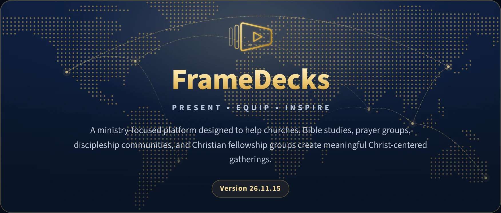

<p align="center"></p>

A service presentation platform for churches and ministries. Plan each service as **Frames** — Welcome, Worship,
Scripture, Discussion, Prayer, Closing — fill them with questions, scriptures, text, timers, pictures, video and
PowerPoint, and present to the room, to Zoom / Teams / Google Meet and to your stream at the same time. Run it from
the PC, a phone or an iPad. FrameDecks runs on the presenting PC, and a service can continue without an internet
connection. Optional workspace features let a team plan together and sync meeting metadata; presentation media,
rendering and camera output stay on the PC. FrameDecks is proprietary software, free to download and use from
[framedecks.com](https://framedecks.com/download). This repository is private.

> **Status: FrameDecks is ready for teaching, Bible study, small-group and hybrid services, with documented gaps.**
> There is no dedicated song / lyrics library yet (lyrics are shown as Text Content or a PowerPoint), and the Windows
> installer is not digitally signed. Automated checks cover key flows, but they do not replace testing the camera,
> PowerPoint, audio and live cloud features on real equipment. Users download it from framedecks.com/download. See the
> [repository audit](docs/project/history/2026-10-18-v6.6-repository-audit.md), [modernization status](docs/project/history/modernization-status.md),
> and the [roadmap](docs/ROADMAP.md).

## What it does
- **Frames and Content**: one Frame per moment of the service; **+ Content** adds a Question, Scripture, Text,
  Image, Video, Timer, PowerPoint or Free Content (announcement, prayer, lower third, branding, camera, screen,
  window, shapes) to the Frame's **Decks**. Frames are compact cards; **Duplicate Frame** (Ctrl+D) puts an independent
  copy right after a Frame, so reusing last week's service never changes it. One Studio plans and runs the meeting,
  and a step-by-step **Setup guide** gets a new PC ready. Rename and edit in place (double-click; no pop-ups); select several Frames or
  Contents to copy, paste, duplicate, move or delete them with Undo ([FRAMES](docs/guide/frames.md) ·
  [CONTENT](docs/guide/content.md)).
- **Presenting**: **Go Live** (T), Frame and item steppers, transitions and auto-advance, Hide all (Esc), Blackout
  (K), Emergency screen, Freeze (F) and Annotate (D) — pen, highlighter, arrow, shapes, text and a **Spotlight** that
  circles the word under the pointer, above everything. Transitions: Cut, Fade, Dip to Black or White, Blur Fade,
  Zoom, Slide, Push, Wipe and **Burst** (the old Frame breaks into drifting dust).
  A **command palette** (Ctrl+K or Ctrl+Space) finds any Frame, question, scripture or setting and runs commands
  ([PRESENTATIONS](docs/guide/presentations.md)).
- **Questions and scriptures**: per-Frame lists with labels; Show question, scripture or both; drag to reorder;
  double-click an item in the list, or any card on the canvas, to edit it in place. ESV fetch online, or any translation
  typed for offline use.
- **Outputs**: the **FrameDecks** virtual camera (your webcam with the Frame on top, background blur, Camera
  Looks) for Zoom, Teams, Google Meet and OBS; a full-screen **Presentation window** for a projector; transparent
  **overlay pages** for OBS ([MEDIA](docs/guide/media.md)).
- **Media**: images, video (muted), PowerPoint (.pptx converted by the PowerPoint on the PC, or PDF), live window
  capture that keeps PowerPoint animations, screen capture, and *Show objects only* for plain slide backgrounds
  ([POWERPOINT](docs/reference/powerpoint.md)).
- **Phone remote**: one view with what is on screen now, large **Previous** / **Next** buttons, arrows for the Frame's
  questions, scriptures or slides, **Teleprompter**, **Draw**, **Freeze** and **Black screen**, and every Frame one tap
  away. PIN-protected, local network only;
  draw on the real live picture, full screen in landscape ([REMOTE_CONTROL](docs/guide/remote-control.md)).
- **Teleprompter**: each Frame's script, or one script for the whole meeting, seen only by the presenter, in one
  window that stays on top of Zoom, Teams or Meet (Prepare → Teleprompter, or R), or on the phone. The screen shows
  only the words; every control (Scroll, speed, text size, **Write Script**, **Upload** a .txt, .md or .docx file,
  **Next Frame**, transparency and **Pin**) is in a top bar that stays hidden until you need it. Never on any output,
  and left out of screen sharing and recordings (Windows 10 2004 or later)
  ([PRESENTATIONS](docs/guide/presentations.md#teleprompter)).
- **Window and tray**: the app's own ribbon instead of the Windows title bar (Snap and resizing kept); Minimize can hide
  it to the tray, where the camera, overlays, phone remote and shortcuts keep working. **Spotlight** (Alt+Space) opens
  the command palette from anywhere in Windows, even from the tray ([GETTING_STARTED](docs/guide/getting-started.md#the-window-buttons-and-the-tray)).
- **Branding**: your logo and Meeting Name in a corner, with size, margin, opacity, padding and an optional plate;
  **Remove background** makes a plain logo background transparent, on the PC. The app window's look (Gold & Navy,
  Morning Light and the other framedecks.com looks, or the same as your workspace; dark, light or match Windows) is
  in **Settings → Meeting & Branding → Look**.
- **Planning**: Quick Start, templates, groups, favourites, and the **Excel Meeting Workbook**: two tabs, a guided
  **Meeting Form** (meeting details, speaker, attendees, presentation, then the Frames, Content, questions and
  scriptures) and a **Dashboard** that sums it up with KPI tiles, readiness checks and a meeting log. Import shows a
  preview with every problem and its row, and can be undone; export gives back the same two tabs, filled in
  ([SERVICE_PLANNING](docs/guide/service-planning.md) · [MEETING_WORKBOOK](docs/reference/meeting-workbook-and-branding.md)).
- **Data**: everything in one folder on the PC, saved atomically, with daily backups and Frame history. A **.frame
  file** carries a whole plan to a service PC without internet: Export for Service PC on framedecks.com, Import Frame
  File on the PC ([FRAME_FILE](docs/reference/frame-file.md)). A linked PC shows Synced, Syncing, Offline or Sync
  failed in its header.

## Hosted companion

The optional Next.js web companion is in `hosted/` and is published as static
files on Cloudflare Pages. With Supabase configured, teams can manage people,
edit synced service plans and link a service PC for remote control when it is
allowed. Sync carries service metadata, not media or live presentation state;
the companion never connects to the PC's local HTTP server. See the
[hosted companion guide](hosted/README.md) for setup and deployment.

## Install
See [INSTALLATION](docs/guide/installation.md) and [GETTING_STARTED](docs/guide/getting-started.md). In short: download the
installer from [framedecks.com/download](https://framedecks.com/download) (until it is code-signed, check its SHA-256
shown there and choose **More info → Run anyway** at the SmartScreen prompt), keep **Install the FrameDecks vCam**
ticked, and allow the one administrator prompt. Windows 10 or 11 (64-bit) is required. Installed copies update
themselves from FrameDecks servers. The installer comes from the **Build Windows installer** workflow, which publishes
version tags to Cloudflare R2 ([release pipeline](docs/deployment/release-pipeline.md),
[BUILDING_THE_INSTALLER](docs/development/building-the-installer.md)).

## Run, build, package (developers)
Prerequisites: Python 3.12 and Node.js (for the tests). There is no UI build step and there are no npm packages.
See [CONTRIBUTING](.github/CONTRIBUTING.md) and the [developer guide](docs/development/developer-guide.md).

```powershell
python src/server.py                                    # run from source in your browser at http://localhost:8750
$env:KC_VCAM_DEMO=1; python src/server.py --remote      # with a built-in test camera and the phone remote on
python -m pip install -r packaging/requirements-desktop.txt -c packaging/constraints.txt   # desktop + camera
python src/desktop_app.py                               # the desktop app window (WebView2)
node tests/run.js                                   # the automated tests (JavaScript)
python -m unittest discover -s tests -p "test_*.py" # the automated tests (Python)
python tools/make_meeting_workbook.py               # rebuild the Excel template after changing src/meeting_form.py
python packaging/check.py                           # start-up self-check
python tools/check_doc_links.py                     # every documentation link and anchor
tools\launchers\build.bat                           # local Windows build (CI is the usual way)
```

## Quality gates (`.github/workflows/build-windows.yml`)
| Gate | What it checks |
|---|---|
| camera build | Builds the FrameDecks vCam (softcam, 64- and 32-bit) and records SHA-256 hashes of the DLLs |
| self-check | `packaging/check.py`: the program starts, serves every page and script, camera name and ID match the build, blur model loads |
| tests | `node tests/run.js`: Frame-owned lists, independent duplicates, conversion of older data, output folding, Meeting Workbook template, import and export |
| Python tests | `python -m unittest`: the Spotlight shortcut and desktop settings, moving data saved under the earlier name, and the Meeting Form layout and export |
| doc-links | `tools/check_doc_links.py`: every relative link and heading anchor in the Markdown docs resolves |
| pinned packages | Builds install `packaging/constraints.txt`: the exact versions of the last good build |
| app folder | The built app contains its window, pages and camera driver |
| installer | Inno Setup builds `FrameDecks v<version>.exe` with a `.sha256` file |
| release | On a `v*` tag, uploads the installer, checksum and release manifest to Cloudflare R2 (downloads.framedecks.com, api.framedecks.com) and keeps a private GitHub Release as a record |

Not automated yet: UI end-to-end tests, the camera in a real Zoom / Teams call, and PowerPoint conversion on real
Office installs — these are covered by the manual [testing script](docs/development/testing.md) before each release.

## Documentation
| Topic | Documents |
|---|---|
| Using it | [GETTING_STARTED](docs/guide/getting-started.md) · [INSTALLATION](docs/guide/installation.md) · [SERVICE_PLANNING](docs/guide/service-planning.md) · [PRESENTATIONS](docs/guide/presentations.md) · [FRAMES](docs/guide/frames.md) · [CONTENT](docs/guide/content.md) · [MEDIA](docs/guide/media.md) · [REMOTE_CONTROL](docs/guide/remote-control.md) |
| Help | [TROUBLESHOOTING](docs/guide/troubleshooting.md) · [FAQ](docs/guide/faq.md) · [SUPPORT](.github/SUPPORT.md) |
| Church teams | [OPERATIONS_HUB](docs/guide/roles/README.md) · [WORSHIP_LEADERS](docs/guide/roles/worship-leaders.md) · [MEDIA_TEAM](docs/guide/roles/media-team.md) · [SERVICE_OPERATORS](docs/guide/roles/service-operators.md) · [REMOTE_OPERATORS](docs/guide/roles/remote-operators.md) · [VOLUNTEERS](docs/guide/roles/volunteers.md) · [SERVICE_DAY_CHECKLIST](docs/guide/roles/service-day-checklist.md) |
| Architecture | [ARCHITECTURE](docs/development/architecture.md) (service flow, engine, remote, media, rendering, sync) · [DESIGN_HISTORY](docs/architecture/design-history.md) · [CONFIGURATION](docs/reference/configuration-guide.md) |
| Security | [SECURITY](.github/SECURITY.md) · [Security boundaries](docs/development/architecture.md#security-boundaries) |
| Development | [CONTRIBUTING](.github/CONTRIBUTING.md) · [DEVELOPER_GUIDE](docs/development/developer-guide.md) · [ENVIRONMENT](docs/deployment/environment-variables.md) · [DEPLOYMENT](docs/deployment/deployment-guide.md) · [BRANCHING](docs/development/branching.md) · [RELEASE_PROCESS](docs/development/release-process.md) · [TESTING](docs/development/testing.md) · [CODING_STANDARDS](docs/development/coding-standards.md) |
| Quality | [REPOSITORY_AUDIT](docs/project/history/2026-10-18-v6.6-repository-audit.md) |
| Reference | [USER_GUIDE](docs/guide/user-guide.md) · [FEATURES](docs/reference/features.md) · [MEETING_WORKBOOK](docs/reference/meeting-workbook-and-branding.md) · [POWERPOINT](docs/reference/powerpoint.md) |
| Project | [ROADMAP](docs/ROADMAP.md) · [CHANGELOG](docs/CHANGELOG.md) · [RELEASE_NOTES](docs/releases/) · [DOCS_INDEX](docs/README.md) |

## Principles
Reliability over features. Volunteers over experts. Offline over online. Privacy over convenience. Honesty over
marketing. Nothing may put a live service at risk, and the screen must always be one key away from safe (Esc, K).
No feature, test result or screenshot in this repository is faked; where something isn't done or isn't verified,
the docs say so.

## License
FrameDecks © 2026 Shobin Mathews. All rights reserved. FrameDecks is proprietary software, licensed under the
[End User License Agreement](LICENSE) ([docs/legal/eula.md](docs/legal/eula.md)); see also [NOTICE](NOTICE). Do not
copy, publish or share this repository's contents. Versions up to 6.14 were published under the Apache License 2.0
and copies of them remain under it. Third-party components keep their own licences, listed in
[THIRD_PARTY_NOTICES.md](docs/legal/THIRD_PARTY_NOTICES.md). Legal pages for users: [terms](docs/legal/terms.md),
[privacy](docs/legal/privacy.md), [cookies](docs/legal/cookies.md), [security](docs/legal/security.md),
[vulnerability disclosure](docs/legal/vulnerability-disclosure.md), all published on framedecks.com.

## Code signing policy
Windows releases are to be code-signed (options and costs: [code-signing.md](docs/deployment/code-signing.md); the free
SignPath Foundation programme is for open-source projects only, so a paid certificate or Azure Trusted Signing is
needed now). The workflow's signing steps stay off until the owner adds the signing secrets.
- Only installers built by this repository's GitHub Actions from `main` or a version tag are signed.
- FrameDecks sends nothing to anyone except the daily update check (its version and Windows version) unless a team
  links a PC to its own workspace (see [docs/architecture/metadata-sync.md](docs/architecture/metadata-sync.md)); it
  collects no telemetry.

<sub>Earlier versions had other names. Version 6.9 and later install over those versions and move their data into the
FrameDecks folder on first start, so every group keeps its data.</sub>
