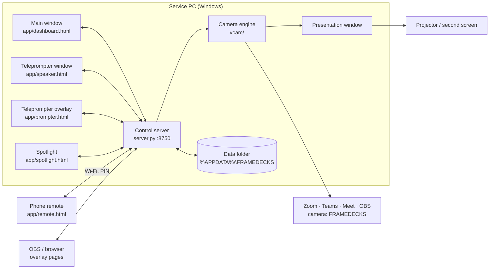
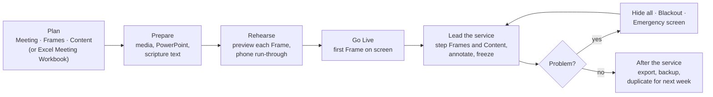
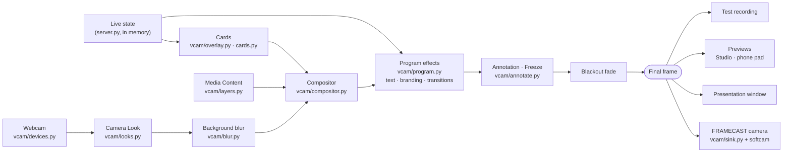
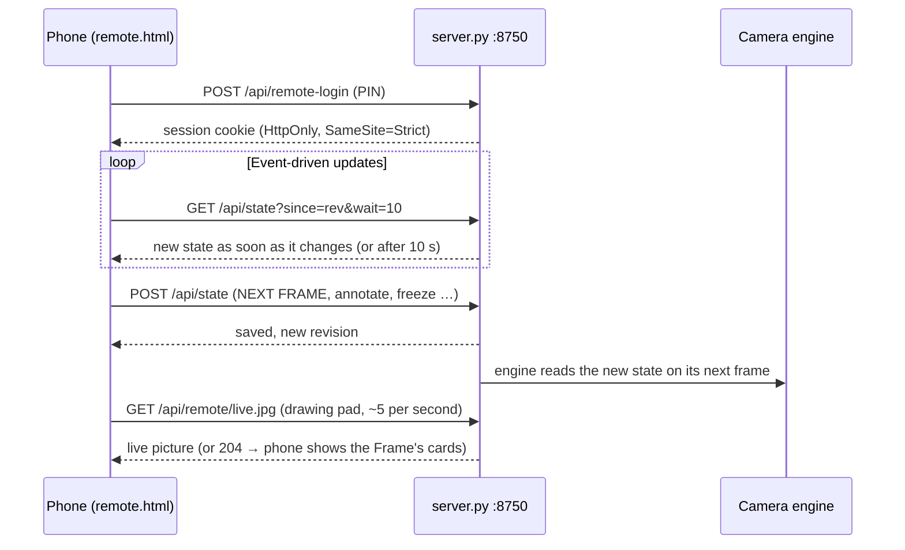
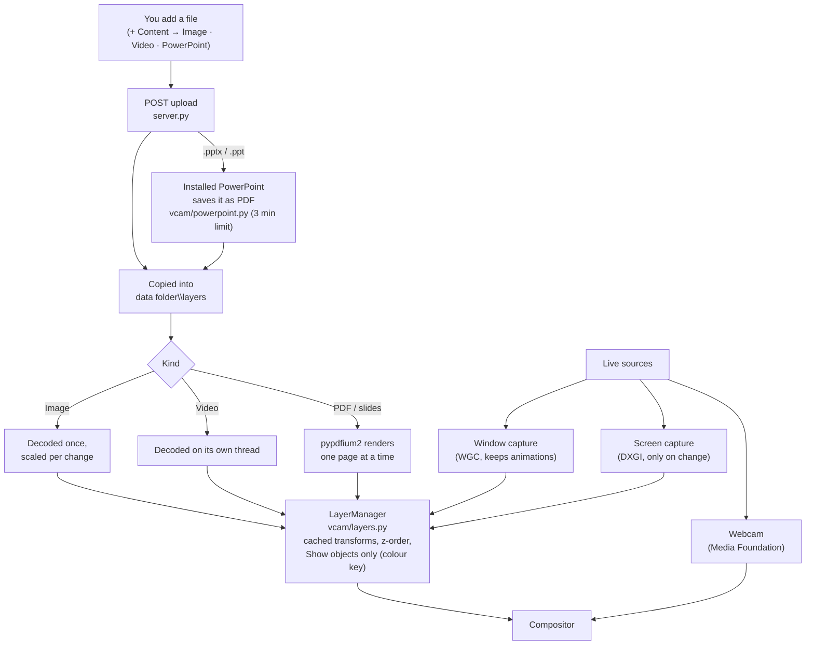
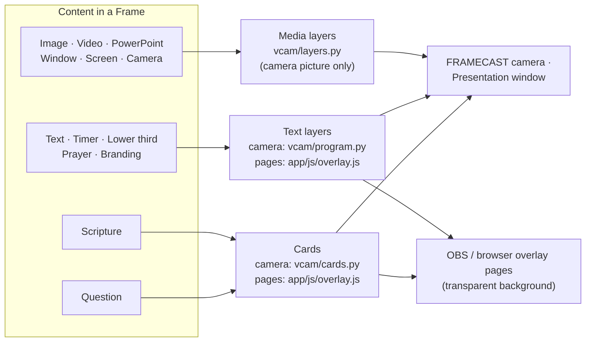
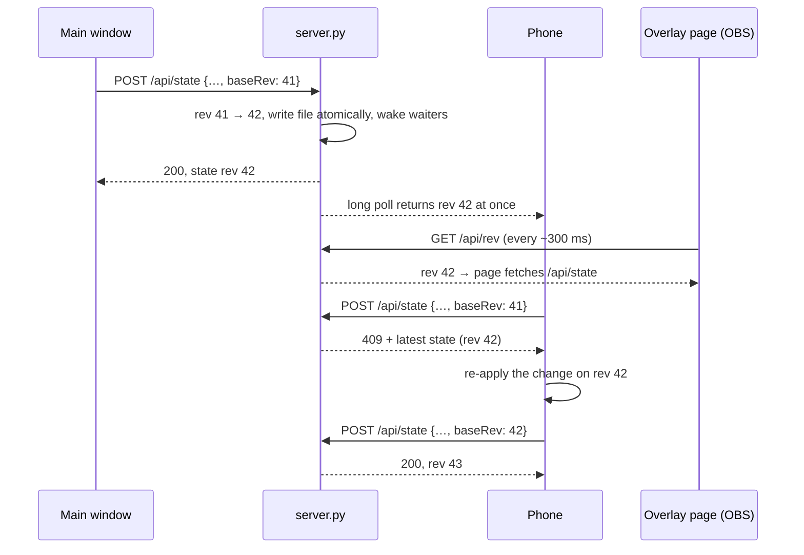
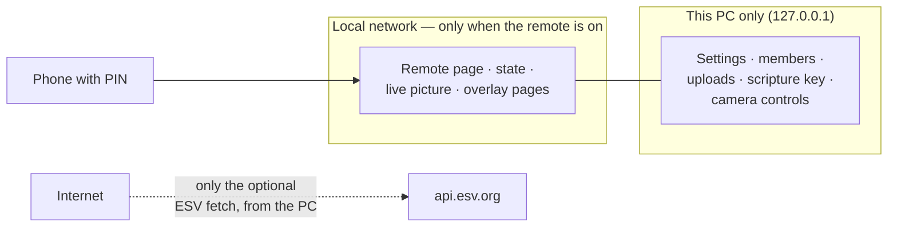

# Architecture

How FRAMEDECKS is built: the parts, how a change travels from a click to the screen, and why it stays
reliable on a Sunday morning.

**Who this is for:** contributors, technical media leads, and anyone who wants to understand what runs on the
service PC. Volunteers do not need this page; start with [Getting started](getting-started.md).

**On this page**
- [Design principles](#design-principles)
- [System at a glance](#system-at-a-glance)
- [1. Service flow](#1-service-flow)
- [2. Presentation engine](#2-presentation-engine)
- [3. Remote control](#3-remote-control)
- [4. Media pipeline](#4-media-pipeline)
- [5. Content rendering](#5-content-rendering)
- [6. Synchronization](#6-synchronization)
- [Desktop windows, tray and shortcut](#desktop-windows-tray-and-shortcut)
- [Components and files](#components-and-files)
- [Data and storage](#data-and-storage)
- [Security boundaries](#security-boundaries)
- [Reliability decisions](#reliability-decisions)

---

## Design principles

| Principle | What it means in the code |
| --- | --- |
| **One PC, no cloud** | Everything runs in one process on the service PC. The web UI talks to `127.0.0.1:8750`. Nothing needs an account or the internet (only the optional ESV scripture fetch does). |
| **One source of truth** | The meeting lives in one state object (`kc-saved-content.json`). Every screen — the main window, the phone, the overlay pages, the camera — reads the same state. |
| **One final picture** | The FRAMECAST camera, the Presentation window and every preview use the same composed frame. Nothing bypasses the compositor, so what you preview is what Zoom receives. |
| **Volunteer-proof** | Plain words in the UI, Frames that own their Content (no hidden sharing), safe defaults, Hide all / Blackout always one key away. |
| **Light on the PC** | Work happens only when something changes. Screens poll cheaply, the phone waits on a long poll, previews are made only while someone is watching. |

## System at a glance

---

## 1. Service flow

What a team does with the software, from planning to the end of the service. Each step maps to a feature.

| Stage | Where in the app |
| --- | --- |
| Plan | + Frame, + Content, Meeting menu (Quick Start, templates, Excel Meeting Workbook) |
| Prepare | Content Settings → Media; PowerPoint conversion; Scripture fetch or typed text |
| Rehearse | Studio Canvas preview (any Frame, not on air); phone **Run-through** |
| Go Live | **Go Live** (T), ◀ Frame / Frame ▶, the phone's NEXT FRAME |
| Lead | → / ← questions, Shift + → / ← scriptures, Annotate (D), Freeze (F), Teleprompter (R), Teleprompter window and Teleprompter overlay (Shift+R), command palette (Ctrl+K), Spotlight (Alt+Space) |
| Recover | Hide all (Esc), Blackout (K), Emergency |
| After | Export to Excel, Settings → Data / Backup, Duplicate Frames |

---

## 2. Presentation engine

The engine turns the live state into one picture, about 30 times a second, and hands it to every output.

- **Order matters.** Media first, cards on top, then text and branding, then drawings, then Freeze and Blackout.
  So drawings always sit above everything, and Blackout always wins.
- **One frame loop.** Only the engine loop touches the final frame. The webcam, blur model, screen capture and
  each playing video run on their own threads and hand over their newest picture under a short lock.
- **Previews on demand.** A preview JPEG is made only while a screen asks for it (640 px wide; 960 px while the
  phone's drawing pad is open) and only when the picture changed.
- **No second encode.** The camera passes uncompressed frames to the meeting app, which encodes once.

---

## 3. Remote control

The phone is a web page served by the PC over the local network. It signs in with a PIN and then uses the same
state as every other screen.

- **Opt-in.** The remote listens on the network only when it is turned on (Settings → Phone & iPad Remote, or
  the `--remote` start option). Otherwise the server answers only this PC.
- **Allow-list.** A phone can reach only the remote page, its scripts, the state, the live picture for the
  drawing pad and the overlay pages. Settings, members, uploads and the scripture key are this-PC-only.
- **Lockout.** Five wrong PINs lock that device out for 60 seconds.
- **Profiles.** *Simple* (default) and *Advanced* are two layouts of the same page; the choice is stored on the
  phone.

---

## 4. Media pipeline

How a file or a live source becomes part of the picture.

- **Files are copied** into the data folder, so a Frame keeps working if the original is moved or deleted.
- **PowerPoint** is converted by the PowerPoint installed on the PC (the only faithful renderer). For animations,
  capture the running slide show window instead. See [reference/powerpoint.md](reference/powerpoint.md).
- **Show objects only** keys out a plain slide background by its corner colour; it is a colour key, not true
  transparency.

---

## 5. Content rendering

Each kind of Content is drawn by the part that suits it, so the camera and the overlay pages look the same.

- **Show on** (Content Settings → Display Settings) decides whether each card or text Content appears on the camera, on the
  overlay pages, or both.
- A Frame **owns** its Question and Scripture lists (`layer.c.items`) and its card appearance (`layer.c.look`).
  Going live applies that Frame's look. Duplicating a Frame gives every Content and item a new id.
- Text uses `{meeting}` and `{org}` placeholders filled from Settings → Meeting & Branding.

---

## 6. Synchronization

All screens stay in step through a single revision number. The rules are simple on purpose.

| Mechanism | Why |
| --- | --- |
| **Revision counter** (`state.rev`) | Every save adds one. A screen that already has the newest revision does nothing. |
| **Conflict check** (`baseRev` → `409`) | Two devices changing things at the same moment never overwrite each other; the late one redoes its change on top. |
| **Atomic writes** | The state is written to a temp file and renamed, so a power cut cannot leave a half-written meeting. |
| **Cheap polling on the PC** | Overlay pages and the main window ask `/api/rev` a few times a second; each request ends at once, so browsers never run out of connections. |
| **Long poll on the phone** | One request waits up to 10 s for a change: instant updates, about six requests a minute when idle, and an honest "reconnecting" when Wi-Fi drops. |
| **Library omitted when unchanged** | The (large) question and verse library is left out of answers while the screen's copy is current. |
| **Frames inside the main window share** | Canvas previews (iframes) subscribe to the main window's store instead of polling. |
| **Camera reads state directly** | The engine reads the in-memory state each frame; there is no extra hop. |

---

## Desktop windows, tray and shortcut

The installed app is one Python process (`desktop_app.py`) with several pywebview (WebView2) windows. Since 6.8 the
window features use Windows' own functions through `desktop_win.py` (ctypes, no new package).

| Window | Page | Notes |
| --- | --- | --- |
| Main window | `app/dashboard.html` | The command bar is the ribbon (`data-win-drag`) with the window buttons (`data-win-controls`) |
| Teleprompter window | `app/speaker.html` | The ribbon is its top bar; the script takes the full width and **On screen & next** slides in |
| Teleprompter overlay | `app/prompter.html` | See-through (`desktop_win.glass`, or the whole-window `desktop_win.fade`), on top, left out of screen sharing (`hide_from_capture`); floating glass toolbar. Exists only while open |
| Spotlight | `app/spotlight.html` | Created hidden at start-up, then only shown and hidden. Runs the command palette's search in its own window |
| Presentation window | `app/present.html` / native | Unchanged: shared in Zoom, no window controls |

- **The ribbon.** `desktop_win.Chrome` removes the Windows caption (`WM_NCCALCSIZE`) but keeps the sizing frame, so
  Snap, edge resizing and the shadow keep working. One shared component, `app/js/window-chrome.js` with
  `app/css/window.css`, draws Minimize, Maximize / Restore and Close in every window, sends a drag to Windows
  (`SC_DRAGMOVE`) once the mouse has moved 4 px, maximizes on double-click and asks the minimize question. The page
  talks to Python through `POST api/app/win`. Settings → General → Window and tray → *Modern window* off keeps the
  Windows title bar; if Windows refuses the change, the title bar simply stays.
- **The tray** (pystray): Open App (the default; a click opens it), Teleprompter (overlay on / off), Search
  (Spotlight), Settings, More (Look, Frame, Stop screen share, Hide all overlays, Presentation window, Phone remote)
  and Exit. Hidden to the tray, the window leaves the taskbar; the server, camera, overlays, phone remote and
  shortcut keep running.
- **The global shortcut thread.** `desktop_win.Hotkeys` registers the Spotlight shortcut with `RegisterHotKey` on its
  own message-loop thread (default Alt+Space, Ctrl+Alt+Space if that is taken). The shortcut centres Spotlight on the
  monitor under the mouse. Spotlight reads its list from the main window (`KCPalette.exportIndex()`) and runs the
  choice there (`KCPalette.runKey()`); background-safe commands leave the main window in the tray.
- **Settings.** `customChrome`, `minimizeTo`, `spotlightKey`, `overlayMode`, `overlayFrost`, `overlayOnTop` and
  `overlayFade`, validated by `server.py`.

## Components and files

| Part | Files | Role |
| --- | --- | --- |
| Control server | `server.py` | HTTP on `127.0.0.1:8750` (plus the LAN when the remote is on), state, uploads, settings, scripture lookup, remote sign-in, backups, the Meeting Workbook export (`POST api/meeting/workbook`, this PC only) |
| Desktop shell | `desktop_app.py` | WebView2 windows via pywebview (main, Teleprompter window, Teleprompter overlay, Spotlight, Presentation window), tray icon and menu, global shortcut, single instance |
| Windows helpers | `desktop_win.py` | Win32 calls via ctypes: the ribbon (`Chrome`, `drag`), see-through glass and fade, capture exclusion, rounded corners, centring on the cursor, the global shortcut thread (`Hotkeys`). Safe no-ops off Windows |
| Window ribbon | `app/js/window-chrome.js`, `app/css/window.css` | The one ribbon component: window buttons, drag, double-click, the minimize question |
| Camera engine | `vcam/engine.py`, `compositor.py`, `layers.py`, `cards.py`, `overlay.py`, `program.py`, `annotate.py`, `blur.py`, `looks.py`, `picture.py`, `screen.py`, `devices.py`, `sink.py`, `powerpoint.py` | Capture, compose, draw cards and drawings, send to the FRAMECAST camera |
| Shared state (UI) | `app/js/store.js` | Normalizes state, Frames and Content model (`KCScenes`), sync loops |
| Main window | `app/dashboard.html`, `app/js/workspace.js`, `frame-lists.js`, `dashboard.js`, `annotate.js`, `preview-edit.js`, `editable.js`, `palette.js`, `prompter-dock.js`, `studio.js`, … | Studio, Content Settings, lists, multi-select, annotation, inline and canvas editing, command palette (also used by Spotlight, `app/spotlight.html`), docked Teleprompter |
| Phone remote | `app/remote.html`, `app/js/remote.js`, `app/css/remote.css` | Simple and Advanced profiles, drawing pad |
| Teleprompter | `app/js/teleprompter.js` (shared, with the floating toolbar), `app/speaker.html`, `app/js/speaker.js` (the Teleprompter window), `app/prompter.html`, `app/js/prompter.js`, `app/css/prompter.css` (the overlay) | The Frame's Teleprompter script, what's on screen, what's next, clocks. No output reads a Frame's script, and the overlay is left out of screen sharing |
| Overlay pages | `app/stage.html` and others, `app/js/overlay.js` | Cards and text for OBS / browser sources |
| Excel | `app/js/meeting-book.js`, `meeting-import.js`, `import-worker.js`, `app/vendor/xlsx.full.min.js`, `meeting_form.py`, `app/templates/FRAMEDECKS-Meeting-Workbook.xlsx` (made by `tools/make_meeting_workbook.py`) | Meeting Workbook import and export. The workbook has two tabs, Dashboard (formulas only) and Meeting Form. `meeting_form.py` holds the form's layout and fills the template for an export (`POST api/meeting/workbook`); `meeting-book.js` reads the form back by its labels and header rows, and still reads the 6.5–6.8 one-sheet-per-list workbooks. The Excel library loads on first use, not at start-up |
| Earlier-name migration | `legacy.py` (data folder, files, backups, recordings), a marked block at the top of `app/js/store.js` (browser settings), `packaging/installer.iss` (old program folder and shortcuts) | Moves data saved by versions published under the program's earlier name to the FRAMEDECKS names, once, never overwriting newer data |
| Packaging | `packaging/` | PyInstaller spec, Inno Setup installer, camera build, self-check |
| Tests | `tests/`, `packaging/check.py` | Store and workbook tests; start-up self-check |

The full, version-by-version engineering record is in
[architecture/design-history.md](architecture/design-history.md).

## Data and storage

Everything lives in the data folder, `%APPDATA%\FRAMEDECKS`. Earlier versions, published under the program's
earlier name, kept their data in a folder and files carrying that name; on first start, 6.9 moves them here once
(`legacy.py`), including backups and recordings, and never overwrites newer data. Details: [reference/configuration-guide.md](reference/configuration-guide.md).

| File / folder | Contents |
| --- | --- |
| `kc-saved-content.json` | The meeting: Frames, Content, lists, branding, live state |
| `kc-members-private.json` | Members (never sent to the phone or the overlay pages) |
| `kc-app-settings.json`, `kc-vcam-settings.json`, `kc-studio.json`, `kc-looks.json` | App, camera, studio and Camera Look settings |
| `kc-remote-pin.txt`, `kc-remote-sessions.json` | Phone remote PIN and signed-in phones |
| `layers\` | Copies of images, videos and slide PDFs you added |
| `backups\` | Daily and manual backups |

## Security boundaries

- The server checks the request's host and origin, so other websites cannot drive it from a browser.
- Member data stays on the PC; it is never part of the state the phone or overlay pages receive.
- No telemetry. The only outgoing request is the optional ESV scripture fetch.

See [../SECURITY.md](../SECURITY.md) for how to report a problem.

## Reliability decisions

| Decision | Benefit during a service |
| --- | --- |
| No cloud, no sign-in | Works with no internet; nothing to expire on a Sunday |
| Single process, single state | No services to keep in sync; restart = back where you were |
| Hide all / Blackout / Emergency always available | One key recovers any screen |
| Atomic saves + daily backups | A crash or power cut does not lose the meeting |
| Previews only on demand | The PC keeps its power for Zoom and the camera |
| "Light on graphics card" window | The UI does not compete with Zoom for the GPU (the overlay then fades as a whole) |
| Modern window and Compatibility transparency switches | The two riskiest window features can be turned off in Settings; each also falls back by itself if Windows refuses it |
| Self-check and tests in every build | A broken page or file never reaches the installer |

## Hosted companion boundary

The optional Next.js companion in `hosted/` is a separately built and deployed
application. It does not connect to the desktop app's local HTTP server; the
current hosted page is a static preview. Keep its routes, dependencies, and
deployment configuration inside `hosted/`. See the
[hosted companion guide](../hosted/README.md).

## Related
- [Getting started](getting-started.md)
- [Media](media.md) · [Remote control](remote-control.md)
- [Design history (engineering log)](architecture/design-history.md)
- [Developer guide](CONTRIBUTING.md) · [Building the installer](development/building-the-installer.md)
- [Environment](ENVIRONMENT.md) · [Deployment](DEPLOYMENT.md) · [Coding standards](CODING-STANDARDS.md)
