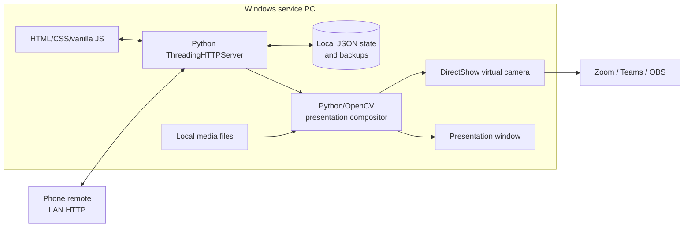
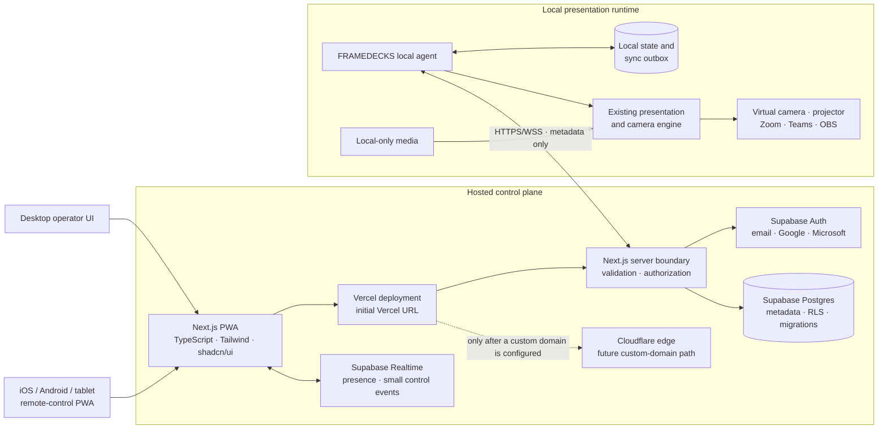
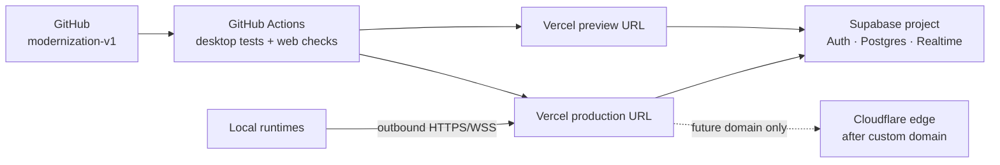

# FRAMEDECKS modernization architecture and migration plan

**Status:** Phase 1 architecture proposal; no application runtime changes have been made  
**Branch:** `modernization-v1`  
**Product constraint:** FRAMEDECKS remains free; no payments, subscriptions, paywalls, trials, feature gates, or licensing restrictions.

## 1. Modernization principles

- Modernize the product incrementally; do not redesign or replace working user flows in a big-bang rewrite.
- Preserve the existing desktop application, presentation engine, local media, and current remote until equivalent
  behavior has been demonstrated on supported devices.
- Keep media bytes local. Cloud synchronization is limited to account/profile data, settings, themes, templates,
  presentation definitions and metadata, pairing records, and audit logs.
- A network outage must not interrupt local presentation rendering, navigation, local video/audio playback, the
  virtual camera, or the existing local Zoom/Teams/OBS output workflows.
- Use the browser/PWA on phones and tablets for remote control only. Do not run the presentation engine or media
  playback on mobile.
- Treat compatibility tests, security controls, data export, and rollback as release features.

## 2. Current-to-target architecture

### Current runtime



### Proposed target



The local runtime is not a Vercel function. The Python/Windows runtime remains responsible for local asset lookup,
presentation timing, capture, composition, native output, and offline operation. The hosted system coordinates
identity, organization metadata, settings, templates, pairing, and audit records.

### Target stack responsibilities

| Technology | Responsibility |
|---|---|
| Next.js + TypeScript | Hosted control plane and browser client; strict types and validated API contracts |
| Tailwind CSS + shadcn/ui | Styling system and accessible primitives introduced without changing the established UI layout |
| Supabase Auth | Email, Google, and Microsoft sign-in; user session lifecycle |
| Supabase Postgres | Organization-scoped metadata, migrations, audit records, RLS |
| Supabase Realtime | Presence and low-volume control notifications; not durable state or media streaming |
| Vercel | Hosted Next.js deployment and preview environments; start with Vercel-provided URLs |
| Cloudflare | Future edge routing/protection after a custom domain is available; not a prerequisite to the initial Vercel deployment |
| GitHub Actions | Keep the existing Windows build/tests and add hosted-app checks independently |
| GitHub Copilot/OpenRouter | Development tools only; not runtime services or a destination for user/presentation data |
| Flutter | Not in the target implementation: iOS/Android are browser/PWA remote-control clients. Reassess only if a specific native-only requirement emerges. |

Stripe is excluded because the product must remain free and must not add payments, subscriptions, paywalls, trials,
feature gating, or licensing restrictions.

## 3. Cloud data and local media contract

### Permitted cloud data

- User accounts and profiles.
- Organization/membership identity and role assignment.
- User and organization settings, themes, templates.
- Versioned presentation definitions and metadata.
- Pairing records, trusted device metadata, revocation state.
- Security and administrative audit logs with defined retention.

### Prohibited cloud data

- Images, video, audio, motion backgrounds, countdown videos, slide decks, or any other presentation media bytes.
- Media libraries or media backups.
- Local absolute paths, device credentials, access tokens, PINs, or private keys embedded in presentation definitions.

Presentation definitions may refer to an opaque logical local-asset identifier and expected media type. A local
runtime maintains the mapping from that identifier to a local file. The mapping must not leak local absolute paths
to the cloud. Missing local assets must be reported visibly and must not block unrelated presentation content.

### Versioning and compatibility

- Version cloud and local presentation-definition schemas explicitly.
- Validate, bound, and normalize every imported/synced definition before it reaches the renderer.
- Keep API routes and internal field/table/service names stable unless a separately reviewed compatibility change
  is approved. User-facing terminology does not rename persisted schema.
- Add forward/backward compatibility tests using representative data from FRAMEDECKS 6.9 and older supported
  formats.

## 4. Authentication, authorization, and pairing

### Account authentication

- Supabase Auth provides email login plus Google and Microsoft OAuth providers.
- Use Supabase's supported JWT/session lifecycle; do not invent a token format or place a service-role key in a
  browser bundle.
- Prefer server-managed secure cookies for the Next.js session boundary. Use `Secure`, `HttpOnly`, and an
  appropriate `SameSite` policy; add CSRF defenses to cookie-authenticated state-changing routes.
- Keep access checks on trusted server code and in database RLS. Client role checks are UX only.
- Revoke sessions/devices on account removal, organization membership removal, explicit revocation, or security
  response.

### Roles

| Role | Proposed capability |
|---|---|
| Viewer | Read permitted meeting metadata, notes, timer, confidence monitor, and queue |
| Operator | Standard remote controls and navigation within granted meetings |
| Presenter | Operator capabilities plus presenter-specific notes/control functions |
| Administrator | Organization membership, pairing approvals, role assignment, device revocation, and settings |

Exact permission mapping must be validated against current remote controls before implementation. The design must
not silently remove existing remote actions; users without a required role receive a clear authorization result.

### Pairing architecture

1. An authenticated administrator selects a runtime and requests pairing.
2. The server creates a cryptographically random, one-time pairing challenge bound to that organization/runtime,
   with a five-minute expiry and server-side rate limits.
3. The app displays a QR code and a six-digit code that resolve to the same challenge. The code is not an
   authentication credential and cannot grant access without the authenticated account and runtime approval.
4. The mobile PWA authenticates, scans/enters the code, and requests pairing. The runtime displays the device/user
   identity and requested role for explicit approval.
5. Approval atomically consumes the challenge, creates a trusted-device record, and issues a scoped, revocable
   session. Reuse, expiry, denial, or revocation invalidates the challenge/device.
6. Pairing, approval, role changes, and revocation create audit events without logging secrets or pairing codes.

```mermaid
sequenceDiagram
  participant Admin as Authenticated admin
  participant Cloud as Next.js + Supabase
  participant Runtime as Local FRAMEDECKS runtime
  participant Phone as Remote PWA
  Admin->>Cloud: Request pairing (runtime, role scope)
  Cloud-->>Admin: QR + six-digit, one-time code (5 min)
  Phone->>Cloud: Sign in; submit QR/code challenge
  Cloud->>Runtime: Pending device approval
  Runtime-->>Admin: Show identity/device and requested scope
  Admin->>Runtime: Approve or deny
  Runtime->>Cloud: Approve challenge
  Cloud->>Cloud: Atomically consume challenge; record trusted device
  Cloud-->>Phone: Scoped revocable authenticated session
```

### Offline pairing and remote-control blocker

The existing remote is served over local HTTP. An HTTPS-hosted PWA cannot be assumed to communicate with an
arbitrary private HTTP address: browser mixed-content/private-network restrictions and trusted-certificate
requirements vary across iOS and Android. HTTPS-only security and an identical phone-remote experience while
offline are therefore not yet demonstrated together.

Do not remove the existing remote or claim offline phone-control parity until a secure local transport/pairing
prototype passes on supported mobile browsers. Candidate approaches must be evaluated for certificate trust,
first-use onboarding, revocation, discovery, and no-internet behavior. Regardless of this open issue, local PC
presentation and output must continue offline.

## 5. Synchronization and offline architecture

### Data flow

1. The local runtime remains authoritative for active presentation execution and local assets.
2. Each metadata change is schema-validated and stored locally with a stable operation ID, schema version, base
   revision, and sync status.
3. When online, the runtime sends queued metadata changes over HTTPS/WSS using a scoped device identity.
4. Server authorization checks account, organization membership, runtime pairing, and role before applying a
   mutation. Database changes use transactions and tenant RLS.
5. Realtime announces a small revision/event, not the full source of truth. Clients fetch current authorized
   metadata and reconcile against the durable revision.
6. Retries reuse operation IDs so duplicate delivery is idempotent. Conflicts are explicit and resolved by a
   defined merge/review flow; do not silently apply last-write-wins to an entire meeting.
7. On connectivity return, queued sync resumes automatically and records progress/errors for the operator.

```mermaid
sequenceDiagram
  participant UI as Desktop / PWA
  participant Local as Local runtime + outbox
  participant Cloud as Next.js API
  participant DB as Supabase Postgres
  participant RT as Realtime
  UI->>Local: Edit presentation metadata
  Local->>Local: Validate and persist locally
  alt Internet available
    Local->>Cloud: HTTPS mutation (operationId, baseRevision)
    Cloud->>DB: Authorize with membership + RLS; commit version
    DB-->>Cloud: Committed version
    Cloud-->>Local: Acknowledgement and canonical revision
    Cloud->>RT: Publish small revision notification
  else Offline
    Local->>Local: Queue change; keep presenting locally
  end
  RT-->>UI: Revision changed
  UI->>Cloud: Fetch current authorized metadata
```

### Offline invariants

**Must continue without internet:** existing PC presentation workflow, rendering, local slide/frame navigation,
video/audio playback, local media resolution, virtual camera, projector output, Zoom/Teams/OBS paths, and local
state saving.

**May pause until connectivity returns:** cloud account operations, cross-device cloud sync, remote commands that
depend on the cloud relay, and remote sign-in/revocation. Offline phone control remains an explicit blocker until
the secure local transport above is proven.

Service worker behavior is limited to the application shell and explicitly safe user-approved drafts. Do not cache
private APIs, member records, pairing responses, or privileged session data. Logout, revocation, and account
switching clear protected cached state.

## 6. PWA design

- Serve from HTTPS, initially using the Vercel-provided URL.
- Preserve `remote.html`'s layout, navigation, screens, button placement, and interaction patterns while migrating
  its backing authentication/session behavior.
- Add a service worker, install/update lifecycle, offline shell, and cache versioning only after route and data
  ownership are clear.
- Keep iOS/Android/tablets as remote-control clients; no presentation rendering, hosting, media playback, or
  virtual camera on mobile.
- Validate install behavior and access recovery on current iOS Safari and Android Chrome before claiming support.
- Cloudflare is deferred until a custom domain exists; Vercel URL deployment must work independently.

## 7. Security architecture requirements

- HTTPS everywhere for hosted pages, APIs, and runtime connections; WSS for persistent channels.
- Supabase-managed JWT/session lifecycle with refresh/revocation; short-lived, scoped local-runtime credentials.
- Organization membership and role checks on every operation; deny by default and enforce tenant RLS.
- Secure cookies and CSRF protection for cookie-authenticated state changes; validate Origin/Host where applicable.
- Rate limits on login, pairing, sensitive actions, and API writes; lockouts must not create easy cross-user denial
  of service.
- Pairing challenges are one-time, five-minute, authenticated, runtime-approved, and replay-resistant.
- Device/session revocation, auditable security events, and defined log retention.
- No service-role keys, OAuth secrets, or reusable pairing credentials in client code, PWA caches, URLs after
  challenge consumption, or logs.
- No media bytes in cloud requests, database rows, audit logs, or PWA caches.
- Test tenant isolation and authorization at both API and database layers before importing real user data.

## 8. Deployment architecture



- Keep the existing Windows installer/build workflow intact and independently releasable.
- Add separate hosted-app CI for lint, typecheck, unit/security-policy tests, browser tests, and production build.
- Separate development, preview, and production Supabase projects/secrets. Avoid production user data in preview.
- Use Vercel-provided URLs first; do not invent or assume a domain. Cloudflare custom-domain routing is deferred.
- Make database changes through reviewed, versioned migrations. Define backup and restore procedures and test them.
- No payment provider, billing webhooks, subscription tables, or paid-entitlement service.

## 9. Risk register and mitigations

| Risk | Severity | Mitigation / gate |
|---|---|---|
| Tenant data leak through incorrect RLS or API authorization | Critical | Deny-by-default policies, cross-tenant tests, independent review, no real data until passed |
| Existing workflows regress during UI migration | High | Preserve current screens and behaviors; port by vertical slice; automated baseline and side-by-side acceptance tests |
| HTTPS-only hosted PWA cannot preserve offline LAN remote control | High / unresolved | Prototype mobile browser local transport; do not remove old path or claim parity until validated |
| Cloud outage blocks live presentation | Critical | Keep rendering, media, and outputs local; test internet cuts during presentation |
| Metadata schema/import loses user content or asset bindings | High | Versioned schema, dry-run import, export/backup, idempotency, data-diff reports, rollback |
| Mac parity estimated as a web-only change | High | Treat native Mac camera/capture/presentation as a separate platform project and gate support claims |
| Local media identifiers/paths leak to cloud | Medium/High | Opaque IDs in cloud, local-only path mapping, payload inspection tests |
| Pairing-code theft/replay or persistent device access | High | Authenticated challenge, five-minute expiry, runtime approval, atomic one-time use, revocation, audit |
| Vercel/Cloudflare topology conflicts with no custom domain | Medium | Deploy directly to Vercel URL first; defer Cloudflare edge until domain configuration |
| Hosted service costs exceed free product sustainability | High | Metadata-only architecture, quotas/abuse controls, budgets and alerts; do not introduce feature gating |
| OAuth/provider setup delays initial deployment | Medium | Build/test email auth first; configure Google/Microsoft as separate provider acceptance gates |

## 10. Implementation phases and exit criteria

| Phase | Scope | Exit criteria |
|---|---|---|
| 1. Audit and architecture | Current-state evidence, security/debt/performance/offline assessment, target architecture, status tracking | Audit, roadmap, risks, and baseline test results documented |
| 2. Frontend foundation | Isolated Next.js + TypeScript + Tailwind + shadcn/ui app and CI | Existing desktop app unchanged; web lint/type/test/build gates pass; Vercel preview works |
| 3. Authentication and tenant model | Supabase email/Google/Microsoft auth, organizations, roles, Postgres migrations, RLS | Tenant isolation tests pass; account/session revocation works; restore/deletion procedures exercised |
| 4. Metadata synchronization | Versioned contracts, local outbox, idempotent sync, conflict recovery, 6.9 data importer | Offline operation unaffected; no media bytes uploaded; representative data round-trips without loss |
| 5. PWA and pairing | HTTPS PWA, QR/6-digit codes, five-minute expiry, runtime approval, device trust/revocation | iOS/Android/browser tests pass; replay, expiry, role, revocation, offline/reconnect tested |
| 6. Deployment and operations | Vercel production, secrets, monitoring, audit retention, backup/restore; future Cloudflare | Vercel URL production ready; restore drill and incident process complete; no custom domain assumed |
| 7. Branding and terminology | User-facing FRAMEDECKS brand/tagline and approved wording only | Layout/navigation unchanged; internal API, model, table, and environment names unchanged |
| 8. Compatibility rollout | Pilot, side-by-side workflows, migration/rollback, platform coverage | Preservation matrix passes; no unresolved critical/high security or data-loss issues |

Phases are gated; a later phase does not begin merely because its row follows the prior one. Phase 5 is blocked from
claiming complete offline phone-remote parity until secure local transport has been demonstrated.

### Branding and terminology migration

When Phase 7 begins:

- Use the user-facing brand **FRAMEDECKS** and tagline **Present • Equip • Inspire**.
- Apply the requested visible hierarchy **Frame → Deck → Content** and replace the user-facing phrase
  **“Decks & Elements”** with **“Decks & Content”** where it exists.
- Generate/replace the horizontal, stacked, and icon logos, favicon, app icons, splash/login branding, and
  marketplace assets without changing application behavior.
- Do not rename APIs, database tables or fields, internal models/services, or environment variables.
- Capture before/after screenshots and run the preservation matrix to verify that branding work changes no layout,
  navigation, or interaction behavior.

## 11. Preservation and compatibility validation

No claim of complete modernization is valid until this matrix is tested against the existing 6.9 release and target
runtime(s):

| Area | Required validation |
|---|---|
| Visual identity/layout | Existing dashboard, studio, settings, overlays, speaker view, and remote screen comparisons show no unintended layout/navigation changes |
| Planning workflows | Meeting/Frame/Content creation, edit, reorder, duplicate, delete, undo, templates, workbook import/export, notes, and settings |
| Presentation | Go Live, frame/content stepping, transitions, timer, notes, blackout, emergency, freeze, annotation, queue, confidence monitor |
| Remote | Same screens, buttons, placement, interactions, and connection states; login/pairing changes do not remove existing capabilities |
| Media | Image, video, audio where supported, PDF/PowerPoint, local capture, and missing-file recovery operate offline |
| Outputs | Virtual camera, presentation window/projector, OBS overlays, Zoom, and Teams verified on supported platforms/hardware |
| Local data/API | Existing user data opens; old local endpoints/contracts remain compatible or use an explicit adapter; no destructive migration |
| Offline | Disconnect internet during an active presentation; all required local outputs continue and queued metadata sync resumes after reconnect |
| Security | Cross-tenant denial, role enforcement, CSRF/rate limit/session revocation, pairing expiry/replay, cache privacy, and secret scan |
| Platform | Windows baseline retained; Mac support is not declared equivalent until a Mac-native runtime and hardware tests pass |

## 12. Rollback plan

1. Keep the current 6.9 desktop installer and local data format readable throughout the migration.
2. Develop the hosted application alongside the desktop product; never make the existing local application depend on
   Supabase or Vercel for presentation.
3. Back up source data before migration and run import in dry-run mode with a field-by-field diff and explicit user
   confirmation.
4. Use additive database migrations first. Prefer forward-fix migrations over destructive rollback after user data
   has been written.
5. Gate new sync and pairing behavior behind separately configurable capabilities; preserve the local-only launch
   path and provide a documented disable/rollback procedure.
6. On failed rollout, disable cloud sync/pairing, continue with the last local state and local media, export any
   cloud metadata, and restore the previous stable desktop release.
7. Verify rollback on a non-production copy before broad pilot; communicate any data reconciliation required.

## 13. Phase 1 completion record

Phase 1 is complete for the repository assessment and architecture deliverables. This does **not** mean SaaS,
PWA, Supabase, pairing, or cloud synchronization has been implemented.

- Audit: [FRAMEDECKS_AUDIT.md](FRAMEDECKS_AUDIT.md)
- Status: [FRAMEDECKS_MODERNIZATION_STATUS.md](FRAMEDECKS_MODERNIZATION_STATUS.md)
- Existing detailed report: [SaaS migration roadmap](project/saas-migration-roadmap.md)
- Existing Windows/Python application remains the tested production runtime.
- `Stripe` is explicitly excluded; product is free.
- Open blockers: secure offline mobile remote transport; product roadmap conflict; Mac-native runtime scope;
  Cloudflare custom domain availability.
