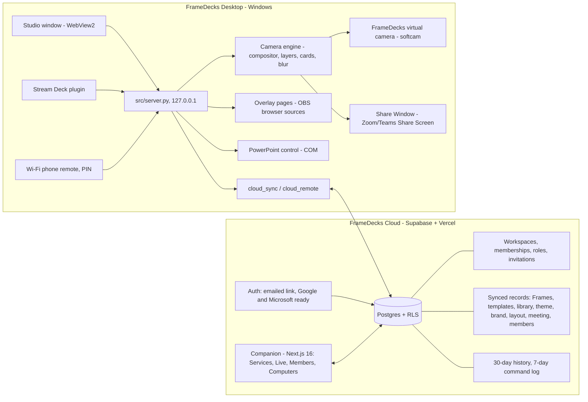

# Architecture review: FrameDecks against the target architecture

A repository-wide review of FrameDecks against the owner's target architecture (25 October 2026): a cloud for people,
templates, settings, AI and audit; a desktop runtime for media, rendering, the virtual camera and meeting delivery.
It covers architecture, gaps, security, performance, cloud vs local, AI, media, UI impact and technical debt.

**Who this is for:** the owner and maintainers deciding what to change, in what order, and what never to change.

**Based on the code at** `claude/peaceful-albattani-6m445e` (on top of `main` at `8482c44`), not on intentions.
Performance figures and the detailed desktop findings are in the earlier
[architecture, performance and product audit](project/2026-10-25-architecture-audit.md) (C1–C10, P1–P10); this review
does not repeat them. The plan that follows from it is [migration-plan.md](migration-plan.md).

**Decisions it needs from the owner** are marked **[Decision]** and gathered in the migration plan (M-D1 to M-D6).

---

## 1. Current architecture assessment

| Layer | What is there now | Files |
|---|---|---|
| Authentication | Supabase Auth (emailed link); Google and Microsoft buttons appear when the providers are switched on; sessions as JWT | `hosted/src/lib/supabase-browser.ts`, `use-session.ts`, `sign-in-form.tsx` |
| Workspaces and roles | Organizations, memberships (owner / admin / member), invitations, "Can run services" | `0001`, `0002`, `0004` |
| Member data | **Kept on the PC** (`kc-members-private.json`), edited in the desktop Members screen, **synced to the workspace** when linked (owners and admins only) | `app/js/members.js`, `src/server.py` `PRIVATE_FILE`, `src/sync_entities.py` |
| Service plans and templates | Kept on the PC (`kc-saved-content.json`); synced as per-record text when linked; editable in part in the companion | `src/cloud_sync.py`, `0003`, `frame-edit.ts` |
| Settings | Workspace-wide looks (theme, brand, layout, meeting) sync; PC settings (camera, windows) stay local | `src/sync_entities.py`, `src/server.py` `APP_SETTINGS_DEFAULTS` |
| History / audit | 30-day record history with who and when (`entity_history`); 7-day command log (`remote_commands`) | `0003`, `0004` |
| Media | Local only: images, video, PDF, PowerPoint in the PC's data folder; sync carries file names only | `vcam/layers.py`, `src/sync_entities.py` |
| Rendering and camera | Local CPU pipeline (OpenCV/numpy), softcam virtual camera, native Share Window | `vcam/` |
| OBS | Browser-source overlay pages served by the PC (`focus-verse.html`, `discussion-question.html`, `birthday.html`, `stage.html`), and the virtual camera as an OBS video source | `app/*.html` |
| Zoom / Teams / Meet | The FRAMECAST camera, and the Share Window for Share Screen; no meeting-app API | `vcam/sink.py`, `vcam/present_window.py` |
| Remote control | Wi-Fi phone remote (LAN, PIN); companion Live page (cloud commands); Stream Deck (local) | `remote.html`, `src/cloud_remote.py`, `streamdeck/` |
| AI | **None** | — |
| PPTX | Import (PowerPoint on the PC saves a PDF); Next/Previous in a running slide show. **No export** | `vcam/powerpoint.py` |

**Verdict.** The repository already follows the target's main split: the cloud holds people, plans as text, roles and
history; the PC holds media, rendering, the camera and meeting delivery, and keeps working offline. The gaps are member
data authority (rule 3), AI (absent), PPTX export and audio (absent), a general audit log, licensing, and a few
security hardening items.

## 2. Architecture gap analysis

| Target component | Status | Gap | Effort |
|---|---|---|---|
| Cloud: Authentication | **Met** (emailed link); OAuth ready | Google/Microsoft need switching on in Supabase (owner, planned) | Owner setup |
| Cloud: Members, phones, birthdays | **Partly**: in the cloud when linked, but the **PC is the source** | Rule 3 says the cloud is the store and PCs must not be permanent storage | Medium; **[Decision] M-D2** |
| Cloud: Groups | **Missing** | No member groups (only a group name for emails) | Small schema + companion; desktop has no place for it without UI change; **[Decision] M-D6** |
| Cloud: Roles, permissions | **Met** for workspace users (owner/admin/member, Can run services); **partly** for members (a free-text `role`) | Member roles are text, not permissions (members are not users) | None needed unless members become users |
| Cloud: AI Engine | **Missing** | No AI feature exists | New; **[Decision] M-D3** |
| Cloud: Template Store | **Partly**: templates sync within a workspace | No shared store across workspaces | Medium; later |
| Cloud: Settings | **Met** for workspace looks; PC settings stay local by design | — | — |
| Cloud: Audit Logs | **Partly**: record history (30 d), command log (7 d) | Membership, invitation, PC link/revoke and role changes are not logged | Small (one table + triggers) |
| Cloud: Secure API (HTTPS + JWT) | **Met**: Supabase over HTTPS, people with JWT, RLS on every table | PCs use a computer key (hash stored), not a JWT: standard API-key pattern, documented | — |
| Desktop: Local media library | **Met** for images, video, PDF/PowerPoint | **Audio** and a dedicated motion-background type are missing (looping video works) | Audio: medium, UI; **[Decision] M-D4** |
| Desktop: Scene engine, presentation runtime, render engine | **Met** | Performance items in the audit (P1–P4 done on this branch) | — |
| Desktop: Virtual camera | **Met** (softcam) | Code signing (C1) | **[Decision] M-D1** |
| Desktop: OBS integration | **Met** (browser sources + camera) | No obs-websocket control (not required) | — |
| Desktop: Teams / Zoom integration | **Met** (camera + Share Window) | — | — |
| Desktop: PPTX export | **Missing** | Plans cannot be exported as `.pptx` | Medium, UI; **[Decision] M-D4** |
| Offline after sign-in | **Met**: presenting never depends on the cloud; sync queues changes | Templates "downloaded" = synced records already on the PC | — |
| Open source, Apache 2.0 | **Missing**: private repository, no `legal/LICENSE` | Licence choice, third-party notices | **[Decision] M-D1** |

## 3. Security review

| Area | Finding | Status |
|---|---|---|
| Transport | Cloud: HTTPS only (Supabase, Vercel). PC: `127.0.0.1` HTTP with Host and Origin checks (DNS-rebinding safe). **Wi-Fi phone remote: plain HTTP on the LAN** with a 6-digit PIN, 5 tries per IP then 60 s, 30-day cookies | Cloud and local fine; LAN remote is legacy and frozen by rule; the companion Live page is the HTTPS alternative |
| Authentication | Supabase Auth (JWT, refresh tokens handled by `supabase-js`); OAuth ready; no custom crypto | Good |
| Authorization | RLS on every table; `security definer` functions with pinned `search_path`; null-safe checks (`coalesce`); admin-only member records; least privilege for PCs (their own workspace, their own commands) | Good; tested on PGlite, **not yet against live Supabase** |
| Secrets | No secrets in the repository (a test enforces it for the companion); publishable key only in Vercel; PC key in Windows Credential Manager, only its SHA-256 in the cloud | Good. The user's own ESV API key is stored in plain text in the data folder: move it to Credential Manager (low) |
| Input validation | Plan normalized by `store.js` on every load; cloud functions check kinds, sizes (256 KB a record, 2 MB a push, 1 KB command args, 64 KB status), counts and rates | Good |
| Rate limiting | `sync_push` 600 writes/min per workspace; `remote_send` 30 per 10 s per person; link-code failures counted | Good |
| Audit | Record history and command log; no log of membership, invitation, role or PC changes | Gap (small) |
| Local data at rest | Member list (names, phones, birthdays) in plain JSON in `%APPDATA%` | Gap under rule 3; Windows account protection only |
| Supply chain | Unsigned installer and DLLs (C1); dependencies pinned in `constraints.txt` and lockfiles | Gap |
| Stream Deck / local commands | `/api/command` answers this PC only, listed actions only, 1 KB args | Good |

## 4. Performance review

The detail is in the [earlier audit](project/2026-10-25-architecture-audit.md) §2–§4 and §7. On this branch:
- **P1, P2:** a live press no longer writes the plan or starts a sync round. Measured: from 8.5 ms to 0.33 ms per press
  with a 3,000-question library.
- **P3:** pictures are capped at the largest size they can be drawn.
- **P4:** the DXGI screen-capture fallback copies only on change.
- **C2:** a crash restarter brings the camera back by itself.

Still open: Windows Graphics Capture throttling on high-refresh displays (needs Windows measurement), and Realtime
for the Live page at scale (P9). Nothing in this review adds per-frame or per-press cost.

## 5. Cloud vs local responsibility review

| Responsibility | Target | Now | Verdict |
|---|---|---|---|
| Authentication | Cloud | Cloud | ✓ |
| Member management | Cloud | PC is the source, cloud is a synced copy (when linked) | ✗ rule 3 (M-D2) |
| Templates | Cloud | Synced records; authored on the PC | ✓ in substance; a shared store is a later step |
| Settings | Cloud | Workspace looks: cloud; PC hardware settings: local | ✓ (hardware settings must stay local) |
| Permissions | Cloud | Cloud (RLS, roles) | ✓ |
| AI services | Cloud (optional) / local | None | Gap (M-D3) |
| Deck metadata | Cloud | Synced Frame records | ✓ |
| Audit logging | Cloud | Partial | Gap (small) |
| Media storage | Local | Local, names only in the cloud | ✓ |
| Rendering, scenes, runtime | Local | Local | ✓ |
| Virtual camera, OBS, Teams, Zoom | Local | Local | ✓ |
| PPTX export | Local | Missing | Gap (M-D4) |
| Cloud outage | Must not stop presenting | Presenting never calls the cloud; sync and phone control pause and resume | ✓ (tested offline in `tests/test_cloud_sync.py`) |

**Rule 3 and offline delivery pull in opposite directions.** Birthday cards are shown live from the member list, so a
PC must have the members when offline. The safe reading is: **the cloud is the source of truth, and the PC keeps a
cache that it can rebuild from the cloud.** That is not permanent storage. Today, for unlinked PCs (people without an
account), the PC is the only store. See M-D2 for the options.

## 6. AI architecture review

**There is no AI in FrameDecks today**, so nothing can break. A target that trends to $0 should be built like this
when a first AI feature is chosen (M-D3):

- **One provider interface**, so features never call a vendor directly:
  - `generate(prompt, options) → text`
  - `embed(text) → vector` (only if search needs it)
  - `available() → bool`
- **Tier 1 (default): Ollama on the PC**, at `http://127.0.0.1:11434`, with a small open-weight model (Phi, Gemma,
  Llama, Mistral) chosen in settings. It is free, private and offline. The desktop calls it locally; nothing leaves
  the PC.
- **Tier 2: a self-hosted endpoint** that speaks the Ollama or OpenAI-compatible API (a church server, a community
  host). Its URL is set per workspace.
- **Tier 3: optional plug-ins** (OpenAI, Anthropic, Gemini, Azure OpenAI). These are off by default; the key belongs
  to the workspace.
  - The key is stored as a Supabase secret and is never sent to clients.
  - Calls go through a Supabase Edge Function, so the key never reaches a browser or PC.
- **Cache every result** by a hash of (feature, input, model) in the workspace's records. A repeated request costs
  nothing, and a cached result works offline.
- **Without AI** the product is unchanged. Every AI feature is optional and hidden when no provider is available, so
  no paid provider is ever required.
- **Good first candidates** (each needs a small UI entry, so owner approval):
  - discussion questions drafted from a scripture passage;
  - a Teleprompter script tidied for reading aloud;
  - translations of card text.

## 7. Media storage review

- **Local-first: met.** Media lives in the PC's data folder.
  - Sync sends only file names (`src/sync_entities.py` keeps `file` and nothing else).
  - No cloud storage bucket exists. The companion shows media as "on the service PC".
- **Cost: $0** for media; no bandwidth is spent on it.
- **Gaps:**
  - A Frame synced to another PC may name a file that PC lacks. Fix: asset references (size, hash of the first MB)
    and a pre-flight check (audit C8). This is text only; no media moves.
  - Audio and motion backgrounds (M-D4).
- **Keep:** no thumbnails in the cloud unless the owner opts in later (audit §6).

## 8. UI impact assessment

Everything recommended for the next phase can be done **with no visible change**:
- the audit log;
- asset references and the pre-flight check (messages through existing status texts);
- the AI provider layer (dormant until a feature uses it);
- Credential Manager for the ESV key;
- licence files;
- member-cache rules (M-D2, option A).

The items below **need visible UI** and so need explicit owner approval, documented first:

| Item | Where it would appear | Minimum |
|---|---|---|
| PPTX export | Desktop: one menu item next to the existing Export | One entry, existing styles |
| Audio Content | Desktop Studio: a new Content type in the existing "+ Content" list | One entry, existing inspector |
| Member groups | Companion Members page (web); desktop Members screen unchanged | A column and a filter in existing styles |
| AI features | Wherever the chosen feature lives | One button, hidden without a provider |
| Members cloud-only (M-D2 option B) | Desktop Members screen would need a sign-in state | Larger; not recommended |

Desktop UI remains frozen by rule (`PROJECT_GUIDE.md`). None of the above is built without the owner's yes.

## 9. Technical debt review

From [PROJECT_STATUS.md](../PROJECT_STATUS.md), the audit, and this review:

| Debt | Risk | Plan |
|---|---|---|
| Live paths unproven against Supabase | High | Owner's live test guide |
| Unsigned binaries | High | M-D1: Apache 2.0 + SignPath Foundation, free for open source |
| No general audit log | Medium | Migration step 2 |
| Member list in plain JSON on PCs | Medium | M-D2 |
| RLS tests on PGlite only | Medium | Live RLS tests (needs `*.supabase.co` allowed here) |
| `pystray` is LGPL-3.0 | Low | Compatible with Apache 2.0 distribution if listed in third-party notices and kept replaceable (it is a separate package in the bundle) |
| Vercel Hobby plan terms (personal, non-commercial) | Medium for a ministry product | M-D5: confirm the plan, or move the companion to a free tier that allows organizations, or self-host (Next.js and Supabase are both self-hostable) |
| ESV key in plain text | Low | Credential Manager |
| `npm audit` dev-only findings; raster wordmark | Low | Unchanged (see PROJECT_STATUS.md) |

**Licences of what ships**:

| Licence | Packages |
|---|---|
| MIT | softcam, windows-capture, comtypes, Next.js, supabase-js, Elgato SDK |
| BSD-3 | pywebview, numpy |
| Apache-2.0 | OpenCV, MediaPipe model, SheetJS CE, PGlite |
| Apache-2.0 / BSD-3 | pypdfium2 (with PDFium, BSD) |
| HPND / MIT-CMU | Pillow |
| ISC | lucide-react |
| OFL | EB Garamond, Source Sans |
| LGPL-3.0 | pystray |
| GPL with the bootloader exception | PyInstaller (bundling apps under any licence is allowed) |

All are compatible with releasing FrameDecks under Apache 2.0, given a third-party notices file.
