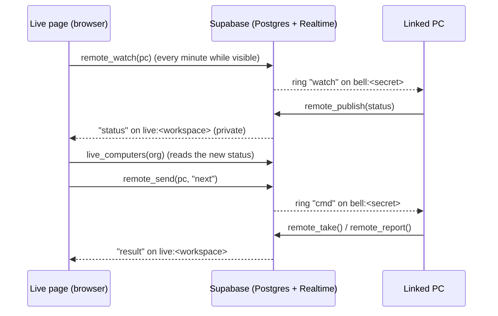

# Live push: the doorbell (9.11)

How a linked PC and the website's Live page learn that something changed without asking every few seconds. It
replaces most polling, keeps everything else as it was, and falls back to the old polling whenever it cannot be used.

**Who this is for:** maintainers. The owner's one step is at the end.

## In one picture

## The rules

- **A ring carries no data.** Only what kind of thing changed (`cmd`, `sync`, `watch`, `status`, `result`) and which PC
  it is about. Everything is still read through the existing functions with their checks.
- **Two kinds of channel.**
  - `bell:<64 hex>`: one per workspace, public Realtime channel, named by a random secret. Only linked PCs learn it,
    from `computer_hello` (their key header). A PC has no user session, so it cannot use a private channel; the
    secret name and the data-free ring are what make this safe. Unlinking a PC deletes the bell (`live_on_revoke`);
    the next `computer_hello` makes a new one.
  - `live:<workspace id>`: private channel (Realtime Authorization). The policy `framedecks_live_read` on
    `realtime.messages` lets in only people for whom `can_run_services` is true.
- **A ring never breaks anything.** `live_send` swallows every error (Realtime off, quota), and is skipped when
  `live_push.enabled` is false.
- **One ring per sync push.** `live_on_entity` rings once per transaction and workspace (a transaction-local flag).
  Realtime delivers after commit, so the PC never pulls before the push is visible.

## Database: `0016_live_push.sql` (additive)

| Added | What |
|---|---|
| `live_push` (one row) | The switch: `update public.live_push set enabled = false;` turns push off for everyone |
| `workspace_bells` | Each workspace's bell name (functions only) |
| `computers.watched_until`, `computers.control_seen_at` | A Live page watches this PC; this PC takes commands |
| `computer_hello(control)` | PC: push on?, bell, watched?, the workspace's change counter `seq` |
| `remote_watch(computer)` | Live page: keep this PC awake for 2 minutes and ring it (at most about once a minute) |
| `live_computers(org)` | `remote_computers` plus `control_seen_at` and `push` |
| Triggers | `remote_commands` insert → `cmd`; taken/answered → `result`; `remote_status` → `status`; `entities` → `sync` |

Rollback: `hosted/supabase/rollback/0016_live_push_down.sql`. Tests: `hosted/tests/supabase-live-push.test.mjs` (the
PGlite stand-in has a `realtime` schema like Supabase's: `messages`, `send()`, `topic()`).

## The PC (`src/live_push.py`)

- `WebSocket`: a standard-library client (ws/wss, the system proxy through CONNECT). No new package.
- `Bell`: joins `realtime:bell:<secret>`, heartbeats every 25 s, calls back on each ring, reconnects (5 s doubling to
  5 min).
- `Doorbell` decides:

| Mode | When | Sync pulls | Commands | Status to the website |
|---|---|---|---|---|
| **push** | Bell connected | On each ring, else every 10 min | On a `cmd` ring, else every 30 s watched / 5 min not | Only while watched or a phone used it: on change and every 30 s |
| **asleep** | Push on but nothing needs it for 10 min | When `computer_hello`'s `seq` passes the cursor; safety 30 min | None | None |
| **poll** | No 0016, push off, bell not connected | Every 60 s (as before) | 1 s / 15 s (as before) | Every 4 s / 30 s (as before) |

Awake (listening) when: a Live page watches it, a phone sent a command, something is on screen, anything changed on the
PC (every `update_state`), or in the first 10 minutes after starting. Asleep, it calls `computer_hello` once a minute.

Settings → Workspace Sync shows the mode in one line ("Updates: Live connection on" / "Resting…" / "Regular checks").

## The website (`hosted/src/components/live-panel.tsx`, `hosted/src/lib/live-view.ts`)

- Reads `live_computers`; if the function is missing, `remote_computers` and everything as before.
- Listens on `live:<workspace>`; each ring reads once (bursts within 150 ms read once).
- Calls `remote_watch` for the PC on screen every minute while the tab is visible.
- Refresh pace (`refreshEvery`): 2 s unless the channel is open and the PC's status says `push: true`; then 30 s as a
  safety net (2 s while a press waits for its answer, 5 s while the PC wakes).
- Badge (`pcState`): **Online** (status under 45 s old), **Waking up…** (push on and the PC checked in within 6
  minutes), **Not connected**.

## Requests per linked PC (control on)

| Situation | Before, per hour | 9.11, per hour |
|---|---|---|
| Open, nobody using it | about 420 | about 60 (resting) |
| In use, no phone | about 420 | about 15–20 plus one per real change |
| Phone running the service | about 6,300 (PC plus Live page) | about 400–600 |

## Compatibility

- PCs before 9.11 with the new website: no `push` in their status, so the page reads every 2 s for them.
- New PCs before 0016 is run: `computer_hello` is missing, so they poll as before.
- Old website tabs with new PCs: the website deploys first; a tab opened before shows a resting PC as "Not connected"
  until it is reloaded (commands still work once the PC is awake).

## Owner step

Run `hosted/supabase/migrations/0016_live_push.sql` once in the Supabase SQL editor. Realtime must allow public
channels (the default). To switch push off for everyone: `update public.live_push set enabled = false;`.
