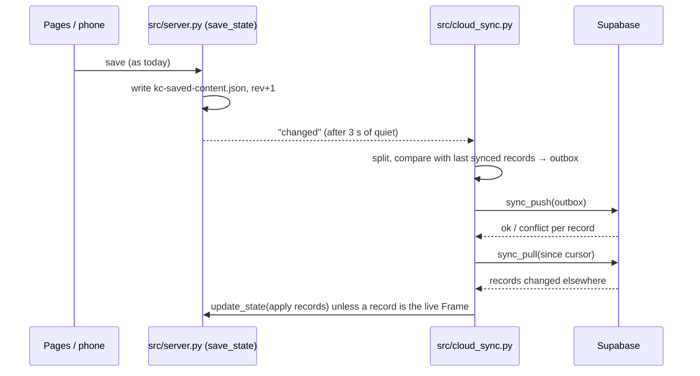

# Syncing service plans (Phase 4 design)

**Status:** agreed with the owner on 25 October 2026 (decisions in [§10](#10-decisions-for-the-owner)). Step 1 of
[§9](#9-tests-and-delivery) is built (`hosted/supabase/migrations/0003_sync.sql`, tested by
`hosted/tests/supabase-sync.test.mjs`), step 2 (`src/sync_entities.py`, `hosted/src/lib/sync-entities.ts`, shared
fixtures in `tests/fixtures/sync/`), and step 3 (`src/cloud_sync.py`, wired into `src/server.py`, Settings → FrameDecks account,
tested in `tests/test_cloud_sync.py`; QA picture `docs/qa/2026-10-25-sync-settings.png`), and step 4 (companion
`/services`, `/members`, `/computers`; QA pictures `docs/qa/2026-10-25-companion-*.png`). Step 5 is the owner's live test.
**Scope:** `main`'s plan: Supabase (project `slrsykiknlqlivlnpvrb`) and the hosted companion on Vercel. The desktop app
stays the place where services run, offline.

## In short (for the owner)

- **What syncs:** the *plan* of a service, as text: Frames and their Content (questions, scriptures, text, timers,
  scripts), Frame order and groups, the question and scripture library, card looks, layout, Meeting Name and colour,
  and the Meeting Form details. Also the **member list** (owner decision D2), visible on the web to the workspace's
  owners and admins only.
- **What never leaves the PC:** pictures, videos, PDFs and PowerPoints; the logo image; the phone-remote PIN; the
  private settings; anything that is live on screen.
- **Nothing changes during a service.** The PC presents from its own copy exactly as today. Sync runs in the
  background, waits while you are offline, and never changes the Frame that is on screen.
- **Nothing is lost.** If the same Frame was changed in two places, both versions are kept.
- **To link a PC:** the PC opens `framedecks.com/connect` in the browser with its request (6.13); you sign in, check
  the two-digit number matches the PC, choose the workspace and press Allow. Typing the PC's short code under Service
  PCs still works.
  The PC makes its own key and the cloud only ever stores a fingerprint (hash) of it.
- **Decisions:** recorded in [§10](#10-decisions-for-the-owner).

## 1. Goals and limits

| Goal | How |
|---|---|
| Plan a service on one PC, find it on another PC or in the companion | Text records per workspace in Supabase, protected by the workspace's row-level security |
| Presenting never depends on the internet | The desktop app keeps reading and writing its own file; sync only copies changes in and out |
| No media in the cloud (product constraint) | Media layers sync their *settings* and file *name* only; the file itself stays in `layers/` on each PC |
| Never lose work | Per-record revisions, an outbox on the PC, and a "keep both" rule for Frames |
| The desktop app looks and works the same | One small settings section to link and unlink (owner decision D1); no other visible change |
| No secrets in the repo or in the browser | The PC gets its own revocable key; the companion uses the signed-in person's session |

Out of scope here: device pairing and remote control through the cloud (Phase 5), editing Frames in the companion
(view first, see D3), and the Flutter app.

## 2. What the desktop app saves today

All of a service plan is one JSON file, `kc-saved-content.json` in the data folder, written atomically by `src/server.py`
(`save_state`), with a revision number `rev` that every save increases. Pages normalize it with `KCStore.normalize`
(`app/js/store.js`). Other files in the data folder are not plans:

| File / folder | Holds | Synced? |
|---|---|---|
| `kc-saved-content.json` | Frames (`scenes`, each with its layers and lists), `library`, the three cards, `layout`, `brand`, `meeting`, `profile`, `live`, `rev` | Split into records (§3); `live`, `rev` and live card text stay |
| `kc-members-private.json` | Member list (names, birthdays) and private settings | The `members` list **yes** (D2), one record per person; the private settings no |
| `layers/` | Pictures, videos, PDFs, PowerPoints used by layers | **No** (media) |
| `bcc-brand-logo.png` | Logo image | **No** (media); `brand.logo` name only |
| `kc-remote-pin.txt`, `kc-remote-sessions.json`, `kc-app-settings.json`, `backups/` | Phone-remote PIN and sessions, app settings, backups | **No** |

## 3. Records ("entities")

The plan is split into small records so that changing one Frame sends one Frame, and two people changing different
Frames never collide. This reuses the mapping designed and tested on the closed Phase 2 work (tag `archive/saas-phase2`)
(`app/js/entities.js`, `docs/architecture/cloud-api.md`), with one change: members are one record per person
(Phase 2 sealed the whole list as one encrypted record, which the web could not show).

| Kind | One per | Body |
|---|---|---|
| `frame` | Frame | The whole Frame: name, group, favourite, transition, script (`notes`), layers with their lists. Media layers keep `c.file` (a file name only) |
| `template` | Frame marked as template | Same as `frame` |
| `order` | workspace | Order of Frames and of the library lists, so inserting a Frame changes that Frame and the order only |
| `library_question`, `library_verse` | saved question / scripture | The item |
| `theme` | workspace (`cards`) | The look of the question, scripture and birthday cards, without what is showing now |
| `brand` | workspace | Meeting Name, organisation, colour, logo *file name*, size flags |
| `layout`, `meeting` | workspace | As saved. The service profile (for example "bible-study") is the `layout` record with id `profile`, body `{"value": …}` |
| `member` | person in `kc-members-private.json` → `members` | `id`, `name`, `country`, `phone`, `email`, `birthDate`, `role` (as `members-core.js` checks them). **Readable by owners and admins only** |

`order` also lists the member ids, so the member list comes back in the same order.

Stays on the PC (never a record): `live`, `rev`, each card's live fields (`text`, `visible`, `seq`, `itemId`, …, the
`CARD_LIVE` list in the Phase 2 `entities.js`), and anything unknown to this version. `join(split(doc))` gives back the same
document (the same content and section order; field order inside a card may differ, which nothing depends on); that
is the core test, run on shared fixtures from Python (desktop), TypeScript (companion) and, later, Dart. The fixtures
(`tests/fixtures/sync/`) are built with the app's own `store.js` by `python tools/make_sync_fixtures.py`, and
`tests/sync-fixtures.test.js` fails if `normalize` changes so that they need rebuilding.

A media layer synced to a PC that lacks its file shows the layer's usual "file missing" state there; the companion
shows "media on the service PC". The file is never fetched.

## 4. Supabase: tables and functions (migration `0003_sync.sql`)

```text
entities (organization_id, kind, id)  primary key
  rev        int     -- 1, 2, 3… per record
  seq        bigint  -- the workspace's change counter when it was last written
  deleted    bool
  body       jsonb   -- null when deleted; at most 256 KB
  updated_by text    -- 'user:<uuid>' or 'computer:<uuid>'
  updated_at timestamptz

workspace_sync (organization_id primary key, seq bigint)   -- one counter per workspace
computers (id, organization_id, name, key_hash, created_by, created_at, last_seen_at, revoked_at)
computer_links (code_hash, key_hash, name, expires_at, organization_id, computer_id)   -- waiting links, 10 minutes
computer_link_failures (user_id, at)   -- wrong codes typed, for the limit of 20 an hour
entity_history (organization_id, kind, id, rev, body, updated_by, replaced_at)   -- kept 30 days (§7)
```

**Row-level security.** Members of a workspace can read its `entities` (the companion's view), except `member`
records (people's phone numbers and birthdays), which only the workspace's owners and admins can read. Writes go only through
the functions below; there is no direct insert or update policy. `computers` is visible to workspace admins (to see
and revoke linked PCs). `workspace_sync` and `computer_links` have no client policies at all.

**Functions** (`security definer`, `search_path` pinned, revoked from `anon` except the two link calls a PC makes
before it has a key):

| Function | Caller | Does |
|---|---|---|
| `sync_pull(since, limit)` | PC (computer key) or member (session) | Records with `seq > since`, oldest first, at most 500, plus the new cursor and `more` |
| `sync_push(changes)` | PC, or admin later | For each `{kind, id, baseRev, deleted, body}`: if the stored `rev` equals `baseRev`, store with `rev + 1` and the next `seq`; otherwise answer `conflict` with the current record. Each change stands alone. At most 200 changes / 2 MB a call |
| `computer_link_start(name, key_hash)` | PC, before it is linked (`anon`) | The PC makes its own key (32 random bytes), keeps it, and sends only its SHA-256 hash. Returns an 8-character code to show; it expires in 10 minutes. At most 1,000 links wait at once |
| `computer_link_approve(code, organization_id)` | Signed-in owner/admin in the companion | Approves the waiting PC for that workspace and creates its `computers` row with the key hash. 20 wrong codes an hour per person, then a pause |
| `computer_link_peek(code)` (6.13, `0010_link_by_url.sql`) | Signed-in user on `/connect` | `unknown`, `expired`, or `pending` with the PC's name and the request's age in seconds, so the page can ask "Allow ‹PC›?". A code not found counts towards the same 20-an-hour limit |
| `computer_link_poll(key)` | PC (`anon`) | `pending`, `expired`, or once: `approved` with the computer id and workspace. The key itself never crosses the network except as the request header later, and the cloud stores only its hash |
| `computer_revoke(id)` | Owner/admin | Sets `revoked_at`; that PC's key stops working at once. The PC keeps working offline |

The PC sends its key in a request header (`x-framedecks-computer`), which the functions read from PostgREST's
`request.headers` and compare by hash; the anon key is still needed to reach the API and gives nothing on its own.

**Ordering without gaps.** `sync_push` takes the next number by updating the workspace's `workspace_sync` row
(`update … set seq = seq + 1 returning seq`) inside the same transaction. Pushes to one workspace therefore commit in
`seq` order, so a reader that saw cursor *n* cannot later miss a record numbered below *n* (a global sequence could
commit out of order). Different workspaces never wait for each other.

## 5. The PC: background sync

A new module `src/cloud_sync.py`, started by `src/server.py` only when this PC is linked. It never runs on the request path
of a page or the phone remote.



- **Outbox.** `kc-sync.json` in the data folder keeps, per record, the `rev` last agreed with the cloud and a hash of
  its body, plus the pull cursor. After each local save the PC splits the plan and compares hashes: changed or new
  records go to the outbox, missing ones become deletions. The outbox survives restarts and power cuts (atomic
  writes), so changes made offline go up when the internet returns.
- **When.** A few seconds after a save, and every 60 seconds to pull. Offline or failing: retry with back-off (up to
  10 minutes), silently; the status shows "Last synced at …".
- **Applying changes from elsewhere.** Pulled records are joined into the plan through the normal `update_state`
  path, so every screen updates as with any other save. **A change to the Frame that is live is held back** until that
  Frame is no longer live; card live text, `live` and `rev` are never touched.
- **Retries are safe.** If a push succeeded but its answer was lost, the retry comes back as a conflict whose body is
  the one this PC sent; the PC treats that as success.
- **Never in the way.** Sync failures are logged and shown in the sync status only; they never block saving,
  presenting, the camera or the phone remote.
- **No new packages.** HTTPS through the Python standard library (`urllib`), JSON as today.
- **Where the cloud is.** Since 9.10.3 the Windows build carries the Supabase address and publishable key
  (`cloud_builtin.json`, written by `tools/write_cloud_builtin.py` from the repository secrets `SUPABASE_URL` and
  `SUPABASE_ANON_KEY`; git-ignored; only a publishable/anon key is accepted), so linking needs no answer from the
  website first. Without it, the PC asks the companion (`https://framedecks.com/api/sync-config`, then
  `https://framedecks.pages.dev`), as before. Either way it keeps them in `kc-sync.json`. `FRAMEDECKS_COMPANION_URL`
  points it at another website for testing (the built-in address is then not used). The approval page (`/connect`) is
  still on the website.
- **Settings → FrameDecks account** (D1) shows Not linked with **Connect to FrameDecks** / waiting for the browser
  (check number, Open the page again, Cancel, and the code as a fallback) / Linked to ‹workspace› with the last
  sync, Sync now and Unlink. Once linked, Settings → Security and Data / Backup say that plans and members sync.
- **The computer key** is made by the PC (32 random bytes) and kept in Windows Credential Manager (through `ctypes`,
  no new package), never in the data folder or backups; only its hash ever reaches the cloud. On other systems
  (development only) it is a file readable by its owner, `.kc-sync-key`, which git ignores. Unlinking deletes it and
  calls `computer_revoke` when online. If the cloud refuses the key (revoked in the companion), the PC stops syncing,
  forgets the key and says so in Settings.

## 6. Conflicts

A conflict means the record changed in the cloud since this PC last saw it. Rules (from the tested Phase 2 design):

| Kind | Rule |
|---|---|
| First link of a PC to a workspace that already has records | A Frame here identical to one in the workspace (ids and times aside, such as the starter Frames every PC makes) is not added twice; any difference and both are kept. Settings this PC never synced take the workspace's. |
| First link: the same id made on two PCs for a library item or person (starter questions, imported lists) | The workspace's keeps the id; this PC's is added under a new id. Never overwritten. |
| `frame`, `template` | **Never lose a Frame.** The cloud's version keeps the id; this PC's version is added as a copy named "‹Frame› (from ‹PC name›)" with a new id, and both appear in the Frames list for a person to tidy. |
| `order` | Merge: keep the cloud's order, then add Frames and items it lacks at the end. |
| everything else | Last writer wins: this PC's version is sent again on top. The earlier version stays in the record history (§7), and from 9.3 also on this PC (`kc-sync.json` → `overwritten`: the latest 50, kept 90 days; records over 64 KB only in the history). |
| `member` | **Never lose a person.** One record per person, so two people edited in two places never collide. The same person changed in two places: last writer wins, and the earlier version stays in the history. |
| Deleted in one place, changed in the other | The change wins and the record comes back: deleting is never allowed to destroy an edit. |

## 7. History, export and safety

- **History.** Each overwritten or deleted body is kept for 30 days in `entity_history` (same RLS as `entities`), so a
  person can be helped to restore it. Daily local backups on the PC continue as today.
- **Export.** The companion gets "Download this workspace" (all records as JSON), and the PC's existing data folder
  remains a complete copy. Importing a 6.9 data folder works as today on the PC, which then syncs it up.
- **Limits.** 256 KB a record, 2 MB a push, 600 writes a minute per workspace; above that the PC waits and retries.
- **Privacy.** Records are readable by workspace members only, and `member` records (names, phones, emails,
  birthdays) by owners and admins only (RLS, tested). No media leaves the PC. Script text in `notes` syncs (D2).
  Removing a person on the PC removes their record; the history keeps it 30 days, then it is gone.

## 8. The companion

Built in step 4 (`hosted/src/app/{services,members,computers}`, data from `sync_pull` joined by
`hosted/src/lib/sync-entities.ts`, display by `hosted/src/lib/services-view.ts`). Before `0003` is run the pages say
so instead of failing.

First release (D3): **view only.** A "Services" page lists the workspace's Frames in order, with each Frame's Content,
questions, scriptures and script, and "media on the service PC" in place of pictures and video. Owners and admins
also see a "Members" list (names, countries, birthdays, contact details) synced from the PC. A "Computers" section
lets owners and admins link a PC (type its code) and revoke it. Editing in the companion comes later, using the same
`sync_push` with the person's session, so it needs no new database work.

## 9. Tests and delivery

| Step | PR | Proven by |
|---|---|---|
| 1. Database | `0003_sync.sql` with the tables, RLS and functions | PGlite tests: push/pull, `seq` order, conflicts, deletes, history, size limits, computer link/poll/revoke, a revoked key refused, another workspace never visible, `anon` refused |
| 2. Records | `entities.py` (desktop) and `entities.ts` (companion) | Shared fixtures: `join(split(doc)) == doc` for real 6.10 files, live fields never in a record, media files never in a record |
| 3. PC sync | `src/cloud_sync.py`, outbox, credential storage, link screen (D1) | Python tests against a fake API: offline queue, retry after a lost answer, the live Frame held back, conflict copies, unlink; desktop UI unchanged apart from D1 |
| 4. Companion | Link a computer; Services view | Browser tests against stand-in responses, as for sign-in |
| 5. Together | — | Two PCs (or two data folders) and the companion against the live project: change on one, see it on the other within a minute; both changed offline, both versions kept |

Each step is its own PR, merged in order; steps 1 and 2 change nothing visible.

## 10. Decisions for the owner

Answered by the owner on 25 October 2026.

| # | Question | Decision |
|---|---|---|
| D1 | The rules say the desktop UI must not change. Linking a PC needs one small place to show a code and the sync status. Allow a **"FrameDecks account" section in Settings** (link / unlink, last synced)? | **Yes:** one section in Settings, nothing else changes |
| D2 | Keep the **member list with birthdays** on the PC only? And sync each Frame's **Teleprompter script**? | **Members sync to the web** (one record per person, owners and admins only). **Scripts sync.** |
| D3 | First companion release: **view** services only, or **edit** too? | **View first;** editing as the next step |
| D4 | Accept the conflict rules in §6 ("keep both" for Frames, last writer wins for settings)? | Not answered yet; built as recommended (yes) unless the owner says otherwise. Only the PC side (step 3) depends on it |
