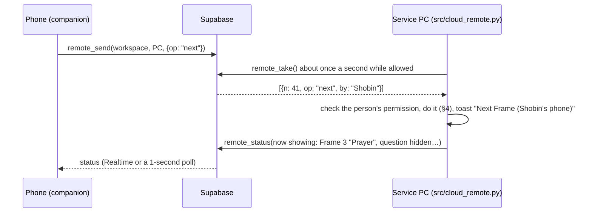

# Controlling a service from the companion (Phase 5 design)

**Status:** agreed with the owner on 25 October 2026 (R1–R5 as recommended, [§9](#9-decisions-for-the-owner)). Step 1
of [§8](#8-tests-and-delivery) is built: `hosted/supabase/migrations/0004_remote.sql`, tested by
`hosted/tests/supabase-remote.test.mjs`. Step 2 is built: `src/cloud_remote.py`, the window bridge in `src/server.py` and
`app/js/cloud-remote.js`, tested by `tests/test_cloud_remote.py` and in the real program in a browser. Step 3 is
built: the Settings switch with the last ten actions, `0005_remote_live.sql`, the companion's Live page and the "Can
run services" checkbox. Step 4 (the owner's live test) remains.
**Builds on:** sync ([metadata-sync.md](metadata-sync.md)): the same Supabase project, workspaces, linked PCs and
computer keys.

## In short (for the owner)

- **What it adds:** on a phone or tablet, anywhere with internet, a signed-in person opens the companion and presses
  **Next Frame**, **Go Live** on a chosen Frame, **Hide all**, **Black screen**, or reads the Teleprompter. The service PC
  does it within about a second.
- **What stays as it is:** the Wi-Fi phone remote with its PIN. It is not changed, and the companion never connects to
  the PC. The PC fetches instructions from your workspace itself, the same way it syncs plans.
- **Safe by default:** off until switched on at the PC; only people the workspace allows; only a short list of actions;
  every action shown on the PC as it happens; one switch at the PC stops it at once.

## 1. Why not the earlier design

The closed Cloudflare Phase 4 work (tag `archive/saas-phase4`: `docs/architecture/pairing-protocol.md` and
`relay-protocol.md`) carried the phone remote's web requests through a relay into the PC's local server, with per-phone
pairing and end-to-end encryption. `main`'s rules forbid both parts of that: the legacy LAN remote must not be touched,
and the hosted app must not reach the local HTTP server. Its good ideas are kept: approval at the PC, roles enforced by
the PC, replay protection, revoking in under a second.

## 2. How it works

- **Commands** go into a table `remote_commands` through one function, `remote_send`, which checks the person may
  control that PC. Each has a number; the PC remembers the last number it ran and never runs one twice or out of order.
  Commands older than 10 seconds are dropped, not run late.
- **Status** comes back as one small record per PC, `remote_status`: the live Frame's name and number, what is visible,
  the Teleprompter script of the live Frame, blackout and freeze. Text only, as in sync; no picture of the screen in
  this phase.
- **Who may:** a workspace owner or admin gives a person the permission "Can run services" in the workspace's people
  list on the companion's Overview (Your workspaces → Members). Owners and admins always have it. The checkbox writes
  `memberships.can_run_services` under the existing admin-only update policy; a member cannot give it to themselves.

## 3. The PC side

- A small background part, `src/cloud_remote.py`, used only when the PC is linked **and** "Allow control from the
  companion" is on in Settings → FrameDecks account (the section the owner already approved; off by default).
- While allowed, it asks for new commands about once a second (one tiny request; no new package, no open socket),
  and every 15 seconds when no phone has sent anything for 10 minutes (so the first press after a quiet spell takes up
  to 15 seconds, then about one). It was 5 seconds until the free plan (26 October 2026) lightened the shared database.
- **Status** goes up when it changes (a saved plan wakes the loop; at most two rounds a second) and at least every
  4 seconds while a phone is active, every 30 seconds otherwise. The Live page counts the PC as online while its
  status is younger than 45 seconds by the database's clock (`server_now`), so a phone with a wrong clock still
  shows it right.
- **The window bridge (R1):** `src/cloud_remote.py` offers the commands to the program's own window, which asks with a
  20-second long poll on this PC only (`GET /api/remote-cloud/next`; other devices get 403) and answers with
  `POST /api/remote-cloud/done`. `app/js/cloud-remote.js` runs each with the keys' functions (`KCWorkspace.step`,
  `KCWorkspace.takeFrame`, `KCActions.hideAll`, `KCActions.toggle`, `KCPresenterTools.blackout`), half a second
  apart like separate key presses. Blackout, question and scripture carry the wanted state (`{on}` / `{show}`) and
  are only toggled when different. A command the window has not picked up within 3 seconds is answered "not run",
  never run late.
- Every action is shown on the PC as a toast ("Next Frame · from Shobin"), and the Settings section lists the
  last ten with time and person (kept by the program; `GET /api/sync` returns them as `remote.recent`).
- The switch is the app setting `cloudRemote` (off by default; `POST /api/app/settings`). Turning it off stops it at
  once; unlinking the PC also stops it.

## 4. Where the actions run (decision R1)

Frame actions (Go Live, Next/Previous Frame, show or hide a card, Hide all) are worked out today by the page's
JavaScript (`app/js/store.js`, `KCScenes.take`, `step`, `hideAll`), which then saves the new state.

| Option | How | For | Against |
|---|---|---|---|
| **A. The PC's own window does it** (recommended) | `src/cloud_remote.py` hands each allowed command to the program's own window through the existing local channel; the window runs exactly the same code as a key press | One implementation; behaviour identical to the keyboard | Needs the program's window running (it always is while FrameDecks runs, also in the tray) |
| B. Port the actions to Python | Same actions rewritten in Python, checked against shared test cases | Works with no window | Two copies of the Frame logic that must stay identical |

## 5. Actions in the first release (decision R2)

| Action | Notes |
|---|---|
| Next / Previous Frame | as the arrow keys |
| Go Live on a chosen Frame | from the synced Frame list |
| Hide all | as Esc |
| Black screen on / off | as K |
| Show / hide the question, the scripture | the live Frame's current items |
| Teleprompter | read only: the live Frame's script, scrolled on the phone |

Not in the first release: editing, annotations, the camera, recording, media upload, settings.

## 6. Security

- Row-level security: only members with "Can run services" (owners and admins always) can call `remote_send` for a PC
  of their workspace; only that PC (its key) can take its commands and write its status.
- The PC has the final say: it re-checks the person's permission (from the command) against the workspace and refuses
  anything outside §5. A refused command is shown on the PC.
- No end-to-end encryption in this phase: commands carry no personal data and status carries only what is on the
  screen. Python's standard library has no X25519 or AES-GCM, and adding a crypto package is a decision on its own
  (R4).
- Every command is kept 7 days with the person and the result, for "who did what".

## 7. The companion

A **Live** page (`/live`): the PC's name and whether it is online (status younger than 45 seconds), the live Frame,
big Previous / Next buttons, Hide all, Black screen, show or hide the question and scripture, the Frame list to Go
Live on, the Teleprompter script, and the PC's answer to the last press ("Done", or why not). Built for a phone first.
People who are not owners or admins cannot read `computers`, so the page reads `remote_computers(org)`
(`0005_remote_live.sql`): the workspace's PCs that are not disconnected, each with its latest status and the
database's time, only for people who may run services. It polls every 2 seconds while the page is visible.

## 8. Tests and delivery

| Step | What | Proven by |
|---|---|---|
| 1 | `0004_remote.sql`: commands, status, permission, functions | PGlite tests: who may send, only the PC takes, numbering, 10-second expiry, other workspaces |
| 2 | `src/cloud_remote.py` and the window bridge (R1) | Python tests against a stand-in cloud; the real program in a browser: a command moves the Frame exactly as the arrow key does; switch off stops it |
| 3 | Settings switch and recent actions on the PC; the companion's Live page | browser tests on desktop and phone sizes |
| 4 | Live test by the owner | a phone on mobile data moves Frames on the service PC within a second |

## 9. Decisions for the owner

Answered by the owner on 25 October 2026: **R1–R5 as recommended.**

| # | Question | Decision |
|---|---|---|
| R1 | Where the actions run (§4) | **A**, the PC's own window |
| R2 | The first actions (§5) | As listed; read-only Teleprompter |
| R3 | Who may control a PC | Owners and admins always; members only when given "Can run services" |
| R4 | End-to-end encryption of commands | Not in this phase (no personal data in them); revisit with the picture of the screen |
| R5 | One more item in Settings → FrameDecks account: "Allow control from the companion" (off by default) and the last ten actions | Yes |
