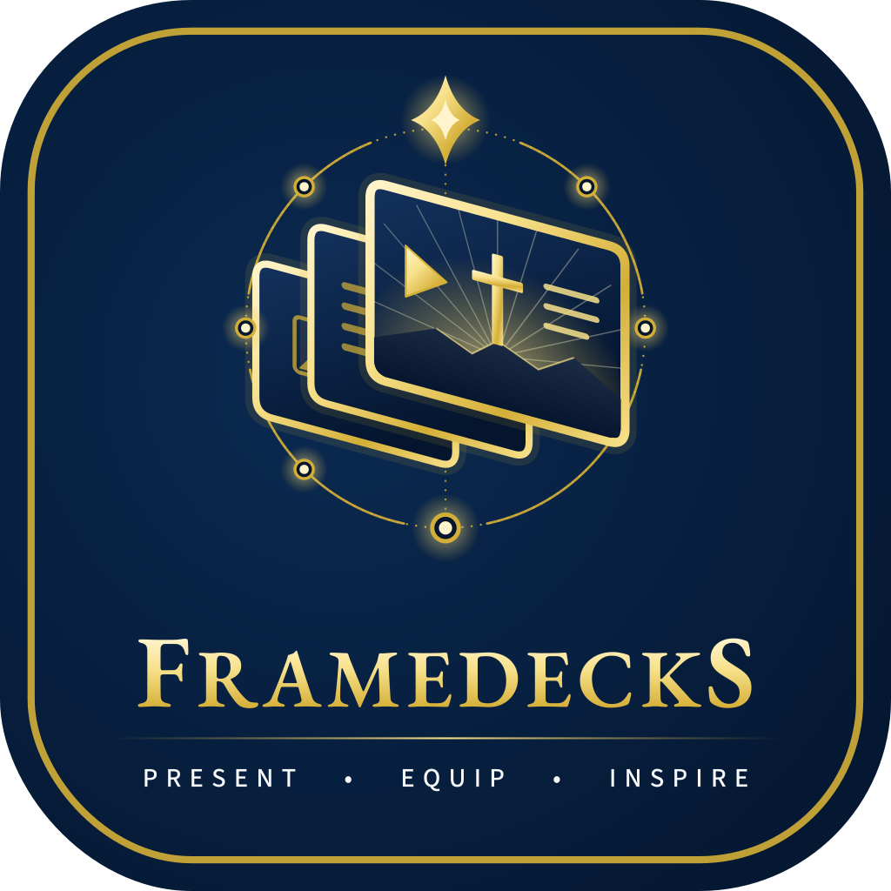

# FRAMEDECKS brand guide

**FRAMEDECKS** — *Present • Equip • Inspire*

The world's most elegant presentation platform for ministry communication, teaching, discipleship, and digital
engagement.

<p align="center"></p>

## 1. The name and the words

| Use | Write |
|---|---|
| Product name | **FRAMEDECKS** (all capitals, one word) |
| Tagline | **Present • Equip • Inspire** (bullets with a space either side; in capitals on the logo) |
| Positioning line | The world's most elegant presentation platform for ministry communication, teaching, discipleship, and digital engagement. |
| How the work is organised | **Frame → Deck → Content**. A Frame is one screen of the service; its **Content** is what appears on it. The lists in the app keep their names: **Frames** and **Content**. "Decks & Content" replaces the older wording "Decks & Elements". |

## 2. The logo

The mark has three parts:

- three presentation frames, in perspective;
- a cross at sunrise in the front frame;
- a gold orbit with its connection nodes and the star of light above.

The wordmark is EB Garamond SemiBold capitals in gold, with the F and the S full height. Under it are a fading gold
rule and the tagline in Source Sans 3. Both fonts already ship with the app (`app/fonts`).

| Version | File (`assets/brand/framedecks/`) |
|---|---|
| Horizontal, for dark backgrounds | `framedecks-horizontal-dark.svg` (PNG in `png/`) |
| Horizontal, for light backgrounds | `framedecks-horizontal-light.svg` |
| Stacked, dark / light | `framedecks-stacked-dark.svg`, `framedecks-stacked-light.svg` |
| Icon only, dark / light | `framedecks-icon-dark.svg`, `framedecks-icon-light.svg` (PNG 256, 512, 1024 in `png/`) |
| App badge (icon and wordmark on the navy tile) | `framedecks-badge.svg`, `png/framedecks-badge-1024.png` |
| App icon (tile, no words) | `framedecks-app-icon.svg` |
| Favicon (one frame and the cross, for 16-48 px) | `framedecks-favicon.svg`, `favicon/` (16, 32, 48, 180, 192, 512, `favicon.ico`) |
| Splash | `framedecks-splash.svg`, `splash/` (portrait, landscape, square) |
| Sign-in | `login/login-hero.png` |
| Microsoft Teams | `marketplace/teams/color.png` (192 × 192) and `outline.png` (32 × 32, white on transparent) |
| Zoom App Marketplace | `marketplace/zoom/app-icon-160.png`, `app-icon-512.png` |
| Store listing banner | `marketplace/listing-banner-1280x720.png` |
| Marketing | `marketing/`: Open Graph 1200 × 630, social square 1080, social banner 1500 × 500, title slide 1920 × 1080 |

Keep clear space around the logo of at least the height of the star. Do not stretch, recolour, outline or rotate it,
and do not put it on busy photos.

## 3. Colours

| Name | Hex | Use |
|---|---|---|
| Midnight | `#04152D` | Backgrounds, the frames' faces, text on light |
| Gold | `#D4AF37` | Frame edges, the orbit, rules |
| Light gold | `#F7E08A` | Highlights, the wordmark's middle |
| Glow | `#FFF4CC` | The light, node centres, the top of the wordmark |
| Paper | `#F8F9FA` | Light backgrounds, text on dark |

## 4. Where the pictures come from

`tools/make_brand_assets.py` draws everything from code and writes every icon, favicon, splash, store and
marketing picture. Run it after any change to the logo:

```bash
pip install cairosvg fonttools pillow
python tools/make_brand_assets.py
```

It writes the platform icons under the file names the apps already use, so no code changes:

- the Windows program: `app/img/kc-emblem.webp`, `app/icons/remote-*.png`, `packaging/kingdom-connect.ico`;
- the Flutter app: `kingdom_connect_app/assets/brand/kc-mark.png`, and the Android, iOS, macOS, Windows and web icons
  and launch images.

The README header (`assets/brand/kc-about-header.webp`) is captured from the About screen by
`tools/make_readme_header.py`.

## 5. What keeps the old name (on purpose)

The rebrand changes what people read and see. Everything that other programs, saved files or existing installs depend
on keeps its name, so nothing breaks and every install upgrades in place:

| Kept | Why |
|---|---|
| The data folder `%APPDATA%\Kingdom Connect`, the program folder, `Kingdom Connect.exe`, the recordings folder | Existing data, shortcuts and settings point there |
| The installer's AppId, file name `Kingdom Connect v<version>.exe` and the CI artifact names | Upgrades install over the old version; release automation finds the file by name |
| `kc-*.json` files, the `kc_remote` cookie, `api/*` and its `"app": "Kingdom Connect"` value | Saved files, signed-in phones and the Flutter app's check of the program |
| The camera device name **KingdomConnect** and its CLSIDs | Zoom, Teams and OBS remember the camera by name and ID |
| The firewall rule "Kingdom Connect Phone Remote" | The helper scripts find and remove it by that name |
| The `.bat` / `.command` start files, the Meeting Workbook file name | Existing guides and shortcuts open them by name |
| Bundle IDs, application IDs, package names (`org.kingdomconnect.*`, `kingdom_connect`), the macOS bundle file name | Store listings, signing, app data and the camera extension depend on them |

The installer replaces the old "Kingdom Connect" Start-menu, desktop and startup shortcuts with "FRAMEDECKS" ones.
