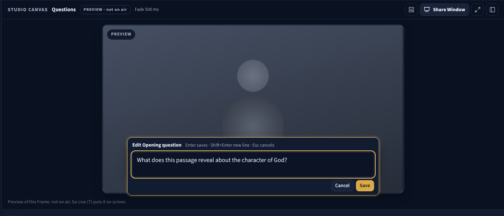

# Content

Every kind of Content you can put in a Frame, and every setting that controls how it looks and where it appears.

**Who this is for:** anyone building Frames: worship leaders, small-group leaders and media volunteers.

**On this page**
- [Add Content](#add-content)
- [The Content list](#the-content-list)
- [Content Settings](#content-settings)
- [Question](#question)
- [Scripture](#scripture)
- [Editing questions and scriptures](#editing-questions-and-scriptures)
- [Text, Prayer Point, Lower Third and Branding](#text-prayer-point-lower-third-and-branding)
- [Timer](#timer)
- [Image, Video and PowerPoint](#image-video-and-powerpoint)
- [Free Content](#free-content)
- [Behavior: where Content appears](#behavior-where-content-appears)
- [Placeholders: {meeting} and {org}](#placeholders-meeting-and-org)

---

## Add Content

1. Select a Frame.
2. Select **+ Content**.
3. Choose a type. The menu has two parts:

| Main types | Free Content |
| --- | --- |
| **Question** | Announcement |
| **Scripture** | Prayer Point |
| **Text** | Lower Third |
| **Image…** | Birthday |
| **Video…** | Branding (logo + Meeting Name) |
| **Timer** | Camera |
| **PowerPoint…** | Screen…, Window (live PowerPoint or any app)… |
| | Logo…, Watermark…, Free text on the picture, Shape, Background |

> **Note:** A Frame has at most one Question, one Scripture, one Birthday and one Branding Content. Put all of a
> Frame's questions into its one Question list. If you choose Question again, Kingdom Connect takes you to the
> existing list.

> **Note:** Picture-based Content (image, video, PowerPoint, camera, screen, window, logo, watermark, free text,
> shape and background) is part of the **KingdomConnect** picture. These items are greyed out until the
> KingdomConnect camera is on (**Settings → KingdomConnect Camera**).

## The Content list

The **Content** list (left, below the Frames) shows what is in the selected Frame.

- **Order:** the top of the list is in front. Drag to change the order.
- **Eye:** show or hide one piece of Content.
- **Lock:** stop a piece of Content from being moved or changed by accident. Unlock it to change it.
- **Rename:** double-click the name or press **F2**.
- **⋯ menu:** Rename, Duplicate, Move forward, Move backward, Delete Content.

Questions, scriptures, birthdays and text always appear in front of camera and media Content.

## Content Settings

Select a piece of Content and its settings appear in **Content Settings**, below the Studio Canvas. Everything is
visible at once, in groups. The group names at the top jump to their group.

| Group | What it holds |
| --- | --- |
| **Content** | What it says or shows: the list, the text, the file |
| **Appearance** | Size, label and opacity |
| **Position** | Where it sits on the picture |
| **Timing** | Durations and counting (Frames and Timers) |
| **Animation** | How it appears |
| **Media** | File, slide and placement settings for pictures, video and PowerPoint |
| **Behavior** | Where it appears: KingdomConnect, OBS pages, or both |

## Question

A **Question** Content holds this Frame's list of discussion questions. It shows one at a time.

**Content group: the list**
- **+ Question** adds a question after the current one.
- **Add several** lets you paste many questions at once, one per line.
- **Click** a question to make it the Frame's current one.
- **Show** puts it on screen (when the Frame is live). **On screen** marks the one showing.
- **Drag** the handle (⋮⋮) to reorder, or use **↑ / ↓**.
- **✕** removes a question; **Remove all** empties the list.
- **Show: Question · Both · Scripture** chooses what **Show** puts on screen: the question, the question with its
  scripture, or the scripture only.

**Appearance**
| Setting | What it does |
| --- | --- |
| **Label** and **Show** | The small heading above every question, such as *Discussion Question*. Untick **Show** to hide it. Each question can have its own label |
| **Text size** | The size of the question text |
| **Card opacity** | How much of the video shows through the card (70%, 80%, 90%, 100% presets) |

**Position:** **Width** and **Above bottom**. **Recommended layout** puts them back.

**Animation:** how each question appears: **Fade**, **Gentle rise**, **Word by word**, **Typewriter**, **Burst**,
**Cut**, or **Random** (pick a different transition each time).

## Scripture

A **Scripture** Content holds this Frame's list of Bible passages. It works like the Question list.

**Fetch a passage (ESV, online)**
1. Type a reference above the list, for example *Romans 8:28*.
2. Select **Fetch scripture**. The passage is added to the list, or fills the scripture you are editing.
3. **Refresh**, **Context** and **Read aloud** are next to it.

Fetching ESV text needs internet and an ESV API key in **Settings → Scripture**.

**Any other translation (offline)**
1. Set **Fetch from** to **Type it myself**.
2. Add a scripture and type or paste the reference, the translation (for example NIV or KJV) and the text.

**Appearance:** Label and Show, Text size, Card opacity. **Position:** Left, Center or Right, Height and Width.
**Animation:** the same choices as Question.

## Editing questions and scriptures

There are two places to edit.

### In Content Settings
Double-click an item in the list (or select it and press **Enter**). The editor opens in the same panel:

| Field | Shown on screen? | Notes |
| --- | --- | --- |
| **Label** | Yes | Empty = the Content's label |
| **Question** / **Reference**, **Translation**, **Text** | Yes | |
| **Answer** (questions) | Never | Shown in the Speaker View and the Advanced phone remote |
| **Notes** | Never | Shown in the Speaker View and the Advanced phone remote |
| **Transition** | — | **Content default**, **Random** or a specific transition for this item only |
| **Show** (questions) | — | **As chosen in the list**, the question only, the question with its scripture, or the scripture only |

Changes save as you type. If the item is on screen, the screen follows. Use the **‹ ›** buttons to edit the
previous or next item, **Show on screen** to show it, and **Done** (or **Esc**) to return to the list.

### On the Studio Canvas
Double-click the question or scripture card on the canvas, in the preview or on the live picture.

- **Enter** saves; **Shift+Enter** starts a new line; **Esc** cancels.
- A click outside the editor also saves.
- If the card is on screen, the screen changes as soon as you save.

## Text, Prayer Point, Lower Third and Branding

**Text** (an announcement card), **Prayer Point** and **Lower Third** are text cards. They work on every output,
including the OBS pages.

**Content**
| Setting | Text / Prayer Point | Lower Third |
| --- | --- | --- |
| Title | **Title**, with **Show the title** | **Name (first line)**, with **Show the name** |
| Body | **Text** | **Role or second line** |
| Logo | **Show my logo on this card** | **Show my logo on this card** |

**Appearance:** Text size and Opacity. **Position:** Position (Top, Centre, Bottom, Upper left / right, Lower left /
right) and Width. **Animation:** Appears with **Fade**, **Gentle rise** or **Cut**.

If the Frame is live, changes appear on screen as you type.

**Branding** is a small badge with your logo and Meeting Name. Choose what it shows (**Logo**, **Meeting Name**,
**Leader / Organization Name**) and its **Size** (Small, Standard, Large, Title). Set the logo and names once in
**Settings → Meeting & Branding**. A quick way to add or remove it is the **Branding** tick in a Frame's settings.

## Timer

A **Timer** counts down on screen, for example before the service starts or during group discussion.

| Setting | What it does |
| --- | --- |
| **Label** and **Show the label** | The heading, such as *Starting in* |
| **Count** | **Duration** (a number of minutes) or **Until a time** (a time of day, such as 10:30) |
| **Minutes** / **Until (time of day)** | Only the one for your choice is shown |
| **At zero, show** | The text shown when it reaches zero, such as *Starting now* |
| **Restart the countdown** | Starts it again from the beginning (when the Frame is live) |

Appearance, Position and Animation work as for Text.

## Image, Video and PowerPoint

These are part of the KingdomConnect picture. Their **Media** group has:

| Setting | What it does |
| --- | --- |
| **File** / **Choose a file…** | The picture, video or PowerPoint file |
| **Start at slide** (PowerPoint) | The slide it opens on. Previous / Next slide move through the slides |
| **Show objects only** (PowerPoint, Window) | Makes a plain slide background see-through, so text and pictures sit on the camera |
| **Centre X / Y, Width, Height** | Placement, as percentages of the picture |
| **Opacity** | How see-through it is |

When the Frame is live, drag Content directly on the canvas to move it, and use the handles to resize it.

**PowerPoint:** a .pptx is turned into slides by the PowerPoint installed on the PC. For animations, add the running
slide show as **Free Content → Window** instead. See [Media](media.md) and
[reference/powerpoint.md](reference/powerpoint.md).

## Free Content

| Type | What it is |
| --- | --- |
| **Announcement** | A text card (the same as **Text**) |
| **Prayer Point** | A text card for prayer requests |
| **Lower Third** | A name and role across the bottom, for a speaker or a reader |
| **Birthday** | A birthday celebration card |
| **Branding** | Your logo and Meeting Name badge |
| **Camera** | Your webcam, placed anywhere on the picture |
| **Screen…** | A whole display, shared into the picture |
| **Window…** | One app window, such as a live PowerPoint slide show |
| **Logo…**, **Watermark…** | A picture, placed as a logo or a faint watermark |
| **Free text on the picture** | Text drawn straight onto the picture |
| **Shape** | A rectangle, for example behind text (the live Studio's own Add menu also has an Ellipse) |
| **Background** | A colour or picture behind everything |

## Behavior: where Content appears

Cards and text have a **Behavior** group:
- **KingdomConnect** (the Zoom / Teams camera, recordings and the Presentation window);
- **OBS / browser overlay pages**.

Untick one to keep that Content off that output. For cards it applies when the Frame is taken live; for text it
applies at once.

Camera and media Content is the KingdomConnect picture itself, so it has no Behavior group.

## Placeholders: {meeting} and {org}

In Text, Prayer Point and Lower Third, type:
- **{meeting}** to show your Meeting Name;
- **{org}** to show your leader or organization name.

Set both in **Settings → Meeting & Branding**. Change them once and every card that uses them follows.

## Related
- [Frames](frames.md)
- [Media](media.md)
- [Presentations](presentations.md)
- [Service planning](service-planning.md)
- [PowerPoint reference](reference/powerpoint.md)
