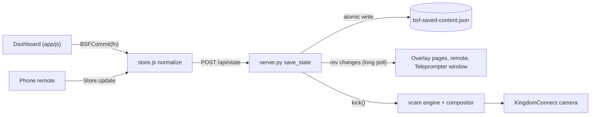

# Developer guide

This guide is for people who want to change Kingdom Connect's code. For how to report bugs, suggest features and
what "done" means for a pull request, start with [CONTRIBUTING.md](../CONTRIBUTING.md).

- [Prerequisites](#prerequisites)
- [Run from source](#run-from-source)
- [Project layout](#project-layout)
- [How the pieces talk to each other](#how-the-pieces-talk-to-each-other)
- [Common changes](#common-changes)
- [Tests](#tests)
- [Debugging tips](#debugging-tips)
- [Building the installer](#building-the-installer)

---

## Prerequisites

| Tool | Version | Needed for |
| --- | --- | --- |
| Python | 3.12 (the version the installer is built with) | Running the program. `server.py` uses only the standard library. |
| Node.js | 18 or newer | Running `tests/` (no npm packages; nothing to install). |
| Git | any recent version | Cloning and branches. |
| Windows 10 or 11 | — | The KingdomConnect camera, screen capture, PowerPoint conversion and the desktop window. The web interface, overlays and phone remote also run on macOS and Linux for development. |
| Packages in `packaging/requirements-desktop.txt` | see the file | The desktop window (pywebview, pystray), the camera pipeline (OpenCV, NumPy), screen capture, PDF slides (pypdfium2), PowerPoint control (comtypes) and PyInstaller. Install them only if you work on those parts. |

```bash
python -m pip install -r packaging/requirements-desktop.txt -c packaging/constraints.txt   # optional: desktop window, camera, slides
```

---

## Run from source

```bash
git clone https://github.com/mshobin/KINGDOM-CONNECT.git
cd KINGDOM-CONNECT
python server.py
```

`server.py` starts the program on <http://localhost:8750> (or the next free port up to 8760) and opens the dashboard
in your browser.

| Option | Effect |
| --- | --- |
| `--no-browser` | Don't open a browser window. Useful for tests and when you open the page yourself. |
| `--remote` | Turn on the phone remote at start-up (it listens on this PC's network addresses, PIN-protected). |

| Environment variable | Effect |
| --- | --- |
| `BSF_DATA_DIR` | Use another data folder. Always set this while developing, so you never touch real meeting or member data. |
| `BSF_VCAM_DEMO=1` | Use a moving **test camera** instead of a webcam, and treat the KingdomConnect camera as installed. The full camera pipeline (cards, annotation, previews, the phone's live picture) works without a webcam or Windows. |
| `BSF_ESV_URL` | Point the scripture lookup at another address (tests). |

A typical development start:

```bash
# macOS / Linux
BSF_DATA_DIR=/tmp/kc-dev BSF_VCAM_DEMO=1 python server.py --no-browser --remote
```

```powershell
# Windows PowerShell
$env:BSF_DATA_DIR = "$env:TEMP\kc-dev"; $env:BSF_VCAM_DEMO = "1"
python server.py --no-browser --remote
```

Then open <http://localhost:8750/dashboard.html>. On a fresh data folder the app offers to import data from an
earlier installation; choose **Start fresh**.

To run the desktop shell (the installed app's window, tray icon and Presentation window) instead of a browser tab:

```bash
python desktop_app.py
```

The Windows start files in the repository root (`Start BSF Command Center.bat`, `Start BSF Command Center with iPad
Remote.bat`, `Start BSF Command Center (Mac).command`) run `server.py` the same way for people using the zip version.

---

## Project layout

| Path | What lives there |
| --- | --- |
| `server.py` | The local program: HTTP server on 127.0.0.1, the shared state, uploads, scripture lookup, backups, the phone remote (PIN, sessions, allow-list) and `APP_VERSION`. |
| `desktop_app.py` | The Windows app shell: pywebview window, tray icon, close-to-background, the Presentation and Teleprompter windows. |
| `app/` | The web interface, served as static files. No build step and no npm packages. |
| `app/dashboard.html` | The main window (Studio · Members · Settings). |
| `app/remote.html` | The phone and tablet remote. |
| `app/stage.html`, `focus-verse.html`, `discussion-question.html`, `birthday.html` | Overlay pages for OBS and browser sources; the Studio Canvas preview uses `stage.html`. |
| `app/present.html`, `app/speaker.html` | The Presentation window fallback and the Teleprompter window (called Speaker View before 6.7). |
| `app/js/store.js` | The shared state: defaults, `normalize`, the Frame helpers (`BSFScenes`), syncing with `server.py`. |
| `app/js/workspace.js` | Frames, Content, the Content Settings panel and the Studio Canvas. |
| `app/js/frame-lists.js` | A Frame's own question and scripture lists, and the in-panel editor. |
| `app/js/*.js` | One feature per file (`annotate.js`, `preview-edit.js`, `speaker.js`, `remote.js`, `meeting-book.js` …). |
| `app/css/theme.css` | Design tokens (colours, radii, type) and most component styles. |
| `app/vendor/` | Third-party browser libraries (SheetJS for Excel). Don't edit; replace with a newer release. |
| `vcam/` | The KingdomConnect camera pipeline: engine loop, webcam, blur, Camera Looks, layers, compositor, cards, annotation, PowerPoint, the DirectShow sink. |
| `packaging/` | PyInstaller spec (`bsf.spec`), Inno Setup script (`installer.iss`), the self-check (`check.py`), version reader (`get_version.py`), camera build helper (`build_vcam.py`), desktop requirements. |
| `tests/` | Automated tests (`*.test.js`) and the runner (`run.js`). |
| `tools/` | Maintainer scripts: the Meeting Workbook generator, world map generator, iPad remote firewall helpers. |
| `samples/` | Example member spreadsheets. |
| `docs/` | User, operations, architecture and development documentation. `docs/releases/` holds release notes. |
| `.github/workflows/build-windows.yml` | Builds and publishes the Windows installer. |

---

## How the pieces talk to each other



1. A page changes state through `window.BSFCommit(fn)` (or `Store.update(fn)` on the remote). `fn` edits a copy of
   the state; `store.js` runs `normalize` so every field is valid, then posts it to `POST /api/state`.
2. `server.py` `save_state` bumps `rev`, writes `bsf-saved-content.json` atomically (temporary file, then replace),
   wakes every waiting page and kicks the camera engine so a shown card appears at once.
3. Every other page (overlays, the remote, the Teleprompter window, other windows) learns about the new `rev` and reloads the
   state. The camera pipeline reads the same state on its next frame.

The state is the single source of truth: never keep a second copy of meeting content in a page. Frames are called
`scenes` and Content is called `layers` in the code and the saved file, for compatibility with older data.

---

## Common changes

### Add a setting to a Content type

1. Add the field and its default in `app/js/store.js`, and clean it in `cleanLayer` (clamp numbers, limit strings).
   `normalize` runs on every load and save, so old saved data gets the default automatically.
2. Add the control in `app/js/workspace.js` (`textForm`, `mediaForm`, or the card panels in `dashboard.html`), in the
   right group: Label, Content, Display Settings (with Animation and Show on), Visual Settings or Media (`GROUPS`). Don't add a second control for
   something that already has one.
3. Use the value where it is drawn: `app/js/overlay.js` for the overlay pages and preview, and `vcam/` for the
   KingdomConnect camera, so both outputs agree.
4. Add a test in `tests/store.test.js` for the cleaning and the default.

### Add a Content type

Content types are listed in `KIND_INFO` and the `CARD_KINDS` / `TEXT_KINDS` lists in `store.js`, added from the
**+ Content** menu in `workspace.js` (`CONTENT_ADD` / `FREE_ADD`), and drawn by `overlay.js` and `vcam/`. Media types
are composed by `vcam/layers.py`. Look at how an existing, similar type is handled in each of those places and follow
it; open an issue first so the design can be agreed.

### Add a page or script the app serves

Put it in `app/`, then add it to the page list in `packaging/check.py` so the self-check proves it is bundled. A page
the phone may load must also be added to `REMOTE_SIGNED_IN` in `server.py` (think carefully: everything on that list
is reachable from the network).

---

## Tests

```bash
node tests/run.js            # every tests/*.test.js; exit code 0 = all passed
VERBOSE=1 node tests/run.js  # also print each test's output
python packaging/check.py    # start the program, fetch every page, check the camera build settings
```

To add a test, create `tests/<name>.test.js`. A test is a plain Node script that throws (or exits non-zero) on
failure. `tests/helpers/load-store.js` loads `app/js/store.js` with small browser stand-ins and returns
`{Store, Scenes, Present}`. More in [docs/development/testing.md](development/testing.md).

---

## Debugging tips

- **Look at the state.** <http://localhost:8750/api/state> shows the current state as JSON.
- **Diagnostics.** Settings → Diagnostics shows request counts, the camera's frame rate, capture-to-send time and
  dropped frames. **Copy diagnostics** gives a support-safe summary.
- **The camera without a webcam.** `BSF_VCAM_DEMO=1` gives a moving test picture; `/api/vcam/preview.jpg` is the
  camera's current picture (this PC only).
- **The phone remote on one machine.** Start with `--remote`, read the PIN and addresses from
  <http://localhost:8750/api/remote-info>, and open `http://<address>:8750/remote.html` in a narrow browser window or
  the browser's device mode.
- **Keyboard shortcuts** are ignored while typing in a box or while a dialog is open; check that before reporting a
  shortcut as broken.
- **The engineering log** ([design-history.md](architecture/design-history.md)) explains why most things are the way
  they are, version by version.

---

## Building the installer

You don't need to build locally. Push to `main`, push a version tag, or run **Build Windows installer** from the
Actions tab on your branch; the workflow builds the camera, runs the self-check and tests, packages the app and
attaches **Kingdom Connect v&lt;version&gt;.exe** (with a `.sha256` file) to the run. Full details, including a
local build with `build.bat`, are in [docs/development/building-the-installer.md](development/building-the-installer.md).
