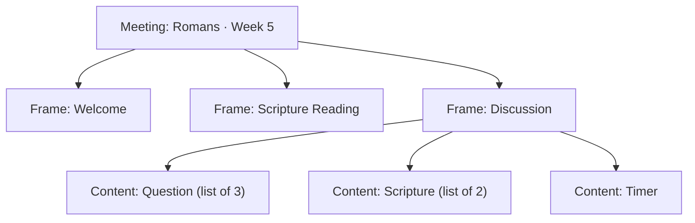

# Frames

How to create, organize and reuse Frames, the building blocks of every meeting.

**Who this is for:** anyone who builds services or meetings in FrameDecks.

**On this page**
- [What a Frame is](#what-a-frame-is)
- [Create a Frame](#create-a-frame)
- [Name, group and order](#name-group-and-order)
- [Select several Frames](#select-several-frames)
- [Frame settings](#frame-settings)
- [Duplicate a Frame](#duplicate-a-frame)
- [One Frame per question](#one-frame-per-question)
- [Templates](#templates)
- [Frame files: share a Frame with another PC](#frame-files-share-a-frame-with-another-pc)
- [The Frame menu at a glance](#the-frame-menu-at-a-glance)
- [Best practices](#best-practices)

---

## What a Frame is

A **Frame** is one screen or one step of your meeting, such as *Welcome*, *Worship*, *Scripture Reading*,
*Discussion* or *Closing*. It holds the **Content** shown at that moment, and its own transition, auto-advance and Teleprompter script.

**Every Frame owns its Content.** Two Frames never share a question, a scripture or a setting, so changing one Frame
never changes another.

## Create a Frame

| Way | How | Result |
| --- | --- | --- |
| **+ Frame** | Select **+ Frame** above the Frames list | One blank Frame, after the selected Frame |
| **Quick Start** | **✨ Meeting → Quick Start…** | A complete set of Frames for a Sunday Service, Bible Study, Youth Service, Conference and more |
| **Library** | The **Library** filter in the Frames list | Ready-made Frames you can add |
| **From a template** | **✨ Meeting → From your templates** | A new Frame made from one of your templates |
| **From Excel** | **Settings → Data / Backup → Meeting from Excel** **→ Import a meeting from Excel…** (or Plan on the website: see [Plan on the website](service-planning.md#plan-on-the-website)) | Every Frame in the workbook. See [Service planning](service-planning.md#plan-in-excel-with-the-meeting-workbook) |
| **From a file** | **✨ Meeting → Import a Frame file…** | A Frame exported from another PC |
| **From a .frame file** | **Settings → Data / Backup → Import Frame File…** | A whole plan from framedecks.com or another PC. See [Move a plan to a service PC](service-planning.md#move-a-plan-to-a-service-pc) |

After creating a Frame, add Content with **+ Content**. See [Content](content.md).

## Name, group and order

- **Rename:** double-click the Frame's **name**, press **F2**, or type in Content Settings → **Name**. The
  name becomes a text box right in the list: **Enter** saves, **Esc** cancels, and clicking away saves. Double-clicking
  anywhere else on the Frame's row puts it on screen (**Go Live**).
- **Group:** Content Settings → **Advanced → Group**, or **⋯ → Move to group…**. Groups fold away in the list; use one
  group per service, such as *Sunday 12 May* or *Romans · Week 5*.
- **Order:** drag a Frame up or down, or use **⋯ → Move up / Move down**. The order is the order of
  **Frame ▶**.
- **Favourite:** select the star on a Frame. The **Favorites** filter shows only starred Frames.
- **Recent:** the **Recent** filter shows what you worked on last.
- **Search:** type in **Search Frames** above the list, or press **Ctrl+K** to open the command palette and find any
  Frame, question or scripture. See [Presentations](presentations.md#command-palette).

## Select several Frames

You can work on several Frames at once.

| To | Do this |
| --- | --- |
| Add a Frame to the selection | **Ctrl+Click** it |
| Select a run of Frames | Click the first, then **Shift+Click** the last |
| Select with the mouse | Drag a box from empty space in the list |
| Select every Frame | **Ctrl+A** |
| Delete the selected Frames | **Delete** or **Backspace**. The message offers **Undo**. You are asked to confirm only for 5 or more |
| Copy, cut, paste | **Ctrl+C**, **Ctrl+X**, **Ctrl+V** |
| Duplicate | **Ctrl+D** |
| Move them | Drag them up or down |

Right-click the selection for the same actions in a menu.

## Frame settings

Select a Frame (and no Content) to see its settings in **Content Settings**. Each Frame is a compact card in the
list; its settings show only what you change often.

| Setting | What it does |
| --- | --- |
| **Name** | Shown in the Frames list, on the phone remote and in the Teleprompter |
| **Teleprompter script** | What you plan to say on this Frame, up to 20,000 characters. Only you see it, in the Teleprompter (on the PC and the phone), never on screen. If the Teleprompter is set to **Whole meeting**, it shows the meeting's one script instead. **Open the Teleprompter** opens it. Called *Leader notes* before 6.7. See [Presentations](presentations.md#teleprompter) |
| **Move to the next Frame after N seconds** | Moves on by itself after that many seconds, but only while **Auto** is on in the command bar |

Below them, **Duplicate Frame** puts a copy right after this Frame.

### Advanced
Fold out **Advanced** for the settings you change less often.

| Setting | What it does |
| --- | --- |
| **Group** | Which group the Frame belongs to |
| **Transition into this Frame** | How the Frame appears: your profile's transition, or one of Cut, Fade, Dip to Black, Dip to White, Blur Fade, Zoom, Slide, Push, Wipe or Burst. See [Transitions](presentations.md#transitions) |
| **Length (ms)** | How long the transition takes |
| **Branding** | Adds or removes your logo and Meeting Name badge in this Frame |
| **Favourite** | Shows the Frame under **Favorites** |
| **Template** | Keeps the Frame as a template for making new Frames. Templates are skipped by **Frame ▶** |
| **Save as template** | Saves a copy of the Frame as a template |
| **One Frame per question / One Frame per verse** | See [One Frame per question](#one-frame-per-question) |

The Frame's history is at the end of **Advanced**: **Created**, **Changed**, **Copied from** and **Original Frame**.

## Duplicate a Frame

Right-click the Frame (or open its **⋯** menu) and choose **Duplicate Frame**, or select it and press **Ctrl+D**. The
copy goes right after the original. To put it in another group, such as next week's service, use **Move to group…**
on the copy.

> **Note:** A duplicate is completely independent. Every Content and every question and scripture gets new IDs,
> and nothing is linked back to the original.

> **Note:** Since 8.0 there is one Duplicate. The other choices (with options, as template, structure only, Create
> variant, to group) were removed; **Save as template** is under **Advanced**.

## One Frame per question

Some leaders prefer each question on its own Frame, so **Frame ▶** moves to the next question.

1. Select a Frame with a Question list.
2. In Frame settings, open **Advanced** and choose **One Frame per question**.
3. New Frames, each with one question, appear right after it.

**One Frame per verse** does the same for a Scripture list.

## Templates

A **template** is a Frame you keep for making new Frames, such as your standard *Welcome* or *Closing*.

- **Make one:** **Advanced → Save as template** in Frame settings.
- **Use one:** **✨ Meeting → From your templates →** the template's name.
- Templates stay in the Frames list but are not part of the running order: **Frame ▶** skips them and you cannot
  **Go Live** on a template.

## Frame files: share a Frame with another PC

- **Export:** **⋯ → Export Frame file** saves the Frame to your Downloads folder.
- **Import:** **✨ Meeting → Import a Frame file…** on the other PC.

To move a whole plan to another PC, use a **.frame file** instead: **Settings → Data / Backup → Export Frame File**.
See [Move a plan to a service PC](service-planning.md#move-a-plan-to-a-service-pc).

## The Frame menu at a glance

| Item | Shortcut |
| --- | --- |
| Go Live | T |
| Duplicate Frame | Ctrl+D |
| Rename | F2 |
| Move to group, Move up, Move down | — |
| Export Frame file | — |
| Delete Frame | — |

## Best practices

- **Name Frames for the volunteer**, not for yourself: *Scripture: Romans 8*, not *Frame 4*.
- **One group per service.** It keeps Frame ▶ in the right order and makes the next service easy to copy.
- **Keep a few templates** for parts that never change, such as Welcome, Offering and Closing.
- **Put private reminders in the Teleprompter script**, not in on-screen text.
- **Preview every Frame** before the service by selecting it. The canvas shows PREVIEW until you Go Live.

## Related
- [Content](content.md)
- [Service planning](service-planning.md)
- [Presentations](presentations.md)
- [Getting started](getting-started.md)
