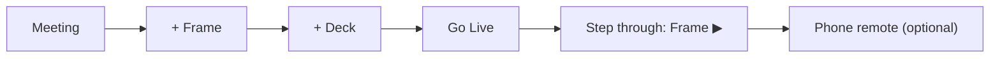
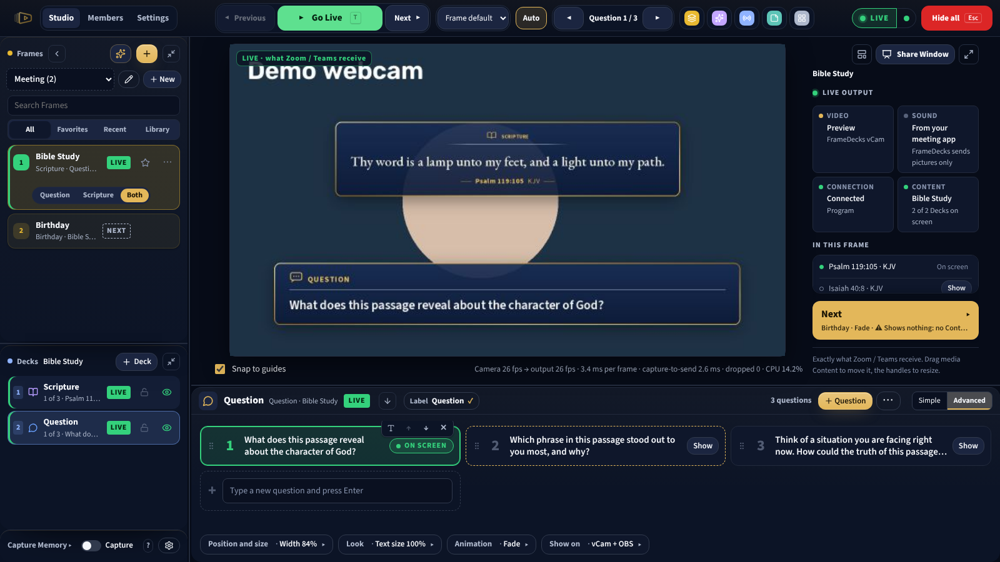

# Getting started

Your first fifteen minutes with FrameDecks: install it, find your way around, build a meeting and put it on screen.

**Who this is for:** anyone opening FrameDecks for the first time, such as a small-group leader, a worship
leader or a media volunteer.

**On this page**
- [What FrameDecks is](#what-framedecks-is)
- [Before you start](#before-you-start)
- [First launch](#first-launch)
- [A tour of the window](#a-tour-of-the-window)
- [Build your first meeting](#build-your-first-meeting)
- [Go Live and step through](#go-live-and-step-through)
- [Add your phone (optional)](#add-your-phone-optional)
- [Your first Sunday checklist](#your-first-sunday-checklist)

---

## What FrameDecks is

FrameDecks is a presentation app for services, Bible studies, prayer meetings and small groups. It runs on one
Windows PC. It needs no accounts and no cloud, and it works without internet.

You build a **Meeting** (your service or meeting) out of **Frames**. A Frame is one screen or one step, such as
*Welcome*, *Scripture Reading*, *Discussion* or *Closing*. Each Frame holds **Content**: a question, a scripture, a
timer, an image, a video, a PowerPoint and more.

When the meeting starts, you press **Go Live** and step from Frame to Frame. What you show appears on:
- **FrameDecks**, a camera you choose in Zoom, Microsoft Teams, Google Meet or OBS (your webcam with your
  Content on top);
- the **Presentation window**, which you can share in Zoom or show full screen on a projector or TV;
- **OBS / browser overlay pages** at `http://localhost:8750/...`, for setups that use OBS.

## Before you start

You need:
- a Windows 10 or Windows 11 PC (64-bit);
- the FrameDecks installer. See [Installation](installation.md).

A webcam is optional. You need one only if people should see you on the FrameDecks vCam.

## First launch

1. Open **FrameDecks** from the desktop icon.
2. The first time (also after an update or a reinstall, until you finish it once), **Welcome to FrameDecks** fills the
   screen: five short pages that show how a meeting is built and how to run it with Spotlight (Alt+Space).
   - **Adding Frames**: a Frame is one moment on screen. **+ Frame** adds one; **Quick Start** adds a ready-made set.
   - **Adding Decks**: a Deck is one block on a Frame (a scripture, a question, text, a picture, a video, a timer or
     slides). **+ Deck** adds one to the selected Frame.
   - **Adding Content**: what a Deck shows, such as each question or verse (**+ Question**, **+ Scripture**).
   - **Finish**: optionally **Sync Workspace**, to plan on framedecks.com and sync to this PC (the browser opens;
     allow this PC, and the page turns to *Linked* by itself; later: Settings → Workspace Sync). Optionally choose a ready-made meeting (Bible Study, Prayer Meeting, Youth Gathering, Fellowship
     Meeting or Church Service). If FrameDecks finds data from an earlier version, **Bring it in** copies it (the old
     folder is not changed).

   Use **Next** and **Back** (or the arrow keys); **Skip** closes it. It does not come back after **Finish** or
   **Skip**; open it again from **Settings → About → Welcome tour** or the command palette (Ctrl+K, "Welcome tour").
3. The app opens on the **Studio**, where you build and run meetings. Each level has its own colour, here and on the
   phone remote: **Frames gold**, **Decks blue**, **Content violet** (green always means *on screen now*).
4. The **Setup guide** (how people will see it, your phone as a remote, connecting to FrameDecks, and a check that
   everything is working) is in **Settings → About → Guided tour**, and in the command palette (Ctrl+K, "Setup guide").
   It shows one step at a time; **Show me how** points at the button to press.

> **Note:** Everything you do is saved automatically on this PC. There is no Save button to remember.

## A tour of the window

*The Studio, shown with the built-in test camera ("Demo webcam") instead of a real webcam.*

| Area | Where | What it does |
| --- | --- | --- |
| **Command bar** | Across the top | Studio · Members · Settings (Alt+1, Alt+3, Alt+4), **◀ Frame · Go Live · Frame ▶**, transitions, the question and scripture steppers, the **Live tools** menu, **Hide all** (with its **Esc** key) and the LIVE status. A PC linked to your team also shows a **Sync** chip |
| **Frames** | Left, top | Every Frame in your meetings, in order, as compact cards. The live Frame is marked **LIVE**, the next one **NEXT** |
| **Decks** | Left, bottom | The Content inside the selected Frame (**+ Deck** adds to it). The top of the list is in front |
| **Studio Canvas** | Middle | A preview of the selected Frame, or the live picture. The badge says **PREVIEW · not on air** or **LIVE** |
| **Content Settings** | Below the canvas | Every setting for what you selected: **Content** (label and words) first, then Position and size, Look, Animation and Show on, which open with a click (a Frame shows its name, Teleprompter script and auto-advance, with the rest under **Advanced**) |

> **Tip:** The canvas badge is your safety check. **PREVIEW · not on air** means nobody sees what you are editing.

To find anything, press **Ctrl+K** (or **Ctrl+Space**) for the **command palette**. The command bar has no search box.
On a narrow window (under 1140 px wide) the command bar wraps onto two rows, so every button stays visible.

### The window buttons and the tray

FrameDecks has no Windows title bar. The command bar at the top is the window's ribbon:
- drag an empty part of it to move the window, and double-click it to maximize;
- Snap (dragging to a screen edge, or Windows key + arrows) and resizing from the edges work as usual;
- **Minimize**, **Maximize / Restore** and **Close** are at the top right of every FrameDecks window.

The first time you select **Minimize**, the app asks *Hide application to system tray?*
- **Hide To Tray** removes the taskbar button. The icon stays in the tray near the clock.
- **Stay In Taskbar** minimizes as usual.

Tick **Remember my choice** to stop the question. You can change it later in **Settings → General → Window and tray
→ Minimize button**. In the tray, everything keeps working: the camera, the overlays, the phone remote and the
shortcuts. Click the tray icon, or choose **Open App** in its menu, to bring the window back.

> **Tip:** Press **Alt+Space** anywhere in Windows to open **Spotlight**, a search box that finds and runs anything
> in FrameDecks, even from the tray. See [Spotlight](presentations.md#spotlight).

If you prefer the Windows title bar, turn off **Modern window** in **Settings → General → Window and tray** and
restart.

## Build your first meeting

There are two quick ways to start.

### Option A: Quick Start (fastest)

1. Select the **✨ Meeting** button next to **+ Frame**.
2. Choose **Quick Start…**.
3. Pick what you are leading, for example **Sunday Service** or **Bible Study**.
4. A complete set of Frames appears in its own group. Change any of them; nothing is on screen until you press
   **Go Live**.

### Option B: Build it yourself

1. Select **+ Frame**. A blank Frame appears after the selected one.
2. Double-click its name (or press **F2**), type a name such as *Discussion*, and press **Enter**.
3. With the Frame selected, select **+ Deck** and choose **Question**.
4. Type your first question in the editor and select **Done**. Add more with **+ Question**, or paste many at once
   with **Add several**.
5. Repeat for the other parts of your meeting: a **Scripture**, a **Timer**, a **Text** welcome and so on.

> **Tip:** To change a question quickly, double-click the card on the Studio Canvas and type. **Enter** saves,
> **Esc** cancels. This works on any card, and on its label (the top line).

See [Service planning](service-planning.md), [Frames](frames.md) and [Content](content.md) for more.

## Go Live and step through

You build and run the meeting in the same place, the Studio. **◀ Previous**, **Next ▶**, **Go Live**, **Hide all** and
**Live tools** are always in the top bar.

1. Select the first Frame.
2. Select **Go Live** (or press **T**). The badge turns to **Live** and **Hide all** turns red: something is on screen.
3. Move through the meeting:
   - **Next ▶** (or **]**) goes to the next Frame; **◀ Previous** (or **[**) goes back;
   - **→ / ←** step through the Frame's questions;
   - **Shift + → / ←** step through its scriptures.
4. When you need a clean screen, press **Esc** (**Hide all**).

**Try it out first.** Turn on **Live tools → Black screen**: your audience sees a black screen while you try Go Live,
Next and Hide all, and your own preview still shows everything. Turn it off when you are ready.
Not sure how people will see your meeting? **Settings → How people see it** offers three ways: FrameDecks vCam in Zoom or
Teams, the Share Window, or a projector, TV or OBS. The words FrameDecks uses are in the [glossary](glossary.md).

See [Presentations](presentations.md) for transitions, Black screen, Freeze, Annotate, the Teleprompter, the command
palette and Spotlight.

## Add your phone (optional)

Your phone can run the whole meeting: next Frame, next question, Annotate, Freeze and Black Screen.

1. Open **Settings → Phone & iPad Remote** and turn it on.
2. The first time, Windows Firewall asks about network access. Tick **Private networks** only, then **Allow**.
3. Scan the QR code with your phone and enter the PIN shown.

See [Remote control](remote-control.md).

## Your first Sunday checklist

Do this once, a day or two before your first real meeting.

- [ ] The app opens and shows your meetings.
- [ ] In Zoom, Teams or Meet, the camera **FrameDecks** is listed and selected (restart the meeting app after
      installing).
- [ ] You can **Go Live** on your first Frame and step to the last one.
- [ ] Your questions and scriptures read correctly on the canvas. Fix typos by double-clicking a card.
- [ ] **Hide all (Esc)** and **Black screen (K)** work.
- [ ] If you use a projector: **Share Window** opens the Presentation window and it fills the projector screen.
- [ ] If you use your phone: it connects, and **NEXT FRAME** works.
- [ ] You know where the **Teleprompter** is (**Live tools → Teleprompter**, or **R**) if you want your script in
      front of you. It stays on top of Zoom or Teams, and only you see it: it is hidden from screen sharing and
      recordings.
- [ ] Do a 10-minute rehearsal with one other person on a test Zoom call.

> **Important:** Rehearse on the same PC, network and room you will use on the day. Most problems are found in the
> first rehearsal, not during the service.

## Related
- [Installation](installation.md)
- [Service planning](service-planning.md)
- [Presentations](presentations.md)
- [Frames](frames.md) and [Content](content.md)
- [Remote control](remote-control.md)
- [Troubleshooting](troubleshooting.md) and [FAQ](faq.md)
- [Ministry team guides](roles/README.md)
