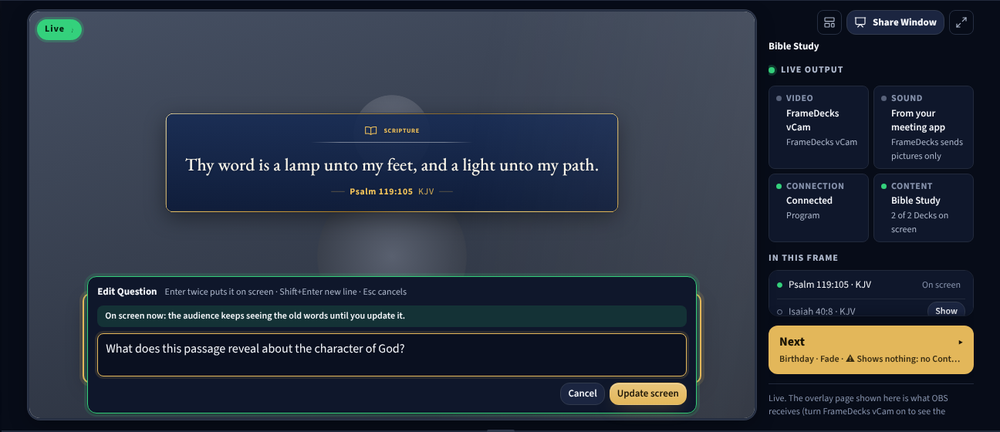
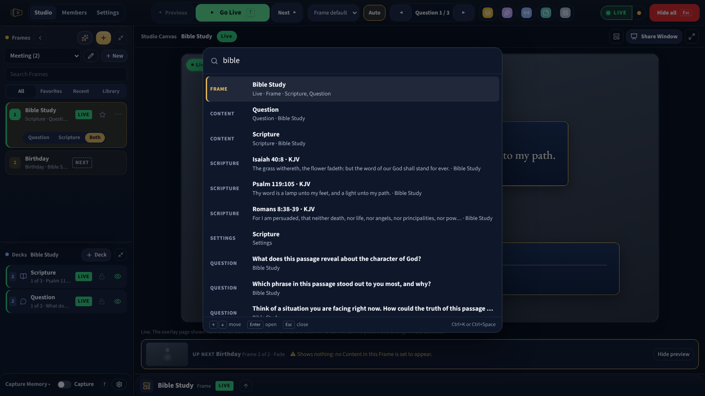
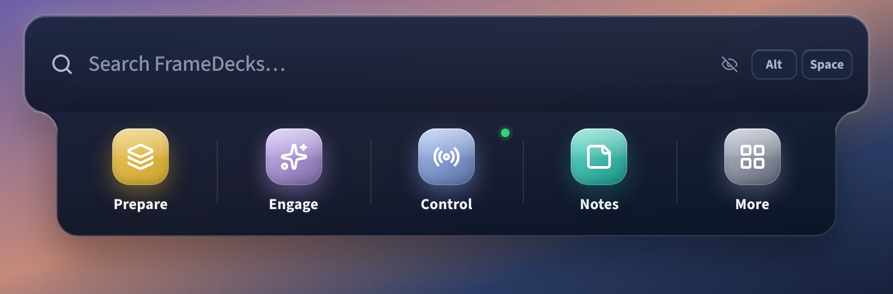
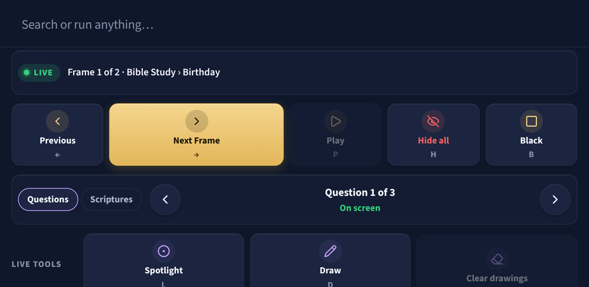

# Presentations: running the service live

Everything you need while the meeting is happening: going live, moving through Frames, handling the unexpected and
keeping your script in view.

**Who this is for:** service operators, worship leaders and small-group leaders who run the screen during a service
or meeting.

**On this page**
- [Where your presentation appears](#where-your-presentation-appears)
- [Preview first, then Go Live](#preview-first-then-go-live)
- [Move through the meeting](#move-through-the-meeting)
- [Questions and scriptures](#questions-and-scriptures)
- [Transitions](#transitions)
- [When something goes wrong: Hide all, Black screen, Emergency, Freeze](#when-something-goes-wrong-hide-all-black-screen-emergency-freeze)
- [Annotate: draw on the picture](#annotate-draw-on-the-picture)
- [Teleprompter](#teleprompter)
- [Command palette](#command-palette) and [Command Center](#command-center)
- [Projector, TV and screen sharing](#projector-tv-and-screen-sharing)
- [Keyboard shortcuts](#keyboard-shortcuts)
- [Live-safety tips](#live-safety-tips)

---

## Where your presentation appears

FrameDecks sends one finished picture to every place you use, all at the same time.

| Output | Use it for | How |
| --- | --- | --- |
| **FrameDecks vCam** | Online and hybrid meetings | Choose **FrameDecks** as the camera in Zoom, Teams, Meet or OBS |
| **Presentation window** | A projector or TV in the room, or **Share Screen → window** in Zoom | Studio → **Share Window**, then **Full screen** |
| **Overlay pages** | OBS setups that add cards over their own video | `http://localhost:8750/...` as an OBS browser source |

## Preview first, then Go Live

The **Studio Canvas** always tells you whether you are looking at the screen people see.

| Badge | Meaning |
| --- | --- |
| **PREVIEW · not on air** | You are looking at a Frame that is not live. Nobody sees changes |
| **LIVE** | This is what Zoom, Teams, the projector and OBS show right now |

1. Select a Frame in the **Frames** list. The canvas previews it.
2. Check it, then select **Go Live** (or press **T**). You can also double-click the Frame's row. Double-clicking
   the Frame's **name** renames it instead.
3. The Frame is marked **LIVE** in the list and the next Frame is marked **NEXT**.

> **Tip:** You can edit a Frame that is not live while another Frame is live. Prepare the next Frame calmly while the
> current one is on screen.

## Move through the meeting

| Action | PC | Phone remote |
| --- | --- | --- |
| Next Frame | **Frame ▶** or **]** | **Next** |
| Previous Frame | **◀ Frame** or **[** | **Previous** |
| Go Live on the selected Frame | **Go Live** or **T** | Tap the Frame in **All Frames** |
| Next question | **→** | The round **▶** arrow |
| Next slide (PowerPoint) | **Page Down** or the slide ▶ button | The round **▶** arrow |

**The Live Stage.** The picture of what people see takes the room: it is the largest 16:9 the Studio has, and a
green ring goes round it while it is live. One column beside it holds three things:
- **is all well**: one sentence, such as *All good. People see “Bible Study”.* (in Advanced, four small tiles: Video,
  Sound, Connection and what is showing);
- **Up next (Safe Next)**: the Frame that **Next** will put on screen, before you press it: a small picture, its name,
  *Frame 3 of 8* and its transition. Before anything is live, Up next is the Frame after the one you selected. A gold
  ⚠ line warns you when the next Frame shows nothing (no Content in it is set to appear), when the black screen or the
  emergency screen is still on, or when a picture, video or PowerPoint in it has no file chosen yet;
- **one big button**: **Go Live** while nothing is on screen, then **Next**. In Advanced, Up next is written on the
  Next button itself, and **In this Frame** lists the live Frame's scriptures and questions: a green dot for what is
  on screen, **Show** for the rest.

**Resize it your way.** Drag the border under the stage: the picture grows or shrinks with it at any window size.
The border clicks into place where the picture fills the width; double-click it (or choose Layout → **Fit the
picture**) to jump there. Drag it far up and the Studio changes to a compact layout: a small picture top-left with
the column under it, and the editor beside them at full height. Drag the border between them to the right, or press
**Big stage**, for the big picture again. FrameDecks remembers your layout on this PC.

**The run sheet.** While you are live, the Frames list shows a **meeting clock** in its header (from your first Go
Live; click it to start it again), and the live Frame shows how long it has been on screen. Give a Frame a **Planned
time** (in the Frame's settings, in minutes) and the list shows its time against the plan, such as *1:11 / 1:00*,
turning gold once it runs over; Frames that are not live show their plan, such as *5 min*. While a Frame is live, the
top bar brings **Control** forward and lets **Prepare** and **More** step back; before you go live, the reverse.

**Simple and Advanced.** The Studio opens in **Simple**: the essentials only. **Advanced** (the switch at the right
of the editor's bar, which stays there when the editor is folded) shows every control again: Transition and
Auto-advance in the top bar, the camera numbers, the status tiles, In this Frame and the editor's settings. Nothing
is renamed or removed; FrameDecks remembers your choice on this PC.

**Auto advance:** a Frame can move to the next one by itself after a number of seconds (Content Settings → **Move
to the next Frame after N seconds**). It only happens while **Auto-advance** in the command bar is on.

## Questions and scriptures

A Frame with a Question or Scripture list shows one item at a time.

- **→ / ←** step through the Frame's questions.
- **Shift + → / ←** step through its scriptures.
- **Q**, **V** and **B** show or hide the question, the scripture and the birthday card.
- In the command bar, **◀ Question ▶** does the same as the arrow keys.
- In the list, **Show** puts one item on screen directly.

**Question · Scripture · Both** on the Frame's card in the Frames list chooses what **Show** puts on screen:
- **Question**: the question only;
- **Both**: the question with its scripture;
- **Scripture**: the scripture only.

> **Tip:** Found a typo while it is on screen? Double-click the card on the Studio Canvas and correct it. While the
> card is on screen your change is a **draft**: the audience keeps seeing the old words until you select
> **Update screen** (or press **Enter** a second time). **Esc** keeps what is there. This works for every card:
> question, scripture, announcement, prayer, lower third and timer. Double-click the card's label (its top line)
> to change the label.
>
> A single click on a card in the preview selects it, and its item lights up in the list below; choosing an item in
> the list outlines its card on the preview.

### Listen for scripture

Say a Bible reference while a Frame is live, such as "John three sixteen" or "Romans eight, starting at verse
thirty-eight", and FrameDecks offers it: **Heard Romans 8:38 · Show · Dismiss**. **Show** adds the passage to the live
Frame's Scripture Deck and puts it on screen. The same switch is in four places, so you never need the Studio in front
during the meeting: **Off · Ask · Auto** in the Command Center's **Control** header, in **Control** on the phone and
tablet remote, **Listen for scripture** in the top bar's **Control** chip, and Settings → Content → Scripture.
**Auto** shows a verse as soon as it is said, without asking.

- It catches a new verse even mid-sentence, and the same verse again after about 20 seconds.
- It hears this PC's microphone only (the one chosen for the Teleprompter's Follow my voice), not people in Zoom or
  Teams, and only while a Frame is live. Nothing is recorded or sent anywhere.
- If a passage cannot be fetched (for example offline), **Show** reads **Try again**; **Dismiss** always works.
- **Earlier** lists the last three verses heard, so one missed in the moment is still one click away.
- A verse that is already in this meeting's plan (any Frame's Scripture Deck) is offered as the planned passage,
  marked **in your plan**: say "Romans eight thirty-eight" and the planned Romans 8:38–39 is shown from the plan,
  instantly and offline.

## Transitions

| Setting | Where | Effect |
| --- | --- | --- |
| The usual transition | **Settings → Transitions** → **Profile** | The transition every Frame uses unless it has its own |
| The Frame's transition | Content Settings → **Advanced → Transition into this Frame** | How this Frame appears: Cut, Fade, Dip to Black, Dip to White, Blur Fade, Zoom, Slide, Push, Wipe or Burst |
| Length (ms) | Same place | The length in milliseconds |
| One-off override | The command bar's transition list (**Frame default**) | Uses another transition for your next takes, until you set it back to **Frame default** |
| A card's own animation | Question / Scripture Content → **Animation** | How the card itself appears, for example Fade, Gentle rise, Word by word, Typewriter |

There is one transition for each effect. Frames that used an older choice are moved for you: Cross
Dissolve, Cinema Fade and Church Service Fade become **Fade**, Slide Right becomes **Slide**, and Soft Scale becomes
**Zoom**.

**Burst:** the Frame on screen breaks into dust that drifts away and uncovers the next Frame (about 1.4 seconds). Set
its look in **Settings → Transitions → Burst**:
- **Dust**: **Light**, **Medium** or **Fine**;
- **Drifts**: **Right**, **Left**, **Up**, **Down** or **Outwards**;
- **Strength**;
- **Dust colour**, or tick **The picture's own colours**.

## When something goes wrong: Hide all, Black screen, Emergency, Freeze

| Control | Key | What people see | Use it when |
| --- | --- | --- | --- |
| **Hide all** | **Esc** | The picture without any cards or text | You want a clean camera picture |
| **Black screen** | **K** | A black picture | You need the screen dark straight away |
| **Emergency** | — | A plain emergency screen with your message | Something urgent is happening in the room |
| **Freeze** | **F** | The picture held still | You are changing things and do not want people to see it |
| **Hide Content** | — | The selected Content is hidden | One item should go away, the rest stays |

Black screen, Freeze, Emergency and Hide the selected Content are in the **Control** chip of the top bar; Draw and
Spotlight are in **Engage**, and so is the Teleprompter (the chips replace the old Live tools menu).
**Go Live**, **◀ Previous**, **Next ▶** and **Hide all** are always in the top bar. The Control chip changes to
**Black screen on**, **Emergency on** or **Frozen**, and Engage turns gold while you draw, so you never forget one is
on. Press the same control again to turn it off.

> **Important:** Remember to unfreeze. While the picture is frozen, people do not see anything you change. The phone
> remote also shows a note while it is frozen.

## Annotate: draw on the picture

Annotate works like ZoomIt: draw over whatever is on screen, slides and cards included. Everyone in Zoom, Teams and
on the projector sees it.

1. Press **D** (or, in a browser, choose **Engage → Draw**). In the desktop app, **Engage → Draw** opens the Share Window
   to draw on instead, as Spotlight does: see [Draw and Spotlight on the Share Window](#draw-and-spotlight-on-the-share-window).
   In the Command Center, Draw opens a draw pad right there: see [Draw and Spotlight in the Command Center](#draw-and-spotlight-in-the-command-center).
2. Pick a tool and draw on the Studio Canvas.
3. Press **Esc** (or **Done**) to stop. The drawings are hidden.

| Tool | Key |
| --- | --- |
| Pen | P |
| Highlighter | H |
| Arrow | A |
| Line | L |
| Rectangle | R |
| Ellipse | E |
| Text | T |
| Spotlight | S |

There are six colours and three thicknesses. **Undo** is Ctrl+Z, **Redo** is Ctrl+Y, and **Clear** removes every
drawing. You can draw on a frozen picture.

You can also draw with your finger on the phone. See [Remote control](remote-control.md#drawing-from-the-phone).

### Spotlight a word

**Spotlight** points people to one word. Choose the Spotlight tool (**S**): nothing follows the mouse, so
you can move freely. **Double-click a word**, or put the mouse over it and press **Ctrl twice**, and a soft
see-through disc lands on it with a ripple and breathes gently while it stays. Then it blooms open into light, a last
ripple runs out and a few fine sparks drift away. Do it again on the next word whenever you like. Double-click empty
space to spotlight that point instead. Prefer a ring? Choose **Gold ring**: a glowing gold circle that pulses,
then opens out with a few sparks.

Quicker still: press **Ctrl** twice quickly with the pointer over the picture on the Studio Canvas. This works even
when you are not annotating.

Everyone sees it: on the FrameDecks vCam in Zoom or Teams, in recordings and on the overlay pages. While the
Spotlight tool is chosen, its panel sets the style (**Soft disc** or **Gold ring**), the **colour** (white by default
for the disc), **Size** (bigger by default), **Length** (1 to 15 seconds) and **Strength** (how see-through
the disc is). The same settings are in **Settings → Transitions → Spotlight (Ctrl twice)**. **Try it** shows one in
the middle of the picture.

From the phone remote: tap **Spotlight** on the live picture, then drag a finger to move it, or tap for a quick
circle (see [Remote control](remote-control.md#spotlight-from-the-phone)).

> **Note:** This is not the same as the [Command Center](#command-center), which finds things from anywhere in Windows.

## Teleprompter

The **Teleprompter** shows what you plan to say on each Frame. Only you see it. It is never on the FrameDecks
camera, the Presentation window, the OBS pages or the phone's drawing pad.

**Write the script**

A switch in the Teleprompter's top bar chooses how the script is kept:
- **Each Frame** (the default): each Frame has its own **Teleprompter script**, and the Teleprompter shows the
  script of the Frame on screen. Write it in Content Settings → **Teleprompter script**.
- **Whole meeting**: one script for the whole meeting, kept with the meeting details. It stays the same when the
  Frame changes.

In the Teleprompter itself:
- **✎ Write Script** (or double-click the text) lets you type the script there.
- **⇪ Upload** loads a script from a .txt, .md or Word (.docx) file. Word headings, bullets and bold are kept. If
  there is already a script, FrameDecks asks before it replaces it.

A script can be up to 20,000 characters. Simple markup, all
optional:

| Type | You get |
| --- | --- |
| `# Heading` | A heading |
| `- bullet` | A bullet point |
| `**bold**` · `*italic*` | **Bold** · *italic* |
| `[PAUSE]` | A cue chip, such as a reminder to pause or pray |
| `---` | A divider line |

**Open it**
- **Engage → Teleprompter**, or press **R** (press it again to close it).
- From the [command palette](#command-palette) or [Command Center](#command-center): type *Teleprompter on / off*.
- From the tray icon near the clock: **Teleprompter**.

The Teleprompter is one window that stays on top of Zoom, Teams, Google Meet, PowerPoint and browsers. Place it
close to your camera, so your eyes stay near the lens. With **Each Frame**, it shows the script of the Frame on
screen. Before you go live, it shows the first Frame, so you can rehearse.

> **Note:** The Teleprompter is never shown in screen sharing or recordings, even when you share your whole screen
> (Windows 10 version 2004 or later). It is never on the FrameDecks vCam either. The Command Center is left out of screen
> sharing too.

**The top bar**

All the controls are in the top bar. The script area shows only your script: no buttons, labels or overlays. The
text fills the whole window, in width and height, at every text size.

The top bar is hidden at first. A small arrow (**▾**) at the top always shows that it is there. Point at the
arrow or the top edge and the bar slides down, with the arrow riding under it; choose the arrow to keep the bar open,
and again to hide it. Its first row shows:
- **Time**: the time of day;
- **Frame**: the Frame on screen, for example *Discussion · 3 of 9* (*Not live yet* before you go live);
- **Next Frame ▸**: puts the next Frame on screen;
- **Timer**: **Start** / **Pause** and **Reset**, to time yourself;
- **Transparency**: **Solid**, **20%**, **40%**, **65%** or **85%**, how much of Zoom or Teams shows through the
  window;
- **Pin**: **Pinned** means the window stays above Zoom, Teams and PowerPoint. Click it to unpin;
- **Keep open** / **Hide bar**, and the window buttons.

FrameDecks remembers the transparency and the pin. They are only in the installed app, not in a web browser. With
**Settings → Controls → General → Performance → Light on graphics card** on (the default), the whole window fades, text
included. With it off, only the background goes see-through and the text stays solid.

Drag the bar to move the window, and drag an edge to resize it.

The second row holds the script controls:

| Control | Key (while the Teleprompter has focus) |
| --- | --- |
| **▶ Scroll**: play / pause | **Space** |
| **Follow my voice**: the script moves as you speak (see below) | **V** |
| Speed: Very slow, Slow, Normal, Fast, Very fast | — |
| Text smaller / larger (**A−** / **A+**) | **−** / **+** |
| Line spacing, high contrast | — |
| Mirror the text (for a teleprompter glass) | **M** |
| **✎ Write Script** · **⇪ Upload** | — |
| **Each Frame** · **Whole meeting** | — |
| Back to the top | **Home** |
| Scroll by hand | **↑ ↓**, **Page Up / Page Down**, the mouse wheel or touch |

**Follow my voice**

Instead of scrolling at a set speed, the Teleprompter can follow you as you speak. Choose **Follow my voice** (or
press **V**) and read: the words you have read go quieter and the next words stay at the reading line, about a third
of the way down, marked by a soft gold band that breathes while it hears you. Speak at your own pace; pause, slow down or go back over a line, and it waits for you.

- **Only while it is in front.** It listens only in the installed app, and only while the Teleprompter is above every
  other window: **Pinned**, or unpinned but the window in front (the one you clicked last). Unpinned, click another
  window, hide the Teleprompter or close it and the microphone is let go at once; click the Teleprompter or pin it and it
  carries on.
- **Off script.** Talk freely (a welcome, a question from the room): the script holds still and carries on when you
  come back to the words. Scroll by hand at any time, and it carries on from there.
- **One at a time.** **▶ Scroll** and **Follow my voice** take turns: choosing one stops the other.
- **Microphone and sensitivity.** The button beside it chooses the microphone (the one you use in Zoom or Teams is
  fine; both can use it at once) and the sensitivity. Lower it if other voices or noise move the script; raise it
  for a soft voice.
- **The first time** it downloads the voice files once (about 40 MB) and keeps them on this PC. **Remove the voice
  files** (beside the microphone) frees the space; they download again the next time you turn it on.
- **Private.** Everything happens on this PC. Nothing you say is recorded, kept or sent anywhere.
- **Light on older PCs.** It runs only while it is on, in the background at low priority, and recognises only the
  words of your script. It needs about 350 MB of free memory, and says so if the PC has less.
- English scripts. Names and unusual words it does not know are skipped; the words around them keep it on track.

> **Note:** In a web browser (not the installed app), the Teleprompter opens as a pop-up and cannot stay on top or
> be kept out of screen sharing.

On the phone, the Teleprompter is on the remote too. See [Remote control](remote-control.md#teleprompter-on-the-phone).

## Capture Memory: copied chats as bubbles on the camera

**Capture Memory** turns what you copy from a chat or an assistant (Teams, Zoom, Google Meet, Webex, Slack, Discord,
WhatsApp, ChatGPT, Claude, Copilot or a browser) into **Memory Cards**. **Show** puts a card on FrameDecks vCam as a
**chat bubble**: just the bubble, with no window or panel around it. There is nothing to paste and no extra window to
manage.

1. Turn on **Capture**: the switch in the Studio's **Capture Memory** pane (under Decks), **Engage → Capture
   copies**, or the tray's **Capture copies**.
2. In the chat, select the text and press **Ctrl+C**. Copy several messages at once and each becomes its own card,
   with the sender's name and the message.
3. The bubble pops open on FrameDecks vCam: the sender's initials on their colour, their name, the app and the
   message. A small card also appears in the corner of your screen with **Show** and **Pin**. It never takes the
   keyboard from Zoom or Teams, screen sharing leaves it out, and it goes after a few seconds (keep the pointer on it
   to keep it).

**On each card** (in the corner card or the pane):

| Button | Does |
|---|---|
| **Show** | Puts the card on screen (again) as a bubble with its full text. On a card already there, **Less** goes back to the first lines |
| **Pin** | Keeps the bubble on screen, also after FrameDecks restarts (up to 12 cards). Pinned bubbles have a gold edge |
| **Hide** (pane) | Takes the bubble off screen; the card stays in the pane |
| **✕** (pane) | Deletes the card |

**Several at once:** tick the cards in the pane and click **Show selected**. They appear together as separate
bubbles, in the order they were copied (the first one at the top).

Unpinned bubbles leave after 12 seconds (Settings ⚙). At most six are on screen at once: the pinned ones, then the
newest. **Esc** (Hide all) takes them all off screen until the next card. You can also type a note in the pane.

**Where the bubbles go** (⚙ → *On FrameDecks vCam*):

- **Beside the video** (the default): the bubbles sit on top of your video on the right (*Side*: or the left). Your
  video keeps its full size; only the other overlays (the question and scripture cards, lower thirds, branding)
  become smaller and move to the left, so nothing overlaps. They go back when the bubbles go.
- **Below the video**: the bubbles run along the bottom, on top of the video; the other overlays move up.
- **Over the picture**: the bubbles float at the edge of the picture and move out of the way of the question,
  scripture and birthday cards, lower thirds, branding and a camera inset.

The Studio preview shows the same. **Also on the Share Window and overlay pages** shows them there too (on the OBS
pages they float over the picture).

**From your phone:** the phone remote has a **Capture Memory** section. Copy a message in WhatsApp, Teams, Zoom,
Messages or any app on the phone, paste it there and tap **Show on screen**. See
[Remote control](remote-control.md#capture-memory-on-the-phone).

> **Note:** Unpinned cards are kept only while FrameDecks runs; pinned cards are kept in `kc-memory.json` in the
> FrameDecks data folder. Nothing is sent anywhere. Copies that a password manager marks as private are never read,
> and Zoom's private messages wait for **Show**. Turn off **Show a card as soon as it's copied** to choose each card.

> **Note:** Capturing copies on the PC needs the installed app on Windows. Elsewhere, type a note in the pane or
> paste on the phone.

## Command palette

The **command palette** finds anything and does most things, from the keyboard.

1. Press **Ctrl+K** or **Ctrl+Space**. (The command bar has no search box: the palette and the **Command Center**
   are where you search.)
2. Type a few letters. It finds Frames, Content, the Frames' questions and scriptures, text, templates, the Library,
   branding, settings, members, Bible references and recent items.
3. It also runs commands, such as **Go Live**, **New Frame**, **Duplicate**, **Teleprompter**, **Export meeting**,
   switching the look (*Look: Forest*, for example) or **Add Content…**.
4. Use **↑ / ↓** to choose and **Enter** to open or run it. **Esc** closes the palette.

You can change the keys in **Settings → Keyboard shortcuts → Command palette**.

### Command Center

The **Command Center** is where everything in FrameDecks starts. It works when another program is in front, and when
FrameDecks is hidden in the tray. It has no window around it: a glass search bar floats on your screen with a tray of
five chips folded away under it.

1. Press **Alt+Space** anywhere. It opens near the top of the screen your mouse is on, above everything. It opens only
   with its shortcut (or the tray's **Command Center**), never by itself.
2. Type in the bar to search everything: Frames, meetings, questions, scriptures, Memory Cards, settings and
   commands. Choose with **↑ / ↓** and **Enter**. Start with **>** for commands only, **#** for meetings and Frames,
   or **@** for people.
3. Or point at the bar: the five chips unfold for as long as the pointer stays. Click a chip, or press **Alt+1** to
   **Alt+5**, and its panel opens under the chips and stays pinned: it is still open the next time you open the
   Command Center. Click the same chip again (or press **Esc**) to close it, and the chips fold away again. Typing in
   the bar shows your results in front of a pinned panel; clear the bar and the panel is back.
4. **Esc** again, or a click anywhere else, closes the Command Center.

| Chip | What it holds |
|---|---|
| **Prepare** | Meetings (switch the meeting this PC shows), Share Window, Studio, Quick Start, Content Library, Import .frame, Camera check, and what you chose last |
| **Engage** | Memory Cards, the Teleprompter, Capture copies, Draw and Spotlight (on a draw pad right in the Command Center), Clear drawings, Hide the cards |
| **Control** | **Go Live** as a switch, **Listen for scripture** (Off · Ask · Auto, at the right of its header), and while you are live the meeting remote (below), with **Freeze** (**Alt+F**) and **Emergency** (press it twice) beside Black screen, and the meeting clock: time since Go Live and this Frame against its planned time |
| **Notes** | Your private notes for this meeting (below) |
| **More** | Sync, How people see it, Phone remote, Meeting & Branding, Shortcuts, All settings, Help & tour |

Each thing is in one chip only: the Teleprompter, Draw, Spotlight and Clear drawings are in **Engage**; the Studio,
the Share Window and the camera check in **Prepare**; the phone remote in **More**.

**Size and place.** In **Settings → Controls → General → Window and tray** choose **Command Center size**
(**Regular**, or **Compact**: slim chips in one row and a narrower bar) and **Command Center opens at** (**Top**,
**Centre** or **Bottom** of the screen). At the bottom it stacks upwards: the search bar sits at the bottom, the
chips above it, and the panels open above the chips.

### Notes

**Notes** (Alt+5) opens a small sticky note under the chip for the meeting shown. Type a note and press **Enter**
(**Shift+Enter** starts a new line): it is saved at once with the time and the Frame on screen, for example
*7:42 pm · Frame 3 · Discussion question*. The pencil changes a note and the bin deletes it. **Copy all**, **Save as a
file** (Markdown) and **Email to me** are the three small buttons at its foot.

Notes stay on this PC (in the program's data folder, one file per meeting): they are never synced to your workspace,
never shown on screen or on the phone remote, and never in the file sent when asking for help. **Alt+←** and
**Alt+→** still move the Frames while you type.

**Go Live** in Control is a switch. On: the first Frame of the meeting goes on screen. Off: everything leaves the
screen and you are off air. A green dot on **Control** shows you are live.

Only you see the Command Center. Like the Teleprompter, it is left out of screen sharing and recordings, even when you
share the whole screen in Zoom, Teams or Google Meet.

### The Command Center as a meeting remote

| Row | Buttons (keys while the Command Center is open) |
|---|---|
| **On screen** | Live, Off air, Black screen or Frozen, the Frame number and what comes next |
| **FrameDecks** | **Previous** (Alt+←), **Next Frame** (Alt+→), **Play / Pause** the video (Alt+P), **Hide all** (Alt+H), **Black** (Alt+B) |
| **Content** | The questions, scriptures or slides of the live Frame, one at a time, like the phone remote: choose **Questions**, **Scriptures** or **Slides**, then **‹ ›** (Alt+↑ / Alt+↓) |
| **Draw and Spotlight** | In **Engage**; **Alt+L** (Spotlight) and **Alt+D** (Draw) still work here |
| **Meeting** | Zoom, Microsoft Teams or Google Meet, whichever has a meeting open: **Mute** (Alt+M), **Camera** (Alt+V), **Share screen** (Alt+S), **Leave** (press twice), and the PC's volume (Alt+- / Alt+=) |

The meeting buttons press the meeting app's own keyboard shortcut in its window, then give the focus back to the
window you were in. Google Meet has no shortcut for sharing or leaving, so those buttons are off for Meet. A button is
also off when no meeting is open. Windows only.

### Draw and Spotlight in the Command Center

Choose **Draw** or **Spotlight** in the Command Center (in **Engage**, or with **Alt+D** or **Alt+L**) and a **draw pad**
opens right in the Command Center. Zoom or Teams stays in front: no other FrameDecks window opens.

- The pad shows the picture people see in the meeting (your FrameDecks vCam camera picture, with the cards).
- **Draw:** drag with the mouse or a pen. Choose **Pen**, **Highlight** or **Arrow**, and gold, red or white. The
  drawing appears on your camera picture when you let go.
- **Spotlight:** click a word or a point on the pad and it lights up for a few seconds on every screen.
- **Undo** (or **Ctrl+Z**) takes back the last drawing; **Clear** removes them all. **Done** (or **Esc**) closes the pad
  and hides the drawings.

The first time you use the pad in a meeting, FrameDecks suggests: *Ask the host to spotlight your video so everyone sees
your drawing large.* (In Zoom the host chooses **Spotlight video** on your video; in Teams, **Spotlight**.)

The pad needs FrameDecks vCam. If **How people see it** (Settings) is set to **Share a window**, Draw and Spotlight open
the Share Window instead, as described next.

### Draw and Spotlight on the Share Window

When people see a shared window (**How people see it** set to **Share a window**), choose **Draw** or **Spotlight** in
the Command Center (in **Engage**, with **Alt+D** or **Alt+L**), type *draw* or *spotlight* in its bar, or use the
**Engage** chip of the Studio's top bar. The **Share Window** (the window you share in Zoom or Teams) opens, comes to
the front, and the Command Center closes, so you can work on what everyone sees:

- **Draw:** drag with the mouse. Keys **1**–**5** choose pen, highlighter, arrow, box or circle; **G**, **R** and **W**
  choose gold, red or white; **Ctrl+Z** undoes, **Delete** clears.
- **Spotlight:** double-click a word (or press **Ctrl** twice with the mouse over it) and it lights up for a few
  seconds on every screen, then blooms away. Nothing follows the mouse in between.
- **Undo**, **Clear** and **Done** appear when you move the mouse near the top of the Share Window. **Esc** or
  **Done** finishes, hides the drawings, and the Share Window moves and resizes as before.

The drawings and the spotlight also show on FrameDecks vCam, the overlay pages and the phone remote.

**Go Live**, **Next / Previous Frame**, **Hide all**, **Black screen**, **Freeze** and the **Teleprompter** run without
bringing the main window back. Everything else opens the main window.

If another program already uses Alt+Space (for example PowerToys Run), FrameDecks uses **Ctrl+Alt+Space**
instead. **Settings → Controls → General → Window and tray → Command Center** shows which shortcut works. You can choose Alt+Space,
Ctrl+Space, Ctrl+Alt+Space, Ctrl+Shift+Space, Win+Shift+K, or Off.

> **Note:** Alt+Space normally opens the window menu of the program in front. If you need that menu, choose another
> Command Center shortcut.

## Projector, TV and screen sharing

The **Presentation window** shows the same finished picture as the FrameDecks vCam (the Memory Card bubbles
only when **Also on the Share Window and overlay pages** is on).

1. In the Studio, select **Share Window**. The Presentation window opens.
2. Drag it to the projector or TV, then select **⛶ Full screen** (or press **F** in that window, or double-click it).
3. To leave full screen, select **⛶ Full screen** again (move the mouse to show the buttons).

> **Important:** **Esc** inside the Presentation window closes it (**✕ Exit**). Press Esc in the main FrameDecks
> window instead when you mean **Hide all**.

To share it in Zoom instead, choose **Share Screen**, then the window named **FrameDecks Share Window**.

> **Note:** Media Content (camera, images, video, PowerPoint, screen and window sharing) is part of the FrameDecks
> picture, so turn on the FrameDecks vCam in **Settings → How people see it → FrameDecks vCam** if you use it.

## Keyboard shortcuts

Shortcuts work while the FrameDecks window has focus, and never while you type in a box. The Command Center's shortcut
is the exception: it works everywhere. You can change the
meeting shortcuts in **Settings**.

| Key | Action |
| --- | --- |
| **T** | Go Live on the selected Frame |
| **]** / **[** | Next / previous Frame |
| **→** / **←** | Next / previous question |
| **Shift + →** / **Shift + ←** | Next / previous scripture |
| **Q** · **V** · **B** | Show or hide the question · scripture · birthday card |
| **Page Down** / **Page Up** | Next / previous slide |
| **Esc** | Hide all |
| **K** | Black screen on / off |
| **F** | Freeze on / off |
| **D** | Annotate on / off |
| **R** | Teleprompter on / off |
| **M** | Mirror the text (in the Teleprompter) |
| **Ctrl + K** or **Ctrl + Space** | Command palette |
| **Alt + Space** | The Command Center, from anywhere in Windows (you can change it in Settings) |
| **F2** | Rename the selected Frame or Content |
| **Ctrl + D** | Duplicate the selected Frame or Content |
| **Ctrl + C** · **Ctrl + X** · **Ctrl + V** | Copy · cut · paste the selected Frames or Content |
| **Ctrl + A** | Select every Frame (or every Content) in the list |
| **Delete** / **Backspace** | Delete the selected Frames or Content (Undo is offered) |
| **Alt + 1 / 3 / 4** | Studio / Members / Settings |

## Live-safety tips

- **Rehearse** once on the same PC, room and network. To try things out before people join, turn on **Control →
  Black screen**: your own preview still shows everything.
- **Check the badge** before you edit: PREVIEW is safe, LIVE is public.
- **Keep Esc in mind.** It hides everything instantly.
- **Silence notifications** on the presentation PC (Windows Focus / Do not disturb).
- **Close what you do not need.** Fewer apps means smoother video.
- **Charge the phone** you use as a remote, and keep the PC plugged in.
- **Name your Frames clearly**, so whoever runs the service knows what comes next.

## Related
- [Frames](frames.md) and [Content](content.md)
- [Media](media.md)
- [Remote control](remote-control.md)
- [Troubleshooting](troubleshooting.md)
- [Service operators guide](roles/README.md)
