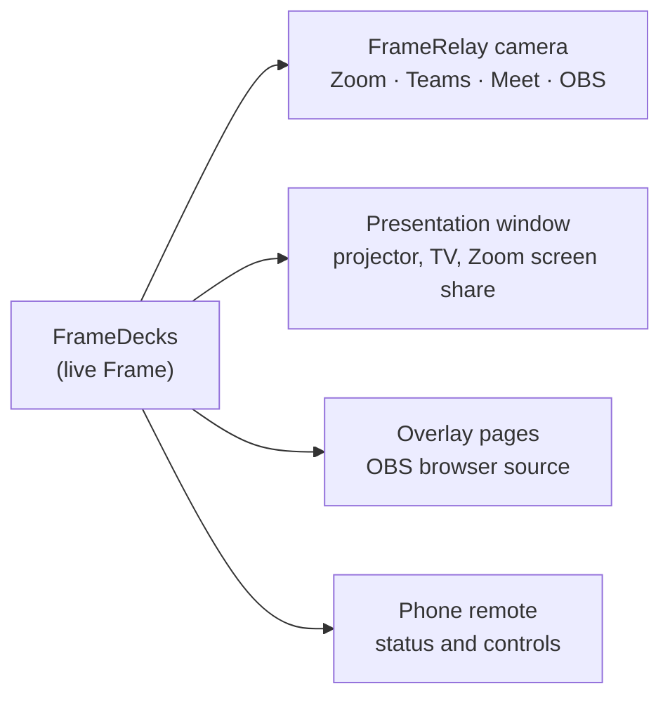
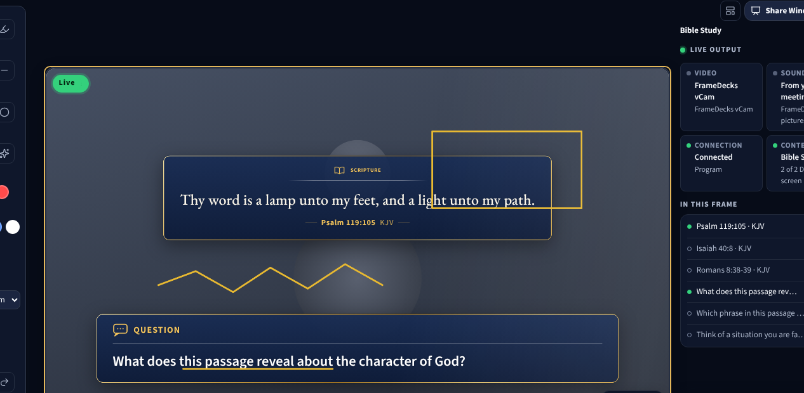

# Presentations: running the service live

Everything you need while the meeting is happening: going live, moving through Frames, handling the unexpected and
keeping your script in view.

**Who this is for:** service operators, worship leaders and small-group leaders who run the screen during a service
or meeting.

**On this page**
- [Where your presentation appears](#where-your-presentation-appears)
- [Preview first, then Go Live](#preview-first-then-go-live)
- [Move through the meeting](#move-through-the-meeting)
- [Questions and scriptures](#questions-and-scriptures)
- [Transitions](#transitions)
- [When something goes wrong: Hide all, Black screen, Emergency, Freeze](#when-something-goes-wrong-hide-all-black-screen-emergency-freeze)
- [Annotate: draw on the picture](#annotate-draw-on-the-picture)
- [Teleprompter](#teleprompter)
- [Command palette](#command-palette) and [Spotlight](#spotlight)
- [Projector, TV and screen sharing](#projector-tv-and-screen-sharing)
- [Keyboard shortcuts](#keyboard-shortcuts)
- [Live-safety tips](#live-safety-tips)

---

## Where your presentation appears

FrameDecks sends one finished picture to every place you use, all at the same time.

| Output | Use it for | How |
| --- | --- | --- |
| **FrameRelay camera** | Online and hybrid meetings | Choose **FrameDecks** as the camera in Zoom, Teams, Meet or OBS |
| **Presentation window** | A projector or TV in the room, or **Share Screen → window** in Zoom | Studio → **Share Window**, then **Full screen** |
| **Overlay pages** | OBS setups that add cards over their own video | `http://localhost:8750/...` as an OBS browser source |

## Preview first, then Go Live

The **Studio Canvas** always tells you whether you are looking at the screen people see.

| Badge | Meaning |
| --- | --- |
| **PREVIEW · not on air** | You are looking at a Frame that is not live. Nobody sees changes |
| **LIVE** | This is what Zoom, Teams, the projector and OBS show right now |

1. Select a Frame in the **Frames** list. The canvas previews it.
2. Check it, then select **Go Live** (or press **T**). You can also double-click the Frame's row. Double-clicking
   the Frame's **name** renames it instead.
3. The Frame is marked **LIVE** in the list and the next Frame is marked **NEXT**.

> **Tip:** You can edit a Frame that is not live while another Frame is live. Prepare the next Frame calmly while the
> current one is on screen.

## Move through the meeting

| Action | PC | Phone remote |
| --- | --- | --- |
| Next Frame | **Frame ▶** or **]** | **Next** |
| Previous Frame | **◀ Frame** or **[** | **Previous** |
| Go Live on the selected Frame | **Go Live** or **T** | Tap the Frame in **All Frames** |
| Next question | **→** | The round **▶** arrow |
| Next slide (PowerPoint) | **Page Down** or the slide ▶ button | The round **▶** arrow |

**Up next (Safe Next).** Under the Studio Canvas, the **Up next** strip shows the Frame that **Next** will put on
screen, before you press it: a small live picture, its name, *Frame 3 of 8*, its transition, and what appears (the
question, the scripture, text, pictures, video, audio). Before anything is live, Up next is the Frame after the one you
selected. A gold ⚠ line warns you when:
- the next Frame shows nothing (no Content in it is set to appear);
- the black screen or the emergency screen is still on (the audience would still see black or the message);
- a picture, video or PowerPoint in it has no file chosen yet.

**Hide preview** keeps only the line (FrameDecks remembers it); **Show preview** brings the picture back. On the last
Frame the strip goes away.

**Auto advance:** a Frame can move to the next one by itself after a number of seconds (Content Settings → **Move
to the next Frame after N seconds**). It only happens while **Auto-advance** in the command bar is on.

## Questions and scriptures

A Frame with a Question or Scripture list shows one item at a time.

- **→ / ←** step through the Frame's questions.
- **Shift + → / ←** step through its scriptures.
- **Q**, **V** and **B** show or hide the question, the scripture and the birthday card.
- In the command bar, **◀ Question ▶** does the same as the arrow keys.
- In the list, **Show** puts one item on screen directly.

**Show: Question · Both · Scripture** (above the question list) chooses what **Show** puts on screen:
- **Question**: the question only;
- **Both**: the question with its scripture;
- **Scripture**: the scripture only.

> **Tip:** Found a typo while it is on screen? Double-click the card on the Studio Canvas, correct it and press
> **Enter**. The screen updates immediately. This works for every card: question, scripture, announcement, prayer,
> lower third and timer. Double-click the card's label (its top line) to change
> the label.

## Transitions

| Setting | Where | Effect |
| --- | --- | --- |
| The usual transition | **Settings → Transitions** → **Profile** | The transition every Frame uses unless it has its own |
| The Frame's transition | Content Settings → **Advanced → Transition into this Frame** | How this Frame appears: Cut, Fade, Dip to Black, Dip to White, Blur Fade, Zoom, Slide, Push, Wipe or Burst |
| Length (ms) | Same place | The length in milliseconds |
| One-off override | The command bar's transition list (**Frame default**) | Uses another transition for your next takes, until you set it back to **Frame default** |
| A card's own animation | Question / Scripture Content → **Animation** | How the card itself appears, for example Fade, Gentle rise, Word by word, Typewriter |

Since 8.2 there is one transition for each effect. Frames that used an older choice are moved for you: Cross
Dissolve, Cinema Fade and Church Service Fade become **Fade**, Slide Right becomes **Slide**, and Soft Scale becomes
**Zoom**.

**Burst:** the Frame on screen breaks into dust that drifts away and uncovers the next Frame (about 1.4 seconds). Set
its look in **Settings → Transitions → Burst**:
- **Dust**: **Light**, **Medium** or **Fine**;
- **Drifts**: **Right**, **Left**, **Up**, **Down** or **Outwards**;
- **Strength**;
- **Dust colour**, or tick **The picture's own colours**.

## When something goes wrong: Hide all, Black screen, Emergency, Freeze

| Control | Key | What people see | Use it when |
| --- | --- | --- | --- |
| **Hide all** | **Esc** | The picture without any cards or text | You want a clean camera picture |
| **Black screen** | **K** | A black picture | You need the screen dark straight away |
| **Emergency** | — | A plain emergency screen with your message | Something urgent is happening in the room |
| **Freeze** | **F** | The picture held still | You are changing things and do not want people to see it |
| **Hide Content** | — | The selected Content is hidden | One item should go away, the rest stays |

Black screen, Emergency, Annotate, Freeze and the Teleprompter are in the **Live tools** menu. **Live tools**, **Go
Live**, **◀ Previous**, **Next ▶** and **Hide all** are always in the top bar. The menu button changes to
**Black screen on ▾**, **Emergency on ▾**, **Frozen ▾** or **Drawing ▾** so you never forget one is on. Press the same
control again to turn it off.

> **Important:** Remember to unfreeze. While the picture is frozen, people do not see anything you change. The phone
> remote also shows a note while it is frozen.

## Annotate: draw on the picture

Annotate works like ZoomIt: draw over whatever is on screen, slides and cards included. Everyone in Zoom, Teams and
on the projector sees it.

1. Press **D**, or choose **Live tools → Draw on the picture**.
2. Pick a tool and draw on the Studio Canvas.
3. Press **Esc** (or **Done**) to stop. The drawings are hidden.

| Tool | Key |
| --- | --- |
| Pen | P |
| Highlighter | H |
| Arrow | A |
| Line | L |
| Rectangle | R |
| Ellipse | E |
| Text | T |
| Spotlight | S |

There are six colours and three thicknesses. **Undo** is Ctrl+Z, **Redo** is Ctrl+Y, and **Clear** removes every
drawing. You can draw on a frozen picture.

You can also draw with your finger on the phone. See [Remote control](remote-control.md#drawing-from-the-phone).

### Spotlight a word

**Spotlight** points people to one word. Choose the Spotlight tool (**S**) and click a word on the picture. Since 8.7
a soft see-through disc lands on it with a ripple, breathes gently while it stays, then closes softly. Click empty
space to spotlight that point instead. Prefer the 8.2 look? Choose **Gold ring**: a glowing gold circle that pulses,
then opens out with a few sparks.

Quicker still: press **Ctrl** twice quickly with the pointer over the picture on the Studio Canvas. This works even
when you are not annotating.

Everyone sees it: on the FrameRelay camera in Zoom or Teams, in recordings and on the overlay pages. While the
Spotlight tool is chosen, its panel sets the style (**Soft disc** or **Gold ring**), the **colour** (white by default
for the disc), **Size** (bigger by default since 8.7), **Length** (1 to 15 seconds) and **Strength** (how see-through
the disc is). The same settings are in **Settings → Transitions → Spotlight (Ctrl twice)**. **Try it** shows one in
the middle of the picture.

> **Note:** This is not the same as the [Spotlight search](#spotlight), which finds things from anywhere in Windows.

## Teleprompter

The **Teleprompter** shows what you plan to say on each Frame. Only you see it. It is never on the FrameDecks
camera, the Presentation window, the OBS pages or the phone's drawing pad.

**Write the script**

A switch in the Teleprompter's top bar chooses how the script is kept:
- **Each Frame** (the default): each Frame has its own **Teleprompter script**, and the Teleprompter shows the
  script of the Frame on screen. Write it in Content Settings → **Teleprompter script**.
- **Whole meeting**: one script for the whole meeting, kept with the meeting details. It stays the same when the
  Frame changes.

In the Teleprompter itself:
- **✎ Write Script** (or double-click the text) lets you type the script there.
- **⇪ Upload** loads a script from a .txt, .md or Word (.docx) file. Word headings, bullets and bold are kept. If
  there is already a script, FrameDecks asks before it replaces it.

A script can be up to 20,000 characters. In 6.6 the Frame's script was called *Leader notes*. Simple markup, all
optional:

| Type | You get |
| --- | --- |
| `# Heading` | A heading |
| `- bullet` | A bullet point |
| `**bold**` · `*italic*` | **Bold** · *italic* |
| `[PAUSE]` | A cue chip, such as a reminder to pause or pray |
| `---` | A divider line |

**Open it**
- **Live tools → Teleprompter**, or press **R** (press it again to close it).
- From the [command palette](#command-palette) or [Spotlight](#spotlight): type *Teleprompter on / off*.
- From the tray icon near the clock: **Teleprompter**.

The Teleprompter is one window that stays on top of Zoom, Teams, Google Meet, PowerPoint and browsers. Place it
close to your camera, so your eyes stay near the lens. With **Each Frame**, it shows the script of the Frame on
screen. Before you go live, it shows the first Frame, so you can rehearse.

> **Note:** The Teleprompter is never shown in screen sharing or recordings, even when you share your whole screen
> (Windows 10 version 2004 or later). It is never on the FrameRelay camera either. Spotlight is left out of screen
> sharing too.

**The top bar**

All the controls are in the top bar. The script area shows only your script: no buttons, labels or overlays. The
text fills the whole window, in width and height, at every text size.

The top bar is hidden at first. A small arrow (**▾**) at the top always shows that it is there (8.6). Point at the
arrow or the top edge and the bar slides down, with the arrow riding under it; choose the arrow to keep the bar open,
and again to hide it. Its first row shows:
- **Time**: the time of day;
- **Frame**: the Frame on screen, for example *Discussion · 3 of 9* (*Not live yet* before you go live);
- **Next Frame ▸**: puts the next Frame on screen;
- **Timer**: **Start** / **Pause** and **Reset**, to time yourself;
- **Transparency**: **Solid**, **20%**, **40%**, **65%** or **85%**, how much of Zoom or Teams shows through the
  window;
- **Pin**: **Pinned** means the window stays above Zoom, Teams and PowerPoint. Click it to unpin;
- **Keep open** / **Hide bar**, and the window buttons.

FrameDecks remembers the transparency and the pin. They are only in the installed app, not in a web browser. With
**Settings → General → Performance → Light on graphics card** on (the default), the whole window fades, text
included. With it off, only the background goes see-through and the text stays solid.

Drag the bar to move the window, and drag an edge to resize it.

The second row holds the script controls:

| Control | Key (while the Teleprompter has focus) |
| --- | --- |
| **▶ Scroll**: play / pause | **Space** |
| Speed: Very slow, Slow, Normal, Fast, Very fast | — |
| Text smaller / larger (**A−** / **A+**) | **−** / **+** |
| Line spacing, high contrast | — |
| Mirror the text (for a teleprompter glass) | **M** |
| **✎ Write Script** · **⇪ Upload** | — |
| **Each Frame** · **Whole meeting** | — |
| Back to the top | **Home** |
| Scroll by hand | **↑ ↓**, **Page Up / Page Down**, the mouse wheel or touch |

> **Note:** In a web browser (not the installed app), the Teleprompter opens as a pop-up and cannot stay on top or
> be kept out of screen sharing.

> **Note:** Version 8.0 has one Teleprompter. The Teleprompter docked in the Studio (left, right, bottom or
> floating), the separate *Teleprompter overlay* with its frosted glass, **Shift+R**, and the old Teleprompter
> window's **On screen & next** panel were removed. Since 8.1, transparency and pin are in the Teleprompter's top bar.
> Since 8.2, every control is in the top bar; the small toolbar that floated over the script is gone.

> **Note:** Answers and presenter notes on questions and scriptures were removed in 6.7. Nothing was deleted from
> your data. Put what you want to remember in the Frame's Teleprompter script.

On the phone, the Teleprompter is on the remote too. See [Remote control](remote-control.md#teleprompter-on-the-phone).

## Memory Cards: copied chat text in the chat overlay

**Memory Cards** put what you copy from a chat or an assistant (Teams, Zoom, Google Meet, Webex, Slack, Discord,
ChatGPT, Claude, Copilot or a browser) into the **chat overlay** on the FrameRelay camera. There is nothing to paste
and no extra window to manage.

1. Turn on **Capture**: the switch in the Studio's **Memory Cards** pane (under Decks), **Live tools → Capture
   copies**, or the tray's **Capture copies**.
2. In the chat, select the text and press **Ctrl+C**.
3. The card appears in the chat overlay on FrameRelay: its title (who wrote it, or the first words) and the first
   lines, with typing dots for a moment. A small card also appears in the corner of your screen with **Show** and
   **Pin**. It never takes the keyboard from Zoom or Teams, screen sharing leaves it out, and it goes after a few
   seconds (keep the pointer on it to keep it).

**On each card** (in the corner card or the pane):

| Button | Does |
|---|---|
| **Show** | Puts the card in the chat overlay (again) with its full text. On a card already there, **Less** goes back to the first lines |
| **Pin** | Keeps it in the chat overlay, also after FrameDecks restarts (up to 12 cards). Pinned cards have a gold edge |
| **Hide** (pane) | Takes it out of the chat overlay; the card stays in the pane |
| **✕** (pane) | Deletes the card |

Unpinned cards leave the chat overlay after 12 seconds (Settings ⚙). At most four cards are in it at once: the
pinned ones, then the newest. **Esc** (Hide all) empties it until the next card. You can also type a note in the pane.

**Where the chat overlay goes** (⚙ → *On FrameRelay*):

- **Beside the video** (the default): the whole picture (your camera, the question and scripture cards, drawings)
  shrinks to the left and the chat overlay takes a column on the right (*Side*: or the left). Nothing overlaps.
- **Below the video**: the picture shrinks upwards and the cards run along the bottom.
- **Over the picture**: a window at the edge of the picture, clear of the bottom cards and of a camera inset.

The Studio preview shows the same. **Also on the Share Window and overlay pages** shows it there too (on the OBS
pages it floats over the picture).

> **Note:** Unpinned cards are kept only while FrameDecks runs; pinned cards are kept in `kc-memory.json` in the
> FrameDecks data folder. Nothing is sent anywhere. Copies that a password manager marks as private are never read,
> and Zoom's private messages wait for **Show**. Turn off **Show a card as soon as it's copied** to choose each card.

> **Note:** Capturing copies needs the installed app on Windows. Elsewhere, type a note in the pane.

> **Note:** 9.0 replaced the Audience Dock of 8.8 and 8.9 with Memory Cards.

## Command palette

The **command palette** finds anything and does most things, from the keyboard.

1. Press **Ctrl+K** or **Ctrl+Space**. (Since 6.9 the command bar has no search box: the palette and **Spotlight**
   are where you search.)
2. Type a few letters. It finds Frames, Content, the Frames' questions and scriptures, text, templates, the Library,
   branding, settings, members, Bible references and recent items.
3. It also runs commands, such as **Go Live**, **New Frame**, **Duplicate**, **Teleprompter**, **Export meeting**,
   switching the look (*Look: Forest*, for example) or **Add Content…**.
4. Use **↑ / ↓** to choose and **Enter** to open or run it. **Esc** closes the palette.

You can change the keys in **Settings → Keyboard shortcuts → Command palette**.

### Spotlight

**Spotlight** is the command palette for the whole of Windows. It works when another program is in front, and when
FrameDecks is hidden in the tray.

1. Press **Alt+Space** anywhere. Spotlight opens in the middle of the screen where your mouse is, above everything.
2. Type, then choose with **↑ / ↓** and **Enter**. It finds the same things as the command palette.
3. **Esc**, or a click somewhere else, closes it.

With an empty search, Spotlight shows **Recent**, **Frequently used** and **Suggested** items.

**Go Live**, **Next / Previous Frame**, **Hide all**, **Black screen**, **Freeze** and the **Teleprompter** run without
bringing the main window back. Everything else opens the main window.

If another program already uses Alt+Space (for example PowerToys Run), FrameDecks uses **Ctrl+Alt+Space**
instead. **Settings → General → Window and tray → Spotlight** shows which shortcut works. You can choose Alt+Space,
Ctrl+Space, Ctrl+Alt+Space, Ctrl+Shift+Space, Win+Shift+K, or Off.

> **Note:** Alt+Space normally opens the window menu of the program in front. If you need that menu, choose another
> Spotlight shortcut.

## Projector, TV and screen sharing

The **Presentation window** shows the same finished picture as the FrameRelay camera (the Memory Cards chat overlay
only when **Also on the Share Window and overlay pages** is on).

1. In the Studio, select **Share Window**. The Presentation window opens.
2. Drag it to the projector or TV, then select **⛶ Full screen** (or press **F** in that window, or double-click it).
3. To leave full screen, select **⛶ Full screen** again (move the mouse to show the buttons).

> **Important:** **Esc** inside the Presentation window closes it (**✕ Exit**). Press Esc in the main FrameDecks
> window instead when you mean **Hide all**.

To share it in Zoom instead, choose **Share Screen**, then the window named **FrameDecks Share Window**.

> **Note:** Media Content (camera, images, video, PowerPoint, screen and window sharing) is part of the FrameDecks
> picture, so turn on the FrameRelay camera in **Settings → How people see it → FrameRelay Camera** if you use it.

## Keyboard shortcuts

Shortcuts work while the FrameDecks window has focus, and never while you type in a box. Spotlight's shortcut
is the exception: it works everywhere. You can change the
meeting shortcuts in **Settings**.

| Key | Action |
| --- | --- |
| **T** | Go Live on the selected Frame |
| **]** / **[** | Next / previous Frame |
| **→** / **←** | Next / previous question |
| **Shift + →** / **Shift + ←** | Next / previous scripture |
| **Q** · **V** · **B** | Show or hide the question · scripture · birthday card |
| **Page Down** / **Page Up** | Next / previous slide |
| **Esc** | Hide all |
| **K** | Black screen on / off |
| **F** | Freeze on / off |
| **D** | Annotate on / off |
| **R** | Teleprompter on / off |
| **M** | Mirror the text (in the Teleprompter) |
| **Ctrl + K** or **Ctrl + Space** | Command palette |
| **Alt + Space** | Spotlight, from anywhere in Windows (you can change it in Settings) |
| **F2** | Rename the selected Frame or Content |
| **Ctrl + D** | Duplicate the selected Frame or Content |
| **Ctrl + C** · **Ctrl + X** · **Ctrl + V** | Copy · cut · paste the selected Frames or Content |
| **Ctrl + A** | Select every Frame (or every Content) in the list |
| **Delete** / **Backspace** | Delete the selected Frames or Content (Undo is offered) |
| **Alt + 1 / 3 / 4** | Studio / Members / Settings |

## Live-safety tips

- **Rehearse** once on the same PC, room and network. To try things out before people join, turn on **Live tools →
  Black screen**: your own preview still shows everything.
- **Check the badge** before you edit: PREVIEW is safe, LIVE is public.
- **Keep Esc in mind.** It hides everything instantly.
- **Silence notifications** on the presentation PC (Windows Focus / Do not disturb).
- **Close what you do not need.** Fewer apps means smoother video.
- **Charge the phone** you use as a remote, and keep the PC plugged in.
- **Name your Frames clearly**, so whoever runs the service knows what comes next.

## Related
- [Frames](frames.md) and [Content](content.md)
- [Media](media.md)
- [Remote control](remote-control.md)
- [Troubleshooting](troubleshooting.md)
- [Service operators guide](roles/README.md)
