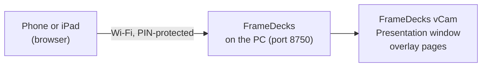

# Phone and tablet remote

Run the service from a phone or iPad: step through Frames, questions, scriptures and slides, draw on the picture, freeze or black out the screen.

**Who this is for:** service operators, remote operators and leaders who want to move freely while presenting.

**On this page**
- [How it works](#how-it-works)
- [Set up the remote](#set-up-the-remote)
- [Security](#security)
- [The remote](#the-remote)
- [Teleprompter on the phone](#teleprompter-on-the-phone)
- [Drawing from the phone](#drawing-from-the-phone)
- [iPad and tablet layout](#ipad-and-tablet-layout)
- [Add it to your home screen](#add-it-to-your-home-screen)
- [Tips for remote operators](#tips-for-remote-operators)
- [If the phone can't connect](#if-the-phone-cant-connect)

---

## How it works

The remote is a web page served by FrameDecks on your PC. Your phone opens it over your church's (or home's) Wi-Fi. Nothing goes through the internet or any outside service.

Every button on the phone changes the same live state as the PC, so the PC, the phone and everyone watching always agree.

## Set up the remote

1. On the PC, open **Settings → Phone & iPad Remote** and turn the remote **on**.
2. The first time, Windows Firewall asks about network access. Tick **Private networks** only, then select **Allow**.
3. On the phone, join the **same Wi-Fi network** as the PC.
4. Scan the **QR code** shown in Settings with the phone's camera, or type the address shown there (it looks like `http://192.168.1.20:8750`).
5. Enter the **6-digit PIN** shown in Settings.

The phone stays signed in for 30 days. After that, or after a new PIN, enter the PIN again.

> **Tip:** In the same Settings section, tick the option to turn the remote on whenever FrameDecks starts, so it is ready for every meeting.

## Security

| Protection | What it means |
| --- | --- |
| **6-digit PIN** | Only people who know the PIN can control the service |
| **Same network only** | The remote works on your local network; it isn't reachable from the internet |
| **Lockout** | After 5 wrong PINs, that device must wait 60 seconds before trying again |
| **New PIN** | **Settings → Phone & iPad Remote → New PIN** signs out every phone and iPad at once |
| **PC-only settings** | Phones can't open Settings, member lists, the Scripture API key or the FrameDecks vCam settings |
| **Live picture** | The picture on the phone's drawing pad is PIN-protected, like the rest of the remote |

> **Important:** Treat the PIN like a key to the sound desk. Share it only with the people running the service, and choose **New PIN** if it has been shared too widely.

## The remote

The remote runs the **whole meeting** from your hand. The top half never moves: the **live picture**, what is on
screen, and **Previous / Next**. Under it, the five chips hold everything else, the same **Prepare**, **Engage**,
**Control**, **Notes** and **More** as the PC's top bar and Command Center. Hold the phone upright and the chips are at
the bottom; turn it **sideways** (or use a tablet) and the picture sits on the left with the chips on the right.
It has the same look as the PC's [Command Center](presentations.md#command-center): dark glass, a
floating top bar, the chips as a floating dock, and each tool's icon in a square of its own colour.

| Part | What it does |
| --- | --- |
| **Top bar** | The meeting name and the **Connected** status, always visible |
| **Hide all** | Hides everything on screen at once. It turns solid red while something is on screen |
| **Live picture** | Exactly what is on screen, with a badge: **Off air**, **On screen**, **Black screen**, **Frozen** or **Emergency**. Its two buttons: **Spotlight** (touch the picture to point) and **Draw**. The picture shows when the phone is sideways (and on a tablet held sideways); upright it is left out so Previous / Next and the Content have the room, and only the badge stays |
| **On screen now** | *Frame 4 of 18*, the Frame's name and what it is showing, plus chips for **FrameDecks vCam**, **Recording**, **Black screen**, **Frozen** or drawings on screen |
| **Previous / Next** | Move through the Frames, in order. You can also swipe across the picture: left for the next Frame, right for the previous one (not while the Spotlight is on). **Next** is gold, shows the name of the Frame it will put on screen, and says **Start** before anything is live |

### The five chips

| Chip | What is in it |
| --- | --- |
| **Control** (blue, opens first) | The Frame on screen. Its questions, scriptures or PowerPoint slides with round **◀ ▶** arrows (*Question 2 of 5*, *Slide 3 of 12*); a **Question / Both / Scripture** switch when it has both; **Video** controls (play, pause, from the start) for videos in the picture; **On this Frame**: every Deck with an eye to show or hide it; **Black screen** (*Show picture* while on) and **Freeze** |
| **Prepare** (gold) | This meeting's date, time, place, speaker and expected people; **Switch meeting** when there are several; the whole meeting, Frame > Deck > Content, numbered like the Meeting Workbook (1 · 1.1 · 1.1.1). Tap a Frame to put it on screen, open it (**⌄**) to see its Decks and every question or scripture; and the **Teleprompter** |
| **Engage** (violet) | **Draw**, **Spotlight**, **Clear drawings** and Capture Memory (see below) |
| **Notes** (teal) | Add a note for this meeting from the phone (see below) |
| **More** (slate) | What the PC is doing (FrameDecks vCam, recording, slides) and **Disconnect this device** |

The remote remembers the chip you used last (a tab saved by an older version opens the chip it moved to). A short vibration (on Android) and a message at the bottom confirm each
press; buttons pause while the PC can't be reached.

The **Emergency** screen is on the PC only. If it is on, the badge says **Emergency**; turn it off on the PC.

## Spotlight from the phone

1. Tap **Spotlight** on the live picture (or in **Engage**). The picture fills the whole screen, on black; **Done**
   brings the remote back.
2. **Drag** a finger on the picture: the spotlight follows it on every screen, live. Lift your finger and it fades.
3. **Tap** once for a quick circle that stays for a few seconds.
4. Tap **Spotlight** again to turn it off, so touches scroll the page as usual.

The spotlight uses the colour, size and strength set on the PC (Settings → Transitions → Spotlight).

## Teleprompter on the phone

The phone can show the Frame's **Teleprompter script**, the same one you see on the PC. Only the phone shows it;
nobody watching sees it.

Select **Teleprompter**. The script opens full screen; select **Done** to close it.

Scroll with your finger, or use the play button to scroll by itself. See
[Presentations](presentations.md#teleprompter) for how to write the script.

## Capture Memory on the phone

Show a message from your phone on the live screen as a chat bubble:

1. In WhatsApp, Teams, Zoom, Messages or any app, long-press the message and choose **Copy**. Copy several messages
   or a whole conversation to show them all.
2. In the remote, open the **Engage** chip, long-press the box and choose **Paste** (or tap **Paste** when the
   remote is installed as an app).
3. Tap **Show on screen**. Each message becomes its own bubble with the sender's name, on screen at once.

Below the box are all the Memory Cards, from the phone and from the PC, newest first:

| Button | Does |
|---|---|
| **Show** / **Show again** | Puts the bubble on screen with its full text |
| **Hide** | Takes the bubble off screen; the card stays |
| **Remove** | Deletes the card |

Tick several cards and tap **Show selected** to put them on screen together, in the order they were copied. Turning
Capture on and the bubble settings stay on the PC.

## Notes from the phone

The **Notes** chip adds a note to this meeting's notes on the PC, stamped with the time and the Frame on screen, the
same as the Notes chip on the PC. Type it and tap **Save note**.

Your notes stay private, so the phone works on two levels, both set on the PC in **Settings → Controls → Phone & iPad
Remote → Notes on the phone**:

| Setting | Default | What it does |
| --- | --- | --- |
| **Add notes from the phone** | On | The phone can add notes. It never edits or deletes them |
| **Read my notes on the phone** | Off | The phone can show the notes too. Tap **Show my notes**; they hide again after a minute, or when you leave the chip or lock the phone |

Nothing of the notes is kept on the phone: it only shows how many there are until you tap **Show my notes**, and the
PC tells the browser not to keep a copy.

## Drawing from the phone

1. Select **Draw** (on the live picture or in **Engage**). The drawing pad opens with the **live picture**, exactly what Zoom, Teams or the projector shows.
2. Choose a tool (**Pen**, **Highlight**, **Arrow**, **Box**, **Circle**) and a colour.
3. Draw with your finger. The drawing appears on screen when you lift your finger.
4. **Undo** removes the last drawing; **Clear** removes them all.
5. Select **Done** to close the pad and hide the drawings.

> **Tip:** Turn the phone **sideways**. The picture then fills the screen and the tools move to a narrow column at the side, so you can draw more accurately. On Android the browser bars hide too; iPhone Safari keeps them.

While the pad is open, the phone gets a sharper picture (960 pixels wide). If the FrameDecks vCam is off, the pad shows the Frame's cards instead, so you are never drawing on a black box.

## iPad and tablet layout

On an iPad or a large tablet held sideways, the live picture and **Previous / Next** sit on the left and the chips on the right, so the whole plan is in view while you run the meeting. Upright, the chips are at the bottom as on a phone.

## Add it to your home screen

- **iPhone / iPad (Safari):** Share → **Add to Home Screen**. It opens full screen, like an app, named **FrameDecks**.
- **Android (Chrome):** ⋮ → **Add to Home screen** (or **Install app**).

The icon opens the remote directly. You still need to be on the same Wi-Fi as the PC.

## Tips for remote operators

- Charge the phone fully, and turn on **Do Not Disturb** so notifications don't cover the buttons.
- Set the phone to stay awake (screen timeout off, or as long as possible) during the service.
- Check the **Connected** status before the service starts and after any Wi-Fi change.
- Use **Freeze** before switching windows or files on the PC, then unfreeze when ready.
- If something unexpected appears, select **Hide all** first, then work out what happened.

## If the phone can't connect

| Cause | Fix |
| --- | --- |
| The remote is off | **Settings → Phone & iPad Remote** → turn it on |
| The phone is on a different network (mobile data, guest Wi-Fi) | Join the same Wi-Fi as the PC. Guest networks often block devices from seeing each other |
| Windows Firewall blocks it | On the PC, run `tools/launchers/Allow iPad Remote - run once.bat` once, or allow the app for **Private networks** |
| The network is set to **Public** in Windows | Settings → Network & internet → your Wi-Fi → **Private network** |
| Wrong PIN too many times | Wait 60 seconds, then try again |
| The PC's address changed | Scan the QR code in Settings again |

More answers: [Troubleshooting](troubleshooting.md#phone-remote).

## Related
- [Presentations](presentations.md)
- [Remote operator guide](roles/remote-operators.md)
- [Troubleshooting](troubleshooting.md)
- [FAQ](faq.md#phone-remote)
- [Getting started](getting-started.md)
