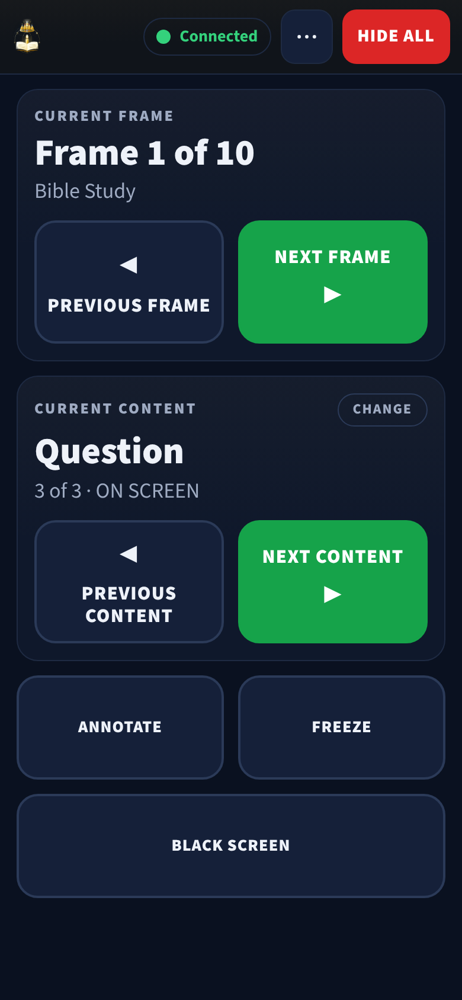

# Volunteers

Everything a new volunteer needs to help run a service with FrameDecks. You can learn it in ten minutes.

**Who this is for:** anyone helping for the first time, usually pressing Next on a phone.

**On this page**
- [Your job](#your-job)
- [Five things to know](#five-things-to-know)
- [Before the service](#before-the-service)
- [During the service](#during-the-service)
- [After the service](#after-the-service)
- [When something goes wrong](#when-something-goes-wrong)
- [Your first three weeks](#your-first-three-weeks)

---

## Your job

Move the service forward when the leader moves on, and keep the screen tidy. You don't need to understand how anything is built.

## Five things to know

| Button | When to press it |
| --- | --- |
| **NEXT CONTENT** | The leader moves to the next question, scripture or slide |
| **NEXT FRAME** | The leader moves to the next part of the service |
| **HIDE ALL** | Anything looks wrong. It clears the screen and deletes nothing |
| **BLACK SCREEN** | The screen should be dark. Press **SHOW PICTURE** to bring it back |
| **FREEZE** | You were asked to hold the picture still |

The **PREVIOUS** buttons go back one step if you press Next too early.

## Before the service

- [ ] Phone charged; **Do Not Disturb** on; screen set to stay awake.
- [ ] Joined the church Wi-Fi (the same one as the PC).
- [ ] Remote opened and showing **Connected** at the top.
- [ ] Agreed a signal with the leader (for example, a nod for Next).

## During the service

- Follow the leader, not the slide: press Next when they move on.
- Glance at **Current Content** (*Question 2 of 5*) to know where you are.
- If you are not sure, wait. A slide shown a second late is better than the wrong slide.

## After the service

- [ ] Close the remote, or leave it; nothing is changed by leaving it open.
- [ ] Tell the service operator about anything that felt confusing.

## When something goes wrong

1. Press **HIDE ALL**.
2. Tell the service operator or leader quietly.
3. Wait for them to put the right thing back on screen.

If the phone shows it is not connected, tell the operator; the PC can carry on without you.

## Your first three weeks

| Week | You… |
| --- | --- |
| 1 | Sit next to an experienced volunteer and watch |
| 2 | Press Next for part of the service while they sit beside you |
| 3 | Run it yourself, with them nearby |

## Related
- [Remote operators](remote-operators.md) (when you're ready for more)
- [Remote control](../remote-control.md)
- [Service-day checklist](service-day-checklist.md)
- [Church operations](README.md)
