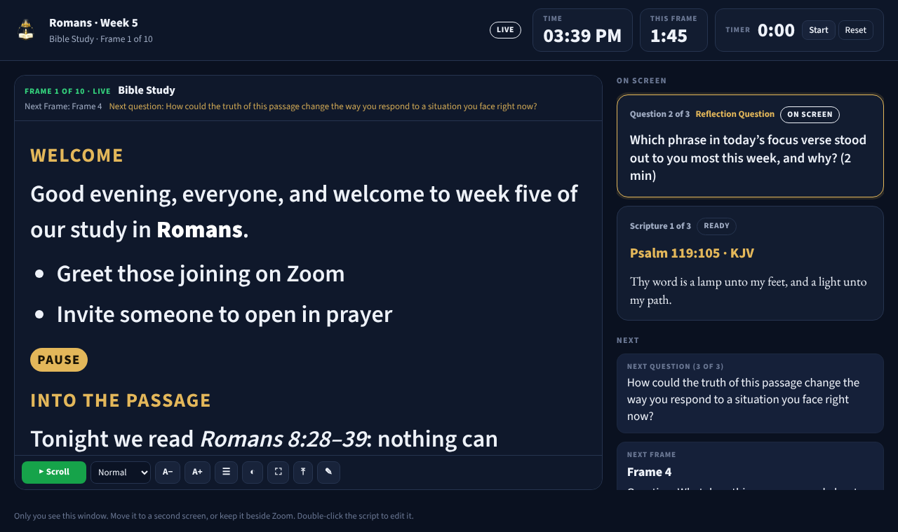

# Worship leaders and teachers

How to lead a service or Bible study with FrameDecks, so the technology supports what you say instead of distracting from it.

**Who this is for:** pastors, worship leaders, Bible study and small-group leaders, and teachers.

**On this page**
- [Your responsibilities](#your-responsibilities)
- [Five things to know](#five-things-to-know)
- [Before the service](#before-the-service)
- [During the service](#during-the-service)
- [After the service](#after-the-service)
- [When something goes wrong](#when-something-goes-wrong)
- [Getting started in this role](#getting-started-in-this-role)

---

## Your responsibilities

- Decide the order of the service and what appears on screen: questions, scriptures, announcements, song words.
- Give the media team the material in good time (ideally by midweek).
- Review the meeting before the day.
- Lead; let the operator handle the controls when you have one.

## Five things to know

1. **A meeting is a list of Frames.** Each Frame is one step of the service (Welcome, Scripture Reading, Discussion…). See [Frames](../frames.md).
2. **Your script is private.** Write what you plan to say in each Frame's **Teleprompter script**. It never appears on screen; only you see it.
3. **The Teleprompter is your confidence monitor.** **Live tools → Teleprompter → In this window** (**R**) docks it beside the Studio. **Live tools → Teleprompter → Own window** opens it on a second screen; select **On screen & next** to see what is on screen, what comes next, the time and a timer. The phone remote has it too.
   Leading on Zoom or Teams from one laptop? **Live tools → Teleprompter → Over Zoom** (**Shift+R**) puts your script in a see-through window over the meeting, so you still see the participants. Zoom and Teams never share it. See [Teleprompter overlay](../presentations.md#teleprompter-overlay-meeting-leader-mode).
4. **You can draw.** **Annotate** (**D**) lets you circle a word in a verse or underline a phrase, on the PC or from a phone.
5. **Hide all is always safe.** **Esc** (or **HIDE ALL** on the phone) clears the screen without deleting anything.

## Before the service

- [ ] Send the passage, questions, songs and announcements to the media team.
- [ ] Check each question's wording (double-click a question in its list, or its card on the Studio Canvas, to edit it).
- [ ] Write each Frame's **Teleprompter script** (Content Settings → Frame → Teleprompter script, or double-click the text in the Teleprompter). Use `# Heading`, `- bullet` and `[PAUSE]` to make it easy to follow.
- [ ] Walk through the whole meeting: select each Frame and look at the Studio Canvas, or use **Run-through** on the phone.
- [ ] Agree hand signals with the operator (for example, a nod = next).
- [ ] Leading on Zoom or Teams? Open the **Teleprompter overlay** (**Shift+R**) in a test call. Choose **Meeting** (press **3**), place it over the participants near your camera, and check that **Stay on top** (📌) is on.

## During the service

- Keep the **Teleprompter** where you can see it: docked in the Studio, the **Teleprompter window** on a second screen, the **Teleprompter overlay** over Zoom or Teams, or **TELEPROMPTER** on your phone. Press **Space** to scroll it, and **A− / A+** to change the text size.
- Watch the **This Frame** time and the **Timer** to pace discussion.
- If you run the service yourself, keep the phone in your hand on the **Simple** remote: **NEXT CONTENT** for the next question, **NEXT FRAME** for the next part.
- To fix a typo you notice on screen, double-click the card on the Studio Canvas, correct it and press **Enter**. The screen updates straight away.
- To find a Frame or question quickly, press **Ctrl+K** and type a few words. If Zoom is in front, press **Alt+Space** for **Spotlight**, which finds the same things.
- In the overlay, press **1** to **5** to make it more or less see-through: **Conference** (4) when you need to see faces, **Presenter** (2) when the text is hard to read. The toolbar fades by itself; move the mouse to bring it back.

## After the service

- [ ] Note any questions that didn't work, for next time.
- [ ] Ask the media team to keep the meeting (or save a Frame as a template) for the next week.

## When something goes wrong

Stay calm and keep leading. The congregation follows your tone more than the screen.

| Situation | Say or do |
| --- | --- |
| The wrong slide appears | Ask the operator for **HIDE ALL**, then carry on speaking |
| The screen must go dark (a sensitive moment, a mistake) | **BLACK SCREEN** (K on the PC) |
| You need a moment to find the next item | **FREEZE** (F) keeps the picture still while things change behind it |
| The phone stops working | Carry on from the PC, or ask the operator to take over |

## Getting started in this role

1. Read [Getting started](../getting-started.md) and [Service planning](../service-planning.md).
2. Build a practice meeting with three Frames, one question and one scripture.
3. Open the Teleprompter window and step through it from your phone.
4. Lead one service with an operator beside you before leading alone.

## Related
- [Church operations](README.md)
- [Service planning](../service-planning.md)
- [Presentations](../presentations.md)
- [Remote control](../remote-control.md)
- [Service-day checklist](service-day-checklist.md)
