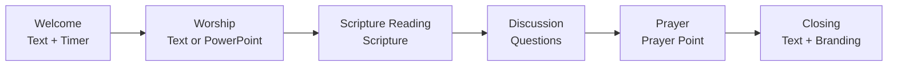

# Service planning

How to plan a service, Bible study or meeting in FrameDecks, from a blank page or from Excel.

**Who this is for:** worship leaders, small-group leaders and whoever prepares the plan for each meeting.

**On this page**
- [Think in Frames](#think-in-frames)
- [A typical order of service](#a-typical-order-of-service)
- [Three ways to start](#three-ways-to-start)
- [Organize your Frames](#organize-your-frames)
- [Reuse last week's service](#reuse-last-weeks-service)
- [Notes for the leader](#notes-for-the-leader)
- [Plan on the website](#plan-on-the-website)
- [Move a plan to a service PC](#move-a-plan-to-a-service-pc)
- [Plan in Excel with the Meeting Workbook](#plan-in-excel-with-the-meeting-workbook)
- [Export to PowerPoint](#export-to-powerpoint)
- [Planning worship lyrics today](#planning-worship-lyrics-today)
- [Weekly planning checklist](#weekly-planning-checklist)

---

## Think in Frames

A **Meeting** is your service or meeting. It is made of **Frames**, in order. Each Frame is one moment the
group or congregation sees, and it holds the **Content** for that moment.

During the meeting you move from one Frame to the next with **Frame ▶**, on the PC or the phone.

> **Tip:** Make one Frame for each change of screen. If the screen should change, it is a new Frame. If only the
> question changes, it is the next item in the same Frame's Question list.

## A typical order of service

| Frame | Suggested Content | Notes |
| --- | --- | --- |
| **Welcome** | Text ("Welcome to {meeting}"), Timer counting down to the start | `{meeting}` shows your Meeting Name |
| **Worship** | Text with the lyrics, or a PowerPoint of the lyrics | See [Planning worship lyrics today](#planning-worship-lyrics-today) |
| **Scripture Reading** | Scripture with the passage | Fetch ESV text, or type any translation |
| **Message / Discussion** | Question list, Scripture list, or PowerPoint slides | Your talking points go in the Teleprompter script |
| **Prayer** | Prayer Point | |
| **Announcements** | Text, Image | |
| **Closing** | Text, Branding (your logo and Meeting Name) | |

## Three ways to start

### 1. Quick Start
1. Select **+ New** above the Frames.
2. Choose **From a ready-made set…**.
3. Pick a ready-made meeting, for example **Sunday Service**, **Bible Study**, **Youth Service** or **Conference**.
4. The Frames appear in their own group. Rename, change or delete any of them.

### 2. From your own template
If you saved a Frame as a template (see [Frames](frames.md#templates)), it appears in the **Meeting** menu under
**From your templates**.

### 3. From scratch
1. Select **+ Frame** for each part of the service. Each new Frame is blank and goes after the selected one.
2. Name each Frame (double-click its name or press **F2**, type, then **Enter**).
3. Select a Frame, then **+ Deck**, and add what it needs. See [Content](content.md).

## Organize your Frames

- **Groups:** put a whole service in one group, for example *Romans · Week 5*. Set it in Content Settings →
  **Advanced → Group**, or from the Frame's **⋯** menu → **Move to group…**.
- **Order:** drag Frames in the list, or use **⋯ → Move up / Move down**.
- **Favourites:** star the Frames you reuse often, then use the **Favorites** filter.
- **Search:** type in **Search Frames**, or press **Ctrl+K** (or **Ctrl+Space**) to open the command palette and
  find anything. See [Presentations](presentations.md#command-palette).
- **Several at once:** **Ctrl+Click** or **Shift+Click** Frames to select several, then drag, copy (**Ctrl+C**),
  paste (**Ctrl+V**), duplicate (**Ctrl+D**) or delete them. See [Frames](frames.md#select-several-frames).
- **Library:** the **Library** filter shows ready-made Frames you can add.

## Reuse last week's service

1. Right-click a Frame (or open its **⋯** menu) and choose **Duplicate Frame**, or select it and press **Ctrl+D**.
   The copy goes right after the original.
2. To put the copy in another group, such as next week's, choose **Move to group…** on the copy (or set **Advanced →
   Group** in Content Settings).
3. Change the copy. The original is never affected.

> **Note:** A duplicate shares nothing with the original. Editing a question in the copy never changes last week's
> service.

## Notes for the leader

Each Frame has one **Teleprompter script**: what you plan to say while that Frame is on screen. Only you see it.
It is never shown on any output. If you prefer one script for the whole meeting, choose **Whole meeting** in the
Teleprompter's top bar. That script is kept with the meeting details.

| Where you write it | Where you read it during the meeting |
| --- | --- |
| Content Settings → **Teleprompter script**, or **✎ Write Script** in the Teleprompter, or **⇪ Upload** a .txt, .md or Word (.docx) file there | **Engage → Teleprompter** (R), a window over Zoom or Teams that is hidden from screen sharing, or the phone remote's Teleprompter |

Use `# Heading`, `- bullet`, `**bold**`, `*italic*`, `[PAUSE]` and `---` to make it easy to read at a glance. See
[Presentations](presentations.md#teleprompter).

## Plan on the website

On framedecks.com, **Plan** guides you in five steps. Each step shows a tick when it is done, and the step to do next
has a gold button:

| Step | Button | What it does |
| --- | --- | --- |
| **Your meeting** | **Edit details** | Opens the meeting's name, date and notes |
| **Add Frames** | **Add Frame** | A new Frame at the end of the meeting |
| **Words and media** | **Write Script** | Opens the first Frame with nothing in it, at its Teleprompter script |
| **Preview** | **Preview** | Each Frame as people will see it, with its transition; ← and → move through them |
| **Sync or export** | **Export for Service PC** | Saves the .frame file. Its status says **Synced**, **Syncing…**, **Offline** or **Sync failed** |

**Meeting details.** **Edit details** has three fields: **Meeting name**, **Date** (a date picker) and **Meeting
notes**. A date typed in an older version stays as it was typed until you change it. **Save details** shows
**✓ Saved** and "Saved. Linked service PCs get it within about a minute."

The older fields (time, location, speaker name and contact, attendees, owner, content notes and additional notes) are
no longer shown. A meeting that has them keeps them, and the form says "This meeting also has details from an earlier
version (speaker, location and so on). They are kept." The Excel Meeting Workbook on the PC is unchanged and still has
its own fields.

**Several meetings.** A workspace can hold more than one meeting, each with its own name, date, notes and
Frames. The meetings are listed at the top of Plan, each with its date and number of Frames:

- choose a meeting to plan it; the steps, the Frames and the timeline are that meeting's;
- **New meeting** asks for a name; **Make the meeting** creates it, empty, and chooses it;
- **Rename** renames the chosen meeting. Its Frames stay with it.

**The timeline.** Beside the plan (under it on a phone), the timeline shows the chosen meeting from its name down to
the last Frame, each Frame with its number, a small picture, its name and what it shows. Drag a Frame to a new place,
or select it and press **Alt + ↑** or **Alt + ↓**. The bin deletes a Frame (after asking). Click a Frame to open it,
or the meeting at the top to edit its details. **Add Frame** at the end adds one. **Hide timeline** folds it away.
Each Frame in the list has **Write Script**, **Choose Animation** (the transitions as buttons that show their
movement) and **Preview**.

**Pictures, video, audio and slides.** In a Frame's Content, **Choose file** keeps the file in this browser only (it is
never put in the cloud). It travels to the service PC inside the .frame file. On another computer or browser, or for
a file already on the service PC, type the file name instead. The Preview is an approximation: the service PC shows
the exact picture.

## Move a plan to a service PC

**Linked PC.** A PC linked to your team on framedecks.com (**Settings → Sync**) gets the plan by
itself. The header shows a **Sync** chip:

| Chip | Meaning |
| --- | --- |
| **Synced** (green) | The PC has the latest plan |
| **Syncing** | Changes are going up or coming down |
| **Offline** | No internet. Your changes wait on the PC and go up later. Presenting is not affected |
| **Sync failed** (red) | Open **Settings → Sync** to see why |

**Settings → Sync** shows the same word. Sync carries everything except media: Sync never puts pictures, video,
audio or slides in the cloud. (Members' phones is separate: while it is open, it shows pictures of the slides on
screen to phones, and removes them when the room closes.)

The PC syncs by itself as soon as the workspace changes (within a minute while it rests). To sync now, choose **Sync now**:

- in **Settings → Sync**. The line above it says **Last successful sync: …**;
- in the header: choose the **Sync** chip (often folded into the status button at the top right; choose it, then
  **Sync**). A small panel shows the status, the workspace, the last successful sync, **Sync now** and
  **Sync settings**;
- in the [command palette](presentations.md#command-palette): type *Sync now*.

While it runs, the button says **Syncing…**. Then the result shows next to it:

| Result | Meaning |
| --- | --- |
| **Sync complete: N changes received, N sent.** | The PC and the website now have the same plan |
| **No changes found. This PC already has the latest plan.** | Nothing to do |
| **Sync failed: …** | The reason follows, for example no internet. Try again when it is fixed |

**No internet, or a PC that is not linked.** Use a **.frame file**. It holds the whole plan in one file.
1. Make it:
   - on framedecks.com: **Plan → Export for Service PC** (the meeting you are planning);
   - on a PC: **Settings → Data / Backup → Export Frame File**. This also includes the pictures, video, audio and
     slides the Frames use (up to 300 MB), and this PC's Teleprompter text and Spotlight settings.

   On framedecks.com the export says exactly what is in the file (Frames, Content, questions and readings, files).
   It also lists the files the Frames use that are not in the file: "Not in the file (not in this browser): … The
   service PC must already have them."
2. Copy the file to the service PC, for example on a USB stick.
3. On the service PC: **Settings → Data / Backup → Import Frame File…** (or in Studio: **+ New → Import… → A Frame file**, formerly **Quick Start → Import a
   Frame file…**, the same import), and choose the file. A file that is cut
   short or was changed by hand is refused, and nothing changes. Export it again.
4. Choose:
   - **Use this plan** (the main button): the PC shows exactly what is in the file: the same Frames, in the same
     order, with their words, scripts and transitions, and the meeting name, date, notes and Teleprompter script.
     The PC's Frames are kept in a backup first. When the PC has other meetings, or its meeting has another name,
     only the file's meeting is replaced (or added); the PC's other meetings and their Frames are kept, and the PC
     then shows the file's meeting.
   - **Add after my Frames**: keeps the PC's Frames and adds the file's at the end. Shown only when the PC already
     has Frames.
   - **Cancel**.
5. Read the check in the **Frame files** box. "✓ Checked against the file: … Everything matches." means the PC has
   exactly what is in the file. Otherwise each difference is marked ⚠. "⚠ Not on this PC yet: …" lists pictures and
   videos the Frames use that are not on this PC.

Both commands are also in the [command palette](presentations.md#command-palette): type *Frame File*. Full details
are in [The .frame file](../reference/frame-file.md).

## Plan in Excel with the Meeting Workbook

Excel is optional. The **Meeting Workbook** is useful when you want to type a whole series of questions or verses at
once. To move a plan to another PC, use a [.frame file](#move-a-plan-to-a-service-pc) instead.

### Two tabs: Dashboard and Meeting Form

The workbook has just two tabs.

**Meeting Form** is where you type. It is one page, read from top to bottom, in numbered sections:

| Section | What you fill in |
| --- | --- |
| **1 · Meeting details** | Meeting name, Date, Time, Location / link, Meeting notes |
| **2 · Speaker** | Speaker name, Speaker contact |
| **3 · Attendees** | Expected attendees, Attendee notes |
| **4 · Presentation** | Presentation owner, Content notes |
| **5 · Meeting plan** | One table, like the app: a **Frame** row for each screen (1, 2, 3), **Deck** rows for what it shows (1.1, 1.2) and **Content** rows for each question or verse in a Deck (1.1.1, 1.1.2). The numbers fill in by themselves |
| **6 · Additional notes** | Anything else: equipment, follow-ups, prayer requests |

- Type in the **cream** boxes. **Tab** moves to the next box.
- Type the date like `2026-10-25` and the time like `19:00`.
- Many cells have a drop-down list (Level, Type, Effect). Pick from it.
- The plan shows a few empty rows. Need more? Select the **+** button in the left margin to open the next rows.
- Import it with **+ New → Import… → A meeting from Excel…**, or in Settings → Data / Backup.

**Dashboard** fills itself in from the Meeting Form. You never type on it, and it is never imported. It shows the
meeting at a glance: how many days to go, the counts of Frames, Content, questions and scriptures, a **Readiness**
checklist, **Quick actions** that jump into the form, a **Content mix** chart, and a **Recent meetings** log. Add a
row to that log after each meeting, and the meeting tiles count them.

Full details are in [reference/meeting-workbook-and-branding.md](../reference/meeting-workbook-and-branding.md).

The same form is on the FrameDecks website, guided step by step ([Plan on the website](#plan-on-the-website)).
It reaches a linked PC by itself, with no file to import
([design](../architecture/meeting-form.md)). The Excel workbook below still works; it is under
**Settings → Data / Backup → Meeting from Excel** and leaves the program in a later version, once the website form has been tested in a real meeting.

### Import a meeting
1. **Settings → Data / Backup → Meeting from Excel** → **Download the Excel template**, then fill in the **Meeting Form** tab.
2. **Import a meeting from Excel…** (same place) and choose the file.
3. Read the **preview**. It lists the Frames and Content that will be made, and every problem with where it is, for
   example *Meeting Form · Content · row 26*. Fix problems in Excel and import again.
4. Choose **Append** (add to what you have) or **Replace**.
5. Changed your mind? **Undo the last Excel import** (same place in Settings).

Workbooks made with earlier versions still import.

### Export a meeting
**Export this meeting (Excel)** (**Settings → Data / Backup → Meeting from Excel**) saves the same **Dashboard** and **Meeting Form**, filled in, to your
Downloads folder. You can edit that file and import it again, or give it to a co-leader.

> **Important:** After an import, **the app is the source of truth**. The Excel file is not linked. Changes you make
> in the app do not go back into the file; export again to get an up-to-date copy.

> **Note:** Audio and Web Page rows are accepted but skipped with a note, because those Content types are not
> available yet.

## Export to PowerPoint

**Meeting → Export this meeting to PowerPoint** saves the whole service as a `.pptx` that anyone can open, print or
send. The file is made on this PC and never uploaded.
- **Slides.** A title slide, then one slide per Frame in order (templates are left out), in FrameDecks navy and gold.
- **Words.** Each Frame's scripture (reference and text), questions, and announcement, prayer or text Content, as
  editable text.
- **Media.** Its pictures from this PC; videos, audio and PDFs by name.
- **Notes.** Each Frame's Teleprompter script as the speaker notes.

## Planning worship lyrics today

FrameDecks does not have a song library yet. A dedicated song library is on the [roadmap](../ROADMAP.md).
Today, churches show lyrics in one of two ways:

1. **Text Content:** one Frame per verse or chorus. Add **+ Deck → Text**, give it a title (the song name) and
   type the words. Duplicate the Frame for the next verse and change the words; step through with **Frame ▶**.
2. **PowerPoint or PDF:** add your existing lyric slides with **+ Deck → PowerPoint…** and step through the slides
   with Page Up / Page Down or the phone.

> **Important:** Make sure your church has the right licence to project the songs you use. FrameDecks does not
> track or report song usage.

## Weekly planning checklist

- [ ] Duplicate last week's Frames and move the copies into a new group, or start from **+ New → From a ready-made set…**.
- [ ] Update every Frame name so the volunteer running it knows what comes next.
- [ ] Add this week's questions and scriptures, and write each Frame's Teleprompter script.
- [ ] Preview each Frame on the Studio Canvas (select it; the badge says PREVIEW).
- [ ] Check spelling by double-clicking cards on the canvas.
- [ ] Add any videos, images and PowerPoint files, and check they open.
- [ ] Hand over: tell the service operator the group name. If the service PC is not linked or has no internet, give
  them a [.frame file](#move-a-plan-to-a-service-pc).

## Related
- [Frames](frames.md)
- [Content](content.md)
- [Presentations](presentations.md)
- [Media](media.md)
- [Meeting Workbook reference](../reference/meeting-workbook-and-branding.md)
- [Ministry team guides](roles/README.md)
