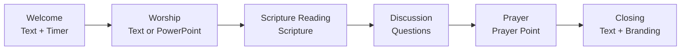

# Service planning

How to plan a service, Bible study or meeting in FrameDecks, from a blank page or from Excel.

**Who this is for:** worship leaders, small-group leaders and whoever prepares the order of service each week.

**On this page**
- [Think in Frames](#think-in-frames)
- [A typical order of service](#a-typical-order-of-service)
- [Three ways to start](#three-ways-to-start)
- [Organize your Frames](#organize-your-frames)
- [Reuse last week's service](#reuse-last-weeks-service)
- [Notes for the leader](#notes-for-the-leader)
- [Plan in Excel with the Meeting Workbook](#plan-in-excel-with-the-meeting-workbook)
- [Export to PowerPoint](#export-to-powerpoint)
- [Planning worship lyrics today](#planning-worship-lyrics-today)
- [Weekly planning checklist](#weekly-planning-checklist)

---

## Think in Frames

A **Meeting** is your service or meeting. It is made of **Frames**, in order. Each Frame is one moment the
congregation or group sees, and it holds the **Content** for that moment.

During the meeting you move from one Frame to the next with **Frame ▶**, on the PC or the phone.

> **Tip:** Make one Frame for each change of screen. If the screen should change, it is a new Frame. If only the
> question changes, it is the next item in the same Frame's Question list.

## A typical order of service

| Frame | Suggested Content | Notes |
| --- | --- | --- |
| **Welcome** | Text ("Welcome to {meeting}"), Timer counting down to the start, Icebreaker | `{meeting}` shows your Meeting Name |
| **Worship** | Text with the lyrics, or a PowerPoint of the lyrics | See [Planning worship lyrics today](#planning-worship-lyrics-today) |
| **Scripture Reading** | Scripture with the passage | Fetch ESV text, or type any translation |
| **Message / Discussion** | Question list, Scripture list, Discussion topic, Poll, or PowerPoint slides | Your talking points go in the Teleprompter script |
| **Prayer** | Prayer Point | |
| **Announcements** | Text, Image | |
| **Closing** | Text, Branding (your logo and Meeting Name) | |

## Three ways to start

### 1. Quick Start
1. Select the **✨ Meeting** button next to **+ Frame**.
2. Choose **Quick Start…**.
3. Pick a ready-made meeting, for example **Sunday Service**, **Bible Study**, **Youth Service** or **Conference**.
4. The Frames appear in their own group. Rename, change or delete any of them.

### 2. From your own template
If you saved a Frame as a template (see [Frames](frames.md#templates)), it appears in the **Meeting** menu under
**From your templates**.

### 3. From scratch
1. Select **+ Frame** for each part of the service. Each new Frame is blank and goes after the selected one.
2. Name each Frame (double-click its name or press **F2**, type, then **Enter**).
3. Select a Frame, then **+ Content**, and add what it needs. See [Content](content.md).

## Organize your Frames

- **Groups:** put a whole service in one group, for example *Romans · Week 5*. Set it in Content Settings →
  **Frame → Group**, or from the Frame's **⋯** menu → **Move to group…**.
- **Order:** drag Frames in the list, or use **⋯ → Move up / Move down**.
- **Favourites:** star the Frames you reuse often, then use the **Favorites** filter.
- **Search:** type in **Search Frames**, or press **Ctrl+K** (or **Ctrl+Space**) to open the command palette and
  find anything. See [Presentations](presentations.md#command-palette).
- **Several at once:** **Ctrl+Click** or **Shift+Click** Frames to select several, then drag, copy (**Ctrl+C**),
  paste (**Ctrl+V**), duplicate (**Ctrl+D**) or delete them. See [Frames](frames.md#select-several-frames).
- **Library:** the **Library** filter shows ready-made Frames you can add.

## Reuse last week's service

1. Open the **⋯** menu on a Frame (or select it and press **Ctrl+D**).
2. Choose a duplicate option:
   - **Duplicate**: an exact, fully independent copy;
   - **Duplicate & edit question**: copies the Frame and opens its question for editing;
   - **Duplicate with options…**: choose what to copy (Content, layout, branding, animations, transitions, output routing);
   - **Duplicate Content structure only**: the same Content, with empty lists;
   - **Duplicate to group…**: copies it straight into another group, such as next week's.
3. Change the copy. The original is never affected.

> **Note:** A duplicate shares nothing with the original. Editing a question in the copy never changes last week's
> service.

## Notes for the leader

Each Frame has one **Teleprompter script**: what you plan to say while that Frame is on screen. Only you see it.
It is never shown on any output.

| Where you write it | Where you read it during the meeting |
| --- | --- |
| Content Settings → **Frame → Teleprompter script**, or double-click the text in the Teleprompter | **Program → Teleprompter** (R), the **Teleprompter window** on a second screen, or the phone remote's Teleprompter |

Use `# Heading`, `- bullet`, `**bold**`, `*italic*`, `[PAUSE]` and `---` to make it easy to read at a glance. See
[Presentations](presentations.md#teleprompter).

> **Note:** Before 6.7 this was called *Leader notes*, and questions and scriptures had their own Answer and Notes.
> Those are no longer shown anywhere, but they are kept in your data. Older workbooks still import: their answers
> and notes go into the Frame's Teleprompter script.

## Plan in Excel with the Meeting Workbook

Excel is optional. The **Meeting Workbook** is useful when one person plans the service and another runs it, or
when you want to type a whole series of questions at once.

### Two tabs: Dashboard and Meeting Form

Since 6.9 the workbook has just two tabs.

**Meeting Form** is where you type. It is one page, read from top to bottom, in numbered sections:

| Section | What you fill in |
| --- | --- |
| **1 · Meeting details** | Meeting name, Date, Time, Location / link, Meeting notes |
| **2 · Speaker** | Speaker name, Speaker contact |
| **3 · Attendees** | Expected attendees, Attendee notes |
| **4 · Presentation** | Presentation owner, Content notes |
| **5 · Frames** | A table: one row per Frame (name, purpose, background, transition, presenter script) |
| **6 · Content** | A table: what each Frame shows, in order |
| **7 · Discussion questions** | A table: the questions of each Question item |
| **8 · Scripture readings** | A table: the scriptures of each Scripture item |
| **9 · Additional notes** | Anything else: equipment, follow-ups, prayer requests |

- Type in the **cream** boxes. **Tab** moves to the next box.
- Type the date like `2026-10-25` and the time like `19:00`.
- Many cells have a drop-down list (Content type, Background, Transition, Animation and so on). Pick from it.
- Each table shows a few empty rows. Need more? Select the **+** button in the left margin to open the next rows.

**Dashboard** fills itself in from the Meeting Form. You never type on it, and it is never imported. It shows the
meeting at a glance: how many days to go, the counts of Frames, Content, questions and scriptures, a **Readiness**
checklist, **Quick actions** that jump into the form, a **Content mix** chart, and a **Recent meetings** log. Add a
row to that log after each meeting, and the meeting tiles count them.

Full details are in [reference/meeting-workbook-and-branding.md](../reference/meeting-workbook-and-branding.md).

Since 6.11 the same form is on the FrameDecks website: **Meeting Form** in the companion
(framedecks.pages.dev). It reaches a linked PC by itself, with no file to import
([design](../architecture/meeting-form.md)). The Excel workbook below still works; it is under
**Settings → Data / Backup → Meeting from Excel** and leaves the program in 6.12.

### Import a meeting
1. **Settings → Data / Backup → Meeting from Excel** → **Download the Excel template**, then fill in the **Meeting Form** tab.
2. **Import a meeting from Excel…** (same place) and choose the file.
3. Read the **preview**. It lists the Frames and Content that will be made, and every problem with where it is, for
   example *Meeting Form · Content · row 26*. Fix problems in Excel and import again.
4. Choose **Append** (add to what you have) or **Replace**.
5. Changed your mind? **Undo the last Excel import** (same place in Settings).

Workbooks from earlier versions (one sheet per list, from 6.5 to 6.8, or the 6.2 one-sheet template) still import.

### Export a meeting
**Export this meeting (Excel)** (**Settings → Data / Backup → Meeting from Excel**) saves the same **Dashboard** and **Meeting Form**, filled in, to your
Downloads folder. You can edit that file and import it again, or give it to a co-leader.

> **Important:** After an import, **the app is the source of truth**. The Excel file is not linked. Changes you make
> in the app do not go back into the file; export again to get an up-to-date copy.

> **Note:** Audio and Web Page rows are accepted but skipped with a note, because those Content types are not
> available yet.

## Export to PowerPoint

**Meeting → Export this meeting to PowerPoint** saves the whole service as a `.pptx` that anyone can open, print or
send. The file is made on this PC and never uploaded.
- **Slides.** A title slide, then one slide per Frame in order (templates are left out), in FrameDecks navy and gold.
- **Words.** Each Frame's scripture (reference and text), questions, and announcement, prayer or text Content, as
  editable text.
- **Media.** Its pictures from this PC; videos, audio and PDFs by name.
- **Notes.** Each Frame's Teleprompter script as the speaker notes.

## Planning worship lyrics today

FrameDecks does not have a song library yet. A dedicated song library is on the [roadmap](../ROADMAP.md).
Today, churches show lyrics in one of two ways:

1. **Text Content:** one Frame per verse or chorus. Add **+ Content → Text**, give it a title (the song name) and
   type the words. Duplicate the Frame for the next verse and change the words; step through with **Frame ▶**.
2. **PowerPoint or PDF:** add your existing lyric slides with **+ Content → PowerPoint…** and step through the slides
   with Page Up / Page Down or the phone.

> **Important:** Make sure your church has the right licence to project the songs you use. FrameDecks does not
> track or report song usage.

## Weekly planning checklist

- [ ] Duplicate last week's service into a new group, or start from Quick Start.
- [ ] Update every Frame name so the volunteer running it knows what comes next.
- [ ] Add this week's questions and scriptures, and write each Frame's Teleprompter script.
- [ ] Preview each Frame on the Studio Canvas (select it; the badge says PREVIEW).
- [ ] Check spelling by double-clicking cards on the canvas.
- [ ] Add any videos, images and PowerPoint files, and check they open.
- [ ] Hand over: tell the service operator the group name, or export the Meeting Workbook for them.

## Related
- [Frames](frames.md)
- [Content](content.md)
- [Presentations](presentations.md)
- [Media](media.md)
- [Meeting Workbook reference](../reference/meeting-workbook-and-branding.md)
- [Ministry team guides](../ministry/README.md)
