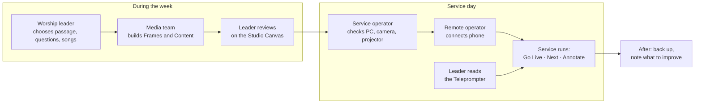

# Church operations

How a church team runs services with FRAMEDECKS: who does what, how the roles work together, and how to train new volunteers.

**Who this is for:** pastors, worship leaders, media team leads and anyone who schedules or trains volunteers.

**On this page**
- [The roles](#the-roles)
- [How the roles work together](#how-the-roles-work-together)
- [Onboarding new volunteers](#onboarding-new-volunteers)
- [Training plan](#training-plan)
- [Role guides](#role-guides)

---

## The roles

Small groups often have one person doing everything. Larger services split the work. Use the roles that fit your church.

| Role | Main job | Uses | Guide |
| --- | --- | --- | --- |
| **Worship leader / teacher** | Leads the service; decides what is said and shown | The Teleprompter (or Teleprompter window), sometimes the phone remote | [Worship leaders](worship-leaders.md) |
| **Media team** | Prepares Frames, slides, videos and scripture before the service | The Studio on the PC | [Media team](media-team.md) |
| **Service operator** | Runs the PC during the service: Go Live, Next, recovery | The PC (command bar, Program menu) | [Service operators](service-operators.md) |
| **Remote operator** | Runs the service, or draws, from a phone or iPad | The phone remote | [Remote operators](remote-operators.md) |
| **Volunteer** | Helps with one simple task, usually Next on the phone | The Simple remote | [Volunteers](volunteers.md) |

## How the roles work together

A typical Sunday:
1. **Day before:** the media team finishes the meeting; the leader checks it on the Studio Canvas and reads through the Teleprompter script.
2. **One hour before:** the service operator starts the PC, FRAMEDECKS, the meeting app and the projector.
3. **30 minutes before:** the remote operator connects the phone; everyone runs through the first Frames together.
4. **During:** the operator (or phone) steps through Frames; the leader reads the script in the Teleprompter.
5. **After:** back up, and write down anything to improve next week.

The [service-day checklist](service-day-checklist.md) has the full timeline.

## Onboarding new volunteers

Every role follows the same three-week pattern. Nobody runs a live service alone before week 3.

| Week | Mode | What happens |
| --- | --- | --- |
| **1. Shadow** | Watch | Sit next to an experienced person during a service. Ask questions afterwards. Read your role guide |
| **2. Assisted** | Do, with help | Run part of the service (for example, the questions section) while the experienced person sits beside you and can take over |
| **3. Solo** | Do | Run the whole role. The experienced person is nearby but not at the controls |

Before week 1, give the new volunteer:
- their role guide;
- 20 minutes with a practice meeting (any meeting not on air: use **Run-through** on the phone, or Frames that are not live on the PC);
- the [emergency card](service-day-checklist.md#emergency-card).

> **Tip:** Practise recovery, not just the happy path. Ask every new volunteer to use **HIDE ALL**, **BLACK SCREEN** and **FREEZE** at least once during training, so they are not surprised by them on a Sunday.

## Training plan

A one-hour team training session that covers everyone:

| Time | Topic | Who |
| --- | --- | --- |
| 0:00 | What FRAMEDECKS is: Meeting → Frame → Content → Present | All |
| 0:10 | Building a Frame: + Frame, + Content, Content Settings | Media team |
| 0:25 | Presenting: Go Live, Next, Hide all, Blackout, Freeze | Operators |
| 0:35 | The phone remote: connect, Simple remote, drawing | Remote operators, volunteers |
| 0:45 | The Teleprompter: the script, what's next, timer | Leaders |
| 0:50 | Something goes wrong: practise recovery | All |
| 0:55 | Questions; schedule shadow weeks | All |

## Role guides

- [Worship leaders and teachers](worship-leaders.md)
- [Media team](media-team.md)
- [Service operators](service-operators.md)
- [Remote operators](remote-operators.md)
- [Volunteers](volunteers.md)
- [Service-day checklist and emergency card](service-day-checklist.md)

## Related
- [Getting started](../getting-started.md)
- [Service planning](../service-planning.md)
- [Remote control](../remote-control.md)
- [Troubleshooting](../troubleshooting.md)
- [FAQ](../faq.md)
