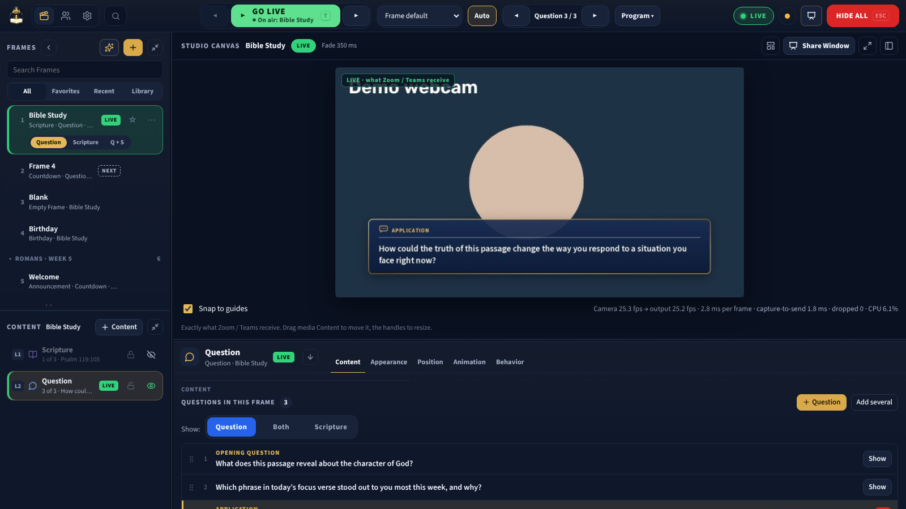

# Media team

How to prepare a meeting in Kingdom Connect so the service runs smoothly: Frames, Content, slides, videos and scripture.

**Who this is for:** media team members who build the meeting before the service.

**On this page**
- [Your responsibilities](#your-responsibilities)
- [Five things to know](#five-things-to-know)
- [Building the meeting](#building-the-meeting)
- [Before the service](#before-the-service)
- [During the service](#during-the-service)
- [After the service](#after-the-service)
- [When something goes wrong](#when-something-goes-wrong)
- [Getting started in this role](#getting-started-in-this-role)

---

## Your responsibilities

- Turn the leader's plan into Frames and Content.
- Prepare media: pictures, videos, PowerPoint decks, song words.
- Fetch or type every scripture.
- Check everything on the Studio Canvas before the day.
- Keep the PC tidy: files on the PC, backups made.

## Five things to know

1. **+ Frame, then + Content.** + Frame adds a blank Frame after the selected one; select it, then **+ Content** to add a Question, Scripture, Text, Image, Video, Timer or PowerPoint.
2. **Every Frame owns its Content.** Changing a question in one Frame never changes another. **Duplicate** makes a fully separate copy.
3. **Content Settings has everything.** One panel, in groups: Content, Appearance, Position, Timing, Animation, Media, Behavior.
4. **Kingdom Connect keeps copies of your files.** Added pictures, videos and slides keep working if the originals move.
5. **Excel is optional.** The Meeting Workbook builds a whole meeting from a spreadsheet; the app is the source of truth after import.

## Building the meeting

1. Make one Frame per part of the service, in order. Name each one clearly (double-click its name): *Welcome*, *Worship 1*, *Reading*, *Discussion*, *Closing*.
2. Add Content to each Frame:
   - **Question**: add questions to its list; double-click one to add its label, answer and notes.
   - **Scripture**: type a reference and **Fetch scripture** (ESV), or choose **Fetch from → Type it myself**.
   - **Text**: announcements, song words (one Frame per verse or chorus), prayer points.
   - **PowerPoint**: a .pptx or PDF; set **Start at slide** if needed.
   - **Video / Image**: choose the file, then place it.
   - **Timer**: a countdown before the service starts.
3. Arrange the order of questions or scriptures by **dragging** them, or with ↑ / ↓.
4. Check the look in **Appearance** and **Position** (text size, width, card opacity).

See [Content](../content.md) and [Media](../media.md) for every option.

## Before the service

- [ ] Every Frame checked on the Studio Canvas (select it; the canvas shows a preview without going on air).
- [ ] Every scripture has its text (fetched ones are kept on the PC for offline use).
- [ ] Every PowerPoint opens and its slides look right.
- [ ] Videos play; their sound plan agreed with the sound team (Kingdom Connect doesn't carry audio).
- [ ] Spelling checked; double-click any card on the canvas to correct it.
- [ ] **Settings → Data / Backup → Back up now**.

## During the service

Usually the service operator runs the controls. Stay available to:
- fix a typo (double-click the card on the canvas, correct, **Enter**);
- add a last-minute Text Content (a prayer request, a notice);
- find a file or slide the leader asks for.

> **Important:** Avoid editing the Frame that is live unless you must: changes to it appear on screen as soon as they are saved.

## After the service

- [ ] **Back up now**.
- [ ] Save reusable Frames as templates (**Save as template** in Content Settings → Frame).
- [ ] Export the meeting to Excel if it should be kept or shared (Meeting menu → **Export this meeting to Excel**).

## When something goes wrong

| Situation | Fix |
| --- | --- |
| A PowerPoint won't convert | Save it as PDF and add the PDF. See [Troubleshooting](../troubleshooting.md#powerpoint-and-media) |
| A scripture won't fetch | Use **Type it myself** and paste the text |
| Wrong content went on screen | Operator: **Hide all** (**Esc**); then fix the Frame |
| An Excel import went wrong | Meeting menu → **Undo the last Excel import** |

## Getting started in this role

1. Read [Getting started](../getting-started.md), [Frames](../frames.md) and [Content](../content.md).
2. Rebuild last week's service from scratch as practice.
3. Shadow one service build, then build one with help, then alone ([onboarding plan](README.md#onboarding-new-volunteers)).

## Related
- [Service planning](../service-planning.md)
- [Content](../content.md)
- [Media](../media.md)
- [Meeting Workbook and branding](../reference/meeting-workbook-and-branding.md)
- [Church operations](README.md)
