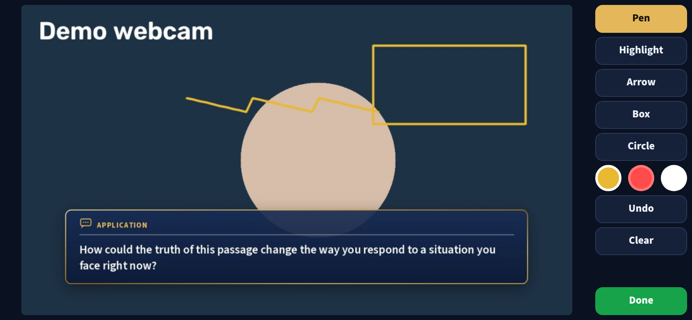

# Remote operators

How to run a service, or draw on the screen, from a phone or iPad with the FRAMEDECKS remote.

**Who this is for:** anyone controlling the service from a phone or tablet, in the room or nearby.

**On this page**
- [Your responsibilities](#your-responsibilities)
- [Five things to know](#five-things-to-know)
- [Before the service](#before-the-service)
- [During the service](#during-the-service)
- [After the service](#after-the-service)
- [When something goes wrong](#when-something-goes-wrong)
- [Getting started in this role](#getting-started-in-this-role)

---

## Your responsibilities

- Step through Frames and Content in time with the leader.
- Draw on the picture when asked (circle a word, underline a phrase).
- Keep an eye on the connection and hand back to the PC if needed.

## Five things to know

1. **Simple or Advanced.** The **Simple** remote has big buttons for Frames and Content. **⋯ → Advanced remote** adds search, a Teleprompter panel, slides and Run-through.
2. **CHANGE** switches between questions, scriptures and slides when a Frame has more than one.
3. **ANNOTATE** shows the live picture; draw with your finger, and it appears on screen when you lift it. Turn the phone sideways for a full-screen picture.
4. **Run-through** (Advanced) lets you look ahead on the phone without changing the screen.
5. **HIDE ALL** is always at the top right.

## Before the service

- [ ] Phone charged (or on a charger); **Do Not Disturb** on; screen stays awake.
- [ ] On the same Wi-Fi as the PC; remote open and showing **Connected**.
- [ ] Agreed with the service operator who controls Next.
- [ ] Tried **ANNOTATE** once: draw, **Undo**, **Done**.
- [ ] Used **Run-through** to check the order of the Frames.

## During the service

- Follow the leader's pace; glance at **Current Frame** and **Current Content** to stay oriented.
- When drawing, use short, simple marks; **Undo** removes the last one; **Done** hides all drawings.
- If you help lead the discussion, read the Frame's script: **TELEPROMPTER** in the Simple remote (full screen), or the **Teleprompter** panel on the Advanced remote's **Live** tab. Only you see it.

## After the service

- [ ] Select **Done** if the drawing pad is still open, so drawings are hidden.
- [ ] Tell the service operator about any connection drops.

## When something goes wrong

| Situation | Do this |
| --- | --- |
| Wrong item on screen | **HIDE ALL**, then step to the right item |
| Pressed Next too early | **PREVIOUS CONTENT** or **PREVIOUS FRAME** |
| Screen must go dark | **BLACK SCREEN** (press **SHOW PICTURE** to return) |
| "Not connected" | Check Wi-Fi; tell the operator, who carries on from the PC. See [Remote control](../remote-control.md#if-the-phone-cant-connect) |
| Drawing pad shows only cards | The camera is off or starting; you can still draw |
| Locked after wrong PINs | Wait 60 seconds, then enter the PIN from Settings |

## Getting started in this role

1. Read [Remote control](../remote-control.md).
2. Connect your phone and practise with **Run-through** during the week.
3. Follow the [three-week onboarding plan](README.md#onboarding-new-volunteers).

## Related
- [Remote control](../remote-control.md)
- [Volunteers](volunteers.md)
- [Service operators](service-operators.md)
- [Service-day checklist](service-day-checklist.md)
- [Church operations](README.md)
