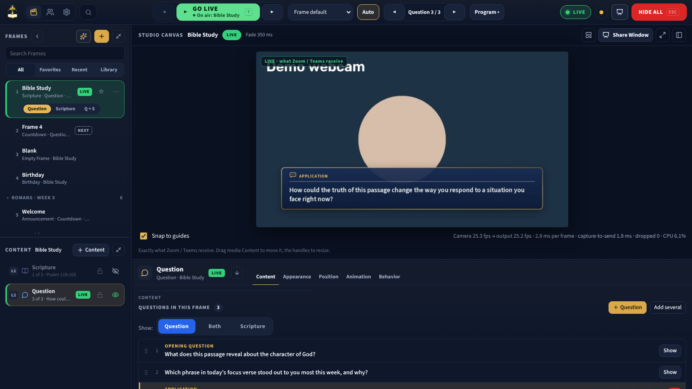

# Service operators

How to run the FRAMEDECKS PC during a service: setup, presenting, and calm recovery when something goes wrong.

**Who this is for:** the person at the PC (or "booth") during the service.

**On this page**
- [Your responsibilities](#your-responsibilities)
- [Five things to know](#five-things-to-know)
- [Keyboard shortcuts](#keyboard-shortcuts)
- [Before the service](#before-the-service)
- [During the service](#during-the-service)
- [After the service](#after-the-service)
- [When something goes wrong](#when-something-goes-wrong)
- [Getting started in this role](#getting-started-in-this-role)

---

## Your responsibilities

- Start and check the PC, FRAMEDECKS, the meeting app, the camera and the projector.
- Put each Frame on screen at the right moment and step through its Content.
- Keep the screen clean and recover quickly from mistakes.
- Back up after the service.

## Five things to know

1. **Selecting a Frame does not put it on air.** The Studio Canvas shows a **PREVIEW**. **Go Live** (**T**) puts it on screen; the badge then reads **LIVE**.
2. **◀ Frame / Frame ▶** in the command bar move to the previous or next Frame and put it on screen.
3. **◀ Question ▶** (or the arrow keys) step through the live Frame's questions; **Shift + arrows** step through its scriptures; **Page Up / Page Down** step through slides.
4. **The Live tools menu is your safety kit:** Hide Content, **Blackout** (K), Emergency, **Annotate** (D), **Freeze** (F), **Teleprompter** (R), **Teleprompter window**, **Teleprompter overlay** (Shift+R).
5. **Hide all** (**Esc**) clears everything and deletes nothing.

## Keyboard shortcuts

| Key | Action |
| --- | --- |
| **T** | Go Live with the selected Frame |
| **→ / ←** | Next / previous question |
| **Shift + → / ←** | Next / previous scripture |
| **Page Down / Page Up** | Next / previous slide |
| **K** | Blackout |
| **F** | Freeze |
| **D** | Annotate |
| **Esc** | Hide all (or stop annotating) |
| **R** | Teleprompter on / off (only you see it) |
| **Shift+R** | Teleprompter overlay on / off (see-through, over Zoom or Teams; only you see it) |
| **Ctrl+K** or **Ctrl+Space** | Command palette: find Frames, Content, questions, references, settings; run commands such as Go Live |
| **Alt+Space** | Spotlight: the same search from anywhere in Windows, even with FRAMEDECKS in the tray |

Shortcuts are ignored while you type in a box. Shortcut keys can be changed in Settings. Spotlight's shortcut is set
in **Settings → General → Window and tray**; if another program uses Alt+Space, it is **Ctrl+Alt+Space**.

## Before the service

- [ ] PC on mains power; Windows updates paused; notifications off (Focus / Do Not Disturb).
- [ ] FRAMEDECKS open; the command bar status shows **FRAMEDECKS** ready.
- [ ] Meeting app open with **FRAMEDECKS** chosen as its camera (restart the app if it isn't listed).
- [ ] Projector: **Share Window** on the Studio Canvas → move the Presentation window to the projector → full screen.
- [ ] Phone remote on (**Settings → Phone & iPad Remote**) and the remote operator connected.
- [ ] Walk through the first three Frames with **Go Live** and check the projector and the meeting app's self-view.
- [ ] Put the opening Frame (for example, a countdown Timer) live.

## During the service

- Keep your eyes on the leader as well as the screen.
- Use **Freeze** before switching files or windows on the PC, so viewers don't see the change.
- Watch the status chips: **BLACKOUT ▾**, **FROZEN ▾** or **ANNOTATING ▾** on the Program button mean that mode is on.
- If a remote operator is running Next, don't fight them: agree who has control before the service.
- Working mostly in Zoom or OBS? Hide FRAMEDECKS to the tray (**Minimize → Hide To Tray**) and press
  **Alt+Space** for **Spotlight**. **Go Live**, **Next / Previous Frame**, **Hide all**, **Blackout** and **Freeze**
  run from Spotlight without bringing the main window back. The tray icon's menu has **Open App**, **Teleprompter**,
  **Search** and, under **More**, **Hide all overlays** and **Stop screen share**. See
  [Spotlight](../presentations.md#spotlight).

## After the service

- [ ] **Hide all**, then close the meeting app.
- [ ] **Settings → Data / Backup → Back up now**.
- [ ] Close FRAMEDECKS with **Keep running in the background** or **Quit**, as your church prefers.
- [ ] Write down problems and fixes for the team.

## When something goes wrong

| Situation | First action | Then |
| --- | --- | --- |
| Wrong thing on screen | **Esc** (Hide all) | Select the right Frame, **Go Live** |
| Must go dark now | **K** (Blackout) | Press **K** again when ready |
| Need time to fix something | **F** (Freeze) | Fix it, then **F** again |
| A message for everyone (technical problem) | **Program → Emergency** | Turn it off when solved |
| Meeting app shows no camera | Choose **FRAMEDECKS** again in the app | Restart the app if it isn't listed |
| Phone remote stopped | Carry on from the PC | See [Troubleshooting](../troubleshooting.md#phone-remote) |

## Getting started in this role

1. Read [Presentations](../presentations.md), [Media](../media.md) and [Troubleshooting](../troubleshooting.md).
2. Practise Go Live, Next, Blackout, Freeze and Hide all on a meeting that is not on a real call.
3. Follow the [three-week onboarding plan](README.md#onboarding-new-volunteers).

## Related
- [Service-day checklist](service-day-checklist.md)
- [Presentations](../presentations.md)
- [Troubleshooting](../troubleshooting.md)
- [Remote operators](remote-operators.md)
- [Church operations](README.md)
