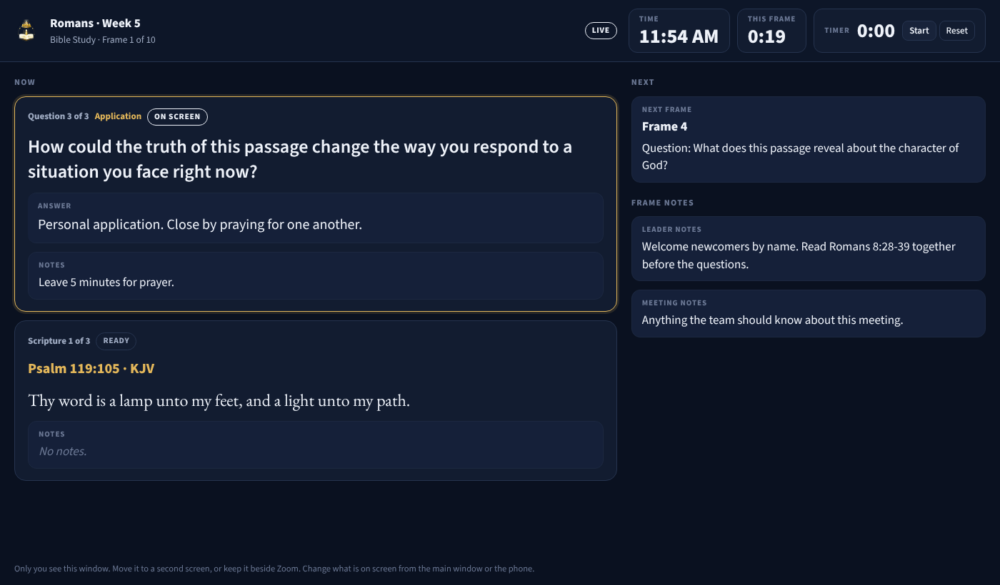

# Worship leaders and teachers

How to lead a service or Bible study with Kingdom Connect, so the technology supports what you say instead of distracting from it.

**Who this is for:** pastors, worship leaders, Bible study and small-group leaders, and teachers.

**On this page**
- [Your responsibilities](#your-responsibilities)
- [Five things to know](#five-things-to-know)
- [Before the service](#before-the-service)
- [During the service](#during-the-service)
- [After the service](#after-the-service)
- [When something goes wrong](#when-something-goes-wrong)
- [Getting started in this role](#getting-started-in-this-role)

---

## Your responsibilities

- Decide the order of the service and what appears on screen: questions, scriptures, announcements, song words.
- Give the media team the material in good time (ideally by midweek).
- Review the meeting before the day.
- Lead; let the operator handle the controls when you have one.

## Five things to know

1. **A meeting is a list of Frames.** Each Frame is one step of the service (Welcome, Scripture Reading, Discussion…). See [Frames](../frames.md).
2. **Answers and notes are private.** Write answers and notes on each question. They never appear on screen; you see them in Speaker View.
3. **Speaker View is your confidence monitor.** **Program → Speaker View** shows what is on screen, its answer and notes, what comes next, the time and a timer.
4. **You can draw.** **Annotate** (**D**) lets you circle a word in a verse or underline a phrase, on the PC or from a phone.
5. **Hide all is always safe.** **Esc** (or **HIDE ALL** on the phone) clears the screen without deleting anything.

## Before the service

- [ ] Send the passage, questions, songs and announcements to the media team.
- [ ] Add an **Answer** and **Notes** to each question (double-click a question in its list, or on the Studio Canvas, to edit it).
- [ ] Add **Leader notes** to Frames where you need a reminder (Content Settings → Frame).
- [ ] Walk through the whole meeting: select each Frame and look at the Studio Canvas, or use **Run-through** on the phone.
- [ ] Agree hand signals with the operator (for example, a nod = next).

## During the service

- Keep **Speaker View** where you can see it: a second screen, a laptop beside you, or a tablet.
- Watch the **This Frame** time and the **Timer** to pace discussion.
- If you run the service yourself, keep the phone in your hand on the **Simple** remote: **NEXT CONTENT** for the next question, **NEXT FRAME** for the next part.
- To fix a typo you notice on screen, double-click the card on the Studio Canvas, correct it and press **Enter**. The screen updates straight away.

## After the service

- [ ] Note any questions that didn't work, for next time.
- [ ] Ask the media team to keep the meeting (or save a Frame as a template) for the next week.

## When something goes wrong

Stay calm and keep leading. The congregation follows your tone more than the screen.

| Situation | Say or do |
| --- | --- |
| The wrong slide appears | Ask the operator for **HIDE ALL**, then carry on speaking |
| The screen must go dark (a sensitive moment, a mistake) | **BLACK SCREEN** (K on the PC) |
| You need a moment to find the next item | **FREEZE** (F) keeps the picture still while things change behind it |
| The phone stops working | Carry on from the PC, or ask the operator to take over |

## Getting started in this role

1. Read [Getting started](../getting-started.md) and [Service planning](../service-planning.md).
2. Build a practice meeting with three Frames, one question and one scripture.
3. Open Speaker View and step through it from your phone.
4. Lead one service with an operator beside you before leading alone.

## Related
- [Church operations](README.md)
- [Service planning](../service-planning.md)
- [Presentations](../presentations.md)
- [Remote control](../remote-control.md)
- [Service-day checklist](service-day-checklist.md)
