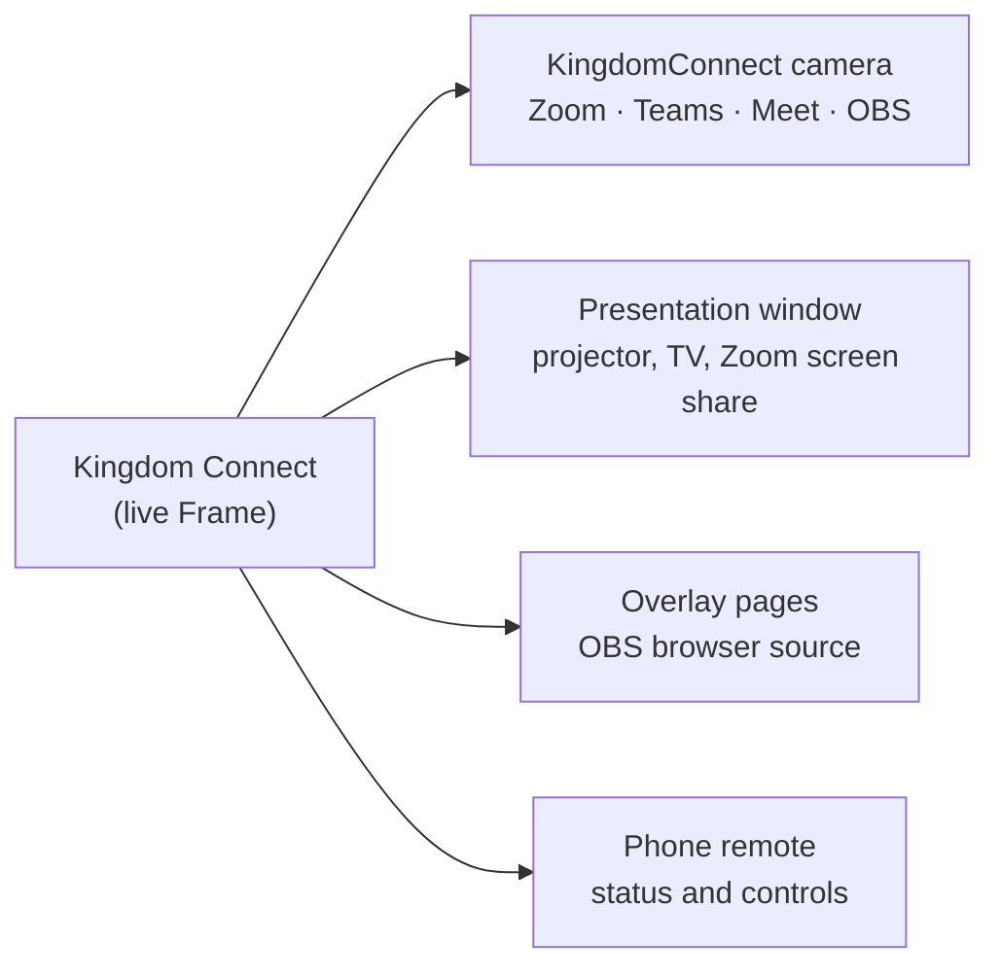
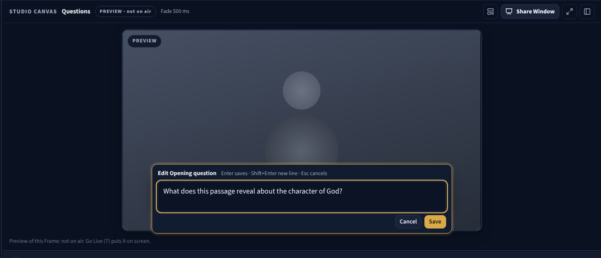
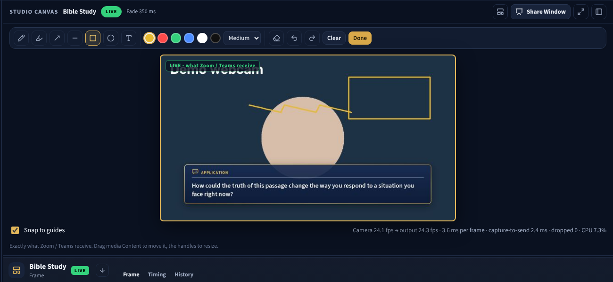
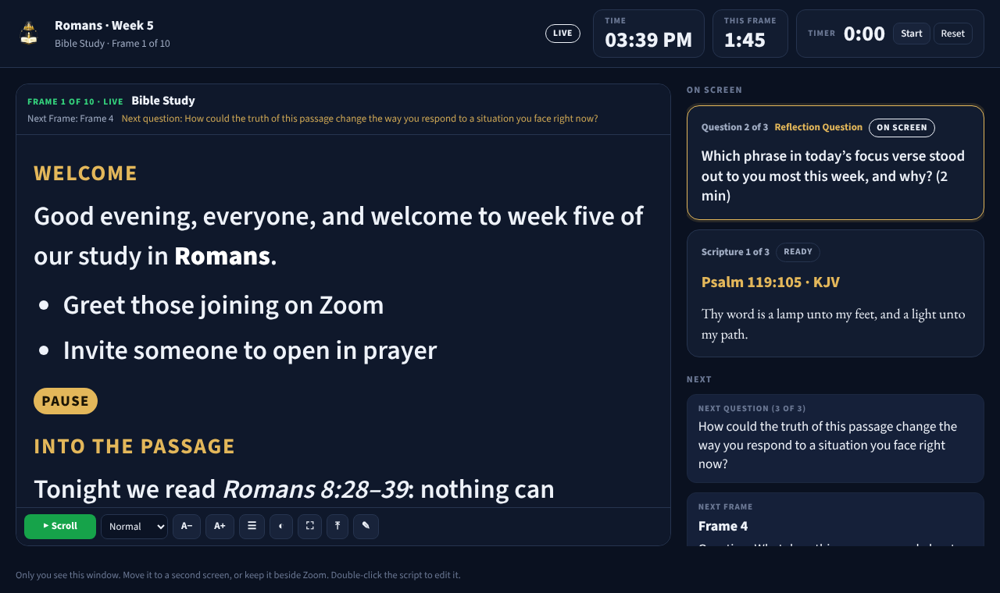

# Presentations: running the service live

Everything you need while the meeting is happening: going live, moving through Frames, handling the unexpected and
keeping your script in view.

**Who this is for:** service operators, worship leaders and small-group leaders who run the screen during a service
or meeting.

**On this page**
- [Where your presentation appears](#where-your-presentation-appears)
- [Preview first, then Go Live](#preview-first-then-go-live)
- [Move through the meeting](#move-through-the-meeting)
- [Questions and scriptures](#questions-and-scriptures)
- [Transitions](#transitions)
- [When something goes wrong: Hide all, Blackout, Emergency, Freeze](#when-something-goes-wrong-hide-all-blackout-emergency-freeze)
- [Annotate: draw on the picture](#annotate-draw-on-the-picture)
- [Teleprompter](#teleprompter)
- [Command palette](#command-palette)
- [Projector, TV and screen sharing](#projector-tv-and-screen-sharing)
- [Keyboard shortcuts](#keyboard-shortcuts)
- [Live-safety tips](#live-safety-tips)

---

## Where your presentation appears

Kingdom Connect sends one finished picture to every place you use, all at the same time.

| Output | Use it for | How |
| --- | --- | --- |
| **KingdomConnect camera** | Online and hybrid meetings | Choose **KingdomConnect** as the camera in Zoom, Teams, Meet or OBS |
| **Presentation window** | A projector or TV in the room, or **Share Screen → window** in Zoom | Studio → **Share Window**, then **Full screen** |
| **Overlay pages** | OBS setups that add cards over their own video | `http://localhost:8750/...` as an OBS browser source |

## Preview first, then Go Live

The **Studio Canvas** always tells you whether you are looking at the screen people see.

| Badge | Meaning |
| --- | --- |
| **PREVIEW · not on air** | You are looking at a Frame that is not live. Nobody sees changes |
| **LIVE** | This is what Zoom, Teams, the projector and OBS show right now |

1. Select a Frame in the **Frames** list. The canvas previews it.
2. Check it, then select **Go Live** (or press **T**). You can also double-click the Frame's row. Double-clicking
   the Frame's **name** renames it instead.
3. The Frame is marked **LIVE** in the list and the next Frame is marked **NEXT**.

> **Tip:** You can edit a Frame that is not live while another Frame is live. Prepare the next Frame calmly while the
> current one is on screen.

## Move through the meeting

| Action | PC | Phone (Simple remote) |
| --- | --- | --- |
| Next Frame | **Frame ▶** or **]** | **NEXT FRAME** |
| Previous Frame | **◀ Frame** or **[** | **PREVIOUS FRAME** |
| Go Live on the selected Frame | **Go Live** or **T** | — |
| Next question | **→** | **NEXT CONTENT** |
| Next slide (PowerPoint) | **Page Down** or the slide ▶ button | **NEXT CONTENT** |

**Auto advance:** a Frame can move to the next one by itself after a number of seconds (Content Settings → Frame →
**Timing**). It only happens while **Auto** in the command bar is on.

**Presentation Mode (P)** hides everything except the Frames, Previous, Go Live and Next. Use it when you want fewer
buttons in front of you.

## Questions and scriptures

A Frame with a Question or Scripture list shows one item at a time.

- **→ / ←** step through the Frame's questions.
- **Shift + → / ←** step through its scriptures.
- **Q**, **V** and **B** show or hide the question, the scripture and the birthday card.
- In the command bar, **◀ Question ▶** does the same as the arrow keys.
- In the list, **Show** puts one item on screen directly.

**Show: Question · Both · Scripture** (above the question list) chooses what **Show** puts on screen:
- **Question**: the question only;
- **Both**: the question with its scripture;
- **Scripture**: the scripture only.

> **Tip:** Found a typo while it is on screen? Double-click the card on the Studio Canvas, correct it and press
> **Enter**. The screen updates immediately. This works for every card: question, scripture, announcement, prayer,
> discussion topic, icebreaker, poll, lower third and timer. Double-click the card's label (its top line) to change
> the label.

## Transitions

| Setting | Where | Effect |
| --- | --- | --- |
| The Frame's transition | Content Settings → Frame → **Timing → Transition into this Frame** | How this Frame appears, for example Fade, Cross Dissolve, Dip to Black, Slide, Push, Cinema Fade or Church Service Fade |
| Duration | Same place | The length in milliseconds |
| One-off override | The command bar's transition list (**Frame default**) | Uses another transition for your next takes, until you set it back to **Frame default** |
| A card's own animation | Question / Scripture Content → **Animation** | How the card itself appears, for example Fade, Gentle rise, Word by word, Typewriter |

## When something goes wrong: Hide all, Blackout, Emergency, Freeze

| Control | Key | What people see | Use it when |
| --- | --- | --- | --- |
| **Hide all** | **Esc** | The picture without any cards or text | You want a clean camera picture |
| **Blackout** | **K** | A black picture | You need the screen dark straight away |
| **Emergency** | — | A plain emergency screen with your message | Something urgent is happening in the room |
| **Freeze** | **F** | The picture held still | You are changing things and do not want people to see it |
| **Hide Content** | — | The selected Content is hidden | One item should go away, the rest stays |

Blackout, Emergency, Annotate, Freeze, the Teleprompter and the Teleprompter window are in the **Program** menu. The menu button changes to
**BLACKOUT ▾**, **EMERGENCY ▾**, **FROZEN ▾** or **ANNOTATING ▾** so you never forget one is on. Press the same
control again to turn it off.

> **Important:** Remember to unfreeze. While the picture is frozen, people do not see anything you change. The phone
> remote also shows a note while it is frozen.

## Annotate: draw on the picture

Annotate works like ZoomIt: draw over whatever is on screen, slides and cards included. Everyone in Zoom, Teams and
on the projector sees it.

1. Press **D**, or choose **Program → Annotate**.
2. Pick a tool and draw on the Studio Canvas.
3. Press **Esc** (or **Done**) to stop. The drawings are hidden.

| Tool | Key |
| --- | --- |
| Pen | P |
| Highlighter | H |
| Arrow | A |
| Line | L |
| Rectangle | R |
| Ellipse | E |
| Text | T |

There are six colours and three thicknesses. **Undo** is Ctrl+Z, **Redo** is Ctrl+Y, and **Clear** removes every
drawing. You can draw on a frozen picture.

You can also draw with your finger on the phone. See [Remote control](remote-control.md#drawing-from-the-phone).

## Teleprompter

The **Teleprompter** shows what you plan to say on each Frame. Only you see it. It is never on the KingdomConnect
camera, the Presentation window, the OBS pages or the phone's drawing pad.

**Write the script**
- Each Frame has its own **Teleprompter script**: Content Settings → **Frame → Teleprompter script** (up to 20,000
  characters). In 6.6 this field was called *Leader notes*.
- Or double-click the text in the Teleprompter (or select **✎**) and type there.
- Simple markup, all optional:

| Type | You get |
| --- | --- |
| `# Heading` | A heading |
| `- bullet` | A bullet point |
| `**bold**` · `*italic*` | **Bold** · *italic* |
| `[PAUSE]` | A cue chip, such as a reminder to pause or pray |
| `---` | A divider line |

**Open it in the Studio**
1. Choose **Program → Teleprompter**, or press **R**.
2. Dock it **Left**, **Right** or **Bottom** of the Studio, or **Float** it. Drag its edge to resize it.
3. **Follows: Live** shows the script of the Frame on screen. **Follows: Selected** shows the Frame you selected,
   so you can read ahead or rehearse.

**Open it in its own window**
**Program → Teleprompter window** (called *Speaker View* in 6.6) opens the Teleprompter in a separate window, ideal
on a second monitor or beside Zoom on a laptop. It also shows the clocks, a **Timer**, what is on screen now and what
comes next.

**Controls**

| Control | Key (while the Teleprompter has focus) |
| --- | --- |
| Scroll: play / pause | **Space** |
| Speed: Very slow, Slow, Normal, Fast, Very fast | — |
| Text smaller / larger (**A−** / **A+**) | **−** / **+** |
| Line spacing, high contrast | — |
| Focus mode | **F** |
| Back to the top | **Home** |
| Scroll by hand | **↑ ↓**, **Page Up / Page Down**, the mouse wheel or touch |

The cue line at the top shows **Frame 3 of 9**, **LIVE** when that Frame is on screen, the next Frame, and the next
question or scripture.

> **Note:** Answers and presenter notes on questions and scriptures were removed in 6.7. Nothing was deleted from
> your data. Put what you want to remember in the Frame's Teleprompter script.

On the phone, the Teleprompter is on the remote too. See [Remote control](remote-control.md#teleprompter-on-the-phone).

## Command palette

The **command palette** finds anything and does most things, from the keyboard.

1. Press **Ctrl+K** or **Ctrl+Space**, or select the search box in the command bar.
2. Type a few letters. It finds Frames, Content, the Frames' questions and scriptures, text, templates, the Library,
   branding, settings, members, Bible references and recent items.
3. It also runs commands, such as **Go Live**, **New Frame**, **Duplicate**, **Teleprompter**, **Export meeting**,
   switching the theme or **Add Content…**.
4. Use **↑ / ↓** to choose and **Enter** to open or run it. **Esc** closes the palette.

You can change the keys in **Settings → Keyboard shortcuts → Command palette**.

## Projector, TV and screen sharing

The **Presentation window** shows the same finished picture as the KingdomConnect camera.

1. In the Studio, select **Share Window**. The Presentation window opens.
2. Drag it to the projector or TV, then select **⛶ Full screen** (or press **F** in that window, or double-click it).
3. To leave full screen, select **⛶ Full screen** again (move the mouse to show the buttons).

> **Important:** **Esc** inside the Presentation window closes it (**✕ Exit**). Press Esc in the main Kingdom Connect
> window instead when you mean **Hide all**.

To share it in Zoom instead, choose **Share Screen**, then the window named **BSF Presentation**.

> **Note:** Media Content (camera, images, video, PowerPoint, screen and window sharing) is part of the KingdomConnect
> picture, so turn on the KingdomConnect camera in **Settings → KingdomConnect Camera** if you use it.

## Keyboard shortcuts

Shortcuts work while the Kingdom Connect window has focus, and never while you type in a box. You can change the
meeting shortcuts in **Settings**.

| Key | Action |
| --- | --- |
| **T** | Go Live on the selected Frame |
| **]** / **[** | Next / previous Frame |
| **→** / **←** | Next / previous question |
| **Shift + →** / **Shift + ←** | Next / previous scripture |
| **Q** · **V** · **B** | Show or hide the question · scripture · birthday card |
| **Page Down** / **Page Up** | Next / previous slide |
| **Esc** | Hide all |
| **K** | Blackout on / off |
| **F** | Freeze on / off |
| **D** | Annotate on / off |
| **P** | Presentation Mode on / off |
| **R** | Teleprompter on / off |
| **Ctrl + K** or **Ctrl + Space** | Command palette |
| **F2** | Rename the selected Frame or Content |
| **Ctrl + D** | Duplicate the selected Frame or Content |
| **Ctrl + C** · **Ctrl + X** · **Ctrl + V** | Copy · cut · paste the selected Frames or Content |
| **Ctrl + A** | Select every Frame (or every Content) in the list |
| **Delete** / **Backspace** | Delete the selected Frames or Content (Undo is offered) |
| **Alt + 1 / 3 / 4** | Studio / Members / Settings |

## Live-safety tips

- **Rehearse** once on the same PC, room and network.
- **Check the badge** before you edit: PREVIEW is safe, LIVE is public.
- **Keep Esc in mind.** It hides everything instantly.
- **Silence notifications** on the presentation PC (Windows Focus / Do not disturb).
- **Close what you do not need.** Fewer apps means smoother video.
- **Charge the phone** you use as a remote, and keep the PC plugged in.
- **Name your Frames clearly**, so whoever runs the service knows what comes next.

## Related
- [Frames](frames.md) and [Content](content.md)
- [Media](media.md)
- [Remote control](remote-control.md)
- [Troubleshooting](troubleshooting.md)
- [Service operators guide](ministry/README.md)
