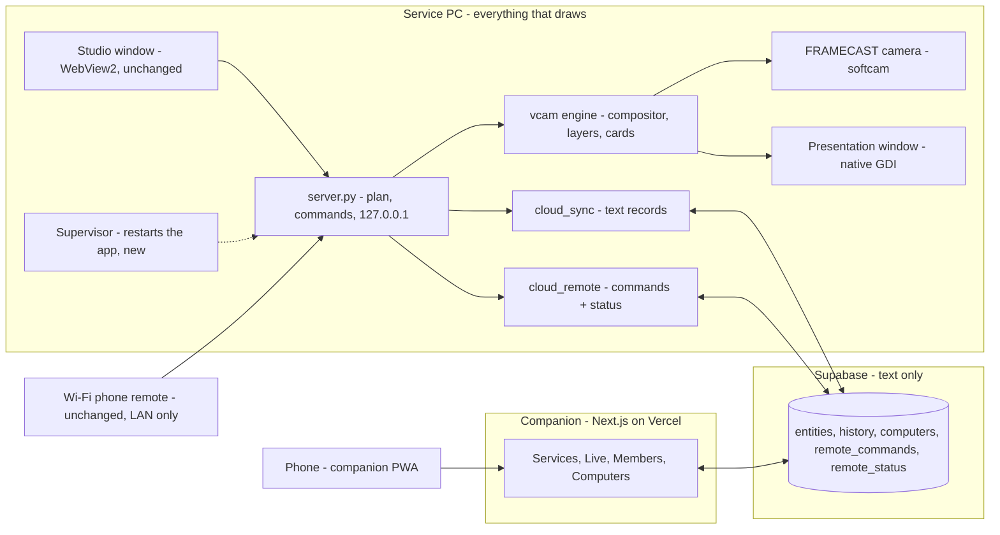

# Architecture, performance and product audit (25 October 2026)

An audit of FRAMEDECKS as a SaaS virtual-camera presentation product: desktop presenter and virtual camera, hosted
companion (web), phone control, and the cloud between them. It covers architecture, performance, resource use,
reliability, security, scalability and polish. **It proposes no change to the UI, visual design, layout, navigation,
branding or workflow.** Where a recommendation would need any visible change it is marked *optional future
enhancement* and needs the owner's approval, as the repository rules require (`CLAUDE.md`).

**Who this is for:** the owner and maintainers deciding what to do next.

**Based on the code at `main` `8482c44`**, not on intentions: `vcam/` (engine, compositor, layers, screen capture,
Presentation window), `server.py`, `desktop_app.py`, `app/js/`, `cloud_sync.py`, `cloud_remote.py`, `hosted/` and
`hosted/supabase/migrations/0001`–`0005`. Figures marked *measured* come from
[performance.md](performance.md) or the engine's own counters; all other figures are **targets**, to be checked with
the counters the program already has (see §7).

## How the brief maps to FRAMEDECKS

The brief uses generic names. In this product they are:

| Brief | FRAMEDECKS |
|---|---|
| Project | A workspace's service plan (one per workspace today) |
| Scene | **Frame** (`scenes[]` in the plan; `frame` record) |
| Frame / layer | **Content** of a Frame (`layers[]`: camera, screen, image, video, pdf, window, text, shapes, cards) |
| Deck | A PDF Content (PowerPoint exported to PDF, `PdfSource`) or a live PowerPoint driven through COM (`vcam/powerpoint.py`) |
| Overlay | Cards (question, scripture, birthday), lower thirds, branding |
| Preset | Templates (`template` records), Looks and the card theme (`theme` record) |
| Asset | A file in the PC's data folder, referenced by **file name only** |
| Mobile app | **No native iOS or Android app exists.** Two phone surfaces: the Wi-Fi phone remote (`remote.html`, PIN) and the hosted companion's Live page (a PWA) |

**Assumptions** (where the brief and the code differ):

1. The brief says leaders create *everything* on the web. In the code, the **desktop Studio is the full editor**. The
   web edits the words and the order of Frames (owner decision E1, `docs/architecture/companion-editing.md`), views
   plans, runs services and manages people. This audit treats the code as the product. §1 explains why that split is
   right, and the brief's model is not adopted.
2. "iOS and Android apps" are read as "the phone experience". The audit validates the two phone surfaces above and
   recommends against building native apps (§10).
3. Audio: the virtual camera is video only, and video Content is decoded **muted** (`VideoSource`: "no audio is
   read"). The audit treats video sound as reaching the meeting through the meeting app's own "share computer
   sound", not through FRAMEDECKS.

---

## 1. Executive verdict

**Is the architecture sound? Yes.** The layer boundaries are right for a live-meeting product:
- all rendering, media and the virtual camera stay on the PC;
- the cloud holds only text records, commands and a small status;
- phones only send commands;
- the PC never accepts inbound connections from the cloud, because it pulls everything itself.

The risks are not in the boundaries. They are in the desktop's per-change costs, a few resource leaks into RAM and
disk, and distribution (no code signing, no auto-update). The cloud paths are also unproven against live Supabase so
far.

**Top 5 strengths**
1. **Local-first by construction.** Sync carries text records only: media becomes a file name (`sync_entities.py`),
   and live state never leaves the PC. A service runs fully offline, and the Frame on screen is never changed by
   sync (`cloud_sync.Engine`: held until it leaves the screen).
2. **The camera engine is frugal.**
   - It releases the webcam when no app is watching, and wakes twice a second only to check.
   - Without a camera it drops to an idle rhythm (5 frames a second, woken at once by any change), and limits
     OpenCV to 2 threads.
   - Background work runs at below-normal priority (`vcam/priority.py`): blur model, decoding, screen capture.
   - It caches every transformed layer, and runs blur segmentation at about 10 a second, separate from the frame
     loop.
   - It already measures itself: fps, ms per frame, late and dropped frames, latency, CPU % (`VCamEngine.status`).
3. **The PC is the only client the cloud can't reach.** The cloud cannot call the PC:
   - The PC polls with its own key, and only its SHA-256 hash is stored (`computers.key_hash`).
   - The key is kept in Windows Credential Manager.
   - The local server binds 127.0.0.1, with Host and Origin checks against DNS rebinding.
4. **Commands run through the same code as the keys** (R1). `cloud-remote.js` calls the keys' own functions:
   `KCWorkspace.step`, `takeFrame`, `KCActions`. So phone control can't diverge from keyboard behaviour, and there
   is one tested path.
5. **Tenant isolation lives in the database, and is tested:**
   - RLS on every table, and `security definer` functions with `search_path` pinned;
   - permission checks wrapped in `coalesce`, after a real bug in `computer_revoke`;
   - member records visible to owners and admins only;
   - rate limits on `sync_push` (600 a minute) and `remote_send` (30 per 10 s);
   - 68 PGlite tests run every migration.

**Top 5 risks**
1. **Every live action rewrites the whole plan on disk and starts a sync round.** `save_state` writes the full plan
   with its library as pretty-printed JSON on every Next, Show or Hide. Each save then `poke`s sync, which 3 s later
   pulls, splits and hashes the whole plan. A large imported library makes every press heavier.
2. **Full-resolution media held in RAM.** `ImageSource` keeps the original picture as BGRA: a 24-megapixel photo
   is about 96 MB per image layer. Screen capture copies each full frame: a 4K display is about 25 MB per frame at
   up to 60 frames a second.
3. **No code signing and no automatic update.** The installer is unsigned, which brings SmartScreen warnings,
   antivirus false positives and no tamper evidence. Fixes reach churches only when someone downloads a GitHub
   artifact by hand.
4. **Unproven against live services.** Sync, phone control, editing and history have only run against stand-ins
   and PGlite. Only sign-in and workspaces are confirmed live. Until the live test guide is run, a production
   failure mode is unknown.
5. **No crash supervisor for the presenting process.** If the Python process dies mid-meeting, the FRAMEDECKS
   camera freezes or goes black in Zoom and nothing restarts it. Engine errors recover, by retrying after 5 s, but
   process crashes do not.

## 2. Architecture scorecard

| Area | Score | Why |
|---|---:|---|
| Performance efficiency | 7 | Idle and camera paths are well tuned and self-measured. Save-per-press I/O, per-save sync rounds and full-resolution image retention cost more than needed. |
| Resource usage | 6 | 118 MB resident measured with the test camera. RAM grows with large images and 4K screen capture. Fixable without changing the UI. |
| Scalability | 7 | Thin cloud: text records, a seq cursor, per-workspace locks, indexed command queue. Polling (Live every 2 s per phone, PC every 1–5 s while switched on) is fine to thousands of PCs; Realtime is the later step. |
| Reliability | 6 | Strong offline story and engine self-recovery. No process supervisor, no auto-update, live paths unproven. |
| Security | 7 | Good key handling, RLS and rate limits. Gaps: unsigned binaries; the Wi-Fi remote uses plain HTTP with a 6-digit PIN and 30-day cookies (the legacy remote, frozen by rule); no end-to-end encryption of commands (accepted, R4). |
| Offline capability | 9 | Services run with no internet. Sync queues changes and catches up, and the Frame on screen is protected. |
| Sync correctness | 8 | Per-record revisions, ordered seq, conflict "keep both", edit beats delete, lost-answer detection, field-level merge for companion edits. Tested against stand-ins, not yet live. |
| Desktop rendering quality | 7 | Careful resampling (area/cubic, one resample), colour-range fix, premultiplied layers, steady-rate output option. RGB24 output and CPU compositing cap headroom at 1080p60. |
| Mobile efficiency | 8 | Phones send small commands and read a small text status. No media and no rendering. The Live page polls every 2 s only while visible. |
| Product polish | 7 | Clear status texts, toasts that say who acted, history and restore. Missing: a pre-flight check for missing media, and a single "ready to present" signal. |

## 3. Critical issues

Ordered by risk to a live meeting.

| # | Issue | Where | Effect | Severity |
|---|---|---|---|---|
| C1 | **Unsigned installer, no update channel** | `.github/workflows/build-windows.yml`, `packaging/installer.iss` | SmartScreen blocks first runs; antivirus may quarantine the virtual-camera DLL; churches run stale versions | Critical (distribution) |
| C2 | **Process crash = frozen camera, no restart** | `desktop_app.py` (single instance, no supervisor) | Meeting shows a frozen or black FRAMEDECKS picture until someone restarts the app by hand | Critical (live) |
| C3 | **Whole-plan write on every live action** | `server.save_state` (`json.dumps(indent=2)`, `os.replace` per save) | Disk writes and CPU on each Next. On slow or encrypted disks or OneDrive-redirected folders, a hitch per press; SSD wear on long services | High |
| C4 | **Sync round after every live action** | `save_state` → `SYNC.poke()` → `Engine.run` (pull + split + hash the whole plan) | When linked, a network round trip and a full-plan hash 3 s after each press, though live state never syncs | High |
| C5 | **Full-resolution images kept in RAM** | `vcam/layers.ImageSource` (`IMREAD_UNCHANGED` → BGRA, kept) | 50–100 MB per high-resolution photo layer; with several, the process can exceed 1 GB on 8 GB PCs | High |
| C6 | **4K screen capture copies every frame** | `vcam/screen.ScreenCapture._store` (`np.ascontiguousarray` per WGC frame) | 0.75–1.5 GB/s of memory traffic on a 4K display, even when the compositor uses one frame in two | High |
| C7 | **Live paths not yet run against Supabase** | sync, Live, editing, history | Unknown failure modes in production | High (until the guide is run) |
| C8 | **Missing media fails silently at service time** | Layers resolve a file name in the data folder; a missing file shows only as a layer error | A Frame synced to a second PC, or after a rename, comes up empty mid-service | Medium |
| C9 | **Wi-Fi remote over plain HTTP** | `remote.html`; PIN 6 digits, 5 tries per IP then 60 s, sessions 30 days | On open church or hotel Wi-Fi, the session cookie can be sniffed; the PIN can be tried from many IPs. Frozen by rule; the cloud Live page is the safe alternative | Medium |
| C10 | **No support bundle** | `kc-app-log.txt` (1 MB rotate), `/api/diagnostics` | Hard to diagnose a church's problem remotely; logs may hold file names (fine) but nothing collects them in one step | Medium |

Not issues (checked):
- The meeting app's audio and video are not delayed by FRAMEDECKS, which adds no audio path. Measured camera
  latency is reported as `latencyMs`.
- The browser UI does not render frames; the Presentation window is native GDI at 15 frames a second.
- The cloud cannot reach the PC.

## 4. Performance optimization plan

None of these changes the UI. "Impact" is for a live service; "Effort" is implementation complexity.

| P | Change | Impact | Effort |
|---|---|---|---|
| **P1** | **Split live state from the plan on disk.** Keep the plan file written only when the plan changes. Write live fields (on-screen Frame, cards, blackout) to a small `kc-live.json`, or write-behind the plan at most once a second. Compact JSON (no `indent`) for the hot file. | High: removes most per-press disk I/O and CPU (fixes C3) | Medium (one load path must merge both; covered by the existing state tests) |
| **P2** | **Sync only when syncable data changed.** In `save_state`, compare a cheap fingerprint of the non-live part, or a dirty flag set by plan edits, before `SYNC.poke()`. The 60-second pull keeps running. | High when linked: no network or hash round per press (fixes C4) | Low |
| **P3** | **Downscale images on load** to the largest size they can ever be drawn at: output long edge × the largest layer scale, capped at 2× output. Keep alpha. Drop the original. | High: RAM per image layer from ~96 MB to ~8 MB at 1080p (fixes C5) | Low |
| **P4** | **Screen capture: copy only what is used.** Store the WGC frame only when the compositor has taken the previous one, or at the output rate. Resize to output size on the capture thread (one area resample) before handing over. | High on 4K displays (fixes C6) | Low–medium |
| **P5** | **Video: decode at the size needed.** When a video is larger than its drawn size, let FFmpeg scale during decode (or resize once on the decode thread). Keep hardware decoding. No re-encoding, ever. | Medium: 4K clips on 1080p output | Low |
| **P6** | **Static-frame reuse with the camera on.** When the camera layer is hidden by layout or covered, skip camera processing (blur, look, adjust) for that frame. `needs_camera()` already exists for the off case. | Medium | Low |
| **P7** | **Blur only when the camera is visible**, and cap the model at 10 a second (already) or 5 a second on low-power PCs (`lowGpu` already signals a weak machine). | Medium (battery on laptops) | Low |
| **P8** | **Output format.** Keep RGB24 at 720p30 (the default). Measure the softcam copy and conversion before considering NV12. Zoom and Teams convert anyway, and the gain is only at 1080p60. | Low–medium | Medium (DLL change; only with measurements) |
| **P9** | **Hosted: Realtime instead of 2-second polling** for the Live page status when more than one phone watches the same PC; keep polling as the fallback. Services: cache the pulled records per workspace and pull only `since` the last seq on revisit. | Medium at scale, low now | Medium |
| **P10** | **Dashboard idle requests** (measured: ~80 per 10 s with the preview open). Already paused when hidden. Merge the 2-second mode check and the 4-second presence ping into the existing long poll when the window is visible. | Low | Low |

**Prioritized:**
- **Critical:** C1 and C2 (distribution and supervisor, §9 Phase 1).
- **High:** P1, P2, P3, P4.
- **Medium:** P5, P6, P7, P9.
- **Low:** P8, P10.

## 5. Recommended target architecture

The current architecture, hardened. No new layers.



**Responsibility matrix**

| Concern | Desktop | Web (companion) | Phone | Cloud API (Supabase functions) | Storage |
|---|---|---|---|---|---|
| Rendering, compositing, virtual camera | **only here** | never | never | never | — |
| Media files (images, video, PDF, PowerPoint, fonts) | **only here** | names only | never | never | PC data folder |
| Frame structure, words, order | full editor | words, order, history (E1) | — | `sync_push` / `sync_pull` | `entities`, 30-day `entity_history` |
| Looks, layouts, templates | editor | view | — | sync | `entities` |
| Live state (on screen, cards visible) | **only here** | read via status | read via status | `remote_status` (text) | not synced |
| Commands (next, go live…) | executes (same code as keys) | sends | sends | `remote_send` / `remote_take` | `remote_commands` (7 days) |
| Identity, roles, workspaces | linked PC key | sign-in | sign-in | RLS | `memberships` |
| Members' personal data | editor | owners/admins | — | RLS | `entities` (member) |

**Wrong-layer check.** No function sits in the wrong layer today. Two to keep out:
- **Media upload or cloud rendering:** never. It breaks privacy and offline use, and adds cost.
- **Full Frame design on the web**, meaning looks, layouts and positions: not without a preview, and a preview
  needs the media, which is on the PC. This is why the brief's "create everything on the web" is not adopted (§10).

## 6. Data and sync model

The model in use (`sync_entities.py`, `hosted/src/lib/sync-entities.ts`, `0003_sync.sql`) is already small,
portable and delta-based: one record per Frame, template, library item, member, plus single records for order,
theme, brand, layout and meeting. Only changed records are pushed (`changes()`); each carries the revision it was
based on.

**Recommended additions** (no UI change):
1. An **asset reference** inside media Content, so a PC can tell "missing", "different" and "renamed" apart (C8).
2. A **device row** with app version and capabilities, for support and update targeting.
3. A **sync event** shape for telemetry. It counts things and holds no content.

```json
{
  "record": {
    "kind": "frame", "id": "sc_et2d6hh", "rev": 8, "seq": 1412, "deleted": false,
    "updatedBy": "computer:6b1f…", "updatedAt": "2026-10-25T12:00:00Z",
    "body": {
      "id": "sc_et2d6hh", "name": "Study: John 3", "group": "Teaching", "notes": "Read verse 16 slowly.",
      "layers": [
        {"id": "Lhfzwapv", "kind": "scripture", "c": {"items": [{"id": "v1_Lhfzwapv", "ref": "John 3:16", "version": "ESV", "text": ""}]}},
        {"id": "L3ock0uf", "kind": "video", "c": {"file": "Opening video.mp4", "loop": true,
          "asset": {"name": "Opening video.mp4", "bytes": 48213904, "sha256_head": "9c1e…", "w": 1920, "h": 1080, "sec": 42.0}}}
      ]
    }
  },
  "order": {"kind": "order", "id": "order", "body": {"scenes": ["sc_7yze23k", "sc_et2d6hh"], "questions": [], "verses": [], "members": []}},
  "device": {"id": "6b1f…", "organization_id": "…", "name": "CHURCH-PC", "app_version": "6.10", "os": "Windows 11 23H2",
             "caps": {"vcam": true, "wgc": true, "hwdecode": "d3d11va"}, "last_seen_at": "…", "revoked_at": null},
  "sync_event": {"device": "6b1f…", "at": "…", "pulled": 3, "pushed": 1, "conflicts": 0, "held": 1, "ms": 420, "error": null}
}
```

- **`asset`:** computed on the PC when a file is added: size, a SHA-256 of the first 1 MB, dimensions, duration.
  It syncs as text. A PC that lacks the file, or has one with the same name but different contents, says so before
  the service (C8). Nothing else about the file leaves the PC.
- **Thumbnails:** recommended **off**. A thumbnail is part of the media, and the rule is "no media leaves the PC".
  If the owner wants web previews later, make it a per-workspace opt-in, with tiny JPEGs (≤ 20 KB) in Supabase
  Storage under the same RLS (*optional future enhancement*).
- **Transport:**
  - Keep HTTPS request/response with long-lived cursors for sync (60-second pull, plus 3 s after a real change).
  - Keep polling `remote_take`: 1 s while active, 5 s idle. It survives captive portals, proxies and sleeping
    laptops, which WebSockets on church and hotel networks often don't.
  - Add Supabase Realtime only as a wake-up hint, never as the only path (P9).
- **Conflicts:** keep "keep both" for Frames edited on two PCs, last writer wins for settings and people, and edit
  beats delete. Companion edits merge field by field (`applyDraft` and `rebase`).
- **Undo:** stays local (the desktop's own undo).
- **Rollback:** `entity_history` keeps 30 days, with restore.
- **Offline edits:** the outbox in `kc-sync.json`, then reconcile on the next round.

## 7. Resource budgets

Targets for an ordinary 8 GB, 4-core Windows 10/11 PC with integrated graphics. Measure each against the engine's
own counters: `cpuPercent`, `msPerFrame`, `lateFrames`, `dropped` and `latencyMs`. Settings → Diagnostics shows most
of them in its "FRAMEDECKS performance" row.

**Desktop (FRAMEDECKS process)**

| State | CPU (whole machine) | RAM | Notes |
|---|---:|---:|---|
| Idle, nobody watching the camera | < 1 % | < 150 MB | measured ~118 MB with the test camera |
| Presenting cards and slides, camera off | < 5 % | < 250 MB | idle rhythm 5 fps, 30 fps for 1.5 s after a change |
| Camera on, 720p30, no blur | < 10 % | < 300 MB | `msPerFrame` < 12 ms |
| Camera on, 720p30, blur | < 18 % | < 350 MB | blur model at 10/s |
| 1080p30, blur, one video layer | < 25 % | < 500 MB | hardware decoding |
| Screen share layout, 1080p display | < 12 % | < 350 MB | after P4 |
| Any state, hard ceiling | — | **< 800 MB** | after P3 and P4 |

| Metric | Target |
|---|---|
| Virtual camera latency (capture → sent) | < 50 ms at 720p30, < 70 ms at 1080p30 (`latencyMs`) |
| Late frames | < 1 % over a service |
| Dropped webcam frames | < 0.5 % |
| Frame switch (key press → new picture sent) | < 100 ms, including transition start |
| Disk writes during a service | < 50 KB per press after P1 (today: the whole plan per press) |
| GPU | Only for video decoding and WGC capture; no constant 3D load. The window is drawn without the graphics card by default (`lowGpu`) |
| Profiles | 720p30 (default), 1080p30 (supported), 1080p60 only on PCs where `msPerFrame` < 12 ms at 1080p30 |

**Web (companion)**

| Metric | Target |
|---|---|
| First load, signed in, mid-range phone on 4G | < 2.5 s to usable (LCP) |
| JavaScript per route | < 200 KB compressed (all chunks today: 1.0 MB uncompressed, 18 files) |
| Interaction (INP) | < 200 ms |
| Live page: press → PC acts | < 1.5 s while active (1 s poll); the first press after a quiet spell ≤ 5 s |
| Live page status refresh | 2 s while visible, none when hidden |
| Requests per open Live page | ≤ 1 every 2 s; ≤ 0.2/s for Services (load once, then on save) |

**Phone**

| Metric | Target |
|---|---|
| Data per hour on the Live page | < 3 MB (status ≤ 64 KB cap; typical 2–5 KB per poll, compressed) |
| Battery | No background work: polling stops when the page is hidden (`document.hidden`) |
| Wi-Fi remote press → PC | < 300 ms on the same network |

**Cloud**

| Metric | Target |
|---|---|
| Per linked PC, switched on | ≤ 1 request/s while a phone is active, 0.2/s idle, plus 1/min sync |
| Per workspace storage | < 5 MB records + 30 days of history |
| `remote_commands` | purged after 7 days (built in) |

## 8. Polish and consolidation recommendations

**Polish without UI changes**
- **Pre-flight check:** before Go Live, and when a PC links or pulls, check every media reference with `asset` (C8).
  Report missing or changed files through the **existing** status texts and toast ("2 files missing on this PC:
  Opening video.mp4…"). No new control is needed.
- **One "ready to present" truth.** The camera's state ("Ready / Live / Error"), sync's ("Linked / Offline") and
  phone control's ("Online") already exist. Make sure each error text says what to do. Several do already: "Another
  app may be using it, or Windows privacy settings may block it". Audit the rest against that standard.
- **Safe mode under load.** When `lateFrames` climbs for 10 s, drop blur to the classic 1/8 path and the
  Presentation window to 10 fps, and say so in the camera status text. Restore it when the load is gone.
- **Smart defaults:**
  - 720p30, which is already the default;
  - background blur off unless a camera is in the layout;
  - "Allow control from the companion" off (already);
  - sync linking says what is shared (already).
- **Keyboard and Stream Deck.** Shortcuts come from one registry (`KCShortcuts`), but they work only while the
  FRAMEDECKS window has focus (`dashboard.js` keydown, Studio tab). The only system-wide hotkey is Spotlight
  (`desktop_win.Hotkeys`). During a meeting Zoom has the focus, so a Stream Deck that sends keys would not reach
  FRAMEDECKS. Two options:
  - System-wide hotkeys for Next, Previous and Hide all through `RegisterHotKey`. This adds settings to the
    existing Shortcuts list, so it needs owner approval.
  - A small Stream Deck plugin that calls the PC's own server on 127.0.0.1 and reaches the same functions through
    the command bus below. No UI change.
- **First run:** a sample plan already loads. Add the asset check so the sample never shows a broken media layer.
- **Accessibility and localization:**
  - Keep all text in the existing strings.
  - The companion uses semantic HTML, labels and `aria-*`, verified in the browser tests.
  - Add `lang` handling when a translation is needed. No UI change until then.
- **Optional future enhancement:** a "Missing files" filter in the existing Services page, using the existing card
  styles. Only if the pre-flight texts prove insufficient.

**Consolidation**

| Merge | What | Why | Risk | UI change |
|---|---|---|---|---|
| One content model | Frames, templates, cards and layers are already one plan with one record mapping. Keep it; don't add separate "deck" or "overlay" entities | One schema, one sync path, one test fixture | None | No |
| One asset system | The data folder plus `asset` references, with one resolver used by layers, the pre-flight check and sync | Missing-file handling in one place | Low | No |
| One command bus | Keys, Wi-Fi remote, companion Live and Stream Deck all call the `KCShortcuts` / `KCActions` functions (the cloud path already does) | Identical behaviour everywhere | The legacy Wi-Fi remote is frozen; route it only if the owner allows | No |
| One diagnostics pipeline | `kc-app-log.txt`, `/api/diagnostics` and the engine counters as one "support bundle" zip: log, diagnostics JSON, counters history, **no media, no plan text** | Faster support | Must strip names, words and paths | No (a Settings button would be an *optional future enhancement*) |
| One identity model | People sign in (Supabase Auth); PCs hold a computer key; phones act as signed-in people. Pairing is the PC's link code. Already one model: don't add device tokens for phones | Fewer secrets, one revocation path | None | No |
| Settings | PC-only settings (camera, window, overlay) stay local; workspace-wide ones (theme, brand, layout, meeting) already sync as records | Clear ownership | None | No |

## 9. Implementation roadmap

**Phase 1: performance and stability**
1. **Code-sign the installer and the DLLs** (C1). An OV or EV certificate goes into the GitHub workflow secrets and
   signtool runs on the `.exe` and `framedecks_vcam*.dll`.
2. **Supervisor (C2).** Add a tiny watchdog: the installed shortcut starts it, and it starts FRAMEDECKS and restarts
   it within 2 s if it exits abnormally, at most 3 times in 5 minutes. The single-instance check already prevents
   doubles. Write a crash marker so the next start offers the log in the existing error text.
3. **P1, P2, P3, P4**, each with a test that checks the change in resource use. For P1, count bytes written per
   press; for P3, the RAM per image layer.
4. **Owner runs the live test guide** (`docs/qa/live-test-guide.md`), C7.

**Phase 2: sync and reliability**
1. Asset references and the pre-flight check (C8). Sync carries `asset` text only.
2. Sync-event counters and device info rows, reported in Settings → FRAMEDECKS account's existing status line.
3. Support bundle (stripped of content).
4. **Auto-update:**
   - Check the signed release feed at start and once a day.
   - Download in the background.
   - **Never install while the camera is in use or a Frame is live.** Install at the next start or quit, and say so
     in the existing tray or toast texts.

**Phase 3: security and scalability**
1. Run the RLS tests against live Supabase (needs `*.supabase.co` allowed here).
2. GDPR:
   - export and delete for a person's member record (already per record);
   - a "delete workspace" path that purges entities and history;
   - write down the data map: cloud holds words, member contacts and birthdays, and commands for 7 days.
3. Realtime wake-ups for Live (P9), with polling kept as the fallback.
4. Optional: end-to-end encryption of commands, if the screen picture ever goes to the cloud (R4).

**Phase 4: polish and advanced**
- Safe mode under load.
- Stream Deck support (plugin or system-wide hotkeys, §8).
- Opt-in web thumbnails (owner decision).
- Google/Microsoft sign-in (already planned with the owner).
- Translations.

## 10. Final recommendations

**Do first**
1. Run the live test guide. Nothing else de-risks as much for 30 minutes of work.
2. Code-sign the builds and add the supervisor (C1, C2).
3. Fix the per-press costs: live state off the plan file, and sync only real changes (P1, P2).
4. Cap image and screen-capture memory (P3, P4).

**Avoid**
- Moving any rendering, conversion or media handling to the cloud or the phone.
- Re-encoding user videos or "optimizing" files on disk. Decode them at the size needed instead.
- A WebSocket-only control path. Keep polling as the baseline on church, hotel and office networks.
- A GPU rewrite of the compositor before the counters show CPU is the limit at the profiles people actually use
  (720p30).

**Don't build**
- **Native iOS or Android apps.** The companion PWA and the Wi-Fi remote already do everything a remote needs.
  Native apps add two code bases, store reviews and push infrastructure for no gain in latency.
- **Full Frame design on the web.** Without the media there is no truthful preview. Keep the web to words, order,
  history, running services and people (E1).
- **A virtual audio device.** Video sound to the meeting goes through the meeting app's own "share computer sound".
  A driver adds risk to every PC for a rare need.
- **Cloud media storage**, unless a paying feature explicitly needs it. Then make it opt-in and per workspace.
