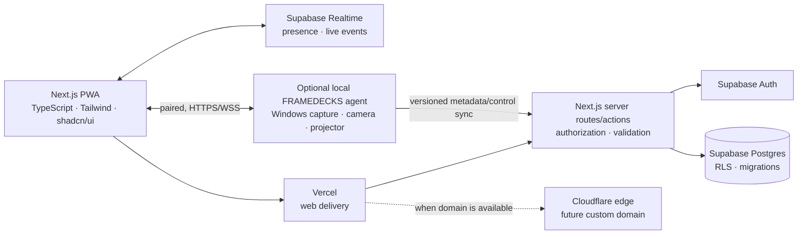

# FRAMEDECKS SaaS migration roadmap

**Assessment date:** 22 October 2026  
**Repository baseline:** FRAMEDECKS 6.9  
**Target direction:** Next.js, TypeScript, Tailwind CSS, shadcn/ui, Supabase, Vercel, Cloudflare (when a custom domain is available), and PWA

## Executive summary

FRAMEDECKS is currently a Windows-first, local-first desktop product, not an early version of a hosted web service.
Its Python process serves a static HTML/CSS/vanilla-JavaScript interface, stores authoritative state in local JSON,
and operates a camera/media pipeline that integrates with Windows, PowerPoint, and a DirectShow virtual camera.
An optional phone remote is served over the local network. This is a deliberate, coherent architecture for offline
service operation.

Moving to SaaS changes the product promise as well as the technology. The prior [roadmap](../../ROADMAP.md)
explicitly ruled out accounts and cloud sync; this modernization direction now supersedes that position while
preserving a free product and local-first presentation. The requested product remains free: no payments, subscriptions, paywalls, licensing
restrictions, trials, or feature gating are in scope. Stripe is therefore excluded.

The recommended target is a **hosted collaboration and planning control plane plus an optional local production
agent**. The hosted app owns accounts, organizations, metadata-only presentation definitions, settings, templates,
notes, monitoring, pairing records, audit logs, and browser-based remote management. It does not host presentation
media or media libraries. A local agent remains responsible for hardware-dependent work such as virtual-camera
output, PowerPoint automation, local capture, and reliable operation when internet access is unavailable. Do not
try to host those Windows capabilities in Vercel functions or assume a browser can replace the existing camera
pipeline. The existing LAN phone remote remains unchanged and separate from the hosted PWA.

Use a staged replacement by user workflow, not a big-bang rewrite. Keep the current desktop release working until
the SaaS product demonstrates tenant isolation, reliable live operation, recoverable data, and a tested migration
path.

## 1. Current architecture

| Area | Current implementation |
|---|---|
| Product/runtime | A single-user, Windows-first desktop application. `desktop_app.py` hosts the interface in WebView2; the source/browser mode can run without the desktop shell. |
| HTTP service | `server.py` uses Python's threaded standard-library HTTP server. It binds to loopback by default; opt-in remote mode exposes a limited route allow-list on the LAN. |
| User interface | Static HTML, CSS, and vanilla JavaScript in [app/](../../app/); no frontend package manifest, bundler, or framework. |
| State and synchronization | In-memory server state persisted to JSON, revision-based conflict detection, atomic state replacement, long polling for the phone, and browser `localStorage`/`BroadcastChannel` in file mode. |
| Media and live output | [vcam/](../../vcam) captures and composes camera, media, cards, and overlays for the virtual camera, presentation window, and previews. Several capabilities depend on Windows APIs, installed PowerPoint, or native libraries. |
| Other persistence | Private member/settings files, local backups, copied media, browser preferences, and optional scripture settings/cache. There is no database or account system. |
| Release and tests | GitHub Actions builds the Windows installer and runs JavaScript and Python tests, packaging checks, and documentation checks. The repository does not currently have a Next.js build or browser end-to-end test suite. |

### Main architecture boundary

The local server is both the control plane and the integration point for the desktop UI, phone, overlays, persistence,
and media engine. The current model is simple to operate on one PC, but it has no tenant boundary, central identity,
multi-host database, cloud object storage, or hosted operations model. The desktop and camera paths are not
stateless web-request workloads.

## 2. Current technology stack

| Layer | Current stack |
|---|---|
| Desktop application | Python 3.12, pywebview/WebView2, pystray, Windows APIs through `ctypes` |
| Server | Python standard library `ThreadingHTTPServer`; custom routing, validation, and session handling |
| Frontend | HTML, CSS, vanilla JavaScript; design-token CSS; no TypeScript or React |
| Data | JSON files, filesystem media and backups, plus browser `localStorage` |
| Camera/media | OpenCV, NumPy, MediaPipe model, Windows capture APIs, `pypdfium2`, `comtypes`, softcam-derived DirectShow driver |
| Workbook support | Vendored SheetJS, loaded on demand, plus Python workbook import/export logic |
| Packaging/CI | PyInstaller, Inno Setup, GitHub Actions, pinned Python build constraints |

The proposed stack is a new hosted application layer:

| Target layer | Recommended responsibility |
|---|---|
| Next.js + TypeScript | Hosted application, server-rendered/static marketing pages where useful, authenticated application routes, and typed server-side operations |
| Tailwind CSS + shadcn/ui | Shared visual system and accessible UI primitives; adopt incrementally rather than translating every existing screen at once |
| Supabase | Auth, PostgreSQL, migrations, row-level security, and Realtime where its delivery semantics fit; do not use it for media storage |
| Vercel | Next.js hosting, preview deployments, and application delivery; not the camera/media-processing host |
| Cloudflare | Future edge protection/routing only after a custom domain is available; initial deployments use Vercel-provided URLs |
| PWA | Secure-context installable browser client with an explicit cache and offline-draft policy; live collaboration still requires a reachable service |
| Local FRAMEDECKS agent | Optional companion for local media, device capture, projector/camera outputs, and offline production workflows |

## 3. Security concerns and security architecture

The current application has useful local-product controls: loopback binding by default, Host/Origin checks, a
non-local route allow-list, a six-digit remote PIN with lockout, random session tokens in an `HttpOnly`/
`SameSite=Strict` cookie, a request-body cap, and separation of private member data from remote state. These
controls reduce exposure for its intended local use; they are not a cloud identity or tenant security model.

| Concern | Current impact | SaaS implication and required response |
|---|---|---|
| Plain HTTP on the optional LAN remote | PIN and session-cookie traffic is not encrypted on that network. The current security policy warns against untrusted Wi-Fi. | Require HTTPS for every hosted surface. Pair the local agent through a short-lived, revocable credential; never reuse the LAN PIN as a SaaS password or bearer token. |
| Shared PIN and long-lived remote session | The remote has shared-secret access rather than per-user identity or fine-grained roles; sessions can last up to 30 days. | Supabase Auth identities, organization membership, explicit operator/viewer roles, short-lived pairing, session revocation, and audit events. Apply least privilege to live-control actions. |
| No tenant isolation today | All current data belongs to the local installation; `org_id` access boundaries do not exist. | Make tenant isolation a release blocker. Put `organization_id` on tenant-owned database rows, enforce PostgreSQL RLS, and test cross-tenant reads/writes with distinct users. Never rely only on UI filtering. |
| Local data at rest is not application-encrypted | Member details and meeting data inherit the operating-system account and filesystem protections. | Keep member/contact data local per the product requirements. Define retention, deletion, residency, backups, and export for the permitted cloud metadata set. |
| Custom HTTP security and limited diagnostics | Routing, authorization, and request handling are implemented in the application; the handler suppresses request logs. | Prefer framework-supported server boundaries, validate inputs with shared schemas, apply abuse/rate limits, and add privacy-conscious audit/security logs with retention and access controls. |
| Hosted secrets and elevated credentials are new | The current app has no hosted secret-management or public cloud authorization boundary. | Keep Supabase service-role keys server-side only; authorize every operation through verified identity and organization membership. Never expose elevated keys to the browser. |
| PWA metadata is not a security or offline solution | The remote manifest provides metadata, but the repository has no service worker/offline implementation; the LAN URL is HTTP. | Serve the PWA only over HTTPS. Define cached data classes and logout/cache clearing. Do not cache private member data or privileged API responses by default. |

These are architectural findings, not a penetration-test result. Before any public beta, perform a threat model and
independent security review of authentication, RLS policies, local-agent pairing, and account recovery.

## 4. Performance concerns

### Current workload

- The camera/compositor is the most important real-time workload. Blur, multi-layer media, capture, and frame output
  can use substantial CPU/GPU resources and must meet live presentation latency expectations.
- State changes serialize and rewrite a JSON document; this is appropriate for one local operator but can become
  costly with larger meetings or frequent changes.
- Preview encoding, video/PDF/image handling, and polling add work to the local process. The architecture uses
  on-demand previews and long polling for the phone, but multiple viewers can still add load.
- Large JavaScript modules make frontend changes and regression isolation harder. Published performance figures in
  [performance.md](performance.md) are from 6.6/6.7, not a current 6.9 hosted-app baseline.

### Target performance risks

- A migration that sends every UI interaction or video frame through PostgreSQL/Supabase Realtime will add latency
  and cost. Persist durable edits, but keep frame-rate media and ephemeral drawing/preview data on an appropriate
  local or streaming path.
- Realtime channels, database subscriptions, and background reconnects need connection, fan-out, and message-size
  budgets. Reconcile from durable versioned state after disconnect rather than treating transient delivery as the
  system of record.
- Metadata payloads and sync events need size limits, rate controls, lifecycle rules, and measured cost controls.
- Vercel functions should handle bounded request/response work, not persistent camera loops, long-lived hardware
  capture, or CPU-heavy media conversion.
- Add current baseline measurements before replacing behavior: first interactive load, editor response, live-control
  round trip, reconnect recovery, largest meeting payload, metadata sync volume, and live-output latency on supported
  local hardware.

## 5. Technical debt and scalability concerns

### Technical debt visible in the current repository

- Responsibility is concentrated in large modules. The engineering assessment identifies `server.py` (about 2,100
  lines) and large client modules such as `store.js`, `workspace.js`, and `members.js`. Keep those measurements
  approximate and remeasure before using them as a refactoring target.
- The same state model and compatibility rules span Python, browser JavaScript, and legacy-data migration. Schema
  evolution currently depends on coordinated normalization and migration logic rather than a versioned database
  migration system.
- A custom server means request parsing, access control, validation, persistence, and error behavior are maintained
  directly in application code.
- Existing tests cover selected state, workbook, migration, and desktop behavior. The engine, server authorization,
  remote login, and complete browser workflows are not comprehensively exercised in automated CI.
- The project lacks hosted-service fundamentals by design: identity, tenant-aware data, database migrations,
  observability/alerting, service-level objectives, cloud disaster recovery, and account support processes.
- Some older project assessments still describe version 6.6; the root [ROADMAP.md](../../ROADMAP.md) and current
  engineering assessment describe version 6.9. Refresh historical audit references when those documents are next
  revised.

### Scaling boundary

The current application scales as one PC and a small set of local clients. It has no horizontal scaling or shared
multi-organization state model. A hosted service introduces independent scaling dimensions: authenticated users,
organizations and membership, concurrent editors, live sessions, database connections, metadata sync volume, and
support/operations. Supabase RLS prevents accidental data crossing only when policies and every relevant query are
correct; it does not replace capacity planning or operational controls.

## 6. Target architecture

### Suggested data boundaries

- **Organization:** tenant identity, locale, retention configuration.
- **Membership:** user-to-organization relationship and role. Authorization derives from server-verified membership,
  not client-provided organization IDs.
- **Meeting and presentation model:** meetings, ordered frames/scenes, content/layers, reusable libraries, and
  versioned configuration. Use relational columns for ownership, order, lifecycle, and queryable fields; use
  validated, versioned JSON for flexible renderer-specific configuration rather than an untyped catch-all document.
- **Private records:** isolate member/contact details from ordinary presentation content and define who may access
  them. Do not copy the current private JSON file wholesale into general meeting tables.
- **Local media references:** store only opaque local asset identifiers and presentation metadata in the cloud. Never
  upload media bytes, local absolute paths, or secrets; resolve media to files on the selected runtime.
- **Live session:** durable state has a version and recovery path. Realtime distributes presence and low-volume
  control events; the local agent owns latency-sensitive capture and rendering. Reconnect must re-fetch authoritative
  state and resolve stale writes explicitly.
- **Free product:** cloud hosting and synchronization do not imply paid tiers. Do not implement billing, subscriptions,
  feature entitlements, paywalls, trials, or licensing restrictions.

## 7. Migration roadmap

Phases are ordered by dependency and risk, not calendar duration. Do not begin production-data migration before
Phase 0 decisions and Phase 2 tenant isolation are complete.

### Phase 0 — Confirm product and privacy direction

**Purpose:** Record the approved free, metadata-only hosted direction and finish privacy/security decisions before
production data is introduced.

- Keep the local presentation runtime as the source for live output and local media; hosted collaboration is
  additive and must not replace existing desktop workflows.
- Exclude member/contact records and media bytes from cloud storage.
- Preserve the requirement that FRAMEDECKS remains entirely free, with no billing or feature gating.
- Identify organization ownership, user roles, support expectations, and
  supported operating modes when internet access fails.
- Define retention, export, deletion, residency, and incident-response expectations for permitted cloud metadata.
- Define service-critical offline behavior and which capabilities require the local agent.

**Exit criteria:** approved product brief, threat model, data inventory/classification, explicit cloud/offline promise,
no-payments decision, and account/device support model. The product direction is approved; production rollout remains
gated on the listed privacy and security details.

### Phase 1 — Establish the hosted application foundation

**Purpose:** Create a separately deployable application without destabilizing the desktop product.

- Add a Next.js App Router application with TypeScript strict mode, lint/type checks, unit tests, and CI build checks.
- Introduce Tailwind and shadcn/ui through shared tokens and accessible primitives; do not port every screen in one
  pass.
- Create a documented server/client boundary and validation schemas for request inputs and persisted configuration.
- Set up preview environments and secret handling. Keep the existing Python application build and release pipeline
  independent.

**Exit criteria:** reproducible preview deployment, passing type/lint/test/build checks, and no production secrets in
client bundles or repository history.

### Phase 2 — Identity, tenancy, and data foundation

**Purpose:** Build the security boundary before migrating user data or adding collaboration.

- Configure Supabase Auth and organization membership, account recovery, session lifecycle, and role definitions.
- Design PostgreSQL tables and migrations for organizations, memberships, meetings, frames, content, and versioned
  configuration.
- Add RLS policies to every tenant-owned table. Deny by default; authorize through membership.
- Add automated policy tests for allowed owner/member/operator behavior and cross-tenant denial.
- Establish backups, restore exercises, database migration rollback procedures, audit events, and deletion workflows.

**Exit criteria:** CI-enforced RLS test suite demonstrates tenant isolation; successful restore drill; migration and
account-deletion procedures documented and exercised in a non-production environment.

### Phase 3 — Port planning and editing workflows

**Purpose:** Deliver hosted value with lower service-day risk before live production control.

- Port organization setup, meeting planning, frame/content editing, templates, and libraries in vertical slices.
- Preserve workbook import/export where it is valuable, but validate imports with explicit previews and bounded
  parsing; do not allow spreadsheet content to bypass normal schema validation.
- Implement optimistic concurrency using explicit versions/ETags or transactional updates, with understandable
  conflict resolution and auditability.
- Add a repeatable importer from the current JSON format. Make it idempotent, validate before commit, report skipped
  or transformed fields, and preserve a downloadable backup/export.
- Keep browser-only drafts bounded and clearly distinguish local unsynced work from saved cloud data.

**Exit criteria:** representative 6.9 data sets import/export without silent loss; concurrent editing tests pass;
keyboard/accessibility and browser end-to-end smoke tests cover critical planning workflows.

### Phase 4 — Local media references and metadata

**Purpose:** Synchronize definitions without moving presentation media into the cloud.

- Keep images, video, audio, motion backgrounds, countdown videos, and all other presentation assets on local
  runtimes. Do not add Supabase Storage or another cloud media bucket.
- Define portable logical asset IDs, local path resolution, missing-file states, and optional local integrity checks.
- Ensure metadata export/import never leaks absolute paths, filenames that expose sensitive data, or secret material.
- Apply strict schema and size limits to metadata even though media bytes remain local.

**Exit criteria:** offline playback tests pass for each existing media type; metadata sync contains no media bytes and
does not break a runtime's local asset bindings.

### Phase 5 — Hosted collaboration, paired runtime, and PWA

**Purpose:** Add authenticated, recoverable hosted control without changing the existing LAN PIN remote or
compromising service-day resilience. The hosted PWA may initially require internet.

- Use Realtime for presence and low-volume control notifications; persist authoritative meeting changes with
  versions. Define ordering, reconnect, duplicate-event, stale-client, and multi-operator behavior.
- Pair the optional local agent using an authenticated, revocable, short-lived flow. Give it scoped permissions and
  a visible connected/offline status; it establishes outbound TLS/WSS to the hosted service. Never expose the
  desktop HTTP server directly to the public internet or proxy hosted HTTPS to local HTTP.
- Implement the PWA manifest, HTTPS delivery, service worker, update behavior, and an explicit cache policy. Cache
  only the application shell and safe user-approved drafts; define what is unavailable offline.
- Build Playwright tests for pairing, operator permissions, online/reconnect, expired sessions, and critical hosted
  controls. Test on real iOS and Android devices. Verify that internet loss affects only hosted features and never
  local presentation or existing LAN remote workflows.

**Exit criteria:** reconnect restores a consistent authoritative state; revoked agents lose access; service-worker
tests confirm private responses are not cached; live-control latency meets agreed budgets; real-device PWA lifecycle
and authentication recovery pass. Hosted features clearly report offline/unpaired state. No secure local HTTPS
transport is required for this online-first scope, and the legacy LAN remote remains untouched.

### Phase 6 — Free-service operations and deployment

**Purpose:** Operate the free hosted service securely and sustainably without introducing payments or feature gates.

- Deploy production through Vercel with environment separation, least-privilege secrets, security headers, abuse
  limits, error reporting, uptime alerts, and privacy-conscious audit logs.
- Start with Vercel-provided URLs. Do not block deployment on a custom domain. Add Cloudflare edge protection or
  routing only when a custom domain is configured and tested.
- Define SLOs, incident response, support/account recovery, backup retention, restore targets, dependency updates,
  and status communication.

**Exit criteria:** production restore drill, verified account and organization deletion, alert ownership, and
documented support/on-call procedures. Cloudflare custom-domain integration remains deferred until a domain exists.

### Phase 7 — Pilot, data migration, and staged rollout

**Purpose:** Prove the product with a small, consenting cohort before broad launch.

- Pilot with organizations representing low-connectivity and media-heavy service use cases.
- Run import in preview mode first; require user confirmation of sensitive fields and show an export/rollback path.
- Compare core workflows against the desktop application; record failures, performance, support burden, and cloud
  cost per active organization.
- Keep existing local releases supported during the pilot. Avoid a forced migration or destructive in-place update.
- Expand rollout only after security, restore, accessibility, service-day reliability, and support exit criteria pass.

**Exit criteria:** no unresolved tenant-isolation or data-loss issues; tested rollback and export; target service
reliability and cost budgets met across the pilot; product and privacy owners approve general availability.

## 8. Modernization recommendations and priorities

1. **Do not rewrite the whole repository.** Preserve the Python camera/desktop application as a local production
   component unless a separate, tested replacement is justified.
2. **Keep the approved product constraints explicit.** The modernization direction is additive, metadata-only,
   local-first for presenting, and free; do not reintroduce media hosting or payment features.
3. **Build identity and tenant security before feature parity.** Supabase RLS policies are the core
   security boundary, not a later hardening task.
4. **Use typed contracts at migration seams.** Introduce validated, versioned schemas for imported state and
   communication with the local agent. Avoid duplicating permissive normalization across Python and TypeScript.
5. **Prioritize data ownership and reversibility.** Provide explicit export, delete, backup, restore, and migration
   status before moving private church data to a hosted system.
6. **Measure before optimizing.** Refresh the 6.9 baseline and set budgets for browser interaction, live-control
   latency, reconnect recovery, metadata size, and local-agent frame latency.
7. **Expand test coverage with each vertical slice.** Add browser end-to-end, tenant-policy, migration, and
   local-agent integration tests; keep the existing Python/JavaScript suite while the desktop product remains.
8. **Exclude payments and gating.** Keep the product free; do not introduce Stripe, paid entitlements, or feature
   restrictions.

## 9. Scope and limitations

This report is a repository-based architecture assessment, not a penetration test, compliance audit, production
capacity test, or detailed Supabase/Vercel cost estimate. It reviewed the current architecture and engineering
documentation, runtime entry points and state/server boundaries, dependency/build configuration, remote PWA
metadata, tests, and release workflow. The repository test suites passed during the Phase 1 baseline. Validate all
proposed security, performance, privacy, and cost assumptions against the approved product requirements before
implementation.
