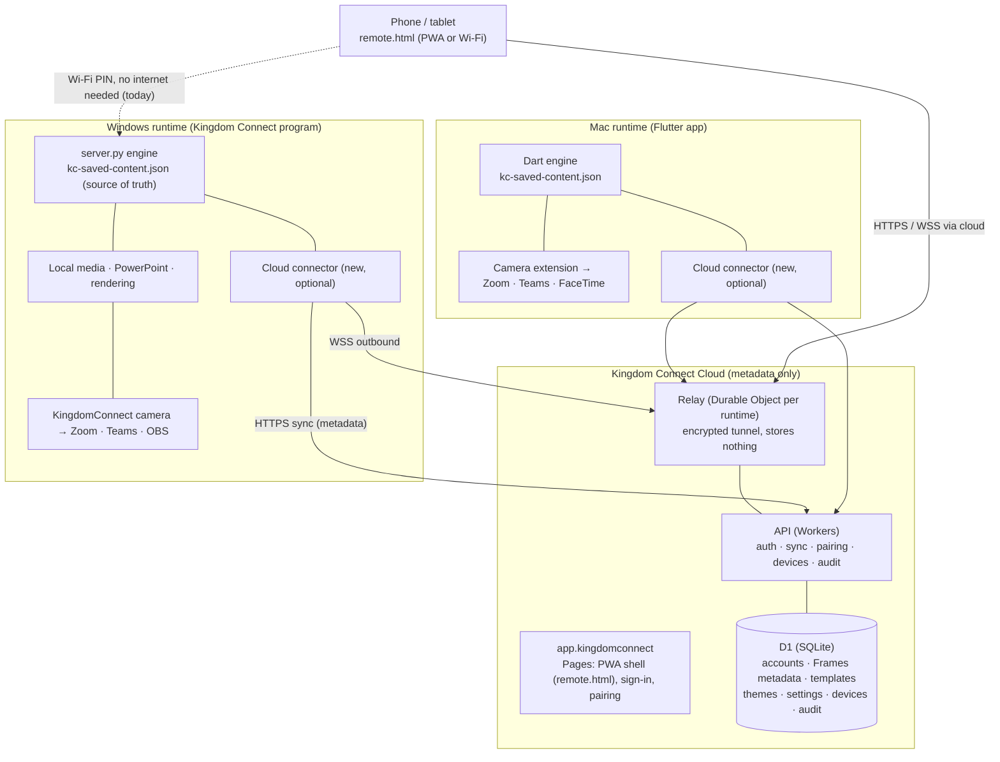
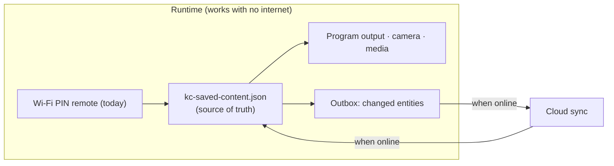
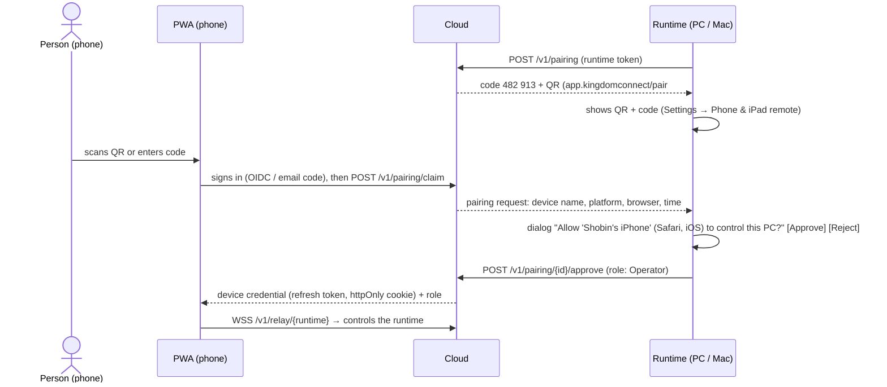
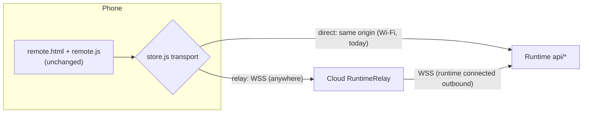
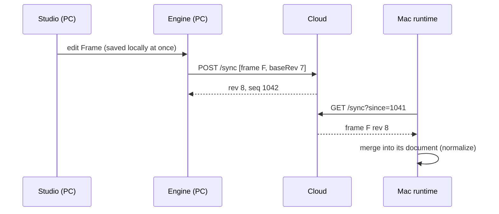
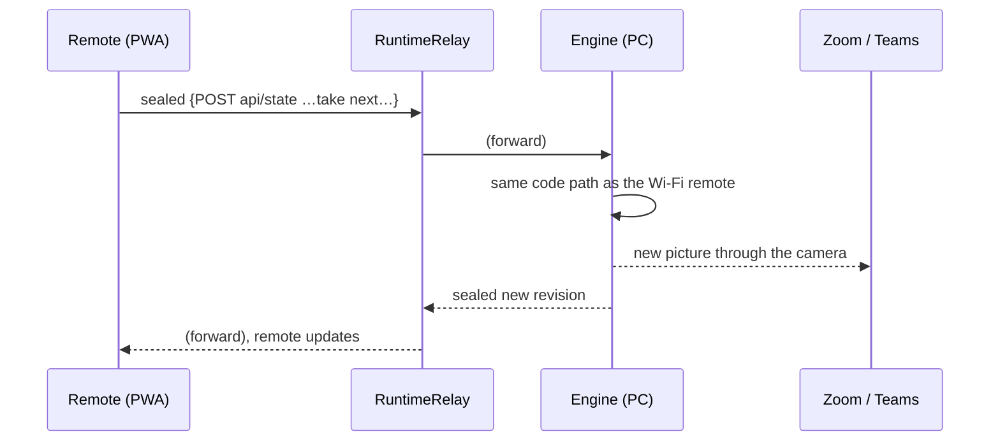

# Kingdom Connect: SaaS + PWA architecture

Status: **design agreed**, October 2026 (decisions D1–D6 below). Nothing here is built yet.

This is a plan to add accounts, cloud sync, an installable web remote and secure pairing to Kingdom Connect,
**around** the existing app. The app's screens, workflows, design, remote and presentation behaviour stay as they
are.

The rule this document follows everywhere: if modernising something would change what a user sees or does,
preservation wins and the modernisation waits.

---

## 0. Starting point: what exists today

The design has to fit the real product, so it starts from it.

| Part | What it is today | Where |
|---|---|---|
| **Windows runtime** | The Kingdom Connect program. A Python engine (`server.py`) with the Studio in a window (pywebview + `app/`). It does all rendering, media, PowerPoint, Speaker View and the KingdomConnect camera (softcam today; Windows 11 Media Foundation camera in PR #9). It saves one JSON document, `kc-saved-content.json`. | repo root |
| **The remote** | `app/remote.html` + `app/js/remote.js`, served **by the Windows program** to phones on the same Wi-Fi after a 6-digit PIN. Simple layout (Previous / Next Frame and Content, Annotate, Freeze, Black screen, Teleprompter) and Advanced layout (Frames with search, Content, live canvas and next-Frame preview, transitions, Q + Scripture, stepper, slides, run-through, Emergency, Auto). | `app/` |
| **Flutter app** | `kingdom_connect_app/` (PR #8). The same Studio on Windows / macOS / Linux, and a native remote on iPhone / iPad / Android that copies the remote's **Simple** layout. It uses the same JSON document and the same `api/state` protocol. | `kingdom_connect_app/` |
| **Mac camera** | A CoreMedia IO camera extension in the Flutter Mac app (PR #10). | `kingdom_connect_app/macos/` |

Three facts in this table decide much of the architecture:

1. **The production remote is `remote.html`.** "Preserve the remote exactly" therefore means the PWA *is*
   `remote.html`: the same files, with a new way to reach the runtime underneath. It is not the Flutter remote and
   not a rebuild. The Flutter native remote stays as an extra, for app stores.
2. **A PWA must be served over HTTPS.** The remote is served today over plain `http://` on the local Wi-Fi.
   - A service worker, and so installability, only works on a secure origin.
   - An HTTPS page cannot call `http://192.168.x.x`: browsers block mixed content and private-network requests.
   - So a remote that installs from the cloud needs an **encrypted relay** through the cloud to reach the runtime.
   - The existing Wi-Fi PIN remote stays, unchanged, as the path that works with no internet.
3. **The engine already separates content from playback.** Everything a Frame needs is in one JSON document of
   text, settings and references to local files. Media is never inside it. Metadata-only sync is therefore natural
   rather than a rewrite.

### What the requested remote capabilities map to

Following "do not invent new workflows", every requested capability is mapped to what the remote already does.

| Requested | Existing equivalent | Status |
|---|---|---|
| Next / Previous Slide | NEXT / PREVIOUS FRAME; NEXT / PREVIOUS CONTENT; PowerPoint slide stepping (`slides`) | ✅ exists |
| Start / Stop Presentation | GO LIVE (take); HIDE ALL; BLACK SCREEN | ✅ exists |
| Jump to Slide | Frames tab: tap a Frame's ▶; the question / scripture stepper | ✅ exists |
| Notes View | TELEPROMPTER ("only you see it") | ✅ exists |
| Timer View | The Countdown Content shown on the live picture | ⚠️ partly: there is no separate timer screen, and none is added (it would be a new workflow) |
| Confidence Monitor | The live canvas plus next-Frame preview (Advanced layout / tablet) | ✅ exists |
| Search Slides | Frames search | ✅ exists |
| Trigger Media | Content tab ON / OFF for media Content (the runtime plays it) | ✅ exists |
| Scene Selection | Frames | ✅ exists |
| Lower Third Controls | Lower Third Content ON / OFF | ✅ exists |
| Service Flow Navigation | Frame order and groups; Run-through | ✅ exists |
| Presentation Queue Navigation | NEXT badge and next-Frame preview | ✅ exists |

### Decisions (agreed)

| # | Decision | Agreed |
|---|---|---|
| D1 | Cloud provider | **Cloudflare** (Pages + Workers + D1 + Durable Objects): the lowest cost for this shape of service (§17) |
| D2 | Which remote becomes the PWA | **`remote.html` itself** (fact 1 above) |
| D3 | How people sign in | Google, Microsoft and Apple sign-in, plus a one-time email code. No passwords to store. |
| D4 | Domain | **None yet.** Until one is chosen, the service runs on Cloudflare's free HTTPS addresses (`kingdom-connect.pages.dev` for the PWA, `kingdom-connect-api.<account>.workers.dev` for the API). Moving to a custom domain later is a configuration change (§14). |
| D5 | Members, birthdays, email list | **Synced, because it costs nothing** (a few kilobytes per ministry, within the free allowances). Because this is personal data about other people, it is **end-to-end encrypted**: the cloud stores only ciphertext it cannot read, and only the ministry's own signed-in computers hold the key (§7, §15). |
| D6 | Meeting details (presenter, contact, attendees) | **Off by default**, with an opt-in "Sync meeting details" setting |

In this document, `app.kingdomconnect` and `api.kingdomconnect` mean "the PWA address" and "the API address": the
`pages.dev` / `workers.dev` addresses above until a domain exists.

---

## 1. SaaS architecture



Principles:

- **The runtime is the authority** for everything live: what is on screen, the camera, media. The cloud never
  decides what is shown.
- **The cloud is optional.** A signed-out runtime behaves exactly like today's app. Every cloud feature is added on
  top and can fail without affecting a service.
- **The cloud stores only metadata** (§17), so a free service stays cheap enough to keep free.
- **No tiers, no limits, no paywalls.** Every feature is available to every user.

## 2. PWA architecture

The PWA is the existing remote, made installable and reachable from anywhere.

| Piece | Design |
|---|---|
| Files | `app/remote.html`, `app/js/remote.js`, `store.js`, CSS, fonts and icons. **The same files** the runtime serves, published unchanged to Pages by CI. |
| Manifest | `remote.webmanifest`: name "Kingdom Connect Remote", the app's icons, `display: standalone`, theme `#0A1120` (the app's navy), `start_url: /remote` |
| Service worker | A small hand-written worker. It precaches the remote's files (app-shell caching) and never caches `api/*`. When offline it shows the shell plus the "Not connected to the PC" state the remote already has. (Flutter's generated service worker is not used: the PWA is not a Flutter web build.) |
| Install | Android / Chrome: the standard install prompt. iPhone / iPad: Share → Add to Home Screen, shown once as a hint on the existing sign-in card (text only, no layout change). |
| Sign-in | On the cloud origin, the existing PIN card becomes a sign-in / pairing card with the same card, logo and button style (§9). On the Wi-Fi origin it stays the PIN card. |
| Transport | A small transport layer under `store.js`: **direct** (same-origin `api/*`, today) or **relay** (§12). `remote.js` and the screens do not change. |
| Responsive | Already responsive: the phone layout, and the tablet three-pane layout at 900 px and wider. No change. |

Browser support: Chrome / Edge / Samsung Internet on Android, and Safari on iOS / iPadOS 16.4 and later (home-screen
web apps). The remote uses no APIs beyond what it uses today.

## 3. Flutter folder structure

The Flutter app keeps its structure. New code goes into new folders behind the existing seams.

```
kingdom_connect_app/lib/
  engine/                 (unchanged) model, normalize, scenes, backend
    backend.dart          + CloudSyncBackend: wraps LocalBackend, syncs in the background
  cloud/                  NEW, used only when signed in
    auth/                 sign-in (OIDC + email code), token store (Keychain / DPAPI)
    sync/                 entity mapping (state document ⇄ entities), push / pull, conflicts
    relay/                runtime-side relay client (WSS), request tunnelling
    pairing/              pair codes, QR, approval dialog, trusted-device list
    api/                  typed client for /v1
  runtime_server/         NEW (Phase 5), the local api/* server for the Mac runtime: serves remote.html
  ui/                     (unchanged screens) plus:
    settings_screen.dart  + "Kingdom Connect account" and "Paired devices" sections
    pairing_dialog.dart   + the Approve / Reject dialog
cloud/                    NEW, repo root: the backend (Workers, TypeScript)
  src/{auth,sync,pairing,devices,audit,relay}/
  migrations/             D1 SQL
  test/
```

## 4. Backend architecture

- **Cloudflare Workers** (TypeScript) host the stateless API (`/v1/...`).
- **D1** (SQLite) holds the data in §7. One small database is enough for this volume.
- **Durable Objects**, three kinds:
  - **RuntimeRelay**, one per runtime: WebSocket hub between one runtime and its paired devices, using the
    hibernation API so idle connections cost nothing.
  - **PairingSession**, one per pair code: the 5-minute state machine.
  - **RateLimiter**: per account and per IP.
- **Pages** hosts the PWA and the sign-in and pairing pages.
- **No** object storage, no CDN for media, no video, no queues.

Each module is independently testable and stateless except for the Durable Objects. The relay never writes what
passes through it to storage.

## 5. Offline-first architecture



- Every edit is saved locally first, exactly as today. Sync is a background reader of the same file.
- **If the internet drops in a service, nothing that matters changes:**
  - the runtime keeps rendering, and the camera keeps feeding Zoom, Teams and OBS;
  - slides, video and audio keep playing;
  - the Wi-Fi remote keeps working.
- The only things that stop are cloud-relay remotes. They show the remote's existing "Not connected" state, plus
  the hint "On the same Wi-Fi? Open http://<PC address>:8750". Live control continues over Wi-Fi.
- When connectivity returns, the outbox drains, changes from other devices arrive, and nothing is lost (§11).
- The cloud is never on the path between pressing NEXT FRAME and the picture changing when the remote is on the
  same Wi-Fi.

## 6. Secure pairing architecture



- **Codes:** 6 digits or a QR code, single use, expire after 5 minutes.
  - At most 5 attempts per code, then the code is dead.
  - Each IP and each account is rate-limited.
  - The code alone is never enough: the person must be signed in **and** someone at the runtime must press Approve.
- **The QR code** carries a 128-bit random pairing token in the URL fragment, which never reaches the server's
  logs. It is used to derive an end-to-end key (§15).
- **Trusted device registry** (§10): every approved device, with its role, last use and Revoke.
- **Multiple devices:** any number per runtime, each with its own role.
- **Roles:**

| Role | Can |
|---|---|
| Viewer | See what is live, the Teleprompter and the confidence view |
| Operator | Everything a Wi-Fi PIN remote can do today (default for a new pairing, so the experience is unchanged) |
| Presenter | Operator, plus annotate and the presenter's own Teleprompter controls |
| Administrator | Presenter, plus manage paired devices and edit Frames from the cloud |

When a role cannot do something, the remote's existing behaviour applies: the button does nothing and a toast
explains. No buttons are hidden or moved.

## 7. Database schema

D1 (SQLite). Times are Unix milliseconds. IDs are random 128-bit text.

```sql
CREATE TABLE users (
  id TEXT PRIMARY KEY, email TEXT UNIQUE NOT NULL, name TEXT, created_at INTEGER NOT NULL,
  deleted_at INTEGER                      -- account deletion: data purged by a job, row kept 30 days
);
CREATE TABLE identities (                 -- Google / Microsoft / Apple / email
  provider TEXT NOT NULL, subject TEXT NOT NULL, user_id TEXT NOT NULL REFERENCES users(id),
  PRIMARY KEY (provider, subject)
);
CREATE TABLE workspaces (                 -- a ministry; a user has one by default
  id TEXT PRIMARY KEY, name TEXT NOT NULL, created_at INTEGER NOT NULL
);
CREATE TABLE workspace_members (
  workspace_id TEXT NOT NULL REFERENCES workspaces(id), user_id TEXT NOT NULL REFERENCES users(id),
  role TEXT NOT NULL CHECK (role IN ('viewer','operator','presenter','admin')),
  PRIMARY KEY (workspace_id, user_id)
);
CREATE TABLE runtimes (                   -- a PC or Mac running Kingdom Connect
  id TEXT PRIMARY KEY, workspace_id TEXT NOT NULL REFERENCES workspaces(id),
  name TEXT NOT NULL, platform TEXT NOT NULL CHECK (platform IN ('windows','macos','linux')),
  app_version TEXT, last_seen_at INTEGER, revoked_at INTEGER
);
CREATE TABLE devices (                    -- trusted remotes (phones, tablets, browsers)
  id TEXT PRIMARY KEY, runtime_id TEXT NOT NULL REFERENCES runtimes(id), user_id TEXT NOT NULL REFERENCES users(id),
  name TEXT NOT NULL, platform TEXT, browser TEXT,
  role TEXT NOT NULL CHECK (role IN ('viewer','operator','presenter','admin')),
  approved_at INTEGER NOT NULL, last_used_at INTEGER, revoked_at INTEGER
);
CREATE TABLE pairing_requests (
  id TEXT PRIMARY KEY, runtime_id TEXT NOT NULL REFERENCES runtimes(id),
  code_hash TEXT NOT NULL,                -- SHA-256 of the 6-digit code with a per-request salt
  token_hash TEXT NOT NULL,               -- SHA-256 of the QR token
  claimed_by_user TEXT, device_name TEXT, device_platform TEXT, device_browser TEXT,
  attempts INTEGER NOT NULL DEFAULT 0,
  status TEXT NOT NULL CHECK (status IN ('open','claimed','approved','rejected','expired')),
  created_at INTEGER NOT NULL, expires_at INTEGER NOT NULL
);
CREATE TABLE refresh_tokens (             -- users, runtimes and devices; rotating, reuse-detecting
  id TEXT PRIMARY KEY, family_id TEXT NOT NULL,
  subject_type TEXT NOT NULL CHECK (subject_type IN ('user','runtime','device')), subject_id TEXT NOT NULL,
  token_hash TEXT NOT NULL UNIQUE, expires_at INTEGER NOT NULL, used_at INTEGER, revoked_at INTEGER
);
CREATE TABLE entities (                   -- synced metadata: one row per Frame / template / theme / setting
  workspace_id TEXT NOT NULL REFERENCES workspaces(id),
  kind TEXT NOT NULL CHECK (kind IN ('frame','template','theme','library_verse','library_question',
                                     'brand','profile','layout','meeting',
                                     'members')),     -- members: body is ciphertext (D5)
  id TEXT NOT NULL,
  rev INTEGER NOT NULL,                   -- per-entity version
  seq INTEGER NOT NULL,                   -- workspace-wide change sequence (pull cursor)
  updated_by TEXT NOT NULL,               -- runtime or device id
  updated_at INTEGER NOT NULL,
  deleted INTEGER NOT NULL DEFAULT 0,
  body TEXT NOT NULL,                     -- JSON exactly as in kc-saved-content.json (local file paths, never bytes)
  PRIMARY KEY (workspace_id, kind, id)
);
CREATE INDEX entities_seq ON entities(workspace_id, seq);
CREATE TABLE audit_log (
  id INTEGER PRIMARY KEY AUTOINCREMENT, workspace_id TEXT, actor_type TEXT, actor_id TEXT,
  action TEXT NOT NULL,                   -- sign_in, pair_approved, device_revoked, role_changed, sync_conflict…
  detail TEXT, ip_hash TEXT, at INTEGER NOT NULL
);
```

**Stored only end-to-end encrypted** (D5): members, birthdays and the email list, as `members` entities whose
`body` is ciphertext. The key is created on the first signed-in computer. Another computer gets it when it joins the
workspace and is approved from a computer that already has it (the same Approve step as pairing, §6), sent sealed
end to end; the cloud never has it. Remote devices (phones) never receive
members data, just as today.

**Never stored in the cloud:**
- media files, logos and other images (only a content hash, so another device can say "logo missing on this computer");
- what is live (`live`);
- camera settings;
- recordings;
- PowerPoint files.

## 8. API design

Base: `https://api.kingdomconnect/v1` (the `workers.dev` address until a domain exists, D4). All requests and responses are JSON, and every request must carry a
token unless marked public.

| Method & path | Who | What |
|---|---|---|
| `POST /auth/oidc/{provider}/start` · `/callback` | public | Sign in with Google / Microsoft / Apple (PKCE) |
| `POST /auth/email/start` · `/verify` | public, rate-limited | One-time code by email |
| `POST /auth/refresh` | refresh token | Rotate: new access + refresh token |
| `POST /auth/logout` | any | Revoke this refresh family |
| `GET /me` · `DELETE /me` | user | Profile · delete account and data |
| `GET /me/export` | user | Everything stored about you, as JSON |
| `POST /runtimes` | user | Register this PC / Mac; returns a runtime credential |
| `GET /sync?since={seq}` | runtime, admin device | Changed entities after `seq` (paged) |
| `POST /sync` | runtime, admin device | Push `[{kind,id,baseRev,body,deleted}]`; returns accepted revs + conflicts |
| `GET/POST/DELETE /templates`, `/themes` | member | Shared templates and themes (they are entity kinds) |
| `POST /pairing` | runtime | New code + QR token |
| `POST /pairing/claim` | user | `{code}` or `{token}` + device info |
| `POST /pairing/{id}/approve` · `/reject` | runtime | With the role |
| `GET /devices` · `PATCH /devices/{id}` · `DELETE /devices/{id}` | admin / runtime | List, change role, revoke |
| `GET /audit?since=` | admin | The workspace's audit log |
| `GET /relay/{runtimeId}` (WebSocket upgrade) | runtime or device | The tunnel (§12) |

Errors use `{"error": {"code": "pair_code_expired", "message": "…"}}`. The messages are written for people, in the
app's plain style.

## 9. Authentication design

- **Identity:** OpenID Connect sign-in (Google, Microsoft, Apple) or a 6-digit code sent by email.
  - No passwords are stored, so there is nothing to leak.
  - Passkeys can be added later without changing the token design.
- **Access token:** a JWT signed with ES256, valid for 10 minutes.
  - Claims: `sub`, `typ` (user / runtime / device), `ws` (workspace), `role`, `rt` (runtime, for devices), `jti`.
  - Verified statelessly by every Worker. Signing keys rotate, and old keys stay valid for verification until their
    tokens expire.
- **Refresh token:** opaque and random, stored only as a hash, rotated on every use.
  - Reusing an old one revokes the whole family (theft detection).
  - Lifetime: user 30 days, device 90 days sliding, runtime until revoked.
- **Token storage:**

| Client | Refresh token kept in | Access token |
|---|---|---|
| Windows runtime (Python) | Windows Credential Manager (DPAPI) | memory |
| Mac runtime (Flutter) | macOS Keychain (`flutter_secure_storage`) | memory |
| PWA remote | `httpOnly; Secure; SameSite=Strict` cookie on the API domain | memory only (never `localStorage`) |
| Native Flutter remote | iOS Keychain / Android Keystore | memory |

- **Signed out = today's app.** Signing in is offered in Settings and never required to present.

## 10. Device management design

- **Settings → Phone & iPad remote** (an existing section) gains:
  - a "Pair with a code" button;
  - the list of trusted devices: name, browser, role, last used, Revoke.
- The Wi-Fi PIN part of that section is unchanged.
- **Revoke** kills the device's refresh family and closes its relay socket at once. The audit log records it.
- **Runtimes** can be renamed and revoked from any signed-in runtime of the same workspace. A revoked runtime keeps
  working offline, exactly like a signed-out app.
- Lost phone: revoke it from the PC, or from the cloud's device list on any other device.

## 11. Synchronization design

The state document is split into **entities**, one per Frame (with its Content and items), library item, template,
theme and setting block. They are synced by version.

- **Map:** `kc-saved-content.json` ⇄ entities, by a pure function in each engine. It is tested so that splitting
  and joining gives back the identical document (the same parity approach as `store.js` ⇄ Dart).
- **Push:** when the document changes, the connector diffs it against the last synced copy and sends the changed
  entities with their `baseRev`.
- **Pull:** `GET /sync?since=seq` merges remote changes into the document through the engine's own update path, so
  the document stays valid (`normalize`).
- **Conflicts** (the same entity changed in two places while offline):
  - Settings blocks: last writer wins, with the losing version kept in the audit log.
  - **Frames are never silently lost:** the cloud keeps one version, and the other becomes a copy named
    "‹Frame› (from ‹PC name›)" in the same group. This is the existing Duplicate outcome, so it is a familiar result.
- **What is live is never synced.** Live state belongs to one runtime at a time.
- **Timing:** sync runs shortly after edits settle, and at start-up. An optional setting, "Pause sync during
  services" (off by default), holds it while something is live.

## 12. Remote control architecture



- **The relay tunnels the existing API.**
  - The remote's `fetch('api/state…')`, `api/remote-login` and `api/remote/studio` calls are wrapped in
    `{id, method, path, body}` messages.
  - The runtime's connector replays each one against its own local server and returns the response.
  - Because the remote and the runtime run exactly the same code paths as on Wi-Fi, every remote feature behaves the
    same: Annotate, slides, run-through, Q + Scripture, Freeze, Emergency. Nothing has to be re-implemented for the
    cloud.
- **Long-poll becomes push:** the runtime pushes each new revision down the socket. That is quicker and lighter than
  holding long-poll requests open through the cloud.
- **End-to-end encryption:** messages are sealed with a key agreed at pairing (§15), so the relay carries only
  ciphertext.
- **Latency:** Wi-Fi stays direct (no change). Over the relay, a press typically adds one round trip through the
  nearest Cloudflare location, about 50–150 ms. This is fine for a remote, and it is why the Wi-Fi path is kept and
  preferred.
- **The runtime connects outward**, so no router or firewall changes are needed and the PC opens no inbound port to
  the internet.

## 13. State management strategy

- **Flutter:** keep Riverpod and the `StateBackend` seam.
  - `CloudSyncBackend` wraps `LocalBackend` (or `EngineBackend`) and adds sync in the background.
  - Screens keep reading `stateProvider` as today.
  - New providers (account, sync status, devices) are used only by the new Settings sections.
- **Remote (`remote.js`):** no change. `store.js` gains a transport interface (`fetchState`, `postState`,
  `subscribe`) with the two implementations.
- **Windows engine (`server.py`):** the connector is a separate module. It reads and writes the document only
  through the engine's existing save and load functions.

## 14. Deployment architecture

| Piece | Where | How |
|---|---|---|
| PWA + sign-in + pairing pages | Cloudflare Pages | CI publishes `app/remote*` + `cloud/web/` on every release tag |
| API, relay, pairing | Workers + Durable Objects | `wrangler deploy` from CI; `staging` and `production` environments |
| Database | D1 | Migrations in `cloud/migrations/`, applied by CI; Time Travel restore point before each migration |
| Windows runtime | Installer (and later MSIX / Store, PR #9) | unchanged |
| Mac runtime | Signed app (and Mac App Store) | PR #10 |
| Native remotes | App Store / Play | From the Flutter app (PR #8) |

Addresses: until a domain is chosen (D4), Pages and Workers use their free `pages.dev` / `workers.dev` HTTPS
addresses. Adding a domain later means adding it in Cloudflare, pointing the PWA and API there, and keeping the old
addresses redirecting, so installed remotes keep working.

Observability: Workers logs and analytics (no personal data in logs), uptime checks on `/v1/health`, and alerts by
email.

## 15. Security architecture

| Requirement | How |
|---|---|
| HTTPS everywhere | TLS 1.2+ on all cloud origins, HSTS with preload. The Wi-Fi path stays LAN-only, PIN-protected, and is never exposed to the internet. |
| JWT + refresh | §9 |
| Role-based access | Role claim in the token, checked by the API and again by the runtime (the runtime has the final say) |
| Session management | Short access tokens, rotating refresh, server-side revocation, a sessions list in Settings |
| Device trust | Pairing needs a signed-in user **and** approval at the runtime. Each device has its own revocable credential. |
| Audit logging | Sign-in, pairing, approval / rejection, role change, revoke, sync conflict. Kept 1 year; the IP is stored only as a hash. |
| Secure token storage | §9 table |
| CSRF | `SameSite=Strict` cookies, an `Origin` check on every state-changing request, and no cookie-only authority for the API (bearer access token required) |
| Replay protection | `jti` + 10-minute expiry. Relay messages carry a per-connection sequence number and are sealed with an AEAD key, so a repeated or reordered message is rejected. |
| Session revocation | Revoking a refresh family closes live sockets through the RuntimeRelay object |
| Rate limiting | Per IP and per account on sign-in, email codes, pairing claims and API writes |
| End-to-end relay encryption | At pairing, the device and runtime do an X25519 key agreement bound to the QR / pair token. Relay payloads use AES-GCM, so the cloud cannot read meeting content in transit. |
| Members data (D5) | End-to-end encrypted with a per-workspace key (AES-256-GCM) that only the ministry's computers hold; the cloud stores ciphertext. Losing every computer loses the key, so Settings offers a printable recovery key. |
| Data minimisation | Metadata only; members data unreadable by the cloud; delete-account and export endpoints |

## 16. Data flow diagrams

**Editing on the PC, seen on another computer**



**Pressing NEXT FRAME away from the Wi-Fi**



## 17. Cloud cost optimisation

- **Store and serve only small JSON.** A large ministry's Frames come to a few megabytes in total.
- **No media, no video, no file hosting, no egress-heavy traffic.**
- **Relay:** the WebSocket hibernation API means idle remotes cost almost nothing, and messages are small.
- **Sync** is pull-on-change with sequence cursors, not polling the whole state.
- **Rough expectation:** within Cloudflare's free allowances for a small user base, and in the low tens of dollars a
  month on the paid Workers plan for thousands of active ministries. **Check current Cloudflare pricing before
  committing; the limits change.**
- **Kill-switches:** sync and relay can be turned off per workspace without affecting presenting.

## 18. Migration strategy

1. Ship the cloud connector **switched off**. Existing users notice nothing.
2. Settings → "Kingdom Connect account" lets a user sign in.
   - At first sign-in, the local document is uploaded as entities. The local file stays the source of truth.
   - If the account already has data from another computer, the person chooses: **Merge**, which uses the conflict
     rules, or **Use this computer's Frames**. Nothing is ever deleted without that choice.
3. The Wi-Fi PIN remote stays the default. "Pair with a code" is offered beside it.
4. The PWA goes live at `app.kingdomconnect/remote` (the `pages.dev` address until a domain exists). The old `http://PC:8750/remote.html` keeps working
   forever.
5. **Rollback:** disabling the connector returns a runtime to exactly today's behaviour. Cloud data stays until the
   user deletes it.

## 19. Refactoring strategy

Only add seams; never move existing behaviour.

| Seam | Change | Risk control |
|---|---|---|
| `store.js` transport | Extract the 3 network calls behind an interface; default = today's `fetch` | Existing Node tests + new transport tests; Playwright screenshots of `remote.html` before and after must match |
| `server.py` connector | New module with only two hooks: "document saved" and "replay this API request" | Off by default; unit tests; the existing Python test suite |
| Dart `CloudSyncBackend` | Decorator around `StateBackend` | Parity tests for entity split / join |
| Settings | Two new sections, in the existing section style | Widget tests; screenshots |

## 20. Existing feature preservation strategy

- **Feature inventory:** every remote and Studio action listed in §0 becomes a checklist.
  - Automated where possible: Playwright for `remote.html`, widget tests for Flutter, the Python tests.
  - Manual for the camera in Zoom, Teams and OBS.
- **Golden screenshots:** the remote in both transports, phone and tablet sizes. Any pixel difference fails CI.
- **Contract tests:** the same API request through the direct and relay paths must give byte-identical responses.
- **Parity tests:** `store.js` ⇄ Dart (today), plus entity split / join (new).
- **Service-day rule:** no cloud call is ever on the path of a live action on the Wi-Fi path, enforced by a test
  that runs a service script with the network disabled.

## 21. Risk assessment

| Risk | Likelihood | Impact | Mitigation |
|---|---|---|---|
| Internet fails mid-service | Medium | High if relied on | Runtime and camera need no internet; the Wi-Fi remote stays; the PWA shows the Wi-Fi fallback (§5) |
| Browsers block HTTPS → LAN calls | Certain | High | That is why the relay exists (§0, §12) |
| iOS web-app limits (no background, possible storage eviction) | Medium | Low | The remote keeps no important state locally; it reconnects on open |
| Relay latency | Medium | Low | Wi-Fi preferred; relay only away from the Wi-Fi |
| Sync conflicts lose edits | Low | High | Frames never overwritten silently (§11); audit log |
| Account takeover | Low | High | OIDC, rotating refresh with reuse detection, approval at the runtime, revocation |
| Two engines (Python, Dart) diverge | Medium | Medium | One protocol spec; shared conformance fixtures, like the parity tests |
| Free service costs grow | Low | Medium | Metadata only; kill-switches; cost alerts |
| Privacy / GDPR (members data is about other people) | Medium | Medium | End-to-end encryption, so the cloud cannot read it; export / delete; minimal logs; a privacy notice before launch |
| Members encryption key lost | Low | Medium | Key on every signed-in computer, plus a printable recovery key; the PC's local copy is always kept |
| Teams does not send a virtual camera to the call (PR #9) | Unknown | High | Test before release; Share Window remains the fallback |
| Mac runtime lacks media and PowerPoint | Certain today | Medium | Phase 5 |

## 22. Implementation roadmap

| Phase | Delivers | Depends on | Size |
|---|---|---|---|
| 1 Foundation | Protocol spec, entity split / join + parity tests, `store.js` transport seam, cloud skeleton (health, CI deploy, D1 migrations), Playwright golden screenshots of the remote | PRs #8–#10 merged | M |
| 2 SaaS | Sign-in, workspaces, runtime registration, sync (Windows connector + Dart backend), Settings sections, audit, export / delete | 1 | L |
| 3 PWA | Manifest, service worker, Pages publishing of `remote.html`, install hints, relay transport + RuntimeRelay | 2 | M |
| 4 Pairing | Codes and QR, approval dialog, roles, device registry, revoke, end-to-end encryption | 3 | M |
| 5 Mac runtime | Local `api/*` server in Dart serving `remote.html`, media Content, connector parity | 2 (4 for pairing) | L |

## 23. Phase 1: Foundation

1. Write `docs/architecture/runtime-protocol.md`, the `api/*` endpoints as they exist today (the spec both engines
   and the relay follow).
2. Entity split / join in JS (`store.js`) and Dart, with shared fixtures. Prove that splitting and joining gives
   back an identical document.
3. Move `store.js` behind a transport interface, with the default unchanged. Add Playwright golden tests of
   `remote.html` (phone and tablet, Simple and Advanced).
4. Create `cloud/` (Workers + D1 + wrangler), with `/v1/health`, staging and production deploys from CI, and the
   migrations in §7.

Exit: everything as today, plus the safety nets that later phases rely on.

## 24. Phase 2: SaaS

Sign-in (D3) · workspaces and members · runtime registration and tokens in the OS keychain · `/sync` with conflict
rules · Windows connector (`server.py` module) · `CloudSyncBackend` (Dart) · Settings: account, sync status, "Sync
meeting details" (D6) · members sync, end-to-end encrypted, with a recovery key (D5) · templates and themes as shared
entities · audit log · export and delete.

Exit: two PCs signed into one account show the same Frames, and every existing test passes with the cloud on or off.

## 25. Phase 3: PWA

Manifest and icons · service worker · CI publishes the remote to Pages · relay transport in `store.js` ·
RuntimeRelay Durable Object · runtime connector socket · install hint on the sign-in card.

Exit: the remote installs from the browser and, away from the Wi-Fi, controls the PC with identical golden
screenshots and identical API responses (contract tests).

## 26. Phase 4: Pairing

Pair code and QR (5-minute, single use) · claim, approve and reject with device details · roles · trusted-device
list and revoke · end-to-end key agreement · rate limits · audit events.

Exit: a new phone pairs in under a minute, with approval at the PC, and a revoked phone is cut off within a second.

## 27. Phase 5: Mac runtime

The Flutter Mac app already has the Studio and the camera (PRs #8, #10). To be a full runtime it needs:
1. A local `api/*` server in Dart (`runtime_server/`) that serves the same `remote.html`, so the Wi-Fi PIN remote
   and the relay work on a Mac exactly as on Windows.
2. Media Content: images and video (with audio) rendered in the program view and the camera.
3. The cloud connector (from Phase 2) and pairing (Phase 4).
4. PowerPoint is out of scope on the Mac for now (it is Windows automation); Frames with slides show what they show
   today.

Exit: a Mac runs a service end to end (Frames, media, camera into Zoom, Teams and FaceTime, remote control), with
the same results as Windows on the shared feature checklist.
