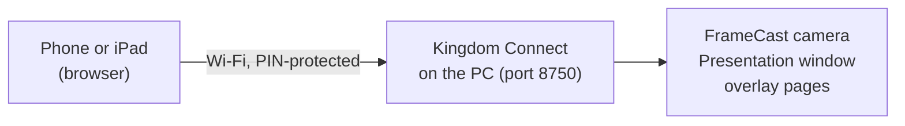
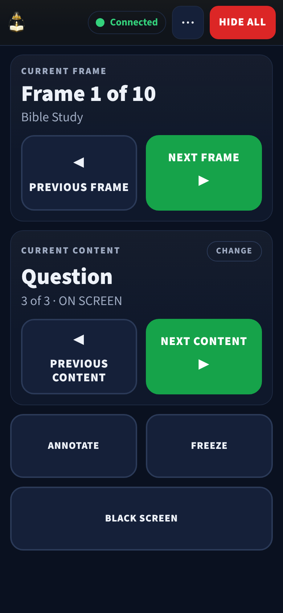
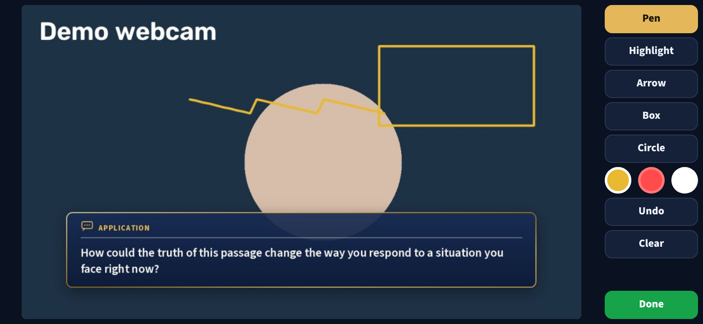

# Phone and tablet remote

Run the service from a phone or iPad: step through Frames and Content, draw on the picture, freeze or black out the screen.

**Who this is for:** service operators, remote operators and leaders who want to move freely while presenting.

**On this page**
- [How it works](#how-it-works)
- [Set up the remote](#set-up-the-remote)
- [Security](#security)
- [Simple remote](#simple-remote)
- [Advanced remote](#advanced-remote)
- [Teleprompter on the phone](#teleprompter-on-the-phone)
- [Drawing from the phone](#drawing-from-the-phone)
- [Run-through mode](#run-through-mode)
- [iPad and tablet layout](#ipad-and-tablet-layout)
- [Add it to your home screen](#add-it-to-your-home-screen)
- [Tips for remote operators](#tips-for-remote-operators)
- [If the phone can't connect](#if-the-phone-cant-connect)

---

## How it works

The remote is a web page served by Kingdom Connect on your PC. Your phone opens it over your church's (or home's) Wi-Fi. Nothing goes through the internet or any outside service.

Every button on the phone changes the same live state as the PC, so the PC, the phone and everyone watching always agree.

## Set up the remote

1. On the PC, open **Settings → Phone & iPad Remote** and turn the remote **on**.
2. The first time, Windows Firewall asks about network access. Tick **Private networks** only, then select **Allow**.
3. On the phone, join the **same Wi-Fi network** as the PC.
4. Scan the **QR code** shown in Settings with the phone's camera, or type the address shown there (it looks like `http://192.168.1.20:8750`).
5. Enter the **6-digit PIN** shown in Settings.

The phone stays signed in for 30 days. After that, or after a new PIN, enter the PIN again.

> **Tip:** In the same Settings section, tick the option to turn the remote on whenever Kingdom Connect starts, so it is ready every Sunday.

## Security

| Protection | What it means |
| --- | --- |
| **6-digit PIN** | Only people who know the PIN can control the service |
| **Same network only** | The remote works on your local network; it isn't reachable from the internet |
| **Lockout** | After 5 wrong PINs, that device must wait 60 seconds before trying again |
| **New PIN** | **Settings → Phone & iPad Remote → New PIN** signs out every phone and iPad at once |
| **PC-only settings** | Phones can't open Settings, member lists, the Scripture API key or the FrameCast camera settings |
| **Live picture** | The picture on the phone's drawing pad is PIN-protected, like the rest of the remote |

> **Important:** Treat the PIN like a key to the sound desk. Share it only with the people running the service, and choose **New PIN** if it has been shared too widely.

## Simple remote

The **Simple** remote is the default. It has one screen with very large buttons, so a volunteer can use it without training.

| Part | What it does |
| --- | --- |
| **Connected** | The connection status, always visible at the top |
| **HIDE ALL** | Hides everything on screen at once |
| **Current Frame** (*Frame 4 of 18*) | Where you are in the meeting |
| **PREVIOUS FRAME / NEXT FRAME** | Move through the Frames, in order |
| **Current Content** (*Question 2 of 5*, *Scripture*, *PowerPoint · Slide 3 of 12*) | What is showing in this Frame |
| **CHANGE** | Appears when a Frame has more than one kind of Content (for example questions **and** scriptures). Switches which one the buttons below control |
| **PREVIOUS CONTENT / NEXT CONTENT** | Step through questions, scriptures or slides |
| **ANNOTATE** | Opens the drawing pad |
| **FREEZE** | Holds the picture while you get the next thing ready |
| **BLACK SCREEN** | Makes the picture black. Select it again (**SHOW PICTURE**) to bring it back |
| **TELEPROMPTER** | Opens the Frame's Teleprompter script full screen, on this phone only |

## Advanced remote

Open the **⋯** menu and choose **Advanced remote** for more control:
- every Frame in a list, with **search** across Frames and Content;
- the Frame's Content (tap to show or hide each one);
- a **Teleprompter** panel on the **Live** tab, visible only on the phone;
- **PowerPoint** slide control;
- **Run-through** mode (below);
- **Annotate**, **Freeze**, **Blackout** and **Emergency**.

The choice is remembered on that phone. Switch back to **Simple** from the same menu.

## Teleprompter on the phone

The phone can show the Frame's **Teleprompter script**, the same one you see on the PC. Only the phone shows it;
nobody watching sees it.

- **Simple remote:** select **TELEPROMPTER**. The script opens full screen.
- **Advanced remote:** open the **Teleprompter** panel on the **Live** tab.

Scroll with your finger, or use the play button to scroll by itself. See
[Presentations](presentations.md#teleprompter) for how to write the script.

## Drawing from the phone

1. Select **ANNOTATE**. The drawing pad opens with the **live picture**, exactly what Zoom, Teams or the projector shows.
2. Choose a tool (**Pen**, **Highlight**, **Arrow**, **Box**, **Circle**) and a colour.
3. Draw with your finger. The drawing appears on screen when you lift your finger.
4. **Undo** removes the last drawing; **Clear** removes them all.
5. Select **Done** to close the pad and hide the drawings.

> **Tip:** Turn the phone **sideways**. The picture then fills the screen and the tools move to a narrow column at the side, so you can draw more accurately. On Android the browser bars hide too; iPhone Safari keeps them.

While the pad is open, the phone gets a sharper picture (960 pixels wide). If the FrameCast camera is off, the pad shows the Frame's cards instead, so you are never drawing on a black box.

## Run-through mode

In the Advanced remote, **Run-through** lets you step through Frames on the phone **without changing what everyone sees**. The phone's preview follows your steps; the screen does not. Use it to rehearse, or to check what is coming next during a long talk. Turn it off to control the screen again.

## iPad and tablet layout

On an iPad or a large tablet, the Advanced remote shows the Frames, the Content and the controls side by side, so you can see the whole meeting at once. The Simple remote stays a single, centred column of large buttons.

## Add it to your home screen

- **iPhone / iPad (Safari):** Share → **Add to Home Screen**. It opens full screen, like an app, named **KC Director**.
- **Android (Chrome):** ⋮ → **Add to Home screen** (or **Install app**).

The icon opens the remote directly. You still need to be on the same Wi-Fi as the PC.

## Tips for remote operators

- Charge the phone fully, and turn on **Do Not Disturb** so notifications don't cover the buttons.
- Set the phone to stay awake (screen timeout off, or as long as possible) during the service.
- Check the **Connected** status before the service starts and after any Wi-Fi change.
- Use **FREEZE** before switching windows or files on the PC, then unfreeze when ready.
- If something unexpected appears, select **HIDE ALL** first, then work out what happened.

## If the phone can't connect

| Cause | Fix |
| --- | --- |
| The remote is off | **Settings → Phone & iPad Remote** → turn it on |
| The phone is on a different network (mobile data, guest Wi-Fi) | Join the same Wi-Fi as the PC. Guest networks often block devices from seeing each other |
| Windows Firewall blocks it | On the PC, run **Allow iPad Remote - run once.bat** (in the Kingdom Connect folder) once, or allow the app for **Private networks** |
| The network is set to **Public** in Windows | Settings → Network & internet → your Wi-Fi → **Private network** |
| Wrong PIN too many times | Wait 60 seconds, then try again |
| The PC's address changed | Scan the QR code in Settings again |

More answers: [Troubleshooting](troubleshooting.md#phone-remote).

## Related
- [Presentations](presentations.md)
- [Remote operator guide](ministry/remote-operators.md)
- [Troubleshooting](troubleshooting.md)
- [FAQ](faq.md#phone-remote)
- [Getting started](getting-started.md)
