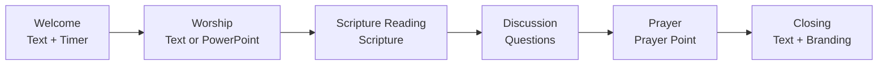

# Service planning

How to plan a service, Bible study or meeting in Kingdom Connect, from a blank page or from Excel.

**Who this is for:** worship leaders, small-group leaders and whoever prepares the order of service each week.

**On this page**
- [Think in Frames](#think-in-frames)
- [A typical order of service](#a-typical-order-of-service)
- [Three ways to start](#three-ways-to-start)
- [Organize your Frames](#organize-your-frames)
- [Reuse last week's service](#reuse-last-weeks-service)
- [Notes for the leader](#notes-for-the-leader)
- [Plan in Excel with the Meeting Workbook](#plan-in-excel-with-the-meeting-workbook)
- [Planning worship lyrics today](#planning-worship-lyrics-today)
- [Weekly planning checklist](#weekly-planning-checklist)

---

## Think in Frames

A **Meeting** is your service or meeting. It is made of **Frames**, in order. Each Frame is one moment the
congregation or group sees, and it holds the **Content** for that moment.

During the meeting you move from one Frame to the next with **Frame ▶**, on the PC or the phone.

> **Tip:** Make one Frame for each change of screen. If the screen should change, it is a new Frame. If only the
> question changes, it is the next item in the same Frame's Question list.

## A typical order of service

| Frame | Suggested Content | Notes |
| --- | --- | --- |
| **Welcome** | Text ("Welcome to {meeting}"), Timer counting down to the start | `{meeting}` shows your Meeting Name |
| **Worship** | Text with the lyrics, or a PowerPoint of the lyrics | See [Planning worship lyrics today](#planning-worship-lyrics-today) |
| **Scripture Reading** | Scripture with the passage | Fetch ESV text, or type any translation |
| **Message / Discussion** | Question list, Scripture list, or PowerPoint slides | Answers and notes stay private |
| **Prayer** | Prayer Point | |
| **Announcements** | Text, Image | |
| **Closing** | Text, Branding (your logo and Meeting Name) | |

## Three ways to start

### 1. Quick Start
1. Select the **✨ Meeting** button next to **+ Frame**.
2. Choose **Quick Start…**.
3. Pick a ready-made meeting, for example **Sunday Service**, **Bible Study**, **Youth Service** or **Conference**.
4. The Frames appear in their own group. Rename, change or delete any of them.

### 2. From your own template
If you saved a Frame as a template (see [Frames](frames.md#templates)), it appears in the **Meeting** menu under
**From your templates**.

### 3. From scratch
1. Select **+ Frame** for each part of the service. Each new Frame is blank and goes after the selected one.
2. Name each Frame (double-click its name or press **F2**).
3. Select a Frame, then **+ Content**, and add what it needs. See [Content](content.md).

## Organize your Frames

- **Groups:** put a whole service in one group, for example *Romans · Week 5*. Set it in Content Settings →
  **Frame → Group**, or from the Frame's **⋯** menu → **Move to group…**.
- **Order:** drag Frames in the list, or use **⋯ → Move up / Move down**.
- **Favourites:** star the Frames you reuse often, then use the **Favorites** filter.
- **Search:** type in **Search Frames**, or press **Ctrl+K** to search everything.
- **Library:** the **Library** filter shows ready-made Frames you can add.

## Reuse last week's service

1. Open the **⋯** menu on a Frame (or select it and press **Ctrl+D**).
2. Choose a duplicate option:
   - **Duplicate**: an exact, fully independent copy;
   - **Duplicate & edit question**: copies the Frame and opens its question for editing;
   - **Duplicate with options…**: choose what to copy (Content, layout, branding, animations, transitions, output routing);
   - **Duplicate Content structure only**: the same Content, with empty lists;
   - **Duplicate to group…**: copies it straight into another group, such as next week's.
3. Change the copy. The original is never affected.

> **Note:** A duplicate shares nothing with the original. Editing a question in the copy never changes last week's
> service.

## Notes for the leader

Kingdom Connect has three kinds of private notes. None of them is ever shown on screen.

| Note | Where you write it | Where you read it during the meeting |
| --- | --- | --- |
| **Leader notes** on a Frame | Content Settings → Frame → **Leader notes** | Speaker View, Advanced phone remote |
| **Answer** for a question | The question's editor → **Answer** | Speaker View, Advanced phone remote |
| **Notes** for a question or scripture | The item's editor → **Notes** | Speaker View, Advanced phone remote |

The **Meeting Overview** notes from the Excel workbook appear in the Speaker View as **Meeting notes**.

## Plan in Excel with the Meeting Workbook

Excel is optional. The **Meeting Workbook** is useful when one person plans the service and another runs it, or
when you want to type a whole series of questions at once.

### The five sheets

| Sheet | One row per… | Main columns |
| --- | --- | --- |
| **Meeting Overview** | detail | Meeting Title, Date, Presenter, Notes |
| **Frames** | Frame | Frame Number, Frame Name, Description, Background, Transition, Presenter Notes |
| **Content** | Content | Frame Number, Content Order, Content Type, Content Name, Main Content, Label, Duration, Animation, Notes |
| **Questions** | question | Frame Number, Content Name, Question Number, Label, Question Text, Answer Text, Notes |
| **Scriptures** | scripture | Frame Number, Content Name, Scripture Number, Label, Reference, Text, Translation, Notes |

The template has drop-down lists and example rows. Full column details are in
[reference/meeting-workbook-and-branding.md](reference/meeting-workbook-and-branding.md).

### Import a meeting
1. **Meeting → Download the Excel template**, then fill it in.
2. **Meeting → Import meeting from Excel…** and choose the file.
3. Read the **preview**. It lists the Frames and Content that will be made, and every problem with its sheet and
   row. Fix problems in Excel and import again.
4. Choose **Append** (add to what you have) or **Replace**.
5. Changed your mind? **Meeting → Undo the last Excel import**.

### Export a meeting
**Meeting → Export this meeting to Excel** saves the same five sheets, filled in, to your Downloads folder. You can
edit that file and import it again.

> **Important:** After an import, **the app is the source of truth**. The Excel file is not linked. Changes you make
> in the app do not go back into the file; export again to get an up-to-date copy.

> **Note:** Audio and Web Page rows are accepted but skipped with a note, because those Content types are not
> available yet.

## Planning worship lyrics today

Kingdom Connect does not have a song library yet. A dedicated song library is on the [roadmap](../ROADMAP.md).
Today, churches show lyrics in one of two ways:

1. **Text Content:** one Frame per verse or chorus. Add **+ Content → Text**, give it a title (the song name) and
   type the words. Duplicate the Frame for the next verse and change the words; step through with **Frame ▶**.
2. **PowerPoint or PDF:** add your existing lyric slides with **+ Content → PowerPoint…** and step through the slides
   with Page Up / Page Down or the phone.

> **Important:** Make sure your church has the right licence to project the songs you use. Kingdom Connect does not
> track or report song usage.

## Weekly planning checklist

- [ ] Duplicate last week's service into a new group, or start from Quick Start.
- [ ] Update every Frame name so the volunteer running it knows what comes next.
- [ ] Add this week's questions and scriptures, with answers and leader notes.
- [ ] Preview each Frame on the Studio Canvas (select it; the badge says PREVIEW).
- [ ] Check spelling by double-clicking cards on the canvas.
- [ ] Add any videos, images and PowerPoint files, and check they open.
- [ ] Hand over: tell the service operator the group name, or export the Meeting Workbook for them.

## Related
- [Frames](frames.md)
- [Content](content.md)
- [Presentations](presentations.md)
- [Media](media.md)
- [Meeting Workbook reference](reference/meeting-workbook-and-branding.md)
- [Ministry team guides](ministry/README.md)
