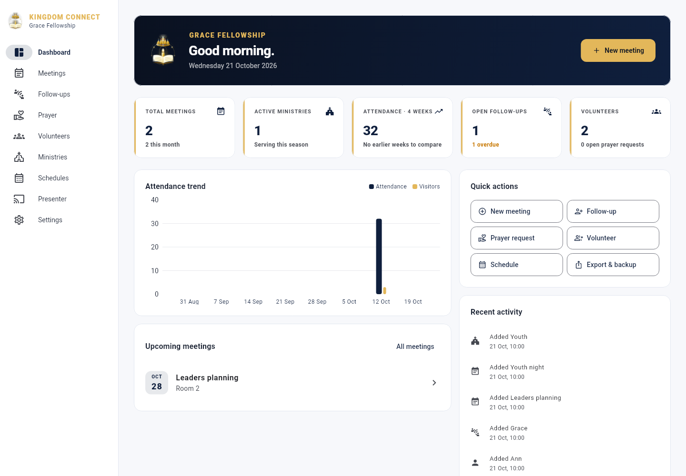
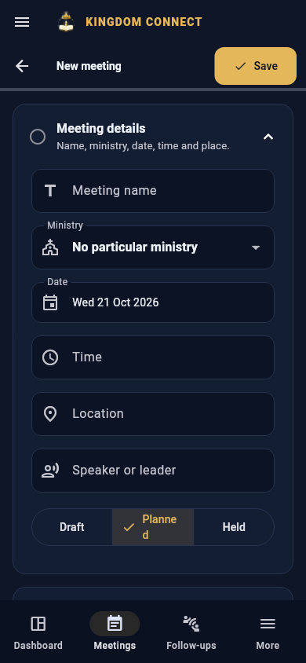

# Kingdom Connect (Flutter): ministry operations, local-first

The cross-platform Kingdom Connect app: an **Executive Dashboard**, a guided **Meeting Form**, follow-ups, prayer
requests, volunteers, ministries and service schedules. It runs on Windows, macOS, iPhone, iPad and Android from one
codebase, and works fully offline.

It runs **next to** the Windows Kingdom Connect program, which is unchanged. Frames, Go Live, the KingdomConnect
camera, overlays, the Teleprompter and the phone remote all stay there. On a PC, the **Presenter** page shows the
program's status and opens its Studio. The plan, the database schema and the migration phases are in
[docs/project/flutter-platform-plan.md](../docs/project/flutter-platform-plan.md).

<p>
  
  
</p>

## Run and test

Flutter 3.47.7 (stable) is required.

```bash
cd kingdom_connect_app
flutter pub get
flutter run -d windows            # or macos, linux, an Android device or emulator, an iOS simulator
flutter analyze
flutter test                      # unit + widget tests, and the real Isar database
dart run build_runner build       # after changing a model in lib/data/models/
flutter test tool/screenshots_test.dart --update-goldens   # refresh tool/screenshots/
```

CI is `.github/workflows/flutter-app.yml`. It analyses, tests, and builds Windows, macOS, iOS (unsigned), Android
and Linux.

## Layout

| Folder | What lives there |
|---|---|
| `lib/core` | Config, failures, permissions (roles, enterprise-ready), the audit-log contract, ids and the clock |
| `lib/data` | The Isar schema (`models/`), the stores and the database (`database/`), repositories, and the import from the Windows app plus backups (`migration/`) |
| `lib/services` | Storage providers (local, and planned OneDrive / SharePoint / Google Drive / iCloud), Excel and PDF export, the presentation-engine bridge, settings and secrets, backup / restore / import |
| `lib/features` | One folder per feature, each with `application/` (logic and providers) and `presentation/` (screens) |
| `lib/shared`, `lib/widgets`, `lib/routing`, `lib/theme` | Riverpod providers, design-system widgets, GoRouter and the responsive shell, design tokens with light and dark themes |

## Data

- Everything is stored on the device (Isar), in the app's support folder.
- **Settings → Your data** makes backups (one JSON file) and restores them.
- **Export to Excel** lets you leave out personal data and private prayer requests.
- **Import from the Windows app** reads `%APPDATA%\Kingdom Connect` without changing it, and brings in the current
  meeting and the member list (as volunteers). Importing again updates the same records.

## Known limits (Phase 1)

- **Web:** not available yet. Isar 3's generated schema uses 64-bit ids that cannot be compiled to JavaScript. The
  repositories already hide the database, so a web store (IndexedDB) can be added in Phase 5 without touching the
  features.
- **Store packaging** (MSIX, App Store, Play) and signing are Phase 6.
