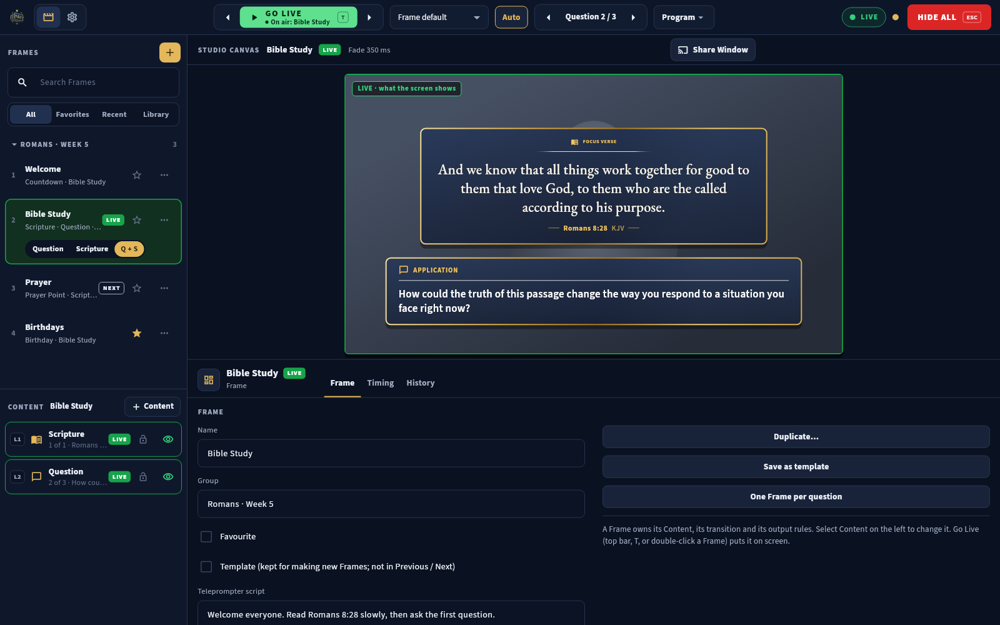
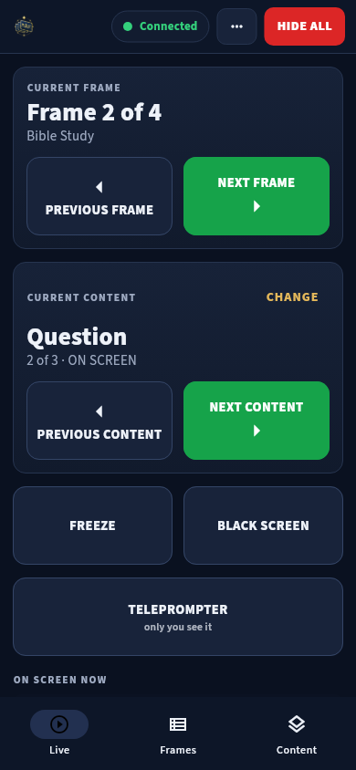

# Kingdom Connect (Flutter): the same app on every platform

A native rebuild of the Windows Kingdom Connect app, with the same design, Frames and saved file.

- **Windows, macOS, Linux:** the Studio (top bar, Frames, Content, canvas, inspector, Settings) and a full-screen
  Share Window.
- **iPhone, iPad, Android:** the remote control for Kingdom Connect on the PC, signed in with its PIN.

<p>
  
  
</p>

The plan, what is built and what still lives only in the Windows program are in
[docs/project/flutter-platform-plan.md](../docs/project/flutter-platform-plan.md).

## Run and test

Flutter 3.47.7 (stable) is required.

```bash
cd kingdom_connect_app
flutter pub get
flutter run -d windows            # or macos, linux, an Android device or emulator, an iOS simulator
flutter analyze
flutter test
```

**The KingdomConnect camera on the Mac** (`macos/KingdomConnectCamera`) needs the app signed with your Apple
Developer team: copy `macos/Runner/Configs/Signing.xcconfig.example` to `Signing.xcconfig`, fill in the team, build,
put the app in /Applications and use Settings → KingdomConnect camera. `tool/macos/add_camera_target.rb` is how the
camera target was added to the Xcode project.

`node tool/parity/make_fixtures.js` regenerates `test/engine/fixtures.json` from the Windows app's `app/js/store.js`
after it changes; `flutter test test/engine` must then still pass.

## Layout

| Folder | What lives there |
|---|---|
| `lib/engine` | The state model, normalize, Frames / Content / live operations (a port of store.js), and the backends (this computer's file, or the Kingdom Connect program) |
| `lib/ui` | Theme tokens, the program renderer, shared fields and actions |
| `lib/ui/studio` | The desktop Studio: top bar, Frames, Content, canvas, inspector, Share Window |
| `lib/ui/remote` | The phone and tablet remote: sign-in, Live, Frames, Content, Teleprompter |
| `test/engine`, `test/ui` | Parity with store.js, the backend against a running program, and the screens |
